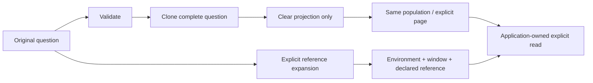

# Preserve populations when changing a display

Changing grouping, measures or paging must not silently change which records
match. Reference expansion is different: it intentionally searches another
population and discloses the conditions it omits.

## Checked population projection

Go exposes `exploration.PopulationQuery(parent, limit, offset)`. JavaScript uses
`populationQuery(parent, {limit, offset})` from `ui/record-population.mjs`.
Both validate the original question, clone it, remove projection directives and
validate the result. They perform no source IO or navigation.

They retain the exact signal, environment representation, fixed window, complete
`where`, `reportedEdge` and `linksTo`. A numeric predicate's binding remains part
of `where` even when the independent top-level numeric measurement is removed.
They clear grouping, numeric/histogram projection, summary, span/severity summary,
time bucket and split-series directives. Paging is explicit; JavaScript accepts
only paging options, so a purported signal or filter override refuses.

```go
records, err := exploration.PopulationQuery(parent, 100, 0)
if err != nil {
    return err
}
// The caller still owns whether, when and how to read records.
```

```js
const query = populationQuery(parent, {limit: 1});
query.groupBy = [{kind: 'column', key: 'service'}];
validateRecordQuestion(query);
```

Current adoption is deliberately small:

- Go record-page reads share the projection reset while retaining the original
  question echo and original derived record-column projection.
- Go explanation planning shares the reset for its two independent populations.
- Counted-value planning uses the JavaScript helper before adding its selected
  categorical grouping. Activity callers supply their existing missing page
  defaults explicitly; invalid supplied fields are not repaired by projection.

Other specialized profiles keep their own eligibility rules. A generic preserving
helper is not permission to bypass a profile refusal or start a source read.

## Deliberate reference expansion

`ui/span-reference-question.mjs` constructs fresh trace or incoming-reference
questions from an explicit environment policy and fixed window. These builders
carry only that scope and the declared trace/span or `linksTo` selector, omitting
prior service, namespace and population conditions. Their callers disclose this
before Run. An explicitly invalid optional span ID refuses rather than becoming
a trace-only lookup.

Outgoing-link inspection and inverse membership now share tuple and link-array
admission in `ui/span-link-membership.mjs`. All three arrays must align; selected
link attributes must be a supplied string map. Unrelated malformed entries do not
hide a different valid matching entry. Duplicate observations remain separate.



## Guardrails and verification

The shared [Go/JS case bank](../tests/fixtures/selector-conservation454.json)
includes ordinary, edge, incoming-link and combined selectors; named, empty and
unreported environments; numeric predicates alongside numeric projections; and
invalid originals/pages. Tests assert detached values, conserved source clauses
and bindings, retained request identity, existing profile refusal and zero IO.
Add case-bank coverage when adding a query selector or projection directive.
Generated Hegel checks vary the same contracts. Actual reference journeys and
counted-value source checks complement those pure tests; they do not turn the
helper into a source owner or the query into a stable snapshot.

See [validation](../VALIDATION.md) for executed results. The next visual cycle
uses held raw gauge observations as dots, then one explicit histogram point,
with no inferred continuity, fleet percentiles or implicit acquisition.
