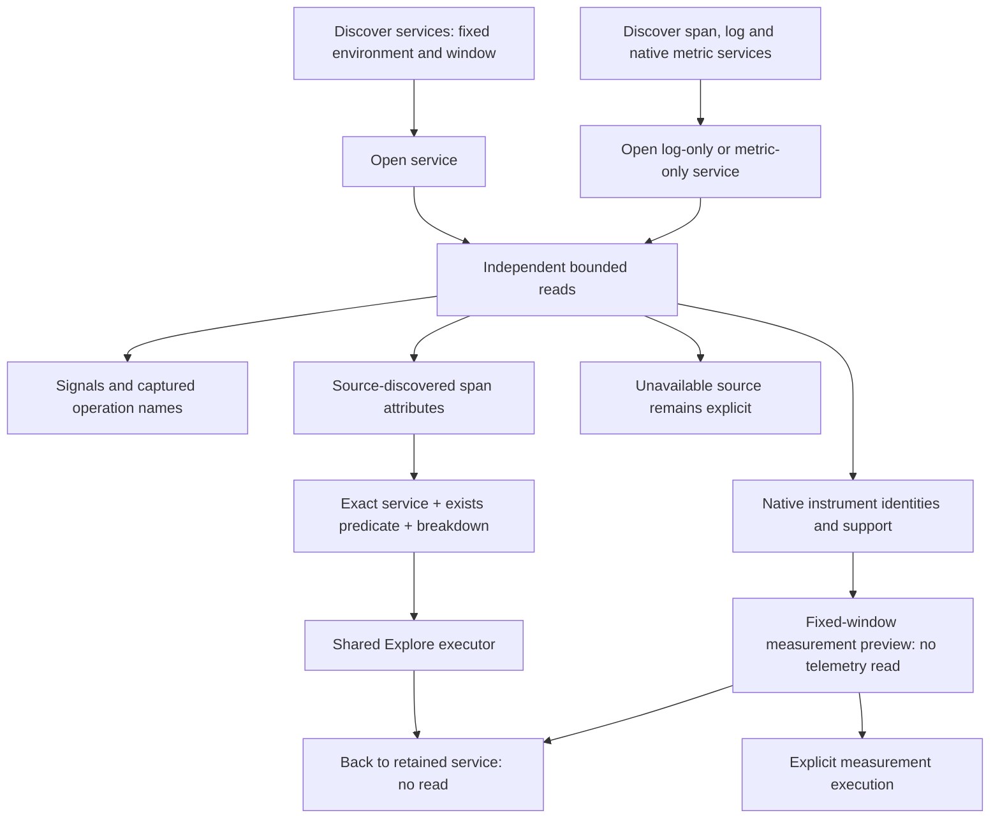

> Current entry: [One Services catalog](UNIFIED_SERVICE_CATALOG.md). The earlier
> separate span/all-signal starting controls have been consolidated. Service detail
> now reads four metadata sources, followed by bounded
> [automatic widget execution](SERVICE_DASHBOARDS.md).

# Browse a service, then follow a question

Implemented on top of existing inventory, service discovery, Explore and native
measurement APIs. Local inventory search filters service buttons and operation
rows without a telemetry read. Services keeps its existing operation table and signal discovery
entry point; the new detail view connects those observations into an investigation.

Discover services to read the catalog in a fixed environment/window, then open one
service. The detail independently reads signal discovery, service-scoped spans and
attributes, native instrument metadata and environment-wide operation inventory.
The operation table displays just the selected service. Native/log-only services
use the same catalog and detail; no span inventory entry is needed first.

Each source can fail independently. The evidence disclosure retains each question,
response and status; these reads are not a transactional snapshot or instrumentation
coverage proof. The [native metric extension](METRIC_SERVICE_DISCOVERY.md) includes
gauge, sum and explicit-histogram data-point records. The catalog is observed
evidence, not complete fleet membership.

## Questions from observed conventions

Suggestions inspect source-discovered **attribute** fields, not the first row or
operation-name heuristics. A present field offers a typed question scoped by exact
service, environment and original half-open time bounds:

| Question | Preferred key, then supported alias | Meaning |
| --- | --- | --- |
| HTTP | `http.route` | Captured span durations/status by reported route |
| Database | `db.system.name`, `db.system` | Captured span durations/status by reported database system |
| Messaging | `messaging.destination.name`, `messaging.system` | Captured span durations/status by destination or system |

Each adds an explicit `exists` predicate for that field before grouping, so unrelated
spans are not silently counted as HTTP/database/messaging work. Preferred and legacy
keys remain exact; the UI does not merge aliases or normalize exporter values.
Suggestions do not establish request rates, business errors, queue delay or
end-to-end latency. Unknown/Unset span status retains existing semantics.
An unavailable suggestion says no matching attributes were observed; discovery
limits and absent telemetry remain explicit. General recorded-status exploration
is also available without a convention-specific attribute.

Native instruments retain scope, version, schema, unit, temporality, monotonicity
and observed dimensions. Unsupported kernels have disabled actions. **Preview
measurement** passes the discovered typed definition and fixed service window to
the existing measurement planner without a telemetry read; execution and capture
remain explicit. Resource pressure is available through emitted native instruments,
such as process utilization gauges. The UI does not synthesize pressure from spans.

## Scope and return behavior

Record questions enter the shared Explore executor. Native previews enter the
existing measurement planner. **Back to service** returns to the retained detail
without a source read, preserving its window and observations. This return link
provides service context; it does not claim later Explore edits retain the service
selector. [Question links](QUESTION_LINKS.md) preserve record questions through
browser history. [Investigation steps](INVESTIGATION_STEPS.md) also preserve and
share validated native questions. Service-detail panels and unpreviewed native
drafts remain local views.
Scope edits, a new inventory run, service changes and explicit service cancellation
invalidate the detail and abort outstanding reads. Responses from an old generation
cannot publish into a changed environment. Cancelled or failed reads never become
zero-observation claims. Read-only saved inventories retain their existing viewer;
they do not automatically gain live instrument reads.

[Storyboard 46](journeys/README.md#46--browse-a-service-and-follow-observed-conventions)
executes ordinary OTLP HTTP/database spans, logs, a utilization gauge and an
unsupported nonmonotonic sum. It checks all three bounded reads, convention narrowing,
local return, source-free measurement preview, log-only services, cancellation
of delayed real responses, desktop/mobile layouts and observed-ledger validation.
Hegel exercises the actual JavaScript suggestion function across generated bounds
and alias choices. Quint validates the actual journey ledger with rejecting scope,
selector, return-read and preview-read mutations. Bombadil follows the service →
question → return path and checks fixed scope, unsupported actions and overflow.
Actual successful checks belong in [VALIDATION.md](../VALIDATION.md).

## Automatic overview extension

[Service dashboards](SERVICE_DASHBOARDS.md) now follow the four independent
metadata reads with a pure Go plan and bounded widget execution. Source failures
remain local/partial and fixed-scope cancellation covers the widget phase.
Returning from a distributed node preserves its view; returning to a filtered
empty service list focuses the catalog search, not the view-switch buttons.
