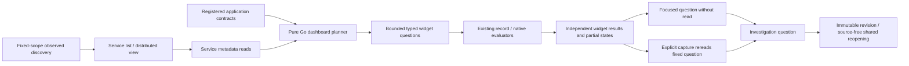

# Automatic service overviews and distributed discovery

Implemented within **Services**, using the existing fixed environment/window and
standard OTel telemetry. No manifest is required. Select **Discover services**,
then open an emitting service; its supported overview widgets load automatically.
**Service list** and **Distributed view** share that discovery evidence. Switching
views does not query telemetry or tick the time window.

## One planner, existing evaluators

`POST /dashboards/plan` is a pure Go planning operation. Supplied observed signals,
attribute keys and native instrument descriptors produce a versioned
`goo/service-dashboard/v1` plan of typed record/measurement questions. It does not
contact a telemetry backend, manufacture SQL in the browser or define health.
Metadata is a hint to execute supported questions, not authenticated provenance.
The operation-package registry supplies matching declarations; callers cannot
inject application-contract revisions into the planning request.

The service detail retains four bounded metadata reads (service discovery, span
attribute discovery, native instrument discovery, operation inventory). The plan
then executes supported widgets with **two concurrent requests**, cancellation and
stale-generation guards. Returned widget questions must match their planned
population and scope. Wrong-scope or wrong-population results are unavailable.
Each widget retains its actual independent source-read time and state. One failed
widget produces a partial overview without zeroing other results. Failed service
discovery withholds the overview rather than guessing signal support.

Defaults are bounded:

- Span activity over time, full-population duration/error summaries and observed
  span-name groups. These are spans, including mixed kinds and retries, not HTTP
  request RED. Unset/unknown status remains explicit.
- Log activity over time and literal reported severity groups. Log severity does
  not establish application failure rate.
- One observed conventional span dimension, in priority order: HTTP route, RPC
  method, database system (new key before legacy alias), messaging destination
  or system. Resource attributes never substitute for record attribute keys.
- Up to two supported discovered native instruments, selected deterministically
  by exact metadata. Existing per-stream kernels retain units, library version,
  schema, temporality/reset and histogram semantics. Up to four exact-stream latest endpoints or intervals are shown per native
  widget; stale/unknown latest observations never fall back to an earlier healthy
  value. These are not whole-window or fleet aggregates. Other instruments remain
  available in Native instruments; there is no fleet-value or percentile merge.

Time buckets keep at most 60 intervals. Group tables show up to 12 of the
complete captured groups; summaries use full aggregate populations, never the
inspection page or visible table rows. Existing source limits fail explicitly.

## Observe → question → evidence → investigation

Each widget offers **Open widget question**, **Add widget question** and
**Capture widget evidence**. Opening/staging preserves the exact fixed scope and
selector without reading telemetry. Activity intervals and groups likewise open
focused questions. A capture opens the ordinary explicit confirmation and rereads
the fixed question; it does not archive the exact dashboard read verbatim.
Questions and constituent captures use existing immutable investigation revisions.
A shared saved question/capture reopens source-free. Saving a question does not
freeze a whole dashboard; no whole-dashboard snapshot contract is introduced.

Application contracts match the actual registry's declared service and environment,
show package/source-manifest revision IDs and remain labelled **declared binding**.
They do not establish current deployment, emission, conformance, a fleet roster
or a distributed graph. The service list still lists observed services; browsing
a declared-only service is a future catalog extension. Generic widgets do not
silently replace the package's operation/lifecycle outcome policy.

## Distributed view

The table and node buttons reuse discovery's reported same-trace parent/span-ID
resolution within the fixed scope. Only resolved cross-service parents become
edges. Edge counts are child-span records, not unique calls, request volume or
end-to-end latency. Unresolved, ambiguous, invalid and internal parent-record
counts remain separately inspectable. Missing parents do not create guessed
external nodes. No async span-link, contextual or declared topology is drawn.

Nodes open service overviews in the same window. An edge's **Open child service
spans (wider population)** stages the child's fixed service question, explicitly
wider than the contributing edge population. The current query AST cannot select
exact resolved parent edges; the UI does not claim that it can.

The catalog currently keys services by environment and exporter service name;
namespace/instance disambiguation of record-service identity remains future work.
Native kernels retain their full stream identities independently. There is no
background polling, automatic SLO creation, deployment-health status, topology
layout graph or whole-dashboard custody artifact. See the
[whole-product review](WHOLE_PRODUCT_REVIEW.md) for the remaining design roadmap.

Discovery support does not guarantee a valid native evaluation: missing service
instance identity, mixed source metadata or invalid intervals still produce an
unavailable/unknown widget under the existing kernel contracts. These states
remain visible instead of substituting a healthy value.
