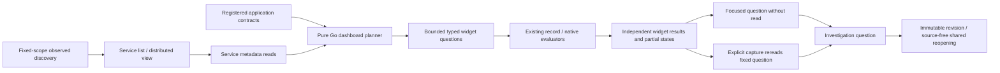

# Automatic service overviews and distributed discovery

Implemented within **Services**, using the existing fixed environment/window and
standard OTel telemetry. No manifest is required. Select **Discover services**,
then open an observed or declared service; its supported overview widgets load automatically.
Declared services without telemetry retain explicit not-observed widgets and
independent registry provenance; see [service identity](SERVICE_IDENTITY.md#declared-services-and-observed-services).
**Service list** and **Distributed view** share that discovery evidence. Switching
views does not query telemetry or tick the time window.

## One planner, existing evaluators

`POST /dashboards/plan` is a pure Go planning operation. Supplied observed signals,
attribute keys and native instrument descriptors produce a versioned
`goo/service-dashboard/v2` plan of typed record/measurement questions. It does not
contact a telemetry backend, manufacture SQL in the browser or define health.
Metadata is a hint to execute supported questions, not authenticated provenance.
The operation-package registry supplies matching declarations; callers cannot
inject application-contract revisions into the planning request.

The service detail retains four bounded metadata reads (service discovery, span
attribute discovery, native instrument discovery, operation inventory). The plan
then executes supported widgets with **two concurrent requests**, cancellation and
stale-generation guards. Returned widget questions must match their planned
population and scope. Wrong-scope or wrong-population results are unavailable.
Each widget retains its actual independent source-read time and state. One failed
widget produces a partial overview without zeroing other results. Failed service
discovery withholds the overview rather than guessing signal support.

Defaults are bounded:

- Span activity over time, full-population duration/error summaries and observed
  span-name groups. These are spans, including mixed kinds and retries, not HTTP
  request RED. Unset/unknown status remains explicit.
- Log activity over time and literal reported severity groups. Log severity does
  not establish application failure rate.
- One observed conventional span dimension, in priority order: HTTP route, RPC
  method, database system (new key before legacy alias), messaging destination
  or system. Resource attributes never substitute for record attribute keys.
- Up to two supported discovered native instruments, selected deterministically
  by exact metadata. Existing per-stream kernels retain units, library version,
  schema, temporality/reset and histogram semantics. Up to four exact-stream latest endpoints or intervals are shown per native
  widget; stale/unknown latest observations never fall back to an earlier healthy
  value. These are not whole-window or fleet aggregates. Other instruments remain
  available in Native instruments; there is no fleet-value or percentile merge.

- Up to two registered operation bindings produce ordinary operation-span cards,
  retaining declared-versus-observed and schema-verification limitations.

Time buckets keep at most 60 intervals. Group tables show up to 12 of the
complete captured groups; summaries use full aggregate populations, never the
inspection page or visible table rows. Existing source limits fail explicitly.

## Observe → question → evidence → investigation

Each widget offers **Open widget question**, **Add widget question** and
**Capture widget evidence**. Opening/staging preserves the exact fixed scope and
selector without reading telemetry. Activity intervals and groups likewise open
focused questions. A capture opens the ordinary explicit confirmation and rereads
the fixed question; it does not archive the exact dashboard read verbatim.
Questions and constituent captures use existing immutable investigation revisions.
A shared saved question/capture reopens source-free. Saving a question does not
freeze a whole dashboard; no whole-dashboard snapshot contract is introduced.

Application contracts match the actual registry's declared service and environment,
show package/source-manifest revision IDs and remain labelled **declared binding**.
They do not establish current deployment, emission, conformance, a fleet roster
or a distributed graph. The service list includes observed and
declared-only services with separate provenance and explicit absence states. Generic widgets do not
silently replace the package's operation/lifecycle outcome policy.

## Distributed view

The table and node buttons reuse discovery's reported same-trace parent/span-ID
resolution within the fixed scope. Only resolved cross-service parents become
edges. Edge counts are child-span records, not unique calls, request volume or
end-to-end latency. Unresolved, ambiguous, invalid and internal parent-record
counts remain separately inspectable. Missing parents do not create guessed
external nodes. No async span-link, contextual or declared topology is drawn.

Nodes open service overviews in the same window. An edge's **Open child service
spans (wider population)** stages the child's fixed service question, explicitly
wider than the contributing edge population. The current query AST cannot select
exact resolved parent edges; the UI does not claim that it can.



The catalog keys services by environment, exporter service name and the presence/value
of `service.namespace`. [Namespace identity and declared-operation questions](SERVICE_IDENTITY.md)
describes selector propagation and registered-binding dashboard cards. Service
instance remains an instrument stream identity rather than a separate catalog node. There is no
background polling, automatic SLO creation, deployment-health status, topology
layout graph or whole-dashboard custody artifact. See the
[whole-product review](WHOLE_PRODUCT_REVIEW.md) for the remaining design roadmap.

Discovery support does not guarantee a valid native evaluation: missing service
instance identity, mixed source metadata or invalid intervals still produce an
unavailable/unknown widget under the existing kernel contracts. These states
remain visible instead of substituting a healthy value.

Resolved edges now offer [exact child-population questions](REPORTED_EDGES.md)
alongside the explicitly wider child-service link. The typed relationship retains
parent-search scope through filters, packages and immutable investigation capture.
Overview assumptions are collapsed under **How these widgets are measured**.

Widgets now reuse the [display library](UI_COMPONENTS.md): one mean plus a compact
p50/P95/P99 strip, exact values in Latency details, and shared label/value lists.
The primary question link stays visible; add/capture actions are under **Widget
actions**. Exact read timestamps remain in each widget evidence disclosure.

## Native service cards and exact-stream questions

Native service cards now use the same passive table/stat/attribute components
as the rest of Goo. Up to four retained streams show their latest evaluated
value beside whole-window coverage or gauge observation state. The current
planner still automatically loads at most two supported discovered instruments;
selection is deterministic by metadata, with other instruments available in the
service's Native instruments section. No new health policy or convention-name
heuristic was introduced.

The compact summary accepts the native kernel's real `ok` interval state for
counters and histograms (gauges use `observed`). Previously, an `observed` check
incorrectly suppressed valid counter/histogram interval values. Latest is chosen
by its actual endpoint, never by an earlier usable value. A newer unknown/reset/
absent interval withholds the value. Recorded zero remains observed. Histograms
retain bucket-bounded p95 ranges, including open-ended bounds; an empty recorded
distribution has no percentile. No scalar percentile or fleet merge is inferred.

A valid latest interval can coexist with incomplete whole-window coverage.
The value is explicitly that retained interval's evaluated rate or distribution,
not a rate for the whole selected window or a live service/fleet claim. Counter
`perSecond` is the existing kernel's floating interval value; exact rational
whole-window comparisons remain a separate workflow. Gauge freshness remains
that of the fixed evaluated window. Source-read time, exact question and evidence
basis stay available on each independently read widget.

Each row offers **Open stream question**, preserving complete resource/point
identity, resource and scope schema URLs, library version, unit, namespace,
environment and fixed bounds through the common exact-stream binding. Opening
previews without reading telemetry; **Run measurement** is explicit. Capture
rereads that exact fixed question, then retains ordinary immutable evidence that
can be reopened or attached to an investigation. An incomplete service-window
capture does not become a valid live-rate baseline automatically; choose complete
export-aligned bounds explicitly for that comparison.

**Native result · exact streams** lazily renders the complete bounded retained
result once. Expanding it, searching streams and reviewing coverage perform no
source reads. Local filters do not revise the widget question, compact summary,
source record count or basis. Closing/reopening the same retained disclosure
keeps its local view; a new source read is a new result. The full result reuses
[native stream navigation](NATIVE_STREAM_NAVIGATION.md) and its diagnostic codes.

```mermaid
sequenceDiagram
 actor User
 participant Service as Service app adapter
 participant Go as Existing typed planner and evaluators
 participant UI as Passive native table and retained browser
 participant Store as Capture store
 User->>Service: Open discovered service and namespace
 Service->>Go: Plan supported questions (no telemetry read)
 Service->>Go: Execute bounded widgets under fixed scope
 Go-->>UI: Independent native results with evaluated intervals and coverage
 User->>UI: Expand/search retained streams
 UI-->>User: Same evidence basis (no telemetry read)
 User->>Service: Open exact stream question
 Service->>Go: Validate exact binding preview (no telemetry read)
 User->>Go: Run measurement; explicitly capture evidence
 Go->>Store: Retain fixed question and typed result
 Store-->>User: Immutable evidence for reopen/investigation
```

Journey75 exercises metrics-only HTTP/runtime services without a manifest,
namespace isolation, six counter streams, a newer absent counter value, native
histogram bounds, gauge freshness, source-free retained browsing, mobile layout,
exact stream preview/Run and capture/reopen. Observed Quint replay includes nine
rejecting mutations; a native service Bombadil actor covers discovery, service
open, retained browsing and exact links. Existing dashboard and service-browser
journeys continue to cover partial failures and cancelled scope generations.
