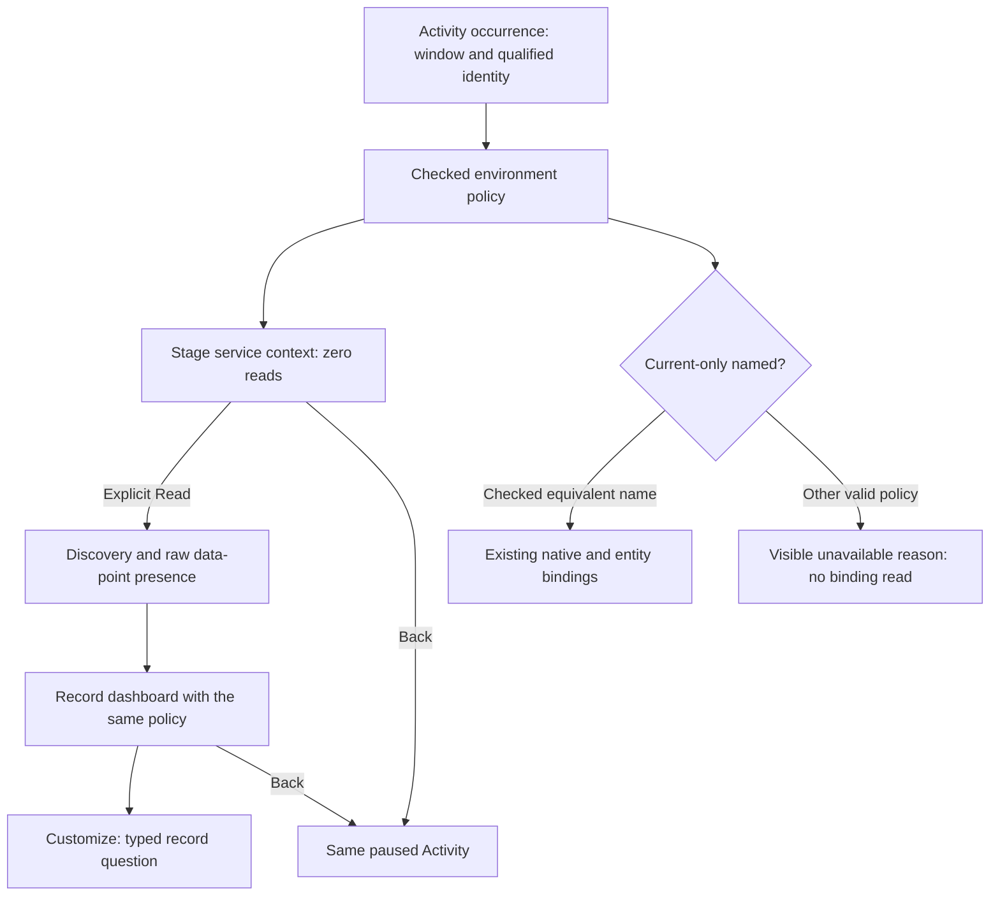

# Environment policies in service exploration

318 extends the observed-service path to checked environment selections. A service
opened from Activity keeps its original completed window, resource namespace and
selection policy through discovery, record dashboards and Customize. Opening
stages context without reading; Read service overview remains explicit.

## Which records belong

| Selection | Membership |
| --- | --- |
| Current-only named | The current `deployment.environment.name` key is present and equals the name. |
| Effective named | Use the current key when present; otherwise use `deployment.environment`. The winning value equals the name. |
| Effective empty | The winning key is present with an empty value. A present-empty current key overrides a nonempty legacy value. |
| Effective unreported | Neither environment key is present. |

Effective selection is precedence, not a union of aliases. A record with current
`staging` and legacy `prod` does not belong to effective `prod`. Empty and
unreported are distinct populations, not invented environment names or wildcards.
The same checked predicate scopes span/log discovery, parent ownership, inventory
and raw metric data-point presence. Metric presence counts exporter records, not
metric values, streams, histogram observations or service health.

## Record views and scalar bindings

Record questions retain the versioned `environmentSelector`, exact namespace and
window. HTTP/RPC/database/messaging profiles still require observed supporting
records. Customize stages the same typed record scope; Run explicitly acquires it.
Origin scope and generated investigation titles display the policy. Rediscovery
retains it until the environment input is actually edited.

Existing native metric evaluation, deployments, entity-bound service annotations
and service-bound view libraries require a current-only named environment. For
other policies, those continuations show an unavailable reason and issue no read.
A dashboard plan reports `nativeCapability: {state: "unsupported", reason: ...}`;
empty native options must not be read as proof that no metrics exist. Direct
planning inputs cannot inject unsupported native instruments or selections.

A typed current-only named selector can use those scalar bindings only after
checked equivalence to the same current-only name. Legacy string inputs retain
that historical meaning. Effective named selections never fall back to a scalar
name merely because their text matches. This cut does not migrate native
measurement definitions or environment-entity stores.

The API uses the existing checked selector DTO and refuses ambiguous, null or
invalid selector choices before source access. Returned scopes and questions
own detached selector values. The service continuation remains local navigation,
not captured evidence or a durable URL.

See [the service-context contract](ACTIVITY_SERVICE_CONTEXT.md),
[architecture review](reviews/SERVICE_ENVIRONMENT_ARCHITECTURE_318.md) and
[design review](reviews/SERVICE_ENVIRONMENT_DESIGN_318.md).
