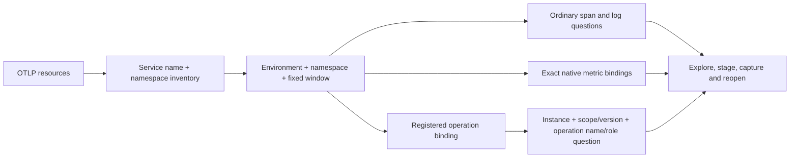

# Service identity and declared-operation questions

Service discovery partitions OTel resources by `service.name` and
`service.namespace` inside the selected environment and fixed event-time window.
A missing namespace, a present empty namespace, and a literal namespace are
separate identities. Neither namespace nor service name proves deployment
membership, ownership, health, or complete topology.

The service catalog, reported parent edges, service overview, attribute questions,
operation inventory and native instrument discovery carry the selected namespace.
A cross-namespace parent link can connect two resources with the same service
name. Duplicate parent ownership across namespaces remains ambiguous. Selecting
one namespace can exclude a parent; this produces an unresolved diagnostic rather
than an inferred edge.

The optional selector is `namespace: {mode: value, value: payments}`,
`namespace: {mode: value}` for present-empty, or `namespace: {mode: missing}`.
An omitted selector retains the earlier **all namespaces** semantics. It does
not mean missing. Existing questions, native definitions and operation packages
omit the new field when unselected, preserving their serialized content and SQL.
Record questions express namespace as an ordinary resource predicate; workbench
step scope retains its existing environment and window fields.

Operation packages may bind `resource.namespace` with the same selector. Their
trace, counter and histogram readers constrain and validate returned resources.
Dashboard planning uses server-registered declarations, never caller-supplied
contracts. Up to two complete bindings generate ordinary span questions matching
instance, instrumentation scope name/version and declared operation name/role
pairs. A conflicting declared namespace withholds the question; an unspecified
namespace is visibly narrowed by the selected service identity.

These cards count captured span records. They do not evaluate business outcomes,
conformance, sampling or completeness. The current trace exporter stores scope
name/version but **does not store scope schema URL**. Schema URL therefore stays
declared metadata and is explicitly unverified. No nonexistent physical column
is queried. Bindings above the six-operation automatic-card budget are withheld;
the underlying package remains available through its normal entry point.

Executable journey: [60 — namespace identity](../journeys/service-namespaces.spec.js).
