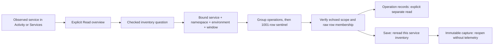

# Selected-service operation inventory

Opening an observed service and choosing **Read service overview** acquires its operation
inventory for the selected service name, namespace, environment policy and fixed
window. The service predicate is bound in SQL before grouping. Unrelated services
therefore cannot exhaust the selected service's 1,000-pair budget. The intentional
whole-environment inventory still refuses more than 1,000 service/span-name pairs;
neither path returns a partial inventory.

`POST /api/inventory` accepts an optional `service` string. Omission selects all
names; a present empty string selects the empty name. Null is invalid. Names have
the existing 128 UTF-8-byte limit and cannot contain NUL. Namespace missing, empty
and named values remain distinct, as do current-only and effective environment
policies. Service discovery and dashboard scope reject this inventory-only field;
dashboards retain their own explicit service argument.

The client does not obtain a broader inventory and then filter it into service
authority. Go source admission, stored-capture validation and the overview check
service membership. Operation continuation preserves the whole scope and adds
the exact span name; it stages records before an explicit read. Returning to
retained Activity performs no telemetry read.

**Save inventory** performs a separate read of this selected service's original
window. It does not archive the displayed catalog. A no-data response means no
observed spans in that scope, not a healthy service; unavailable inventory remains
unknown while independently acquired service signals can remain useful. Span
names describe observed instrumentation, not declared business operations or
complete request populations.

Implementation and native acceptance are tracked in the
[architecture review](reviews/SERVICE_INVENTORY_ARCHITECTURE_349.md),
[design review](reviews/SERVICE_INVENTORY_DESIGN_349.md) and
[validation record](../VALIDATION.md).
