# Service summaries without record inspection

Service dashboard record widgets use `POST /record-aggregates` (UI proxy
`/api/record-aggregates`). The response supplies complete summaries and groups,
plus overall time buckets when requested, without reading record pages or field
inventories. Native instruments retain their existing `/measurements` path.

This adoption covers **widget execution only**. The service browser's supporting
`/explore` request still supplies real rows and fields for its held-record
inspector, field suggestions and positive profile witnesses. A metric name or an
attribute-key inventory cannot replace the same-row role, attributes, resource
identity and event-time checks used for automatic HTTP/RPC/database/messaging
selection. A missing witness remains unknown.

## Execution contract

The exact original `exploration.Query` is retained. The narrow execution accepts
one string grouping, offset zero, optional span-duration/status summaries and an
optional overall bucket width. It rejects numeric result/histogram and split-series
projections; typed numeric **WHERE predicates** and reported-edge scope remain
supported. Existing compiler, source adapters and parameter binding apply.

`goo/record-aggregates/v1` contains question, state, count, complete groups,
requested duration/status/timeSeries blocks, warnings, capturedAt, combined basis
and independent count/groups/timeSeries read receipts. There are no inspection
rows, fields, page flags, plan, result token or capture receipt. Count and summaries
share the count statement; grouped summaries share the group statement; overall
bucket summaries share the optional time-series statement. Thus activity widgets
read three statements and diagnosis/declared widgets read two, rather than five
and four respectively. The statements remain independent observations.

```mermaid
flowchart LR
  S[Service browser supporting read] --> P[Full rows / fields / profile witnesses]
  P --> D[Source-free dashboard plan]
  D --> W[Record widget owner]
  W --> C[Count + requested overall summaries]
  C --> G[Complete groups + requested summaries]
  G --> T[Optional overall time buckets]
  T --> V[Shared decoding and conservation checks]
  V --> U[Existing summary / diagnosis / timeline displays]
  U --> Q[Original question: Open / pin / fresh capture]
```

Pure group decoding and count/status series agreement are shared with full
exploration. The legacy path preserves its read order, parser behavior, warnings,
result serialization and basis. The new response additionally checks duration
sum/min/max conservation across time buckets; the legacy path retains its prior
count/status-only series agreement policy. Quantiles are never averaged or merged
across groups/buckets to manufacture an overall percentile.

Missing and present-empty dimensions remain separate. The 1,001-group sentinel
still refuses the entire result above 1,000 groups. Requested groups/series are
read even for count zero. Malformed data, unsupported requests, source budgets,
shared admission and cancellation remain bounded failures. The route uses strict
16 KiB decoding, a 55-second enclosing deadline and existing per-statement budgets.

Disagreement returns `changed_between_reads` diagnostic observations. Dashboard
widgets withhold aggregate figures, rates, rankings and timeline plots while
keeping source provenance and original-question actions. A failed widget does not
turn into empty or healthy data; other independent widgets retain their results.
The existing two-worker owner still controls cancellation and stale publication.

Open and pin use the original planned question. Capture keeps the existing full
capture workflow and performs a separate fresh read; it never stores the aggregate
response as an inspection result. Previously stored capture bytes and IDs remain
unchanged. Source read clocks, transient observations and stored custody stay
separate.

## Measured read sets and compatibility

Before implementation, the archived HTTP and messaging fixtures were reread using
the existing executor: each main widget issued count → rows → groups → fields →
timeSeries; each diagnosis widget omitted the last statement. All four fixed
queries matched 137 records and four groups. These are modest real fixture
populations, not large-cardinality workloads.

The controlled final comparison uses the same query files and stopped owned lab
traffic generator. Source statement/body hashes and canonical aggregate meaning
are compared separately from DTO size and physical scan work. The audit tool
supports `GOO_AUDIT_MODE=record-aggregates`; its default remains `explore`.

An independent archived-revision probe also compares full `Source.Fetch` output
from `88a85b9` and the refactor, removing only capturedAt. Exact normalized JSON
bytes, including the original basis, plan, rows, fields and all summaries, match
for all four queries. This is a differential legacy-result check, not a claim that
new source reads create an identical immutable capture timestamp. Existing frozen
storage tests independently preserve old capture bytes/IDs.

Actual measurement receipts, executable journey and frames are linked from
[VALIDATION.md](../VALIDATION.md) as each acceptance gate completes.

| Fixture / widget | Reads before → after | Serialized executor bytes before → after | Summed CH read rows before → after | Summed CH read bytes before → after | Observed ms before → after |
| --- | --- | --- | --- | --- | --- |
| http-spans | 5 → 3 | 103936 → 5456 | 40960 → 24576 | 3869865 → 2023393 | 181.266 → 122.059 |
| http-dimension | 4 → 2 | 99954 → 2546 | 32768 → 16384 | 3193234 → 1346762 | 76.808 → 53.938 |
| messaging-spans | 5 → 3 | 117788 → 5376 | 30885 → 18531 | 6610989 → 3364500 | 149.484 → 149.414 |
| messaging-dimension | 4 → 2 | 113926 → 2570 | 24708 → 12354 | 5485371 → 2238882 | 122.565 → 55.373 |

[Comparison manifest](evidence/service-aggregate-audit/comparison.json) records
canonical aggregate equality and retained SQL/body-size equality; neighboring
`*-question.json`, `*-before.json` and `*-after.json` files retain each case.
The [initial read baseline](evidence/service-aggregate-audit/baseline-manifest.json)
precedes source edits. [Legacy byte-equivalence receipts](evidence/service-aggregate-audit/legacy-equivalence.json)
and the [exact probe](evidence/service-aggregate-audit/legacy-probe.go.txt) describe
the archived/current differential check. Raw record output was compared in memory
and not retained by that probe.

Summed physical rows count work across statements, not unique telemetry records.
All fixtures have four groups; HTTP versus messaging varies protocol/data width,
not cardinality alone. These single observations are not a large-cardinality or
production latency benchmark. Messaging activity elapsed time was essentially
unchanged despite fewer reads. Serialized executor bytes and decoded response
bytes are different from HTTP wire traffic. The retained aggregates still scan
more records than the matching population.
