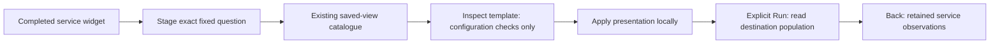

# Use a saved template from service evidence

356 is implemented and validated. See the
[executable storyboard](journeys/356-service-templates.md) and
[validation record](../VALIDATION.md).

**Use saved template** opens the existing population workspace and saved-view
catalogue for a supported service widget's complete fixed question. It is available
for completed ordinary record widgets with one grouping, after overview reads
settle. Native streams, specialized numeric/histogram/relationship/time-split
profiles and changed-between-reads results do not gain this action.

The widget supplies service, namespace, environment policy, predicates, grouping,
measures and fixed UTC bounds. The saved template supplies its declared compatible
presentation. Its original question is a validation specimen; **Open original
question** intentionally opens that different scope. Inspect and Apply do not
substitute specimen scope, inject protocol predicates, choose another grouping or
read telemetry.

Existing compatibility checks retain their meaning. Wrong signals, missing
profile/measure requirements and incompatible timeline widths refuse Apply.
Comparison templates require an explicitly chosen destination baseline through
the existing controls; the specimen baseline is never inherited. This entry
adds no baseline picker or implicit source acquisition.

Run reads the staged destination explicitly. Saving preserves its configuration,
not observations or an immutable capture. Back restores the service overview and
its independent results, disclosures and source receipts without rereading them.
Template entry waits for pending overview reads so departing does not retire the
return owner. Changed destinations, superseded inspections and retired controls
cannot adopt a late expansion.

The service browser owns the return path, the investigation trail stages the
question, and the existing population owner handles catalogue inspection, checked
expansion and local Apply. Display components do not acquire data. No new grammar,
catalogue, renderer or team-authorization model is introduced.
