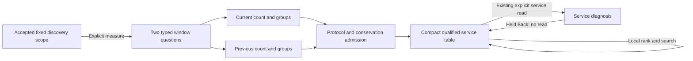

# Fleet service triage

Status: delivered and independently accepted. Milestone 412 extends the existing
Services catalog; it does not add a fleet membership or health authority.

The operator explicitly measures captured Server-kind spans for the accepted
catalog scope. One compact table shows qualified service, captured count with
change from the equal preceding window, recorded Error fraction and mean span
duration. Native ranking/search and switching back to signal counts are local.
Opening a service uses the existing namespace-aware service view and held Back.

## Measurement and ownership

- The typed questions group by `column:service` and `resource:service.namespace`,
  with exact `column:kind = Server`. Missing and present-empty namespaces remain
  different tuples. HTTP/RPC conventions are optional: this measures the reported
  Server span role, not unique requests, attempts or successful work.
- Current bounds are the accepted fixed discovery window. Baseline bounds are
  `[from − (to − from), from)`. No negative/clamped history or implicit clock
  refresh. Each window retains its own question, read clocks and content basis.
- Existing aggregate-only execution reads count/summaries and complete grouped
  summaries: two SQL statements per window, four total. No inspection pages,
  fields, per-service dashboard reads or new source adapter is added.
- At most 1,000 qualified groups per window; overflow fails rather than ranking
  a truncated top list. Count/status/duration disagreement is diagnostic and
  cannot produce actionable rankings. Both responses must match their exact
  questions and pass the shared protocol/conservation admission.
- Mean is exact duration sum/count; percentages and ranking use integer/rational
  arithmetic before display rounding. Group percentiles are never averaged.
  Counts and deltas describe captured records in equal windows, not unsampled
  traffic rates, SLOs or statistical significance.
- Union accepted current/baseline group identities with the catalog. A complete
  consistent aggregate with no matching group supports zero captured Server
  records for that window, not zero application traffic or service health.
  Without such admitted evidence, values remain unavailable. A service absent
  from one independently read discovery response may still appear in summaries.
  An unqualified declaration is not a missing-namespace tuple: its values remain
  unavailable until an exact observed identity is known.
- Query execution, cancellation, scope and navigation remain in application
  adapters. Display components receive supplied data. Scope replacement, departure,
  hiding and cancellation retire pending adoption; no automatic retry/polling.

## Verification

The [real-source storyboard](journeys/service-triage.md) and
[executable journey](../journeys/service-triage.spec.js) pass against ordinary
OTLP/ClickHouse telemetry. Actual desktop/390px/320px frames show the native table
and compact three-stat mobile cards. The journey includes a 40-second Bombadil
campaign, raw-row arithmetic oracle, upstream failure and held-request retirement.

[Isolated verification](../verification/servicetriage/README.md) runs 64 Hegel cases
against the actual JavaScript model with independent Go big.Int arithmetic, strict
Quint protocol checks and replay of the actual browser read ledger. Rejecting
scope/read/late-adoption controls are required. The lifecycle model is a protocol
model; actual UI ownership is exercised by owner tests and the browser journey.

The [independent review](reviews/SERVICE_TRIAGE_REVIEW_412.md) records acceptance,
corrections and limits. [Validation](../VALIDATION.md) records commands/results.
This is bounded captured-span triage, not fleet health or a production SLO.

## Scope limits

The table currently measures the reported Server role. Consumer/Client roles and
fleet health require separate definitions. Triage state is retained locally through
service return; direct saved fleet-summary composition/capture is not added here.
Existing service/question capture paths remain explicit independent operations.
