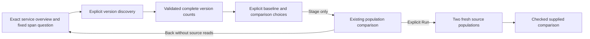

# Guided service-version comparisons

Milestone 415 is delivered. See [validation](../VALIDATION.md), the
[storyboard](journeys/service-versions.md) and
[independent review](reviews/SERVICE_VERSION_COMPARISON_REVIEW_415.md).

From a service's ordinary span overview, open **Compare versions**, explicitly
**Discover versions**, select a baseline and comparison version, then **Stage
version comparison**. The destination uses the existing population workspace;
**Run** acquires fresh evidence. **Back to service** restores the held overview.

Discovery stays inside the original fixed window, exact qualified service and
typed environment policy. Existing role/profile and operation predicates are
preserved. The version dimension is the reported OTel resource `service.version`;
a similarly named span attribute or a deployment receipt is not substituted.
Missing, present empty and literal reported values remain distinct.

The first slice requests one count plus complete version groups. Selection is
available only after a coherent, validated response with conserved group counts.
There is no default pair. The two populations must be distinct and explicitly
selected. Choosing versions and staging are local configuration operations.
They do not acquire telemetry or save evidence.

Count and supported mean duration use the existing checked comparison model.
Comparison preserves the original widget's group dimension so corresponding
operations remain comparable. Each population has its own captured count and
source-read basis. Captured records are not request throughput, sampling coverage
or a deployment's full traffic. Mean duration is not an averaged percentile;
recorded Error fractions and causal deployment attribution are outside this
comparison carrier.

Owners must cancel departed discovery, refuse late responses and retire obsolete
controls. A disclosure is not a source subscription. Shared display components
receive supplied facts; they do not own query scope, source reads or navigation.
The milestone adds no backend, query engine, issue store or compatibility format.

Discovery has its own Read details disclosure: acquisition time, independent
count/group read clocks and bases, exact question, environment and fixed window.
The concise status shows missing and present-empty counts even after two ordinary
versions are selected. Read details opens with native keyboard behavior and does
not query the source. Unrepresentable values remain counted and visibly
unselectable; a failed discovery withdraws old choices and receipts.
