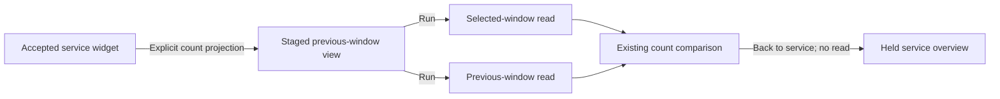

# Compare captured records from a service

In a supported service widget's **Widget actions**, choose **Compare captured
records**. The existing population workspace stages the selected window and its
adjacent, equal-duration previous window. **Run** reads both independently.
**Back to service** restores the held overview without reading telemetry.

This compares captured counts, not every measure displayed in the widget. The
checked projection omits unused duration/status summary directives and preserves
all population filters, environment/namespace policy, qualified grouping, selected
window and page limit. Typed numeric predicates remain filters. It does not infer
requests, unique transactions, success, coverage or application health.

The initial arm uses the existing single-category, page-zero count-comparison
profile with limits up to 100. Numeric measures, histograms, reported edges,
grouped timelines, native measurements and invalid previous windows are excluded.
The action never invents grouping, resets a continuation or clamps a page limit.

Only the accepted current widget can stage the comparison. Pending dashboards,
changed/incoherent reads, hidden or retired actions and foreign widget responses
cannot acquire authority. Each comparison operand retains its own read time and
basis; saved intent and the held service overview remain separate from fresh data.

See [service dashboards](SERVICE_DASHBOARDS.md),
[fixed comparison windows](PAIRED_COMPARISON_WINDOWS.md) and
[validation](../VALIDATION.md).
