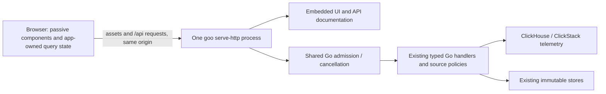

# One Go runtime for Goo

Decision recorded 2026-10-28 before implementation. The user explicitly requested
Go/Rust as the product runtime and now authorized removal of the Python proxy.
That instruction supersedes the repository's earlier transitional instruction to
preserve the Python lab server. Preserve the runnable observability lab and stored
data; preserving its old server implementation is no longer the goal.

## Why this migration is necessary

The product already validates, plans, executes and captures ordinary OTel questions
in Go. Nevertheless the browser reaches those handlers through `server.py`, which
serves assets, duplicates route allowlists/body limits, buffers JSON responses and
relays SSE. It also retains an unrelated fixed reservation SQL compiler in
`grammar.py`. This adds a second upload/abort/error boundary, a second startup
configuration, independent deployed assets and misleading architecture complexity.
Milestone 237 fixed direct Go receive cancellation; the Python upload boundary
remains outside that guarantee. Retiring the extra boundary is preferable to
building another lifetime-management layer around it.

This is consolidation of the executable boundary, not a semantic-engine rewrite.
Keep source-family policy, strict JSON decoding, admission/cancellation, source
adapters, immutable publication and passive framework-neutral UI components.

## Target composition

The configured Go server serves browser assets and API documentation and dispatches
`/api/*` directly to the same in-process handler graph already serving native Go
routes. There is no loopback HTTP proxy and no second mux registration, budget,
snapshot bank or capture store. Prefix adaptation preserves method, query, headers,
body, cancellation context and response-writer streaming capabilities. Native
unprefixed routes may remain as deliberate direct API entry points for current
clients; they are not another service or an alternate execution policy. Do not add
independent route allowlists or size limits at the asset boundary.

Embed the flat browser assets and API docs at build time. This gives a compiled
binary a working UI from an empty directory, with no Python, node process or
source checkout at runtime. Serve only intended HTML/CSS/ESM resources, with
correct MIME, HEAD behavior and deterministic 404s; no directory listing, arbitrary
filesystem serving, or successful HTML fallback for missing API/module paths.
Avoid durable browser caching of unversioned assets during this migration.

Use the same Go `--profile` for `/api/ui-config` and runtime capabilities. Generic
startup must work without sample packages/configuration and must not probe
ClickHouse just to start or serve assets/catalog metadata. Source connectivity
health is distinct from process readiness: do not label a successful asset read
as proof telemetry is queryable.

## Python responsibility disposition

| Existing responsibility | Migration |
| --- | --- |
| HTML, CSS, ESM and component gallery | Embedded Go asset handler |
| OpenAPI JSON and documentation HTML | Embedded Go documentation handler |
| JSON API forwarding and header propagation | Direct in-process prefix adaptation into existing Go handler/budget |
| Tail SSE forwarding and disconnect watcher | Direct existing Go tail handler and browser connection; remove watcher/proxy |
| `ui-config` | Go profile-owned metadata |
| Example YAML gallery | Embedded ordinary telemetry-package examples served by Go; existing Go planner remains compiler |
| Reservation grammar and prebuilt JSON catalogs | Remove legacy-only UI/catalog dependencies, or retain only explicitly useful metadata; no second evaluator |
| Fixed `/api/query` and `/api/explain` compiler | Retire legacy example UI and migrate its maintained scenarios to the ordinary Go exploration/package flows |
| Python health query | Explicit Go readiness/source-health contract; update callers to match what is actually tested |

The fixed compiler is still live in `ui/app.mjs` and the old reservation
`journeys/investigation.spec.js`; removing its endpoints without updating those
surfaces would leave broken visible functionality and misleading tests. The newer
`ui/example-questions.mjs` already uses ordinary YAML telemetry packages and the
Go planner and should survive. Do not port the bespoke reservation SQL templates
into the general Go backend merely to preserve an obsolete example interface.
Where a legacy scenario tests a still-desired capability (waterfall, heatmap,
exact filters, cancellation or scope consistency), retain that behavioral coverage
through its general Go surface rather than deleting coverage wholesale. Completion
preview/burn calculations are returned-row demo calculations, not production SLOs;
do not silently relabel a replacement as equivalent lifecycle measurement.

`sample.py` is a Python *instrumented application fixture*, independent of the
Goo server. Separate its development image/dependencies from the Go product image.
Python-based offline compiler tests, fixture traffic and documentation scripts do
not imply Python is needed to run Goo. Keep any remaining tools explicitly labeled
and outside the product startup path. Remove `server.py` from deployed entrypoints;
remove dead runtime/proxy tests and obsolete `PACKAGES_URL` configuration with it.

## Deployment and validation boundaries

Use one Compose Goo service/process for assets and API, retaining the current
browser URL if practical. Map any temporarily retained native API port directly
to that same process, not a duplicate server/container with independent state.
Preserve the investigations volume, ClickHouse/Redis volumes and existing IDs;
this migration requires no data reset or import. Do not accidentally move the
capture directory by changing the image working directory or service mounts.
Existing Compose service-name references and test helpers need inventory before
renaming services. Keep unrelated sample apps, collector and HyperDX behavior.

Required verification before calling the migration complete:

- A built Go binary alone, launched from a disposable empty working directory,
  serves generic UI, component gallery, docs, configuration and direct API requests.
  No Python child process or second HTTP hop exists.
- Prefix/native routes share admission, cancellation tombstones and server-owned
  snapshot capabilities. Body limits/refusals, query headers, statuses and exact
  timestamp strings retain their handler-owned semantics.
- Exercise stalled uploads, malformed bodies and large error responses against the
  browser-facing Go entry point. Verify a normal next request succeeds and SSE
  cancellation releases its own slots without proxy buffering/watchers.
- Run existing Go semantic/source tests and the strict required ledger verifier;
  perform real browser journeys for stream, inspection, source cancellation,
  capture/reopen and an ordinary example package. Add no new false-green skips.
- Update maintained startup/smoke helpers, Docker/Compose paths, API specification,
  architecture diagrams, generic-startup docs and current README together. Mark
  historical screenshots/prose as history where applicable, rather than claiming
  they were always a single process.
- Validate the deployed binary/assets together. Source code or matching OpenAPI
  content alone does not establish that the running container uses the new Go UI.

The migration itself does not fix open Activity filter/Inspect interaction issues,
change authorization/isolation, or make the local lab production-ready. Those
remain explicit backlog work after the runtime boundary is coherent.

## Independent architecture review of implementation — 238

The implementation now uses `cmd/goo/serve_ui.go` around the existing budgeted mux,
with embedded assets/catalogs and one profile. Compose removes the query gateway
and maps both retained host ports to the same Go process; the existing capture
volume path is unchanged. The Python-only panel/compiler endpoints are removed,
while ordinary YAML examples remain. No runtime blocker was found in the reviewed
routing, response-writer capabilities, static-resource exposure or state ownership.

Independently passed the four focused Go acceptances for embedded resources and
metadata, both-prefix streaming/cancellation, browser-prefix incomplete-body
cancellation/admission release, and configured serving from an empty directory.
Those tests do not substitute for the separate real compiled-binary browser,
source-read and deployed-image checks recorded in the validation log. Current
architecture diagrams and maintained startup prose must describe this composition;
historical two-process milestone records should be marked superseded, not silently
rewritten as if the old boundary never existed.

## Lab configuration is separate from embedded product assets

The generic binary serves UI/docs from an empty directory. Optional lab operation
packages still read their configured annotation-source directories at startup;
workflow declarations validate their referenced YAML package files. The lab image
therefore includes config plus the two annotated sample source directories and
telemetry example YAML. These are declaration inputs, not a Python server or a
runtime Go compiler. The runtime-layout regression tests these exact image inputs
rather than borrowing the complete developer checkout.
