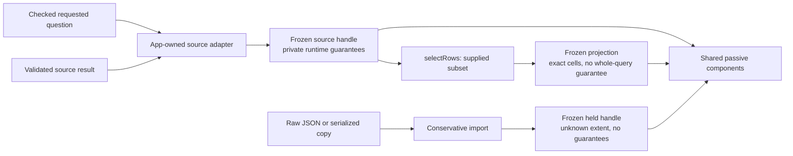

# Immutable snapshot construction — 265

H0 gives the scoped display pilot one admission boundary. Components share frozen
snapshot handles; complete-only displays require a private runtime witness from a
configured source adapter. Copying an origin label or completeness object cannot
recreate that witness. This is a host trust boundary, not source authentication,
a signature, or a new data-query engine.

## Admit once, share the handle

```js
import {createSourceAdapter, asSnapshot} from './snapshots.mjs';

// Configure inside the application source owner, never from a view definition.
const source = createSourceAdapter({id: 'clickhouse:primary'});
const snapshot = source.adoptSnapshot(response.viewDataset, {
  question: acceptedQuestion,
});
chart.snapshot = snapshot;
chart.display = {
  kind: 'bar', category: 'category', value: 'count', requiresComplete: true,
};

asSnapshot(snapshot) === snapshot; // true: no additional defensive copy
```

The application first checks the successful response against its requested
question. Adoption then checks canonical shape, explicit `source-read` origin,
record-question/predicate validity and the existing question identity semantics.
Those semantics account for Go's omitted zero/default fields; adoption does not
invent a second question normalizer. Interval bounds/bucket must match the checked
question, ranked dimensions must match its grouping count, and numeric units and
duration profiles must match its requested measures.

One defensive clone detaches the admitted data from the mutable producer, then
recursive freezing protects fields, rows, values, support, scope and provenance.
Getters return that same immutable handle. The application admits only its known
`/api/explore` dataset slots; an arbitrary HTTP response is not a source producer.
Source adapters with identical logical labels still have distinct private instance
identities. An adapter refuses another adapter's branded handle.

The application adapter in `ui/source-snapshots.mjs` checks the submitted and
returned questions, expected slot shape, response basis and original read clock.
Saved record pages use a separate adapter after matching the immutable receipt;
only delivery paging may differ. Their original aggregate selector and capture
clock survive paging, independently of the receipt's custody clock. Fresh context
and previous-window reads use the same Explore admission path. These checks do not
replace the host's execution lifecycle or current-result guards.



A guarantee covers the declared captured-query aspect: `groups`, `intervals` or
`summary`. It does not prove complete collection, unsampled telemetry, transactional
agreement among independent reads, or valid values for every measure. An exhaustive
aggregate can still contain unavailable numeric measures and unknown sampling.

## Imports and comparisons

| API | Result |
| --- | --- |
| `asSnapshot(input)` | Return an admitted handle unchanged; otherwise import conservatively |
| `importSnapshot(raw)` | Clone, assign fresh local IDs, set `browser-held`, remove completeness and set extent to `unknown`, then validate/freeze |
| `isSnapshot(value)` | Test the private runtime handle registry |
| `getSnapshotInfo(handle)` | Frozen entry/source-instance/parent/projection/guarantee facts; `null` for raw data |
| `hasGuarantee(handle, aspect)` | Check the private witness, not serialized metadata |
| `asComparison(input)` | Share admitted sides, import raw sides conservatively, validate and freeze the independent comparison |
| `parseSnapshotJSON(text)` / `parseComparisonJSON(text)` | Enforce text limits before parsing, then use conservative admission |

Each raw import receives new opaque local dataset/revision IDs, so edited JSON
cannot retain a source-content identity. An existing `sourceBasis` claim is retained;
when absent on a serialized `source-read` snapshot, its original revision is carried
only as an advisory source-basis claim. No capture clock or custody claim is invented.

`JSON.stringify`, `JSON.parse` and `structuredClone` do not preserve the runtime
witness. Even a byte-identical copy cannot satisfy `requiresComplete` without an
intentional new adoption at the trusted source boundary. Structural
`validateSnapshot` checks data consistency; it does not grant authority.
`validateDisplay` and `capabilities().completeAspects` require the runtime witness.

Comparisons retain two independent snapshots. The `/api/compare` route is a held-data
comparison, not a source-adoption endpoint. Exact signed differences remain checked
against both sides' methods, units, bindings and support; normalization does not
merge provenance or turn held sides into complete source results.

## Safe supplied-row projection

```js
import {selectRows} from './snapshots.mjs';
const subset = selectRows(snapshot, ['stable-row-key']);
```

`selectRows` accepts only an admitted ranked or time-series handle and distinct,
existing row keys. It preserves parent order, exact values and support, sharing the
already-frozen rows and field descriptors. Passing every key returns the original
handle, including when the input key order differs.

A proper subset gets new local opaque dataset/revision IDs, `browser-held` origin,
private parent/projection lineage and no whole-query witness. Extent becomes
`partial`, or stays `unknown` when the parent extent was unknown. Local IDs are not
content hashes. Scope, capture clock and any supplied source-basis claim remain
unchanged. A time subset retains its original window and gaps; it never fills
missing intervals with zero or recomputes totals from selected rows.

Summary projection, foreign/duplicate keys and callback reducers refuse. This API
adds no new local-filter control to the product and does not execute or stage a
source query. Aggregate rows are still not attested member-record references.

## Limits and failures

| Input | Normalization limits |
| --- | --- |
| Snapshot | 8 MiB accounted data, 250,000 nodes, depth 32 |
| Comparison | 16 MiB + 64 KiB accounted data, 500,000 nodes, depth 34 |

The exported `SNAPSHOT_LIMITS` and `COMPARISON_LIMITS` are frozen. Plain-data
inspection checks descriptors and budgets before cloning. Getters/setters,
functions, cycles, non-plain prototypes, hidden/symbol properties and sparse arrays
refuse. Repeated aliases count for each logical appearance; sharing does not bypass
budgets. Escaped text is counted incrementally to avoid a large intermediate copy.
JSON text limits apply before parsing as well.

Failures throw `SnapshotError`, a `TypeError` with a stable diagnostic `code` and
message. Examples include `shape`, `source-question`, `source-origin`,
`source-instance`, `projection-keys`, `accessor`, `cycle`, `prototype` and
`budget-bytes` / `budget-nodes` / `budget-depth`. A failed component setter clears
its previous successful value rather than leaving old data visible as current.

## Execution ownership after H0

H0 does not make a data revision an active execution epoch. Existing owners still
control requests, cancellation, visibility and action guards.266 adds
[bounded H1 role/execution handles and a resolver](SCOPED_ACTION_OWNERSHIP.md) for
canonical fixed Explore group/interval actions, checking role, epoch, revision,
stable membership and direct projection lineage before staging. Other action
families and whole-screen composition remain to be migrated before contributed
view execution, broader live subscriptions or renderer/editor expansion. See the
[pit-of-success review](MODEL_PIT_OF_SUCCESS_264.md) and
[current roadmap](ROADMAP_2026_10_30.md).
