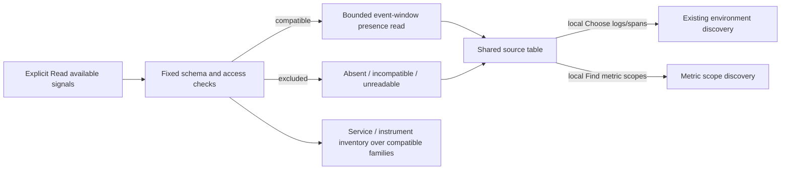

# Find usable telemetry sources

In Activity, open **Find data** and choose **Read available signals**. Goo checks
the six supported ClickHouse exporter families in a bounded time window. The
result distinguishes usable sources from missing tables, unsupported schemas and
unavailable reads. Opening the chooser alone performs no source work.

For usable Logs or Spans, **Choose logs/spans** stages that signal and focuses
**Read environment scopes**. It does not read environments, start a tail or change
your environment/filter predicates. Preview and Stage then use the existing typed
scope flow; Start remains explicit. This also holds when a clean Activity scope
was already applied. The ordinary signal select keeps its existing behavior.

## What the states mean

| Display | Evidence |
| --- | --- |
| Records observed / Points observed | A compatible, readable profile returned a bounded presence witness in this window. |
| No records / No exported points in window | The presence read succeeded with no rows. The table is still usable. |
| Table absent | The source returned a structured missing-table/database exception. |
| Unsupported schema | Required discovery columns were missing or had unsupported types. |
| Source unavailable | Schema or read access could not be checked, including denial or rejected metadata. |
| Read unavailable | Profile checks succeeded, but the subsequent presence read failed or was rejected. |

Records are logs/spans; metric-family records are **exported points**. A presence
witness is not a count, metric value, stream count, histogram mass, completeness
claim or service-health verdict. All services and environments are inspected only
within the explicitly chosen window. Read time and event-time scope are distinct.
Source details remain in a collapsed disclosure.

For usable metric families, **Find metric scopes** opens Measurements locally and
carries this exact source-check window. **Read metric scopes** explicitly discovers
qualified environment/service choices; selecting one stages instrument discovery
without another read. See [metric scope discovery](METRIC_SCOPE_DISCOVERY.md).

Metric-family compatibility still does not promise evaluation support. Instrument
eligibility and the existing kernel's instance-identity requirements remain
separate from browsing scopes.

## Partial installations

Service discovery now checks each family independently and queries only compatible
sources. Parent-link reads run only when spans are usable. Instrument discovery
checks its four metric families and retains its existing global point limit and
instrument eligibility rules. Both catalogs disclose excluded families.

If no family is usable, inventory refuses rather than reporting an empty catalog.
If a table changes or fails after its check, the catalog read fails; a failed read
is not silently converted to an absent or empty family. Results are independent
reads, not a transactional snapshot.

## Implementation boundary

`internal/sourcecap` owns fixed table names and required column profiles. It issues
DESCRIBE and zero-row column reads, never arbitrary client SQL. Structured
ClickHouse exception headers classify missing tables; exception prose and bodies
are not parsed or exposed. Permission denial, missing exception metadata and empty
schema responses do not establish table absence.

`POST /source-capabilities` accepts only a half-open window of at most 120 minutes.
It uses normal source admission/cancellation, a 4 KiB body limit and a 30-second
whole-request deadline. At most twelve readiness reads and six presence reads are
issued. Results are not cached. The existing source transport supplies readonly,
row/byte/memory/time limits and request cancellation.

[Independent review](reviews/SOURCE_CAPABILITIES_431.md) · [API](API.md) · [Executable storyboard](journeys/source-capabilities.md) ·
[Roadmap](ROADMAP_2026_11_14_CHECKPOINT_430.md).
