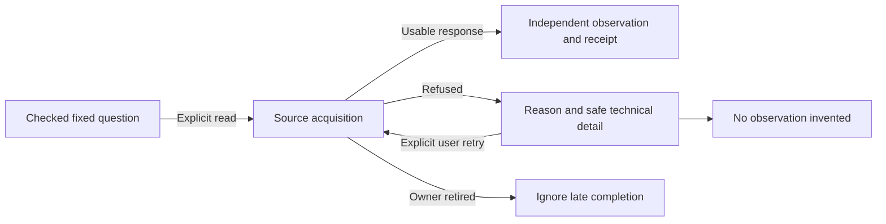

# When a source read cannot complete

Ordinary exploration reports a concise reason when a source read times out,
is cancelled, exceeds a known limit, returns unusable data or is unavailable.
Technical details explain the checked boundary in a disclosure. They are fixed,
bounded descriptions, not raw database errors, transport URLs or query text.

| Reason | What it establishes |
| --- | --- |
| Source read timed out | The acquisition exceeded a checked time limit |
| Source read cancelled | The acquisition stopped before completion |
| Source read exceeded a limit | A known read, result or grouping limit refused the acquisition |
| Source response rejected | Returned data could not support the requested observation |
| Source unavailable | No usable observation was obtained; a more specific cause is not asserted |

A failed read is unavailable evidence. It does not mean zero traffic, zero latency,
healthy operation or an application failure. An empty successful read remains a
different result. Successful changed-between-reads diagnostics also retain their
existing meaning.

Use the existing explicit Run, Read or affected-side Retry to acquire again.
The same question may succeed after an external source fix; no category promises
permanent failure. A narrower scope may help with a budget refusal, but Goo does
not silently shorten the window, discard values, increase limits or retry for you.
Local cancellation/navigation retires its owner; a late response cannot overwrite
the returned task with an old failure.



For paired facets, the available side keeps its exact counts and source receipts;
the failed side stays unknown. A missing category means zero only within a ready
returned partition. Side Retry reads that side's same checked question and field.
It does not update the other operand or the held comparison's separate clock.
Page failures likewise do not replace held aggregate measurements with page counts.

## API and coverage

The fourteen routes using the shared source-read HTTP handler return runtime
failures as HTTP 502 with a closed envelope:

```json
{
  "error": "Source read timed out.",
  "refusal": {
    "kind": "timeout",
    "detail": "The source read exceeded its time limit."
  }
}
```

Kinds are `timeout`, `cancelled`, `budget`, `malformed` and `unavailable`.
The detail limit is 256 UTF-8 bytes; current details are fixed safe descriptions.
There is no retry-policy field and no new read receipt on a failure. The shared
browser parser recognizes the runtime envelope only on 502 and checks its
canonical reason/kind pairing. Ordinary population, record/page, fixed-baseline
and counted-facet owners use the shared presentation. This does not promise
specialized recovery gestures on every signal surface.

The shared routes cover nine record reads (environment scopes and their record
preview, inventory, discovery, aggregates, counted values, trace search, record
page and exploration) and five native reads (metric discovery, measurements,
host discovery, pod-metric discovery and pod discovery). Native adapters without
a more specific typed cause use safe unavailable fallback; this cut does not
classify arbitrary upstream exception prose.

HTTP 400 invalid input/body admission, 409 query-ID conflict and 429 shared
capacity refusal remain separate. In particular `/api/compare` evaluates supplied
summaries: its independent 1 MiB request-body cap is not a source runtime budget.
An upstream HTTP 500/503 alone does not establish a database budget exception.

See the [architecture review](reviews/SOURCE_REFUSAL_ARCHITECTURE_344.md),
[HTTP boundaries](HTTP_BOUNDARIES.md) and [validation record](../VALIDATION.md).
Code, live fault/recovery and desktop/narrow screenshot acceptance pass for 344.
See the [executable storyboard](journeys/344-source-refusal.md).
