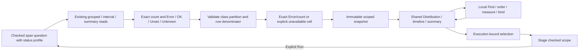

# Recorded span status in scoped views — 268

Status counts and recorded-error fractions use the same immutable dataset,
display components and execution-bound actions as ordinary numeric and duration
breakdowns. They describe captured spans, not business success or an availability
SLI. An Unset status is not OK; unrecognized statuses remain Unknown.

## Exact operands, explicit availability

Each known population row declares `count` and four captured-record measures:
`status.error`, `status.ok`, `status.unset` and `status.unknown`. Their aggregation
is `{family: 'span-status', kind: 'count', method: 'exact'}`. The four canonical
integer strings must sum exactly to that row's count. These classes are separate
from numeric-value support (`valid`, `missing`, `empty`, `invalid`).

`status.error_fraction` is a reduced rational Error/count, with dimensionless
unit `1` and this aggregation:

```json
{"family":"ratio","kind":"fraction","method":"exact-rational","numerator":"status.error","denominator":"count"}
```

References name compatible count operands in the same row. Validation checks the
exact cross-product and the fraction's bounds, not a rounded display percentage.
Ordinary dimensionless numeric values do not become percentages. A known empty
row has four derived zero counts and a null `no_data` fraction: 0/0 is not 0%.
Unknown rows retain null/unknown counts and fraction. Missing or inconsistent
requested source profiles are refused rather than filled with plausible zeros.



## Display and interaction

Fraction bars, interval bars and compatible numeric lines use a fixed 0–100%
axis. A 1% error fraction stays 1% wide even when it is the largest visible
fraction; local Find never rescales it into 100%.
Exact explanations retain numerator, denominator and the other status classes.
Unset/Unknown remain visible, including when recorded errors are zero. No health
color or success inference follows from a zero recorded-error fraction.

This row-local ratio differs from a group's share of the whole population.
Whole-group count shares still require the verified partition and source witness
from [267](ORDINARY_BREAKDOWNS.md). A held or projected row can retain internally
consistent status operands without acquiring whole-query completeness. Imported
provenance remains unknown; a mathematically valid fraction is not proof that all
telemetry was collected.

Ordinary fixed and Saved one-field status breakdowns use the common Distribution;
the common population summary replaces the duplicate status card. Saved stays
read-only. Local presentation performs no reads; current group/window selection
stages, and Run reads. Existing H1 execution/role guards remain in force.

## Deliberate boundaries

Status cohort comparisons keep the existing exact independent denominators and
percentage-point presenter. Canonical `ViewComparison` is not emitted for these
queries: a signed fraction difference needs its own interpretation, and is not a
bounded fraction level. Dedicated multidimensional error triage, histograms,
grouped/native time series and population-workspace presenters retain their
explicit owners. No Plotly adapter or persisted view editor is introduced.

See [the executable storyboard](../journeys/268-status-fractions-storyboard.md)
and [validation](../VALIDATION.md) for checks actually executed.
