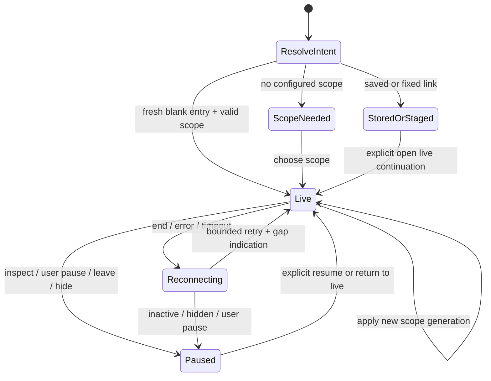

# Stream-first Explore: architecture review

Prepared 2026-10-22 against `3fbefea`. **Source-backed proposal, not implemented
behavior or a new integration validation record.** This follows the user's
stream-first steering after the first consolidation cut. The companion
[interaction design](STREAM_FIRST_ENTRY_DESIGN.md) describes the product surface;
the [active implementation queue](IMPLEMENTATION_PLAN.md) owns delivery order.

The direction is feasible using the existing record-tail machinery. Fresh Explore
should be a bounded live monitor, not a question editor that must run before the
user sees data. A log/span row can lead to filtering, inspection, a fixed question
or capture. Old explicit-start UI conventions should not block auto-start on this
new entry; saved artifacts and shared fixed questions still have different intent.

## Existing mechanics worth reusing

| Source | Actual capability | Consequence for the entry |
| --- | --- | --- |
| [`exploration/tail.go`](../exploration/tail.go), `TailSelector.Query` | One optional signal (`logs` default, or `spans`), exact environment and supported predicates. A rolling 60-second **event-time** question; no fixed window or aggregate settings. | Can start independently of population planning or `/explore` aggregate reads. It is not an ingestion subscription or replay cursor. |
| `Source.PollTail` in the same file | Every poll reads recent records, newest-biased, at most 1,000 records and 512 KiB of returned row payload. The returned batch is presented in event-time order. | A high-volume source can omit data even while the UI updates normally. Keep a visible limited/gap state. Do not present observed rows as a complete firehose. |
| [`cmd/goo/tail_http.go`](../cmd/goo/tail_http.go), `registerTail` | POST SSE with reset/batch/gap events, sequential event IDs, 2-second polling, a 60-second connection lifetime, four global connection slots and a 5-second write deadline. | Reuse the transport. Budget auto-start carefully: two signals per visit would consume half the process capacity before a second user opens the app. |
| `TailTracker.Observe` | Canonical-payload hash plus observed multiplicity, a bounded 20,000-key tracker and late-event-time flags. | These are connection-local observation handles, not physical event identity, unique invocations or exactly-once delivery. |
| [`ui/tail.js`](../ui/tail.js), `TailBuffer`/`SSEParser` | Bounded parser, row/byte eviction, replay suppression inside the connection, sequence checks and obsolete-generation rejection. Default buffer is 100 rows / 2 MiB. | Keep these mechanics; do not introduce an unbounded browser stream or rebuild identity in the display component. |
| `GooTail.mount` | Logs and spans, pause/resume, follow state, staleness after 6 seconds without a completed batch, reconnect after 2 seconds, pause on focus/hidden document and original-window trace continuation. | Useful behavior exists, but its full heading/toolbar/disclosure composition should not be embedded and hidden with another layer of CSS. |
| [`ui/population-workspace.js`](../ui/population-workspace.js) | Explicit population tails, independent live comparison and saved configuration, with source-free restoration. | Reuse supported continuation intent, not the whole fixed-population workspace as a prerequisite to entry. |
| [`ui/investigation-trail.js`](../ui/investigation-trail.js) | Up to eight retained visits in one tab; leaving suspends the current adapter and retains DOM/scroll/display children. | Automatic monitoring must be owned by the active entry, not by every retained visit or custom-element reconnect. |

The row compiler already returns the relevant generic OTel fields. In
[`exploration/compiler.go`](../exploration/compiler.go), spans include `TraceId`,
`SpanId`, `ParentSpanId`, name/kind/status/duration, resources, scope and link
references. Logs contain reported trace/span IDs, body/severity and resource/scope
attributes. A log does not supply an enclosing span name or span-parent chain.
The environment is currently supplied by the selector; an all-environment monitor
is not an existing selector mode.

## The smallest useful slice

Create a fresh-entry application coordinator above the existing tail core. Its
initial read is **one active signal**, with a compact Logs / Spans switch. Use the
workspace's configured source/environment, or a previously chosen valid explicit
scope. If no such scope is available, show a compact scope chooser instead of
guessing `prod`, silently treating `local` as universal, or querying all environments.
The scope pill must make the applied environment visible.

Start without waiting for inventory, a population plan, a full aggregate or an
operation manifest. A log-only or span-only deployment must still work. When the
chosen signal has no recent observations, show that state and the alternate signal
control; do not call it healthy. A later combined view can opt into both signals
through the same coordinator after capacity and fairness are measured. This first
slice does not require a combined backend endpoint.

Above the stream: source/environment and applied selector pills, a small signal
switch, connection state and Pause/Resume. Inside each row: UTC event time,
service, severity/status, body or span name/duration, a compact trace reference or
observed-parent trail when available, and explicitly selected field pills.
Below or beside selected rows: inspect, include/exclude field, open trace, expand
fixed context, and eventually preserve selected evidence. Question authoring,
full-population charts, saved definitions and narrative editing should appear as
continuations, not startup prerequisites.

Do not implement this by automatically clicking **Show recent activity**, followed
by **Start population tail**. That would execute two aggregate population reads,
mount a second workflow and conceal the ownership problem rather than remove it.

## One lifecycle owner

The auto-start predicate should be explicit and testable:

- Explore's record destination is active, visible and connected.
- This is a genuinely fresh blank entry or explicit return-to-live action.
- The initial URL does not identify a saved capture/document/evidence/view or
  shared question/step. Those artifacts continue to open without executing sources.
- A valid applied workspace scope exists.
- No monitor is already owned by that entry/generation, and no user/inspection
  pause is being overridden.

`GooInvestigationTrail.create()` currently calls `GooExploration.mount()` even when
a fixed question will be applied immediately afterwards. Auto-start inside mount
without classifying the visit would race the fixed-link restoration and create a
hidden source read. Pass visit intent from the navigation/trail owner, then launch
only after URL/scope resolution. Do not use a timer or `connectedCallback` to infer
that the entry is blank.

The same owner must abort the active SSE reader, reconnect timer and watchdog on
navigation away, switching to Measurements, hiding the document, replacing scope
or disposing the visit. Retained back-stack views remain paused. Returning to an
inspected/paused view must restore its anchor and scroll, not reconnect and erase
it. An explicit **Return to live** or **Resume** may start a new recent window and
must expose its continuity gap.

An auto-paused hidden/left visit can remember why it stopped, but that must not
silently outrank a later explicit user/inspection pause. Scope edits stage locally;
committing a chip/filter applies a new selector generation. Abort the old reader
before starting the new one, label the new applied scope, and prevent late old
batches from entering the replacement buffer. Retain the old frozen inspection
context separately if the user chose it; never let its rows appear under new pills.

Keep the passive element contract. A display row/list, pill or breadcrumb receives
supplied records and emits bounded intents; it does not fetch, subscribe, navigate
or publish. A narrow extraction from `GooTail.mount` can separate connection/buffer
ownership from row presentation while preserving its existing public behavior for
population tails. Avoid a generic global store or a second implementation of the
SSE state machine.

## Parent breadcrumbs: useful, but only from observed evidence

A first breadcrumb can resolve parent references against a bounded index of the
**supplied span rows**, keyed by applied environment + trace ID + span ID. It needs
explicit states:

| State | Presentation and behavior |
| --- | --- |
| No parent reported / all-zero parent | No reported parent. Do not claim complete root coverage. |
| One usable parent in supplied rows | Show its reported service/name and retain the exact reference. |
| Parent outside retained rows/window | Show an unresolved-parent marker; expansion is a separate named source read. |
| Multiple candidates / duplicate IDs | Show ambiguity. Do not choose the latest arrival or the last map entry. |
| Cycle or depth budget | Show truncation/cycle state and leave the row inspectable. |
| Log with valid trace/span IDs only | Show the reported trace/span reference. A span name or ancestry requires observed span context. |
| Async span links | Show a link/reference affordance, never append it as a parent edge. |

The existing [`ui/waterfall.js`](../ui/waterfall.js) can inspire reported-parent
labels, cycle treatment and passive display. Its `layout` currently builds a
single-value map for `(TraceId, SpanId)` and warns that duplicates can be ambiguous.
Do not reuse that map as proof of a unique ancestry path. A stream breadcrumb
resolver should preserve candidate multiplicity/ambiguity and use a small depth
cap. This deserves pure graph properties and hostile fixtures, not just screenshots.

A supplied-row breadcrumb must not trigger one trace request per row. At high
volume that would turn a bounded monitor into an N+1 source workload and silently
broaden scope across services. A selected **Expand trace** action can use the
existing exact-trace continuation with its own fixed original read window, basis
and completeness caveat. The fact that a parent was absent from this stream never
proves a broken trace.

## Statistics and dual-signal truth

The first stats should come from existing known facts: retained rows, evicted rows,
observed rows in the current connection, last completed read time and connection
state. Label local error/severity counts as counts **in this view**, if added.
Do not label observed arrival rate as request throughput, or compute p95 from the
100 retained spans and present it as a full-population percentile.

A later small transport extension could expose `matchedInPoll` alongside its
window and `limited` flag. `PollTail` has the bounded matched rows before
`TailTracker.Observe` suppresses already-observed payloads; the current SSE batch
contains only newly observed members. An uncapped complete poll could report its
matched row count; a limited poll reports a retained/lower-bound count. Neither
`rows.length` in the SSE batch nor the cross-poll seen ledger is that count, and
none is ingestion/request throughput. This metadata would avoid an extra count
query, but needs its own typed response/limit fixtures and is not in the initial
source-free buffer-stat slice.

Actual population count/error/latency summaries are a distinct optional layer:
fixed explicit windows, typed Go evaluators and independent reads, with their own
read timestamp. They can appear after selection, opening a chart or requesting a
comparison. Existing `GooLiveComparison` already separates full-population reads
from the tail; keep that boundary instead of copying its numbers into tail stats
without a window label.

A future merged Logs + Spans view needs one app coordinator, not two uncoordinated
full tail widgets. Preserve signal-qualified observation keys, per-signal state,
limits and read windows; one failed signal must not wipe out the other. Merge by
observation order or another explicitly defined policy. There is no shared
transactional snapshot or cross-signal ordering guarantee. Do not attach a log to
a nearby span by time alone.

## Pause is not capture

Current `GooTail` pause stops transport and retains a local bounded buffer. Resume
receives a `reset` event and clears that buffer. Its public `snapshot()` returns
key/record pairs but omits the per-row `readWindow` stored internally. That makes
it insufficient as an exact evidence handoff for the new interaction surface.

Current native selection retention accepts a saved capture or a server-produced
`resultToken` and indexes. [`exploration/result_snapshots.go`](../exploration/result_snapshots.go)
freezes a whole `Result` page for two minutes with bounded process-local capability
storage. `/tail` does not issue that token, and
[`cmd/goo/retention_http.go`](../cmd/goo/retention_http.go) does not accept tail
handles or arbitrary client records. This is a real missing custody primitive,
not a button-label problem.

Before offering **Preserve these records**, add a bounded server-owned tail-batch
or selected-observation capability with signal, selector, original per-batch read
window, observed/read clock, exact payload and occurrence membership. Selected
rows spanning polls must preserve their distinct windows and handles; existing
`Result` aggregates must not be forged to make the current API appear compatible.
A dedicated typed tail-selection origin or a small exact-member fragment contract
can reuse retention mechanics only after its manifest/version semantics are explicit.

The initial slice may pause, inspect and stage a fixed question. If its capture
continuation rereads the source, label it **Capture a new fixed read** and retain
the original live reference separately. Do not say that it freezes the displayed
tail. New exact-member retention should then reuse the native retry journal's
idempotency/reload recovery once the server supports the intent. Browser-only
selection is not server custody and does not become durable on pause.

## Capacity, gaps and failure behavior

Keep the existing source-poll, byte, parser, identity and UI budgets visible in
operational semantics. Do not increase them just to make a busy screenshot look
complete. The four global slots are a prototype fairness constraint: an inactive
visit must release its slot, and 429 must produce an understandable unavailable
state with bounded backoff. Avoid synchronized reconnect storms across two signals
or several tabs; a small capped retry/jitter policy can follow measured need.

A 60-second connection ending causes a new connection and therefore a visible
continuity gap. The backend is biased toward the newest 1,000 source records in
that last-minute event-time window, so a delayed old event can be missed entirely;
the current implementation does not replay by ingestion offset. Within a connection,
canonical equal records preserve maximum observed multiplicity, not a count of
every underlying duplicate across rolling windows. A genuine ingestion-backed
cursor is a future source capability, not a UI mode promised by this change.

Keep last good rows visible when one read fails; mark stale/unavailable rather
than displaying an empty healthy result. Limit DOM work to bounded batches and
stable row nodes; do not rerender/reorder the entire stream while a user reads,
selects text or uses the keyboard. Row focus/inspection should pause the feed,
with the anchor held outside the evictable rolling buffer.

## Bounded delivery and evidence

1. **Fresh-entry owner and compact stream.** One active signal, explicit configured
   scope, auto-start only for true blank Explore, pause/resume/follow, compact UTC
   rows, view-level stats and a separate selected-row inspector. Keep advanced
   questions/captures available through progressive continuations.
2. **Local ancestry and interaction scope.** Ambiguity-aware supplied-row graph,
   chosen field pills, include/exclude intents and stable paused selections. A
   trace continuation remains an explicit independent read.
3. **Exact selected-record custody.** Introduce/version the server membership
   contract, bounded capabilities and manifests; then enable preserve/tag/attach
   with existing retry-safe native writes. This may be combined with cut 2 only
   if custody fixtures and failure tests are reviewable.
4. **Combined signals and population enrichment.** Measure capacity/fairness before
   a merged default. Add independent population summaries/comparisons through the
   existing typed evaluators, not browser-buffer approximations.

Acceptance should include:

- Real OTLP logs and spans in separate services/environments; a fresh visible entry
  starts exactly one monitor without population/aggregate queries. Saved/deep links
  and a second hidden trail entry start none. No-data and source failure stay honest.
- Navigation, tab hiding, signal/scope replacement and repeated mount/dispose never
  leak readers/timers/slots. Delayed obsolete batches cannot publish. Inspection
  and text selection preserve the exact row/scroll/focus anchor under new arrivals.
- Missing/empty attribute values, large exact timestamps, duplicate payloads/IDs,
  late event times, ambiguous parents, cycles, depth limits and log-only IDs are
  exercised. No breadcrumb disclosure causes a source request.
- Hegel state/swarm tests extend the real tail owner with auto-start/pause/apply/
  replace/dispose interleavings; pure graph properties cover ancestry. The existing
  [tail model](../verification/model/tail.qnt) must be extended for these events,
  rather than relabelling its current single explicit sequence as full coverage.
- Quint observed traces and rejecting controls detect hidden startup reads on
  stored links, two monitors for one visit, stale publication, resume without gap,
  and capture that substitutes a reread for exact selected membership.
- Playwright and bounded Bombadil exercise the first viewport, continuous arrivals,
  pause/inspection, progressive filters, log/span switch, mobile touch/keyboard and
  disclosed limits. Update actual screenshots; do not present this proposal as
  an already captured UI.

No runtime files were changed and no new browser, source, load or integration
campaign was run for this review. It uses current source and existing validation
records, not a claim that the proposed entry is production-ready.
