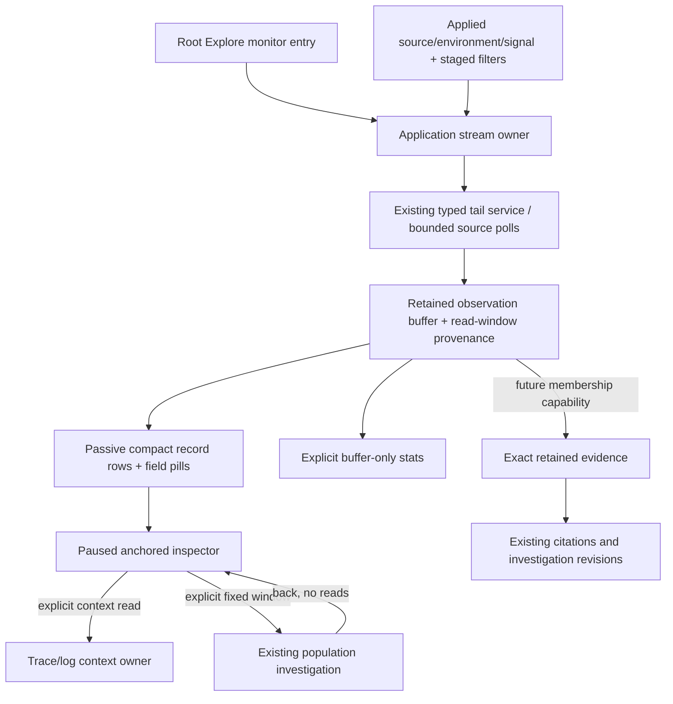

# Stream-first Explore entry

Prepared 2026-10-22 following the user's direction: the initial entry should feel
like a live firehose of logs and/or spans, with compact context and basic stats;
question/capture machinery should emerge from interaction. **This is a design
proposal and source review, not implemented behavior or a fresh usability test.**
The companion [architecture review](STREAM_FIRST_ENTRY_ARCHITECTURE.md) maps these
interactions onto current owners and protocol limits.

It supersedes the previous requirement that the root Explore entry remain inert
until **Show recent activity**. That supersession applies to the live monitor,
not to reopening saved questions, views, captures or investigation revisions.

## Product recommendation

Make the default Explore route the live activity monitor itself. Show useful
records immediately after a known environment/source is available. The first
question is implicit and visible: “What is arriving in this scope now?” The
question grammar remains the mechanism behind narrowing and reuse; users need
not complete a form or learn an artifact taxonomy before seeing telemetry.

The stream is the main canvas. Give it one compact toolbar, a thin activity/status
strip and dense rows. Put query construction, detailed charts, question naming,
configuration publication and capture receipts below the stream or behind the
interaction that makes them relevant. Do not move the existing full tail panel
above the existing full query workspace: that would preserve the same layered
workflow problem in a new order.

The ideal product includes **Both / Logs / Spans**. A safe first implementation can
ship **Logs / Spans** with one selected signal and one bounded subscription. Show
only implemented choices; do not display a pretend Both mode. Then add a
coordinated mixed feed with explicit independent-read semantics and a shared
budget. Ordinary OTel and non-Go services must work without a Goo manifest.

## The first viewport

A proposed desktop viewport, shown here as a storyboard rather than a screenshot:

```text
Explore   [environment: production v] [Logs | Spans]   [Live ● / Pause]
[service: api ×] [region: west ×]  [+ Filter]     [Fields] [Search…]
100 retained · 27 newly observed · last source read 1s ago   tiny activity bars
14:32:18.102Z  WARN   api      checkout timed out         [region: west]
14:32:18.105Z  42 ms  api      POST /checkout             [status: Error]
                         … › gateway › checkout
14:32:18.109Z  INFO   worker   reconciliation started
                         trace a81… / span b40…
```

Rows in this illustration are explanatory, not telemetry fixtures. The first cut
has one signal, so its rows will not mix the illustrated log/span types yet.

- The applied environment and source belong in the toolbar. Do not repeat a
  single invariant environment on every row. Environment pills on rows become
  useful only when supported scopes actually contain multiple environments.
- A row needs UTC event time, service, severity or span status/duration, and a
  message/operation summary. Keep two optional chosen field pills, with overflow
  in disclosure. Raw exact timestamps and long values remain available to copy.
- Service is an action-bearing label; a small number of user-chosen fields can be
  columns or pills. Do not infer a “useful” generic HTTP schema for custom OTel.
- A thin status line says Live, Paused, Reconnecting, Partial or Unavailable, plus
  last completed read. Normal caveats belong in one scope/limits disclosure;
  active stale/gap/truncation warnings stay visible.
- The stream fills the available viewport and scrolls internally. Mobile keeps
  time/type on one compact row and summary/service beneath; use two or three
  lines per ordinary record, not a large card per field. The application nav must
  not consume most of the initial mobile viewport.
- Do not put the investigation trail's disabled “Visit 1 of 1” controls, a query
  builder, a save title, source plan, multiple chart bands or capture catalog ahead
  of the first row.

Initial connection uses a real configured environment (currently the local lab
supplies one), or an explicitly selected remembered scope if such configuration
is implemented. No production environment should be invented. If none is known,
show one environment choice and an honest waiting state. A source with no recent
records remains a usable live empty view, not a healthy system assessment.

## Interaction ladder

| Gesture | Immediate behavior | What stays explicit |
| --- | --- | --- |
| Arrive at root Explore | Auto-connect the bounded monitor once for its displayed configured scope. | No aggregate exploration, definition publication or capture is implied. |
| Toggle Logs/Spans | Start the chosen signal's new connection generation; preserve the other view only if a bounded retained-view owner exists. | The selected signal and any discarded local selection are visible. No silent broadening of unsupported selectors. |
| Scroll away from the live edge | Stop follow. The first slice pauses transport as well, retaining the current buffer and anchor. | A visible Resume action states that it starts a new recent window with a continuity gap. |
| Focus or inspect a row | Pause and pin its immutable local record content; open the shared inspector adjacent to the stream. | Trace expansion or surrounding logs are named additional reads. |
| Click a field/service pill | Stage an Include/Exclude chip locally, with the existing typed field/value semantics. | One Apply action retargets the stream; selection is never silently executed. |
| Type search | Clearly identify local retained-buffer search versus a staged server predicate. | Server predicates are validated and applied to the connection; local search changes no population claim. |
| Check rows or shift-select | Pause and create a bounded local selection with an action bar. | Exact tail custody is unavailable until a server membership contract is added. |
| Select a time interval/activity mark | Pause; show exact preview bounds and “Investigate this window.” | Explicit execution opens the existing fixed population canvas; the original stream remains a retained paused parent. |
| Open deeper scope | Stage the ordinary typed question using selected signal, selectors and a named fixed window. | The deeper read can differ from the row that prompted it. Do not claim anchor preservation without checking. |
| Decide this is reusable | Offer Save view / Save question at the corresponding scope/definition control. | These save configuration; they do not freeze stream records. |
| Decide this is evidence | Offer supported retain/capture actions beside the paused selection or inspector. | Explain exact displayed members versus a later fixed-window reread. No automatic capture/publication. |

Normal narrowing should use pills, compact selectors and the inspector; the full
query builder is an advanced disclosure, not a second primary entry. Keep one
applied scope and a small staged-change indicator. On Apply, invalidate the old
connection before accepting the new one. Either show the old rows as explicitly
paused prior scope until a replacement succeeds, or replace them with loading;
never mix them under the new applied label. Failed retargeting leaves the old
scope identifiable and the retry draft intact.

## Arrival, anchoring and backpressure

Prefer a normal oldest-to-newest stream with follow at the bottom for the first
slice: this matches the current append/reconcile owner and ordinary log-tail
expectations. Direction can be revisited after real use; avoid starting with a
sort/preferences matrix. Arrival means observation order, with an explicit late-
event-time indicator. Event-time sorting cannot imply complete ingestion order.

The conservative first policy is **pause transport on inspection/focus or scroll
away**, not merely stop autoscrolling. Current `TailBuffer` evicts older rows; just
turning follow off does not protect a row or its position. Preserve the paused
buffer and inspector while a child is open. Return stays paused; closing a child
must not reconnect or jump to live automatically.

A later policy may keep receiving into a separate bounded pending lane and show
“37 new · Return to live.” It needs two ownership regions: inspected/selected
anchors cannot be evicted by pending arrivals, and pending overflow must be
reported. Do not implement a visually convincing new-record counter while
silently replacing the inspected record bank. Keyboard focus, text selection and
scroll anchors must survive row updates; respect reduced motion and avoid
continuously reordering visible rows.

Retain existing conservative budgets initially: 100 displayed observations,
2 MiB browser payload, 1,000-row/512 KiB poll inspection cap, 20,000 connection
identity handles and 2-second polling of the last 60 seconds of event time.
Display “100 retained; 200 evicted from this view,” not “100 total.” On reconnect,
source caps, sequence mismatch, connection expiry or resume, show the actual gap
state. No catch-up/replay guarantee exists today. A real ingestion cursor would
be a separately designed source capability, not a label change.

The server currently allows four tail connections process-wide and ends a
connection after 60 seconds. Automatic root monitors make this limit product-
visible. A first one-signal monitor consumes one slot; a naive two-signal entry
consumes two. Handle 429 as an honest unavailable/capacity state with bounded
retry/backoff, not a tight retry loop. A shared deployment needs proper per-session
budgets and coordination before default dual subscriptions scale beyond the lab.

Pause on hidden documents and leaving the workspace. On initial root arrival,
automatic connection is the intended product action; returning from a paused
investigation is a different transition and remains paused. The application
adapter owns this distinction; passive custom-element connection callbacks do not
start subscriptions. Multiple route/hash events must not create duplicate tails.

## Breadcrumbs and OTel truthfulness

A breadcrumb is worthwhile when it conveys actual reported structure in a glance.
It must not be a generic path assembled from same-trace records or arrival order.

- For a span, follow `ParentSpanId` within the same trace and permitted source/
  environment scope only when the bounded retained context resolves that ID
  uniquely. Cap depth/width and show the current operation plus a small number of
  known ancestors. Missing intermediate context is a gap/ellipsis; duplicate or
  conflicting owners are ambiguous. No reported parent is different from proving
  this is the complete trace's root.
- For a log with trace/span IDs, show its short reported context IDs immediately.
  A matching retained span can supply observed operation context if uniquely
  resolved. A log's own service remains visible; do not substitute the span's
  resource identity for the log's resource identity.
- OTel links and business-subject relations are different relationships. They are
  not parent breadcrumbs and must not be rendered as one continuous ancestry path.
- First-cut rows should show IDs/context-available affordances without automatic
  per-row network queries. Fetching ancestry independently for every new record
  creates an N+1 query problem and unpredictable scope expansion. **Load trace
  context** can be one explicit inspector read, reusing the existing waterfall.
- Names/labels come from typed source projections. UI code should not invent new
  raw attribute-map conventions. Missing, present empty and unavailable remain
  distinct whenever that distinction is present in the source contract.

The existing waterfall already works with retained `TraceId`, `SpanId` and
`ParentSpanId`, but its current map-based structure is not sufficient evidence of
unique parent ownership in a new mixed feed. Add duplicate/cycle/partial coverage
controls to any reusable ancestry projection instead of silently reusing a map
that overwrites conflicting records.

## Basic stats without invented totals

The first strip can display retained observations, newly observed handles on this
connection, evicted observations, last completed read and connection state. Buffer
log severities or span error/duration summaries may be useful, but must be named
“within retained observations.” Suppress misleading percentile badges from 100
inspection rows as if they summarized the full system.

Full matching counts, rates and percentiles remain Go-owned independent aggregate
reads with their own scope/window/state. Add them as one optional rolling summary
strip after the monitor works; show its window and last refresh independently of
row arrival. Existing live-comparison work can be reused after the user pins a
baseline. A comparison of buffer contents against a full-population baseline is
not a valid substitute for aligned typed measurement questions.

## Progressive custody and reusable pieces

There are three distinct user intentions:

1. Keep this exact observed row/selection: requires a server-issued membership
   reference for the tail read or retained-record bank. The current connection
   observation key is not such a reference.
2. Capture what a fixed question returns now: use the existing explicit capture
   path, with the warning that late/new data may differ from the observed stream.
3. Reuse this filter/layout/question: save configuration without claiming any
   evidence is retained.

Current native retention accepts saved captures or fixed result-page capabilities;
`/api/tail` does not issue those result tokens. Do not attach a tail hash/ordinal
key to the existing live-page retention API or let a fresh read stand in for the
selected observation. Until exact tail custody exists, offer Copy record, local
selection, an explicit fixed-window investigation, and supported later-read
capture. A disabled exact-retention affordance should explain the boundary only
when the user asks to retain; it should not dominate the first viewport.

Annotations and training labels can later attach to the exact retained target
through the shared authored-meaning contracts. Merely applying a facet, hovering a
row or opening an inspector is neither a label nor an automatic training example.

## Bounded delivery sequence

These are capability-sized design refinements to A1, not another parallel backlog.
The [active implementation queue](IMPLEMENTATION_PLAN.md) owns delivery ordering;
its S1–S3 cuts may group or defer the capability slices below.

| Cut | Concrete scope | Acceptance and exit condition |
| --- | --- | --- |
| Root monitor | One chosen logs/spans signal, configured environment, automatic root connection, compact rows/status/pills, Pause/Resume, pause-on-inspect/scroll/hidden/leave. Keep saved routes inert and advanced fixed investigation reachable. | First real record in the initial desktop/mobile viewport; no form wall; one connection per owner; route events and obsolete batches cannot publish into a replacement scope; budget/gap/empty/unavailable/429 states visible. No claim of exact tail capture. |
| Interaction-led investigation | Typed staged pill filters, bounded local selection, stable inspector, explicit fixed-window child and paused-parent return. Share row/context display with the existing fixed page rather than creating another table implementation. | Source-free staging/disclosure; Apply starts one correct generation; generic custom OTel and missing/empty values; keyboard/touch; selection survives arrivals by pausing; returning does not subscribe. Exact anchor retention is checked or marked unverified in later reads. |
| Mixed feed/context | Coordinated Both mode with one owner/shared budget and per-signal failures; bounded source-projected ancestry or explicit loaded trace context. | Deterministic observation ordering, no cross-scope key collision, independent signal bases/failures, no parent invention from missing/duplicate/cyclic data, no N+1 implicit reads. Keep Logs/Spans useful if Both is unavailable. |
| Exact stream custody | Server-issued bounded tail membership capabilities and explicit retain-selected integration, preserving original record/read window/ordinal/identity basis. | Expiry, duplicate payload occurrences, late arrival, replaced connection, stale selection and lost acknowledgment/reload all preserve intent or fail explicitly. Existing retained evidence/document APIs keep their hashes and clocks. |
| Aggregate strip/reuse | Optional typed rolling aggregate summary, pinned live comparison, saved monitor configuration and interaction-led question publication. | Population versus buffer measures cannot be confused; saved configuration opens paused unless explicitly saved/opened as a monitor action; state/shared source adapters and component owners stay separate. |

Do not block S1 on full genealogy, dual-signal aggregation, a new storage engine,
virtualization framework or exact training dataset export. Do not declare the
stream-first product delivered by merely relocating the current full tail panel.

## Ownership and components



Reuse passive `goo-table`, attribute presentation, timestamps, shared inspector,
field/presence labels, scope summary and tag/pill primitives. Extract a compact
supplied-record row/context presenter where two actual consumers agree. Do not
build a universal signal schema, put requests in a breadcrumb element, or combine
buffer counts with Go aggregate semantics. The app owns subscription lifetime,
selector application, anchoring, route transitions, provenance and custody.

The current `ui/tail.js` combines transport, buffering and a large presentation.
Retain its tested buffer/parser machinery but split its presentation/owner along
real consumer seams, avoiding a second forked SSE parser or parallel tail store.
The query builder and fixed population canvas should become explicit progressive
continuations of the stream, not a second persistent stacked entry.

## Executable acceptance storyboard

1. Emit generic OTLP logs and spans for two services in a unique environment.
   Open root Explore with that configured scope and observe automatic connection
   and usable rows before any query/capture form. Assert one active subscription,
   readable UTC values, meaningful first-row positions and mobile containment.
2. Observe a new arrival, scroll away, focus a record and inspect it. Assert its
   content and scroll/focus anchor remain, the owner is paused, and no row-context
   source read occurs until explicitly requested.
3. Stage a service or exact attribute pill. Assert no request. Apply and release a
   deliberately delayed old response; only the new selector's generation can
   publish. Exercise missing versus empty and a log-only/span-only/custom schema.
4. Open an explicit fixed-window child, run and inspect, then return. Parent row,
   draft selection and inspector remain; subscription stays paused. Opening a saved
   view, capture, document or old fixed-question URL does not activate the monitor.
5. Exercise poll limits/eviction, a hidden tab, disconnect/reconnect and 429.
   Counter labels, gap state and resume behavior stay honest. Empty is not healthy;
   one failed signal in later Both mode is not zero records.
6. Show a reported parent, missing parent, duplicate/conflicting parent, cycle,
   invalid IDs and OTel link. Only valid observed parent edges form breadcrumbs;
   expanding context is an independently accounted source read.
7. Once S4 exists, retain two equal-payload occurrences from the paused stream,
   replace/expire the connection and lose the acknowledgment. Assert membership,
   request intent and recovered IDs through the existing native recovery path.

Use Playwright over actual OTLP for these journeys and refresh real screenshots.
Extend Bombadil with reachable pause/resume, scope change, local filter staging,
inspection and parent-return actions; invariants cover bounded rows, one owner,
stable anchors, no hidden source reads/publication and honest gap states. Hegel
state/swarm should exercise connect/batch/pause/apply/replace/late/dispose ordering
and ancestry identity cases. Quint observed traces need rejecting controls for
implicit subscriptions on saved routes, duplicate owners, obsolete publication,
selection-driven hidden reads, automatic resume on return and false exact custody.
Existing no-implicit-tail assertions remain valid for saved artifacts but must be
changed deliberately for root monitor arrival—not globally removed.

## Source basis

- [`ui/tail.js`](../ui/tail.js): `TailBuffer`, parser, pause/follow, per-connection
  generation, 100-row/2 MiB buffer and current large tail panel.
- [`exploration/tail.go`](../exploration/tail.go): 60-second event-time selector,
  bounded polls and multiplicity-based observation handles.
- [`cmd/goo/tail_http.go`](../cmd/goo/tail_http.go): four process-wide slots,
  2-second polls, 60-second connection deadline and reset/batch/gap protocol.
- [`ui/population-workspace.js`](../ui/population-workspace.js) and
  [current population contract](POPULATION_WORKSPACE.md): independent signal
  planning, saved configuration, live controls and retained paused children.
- [`ui/exploration.js`](../ui/exploration.js),
  [`ui/investigation-trail.js`](../ui/investigation-trail.js),
  [record selection](RECORD_POPULATIONS.md), and
  [native retention](WORKBENCH_ANNOTATIONS.md): existing paths and custody limits.
- [`ui/waterfall.js`](../ui/waterfall.js): supplied-row reported parent structure;
  requires ambiguity/coverage safeguards before it becomes a live breadcrumb.
- [Display component contract](UI_COMPONENTS.md), [product essence](PRODUCT_ESSENCE.md),
  [active queue](IMPLEMENTATION_PLAN.md) and [actual validation](../VALIDATION.md).

This review inspected source and current docs only. It did not run a browser,
benchmark stream throughput, establish a production-default environment, verify
backend authorization or validate a new tail capture/ancestry API.
