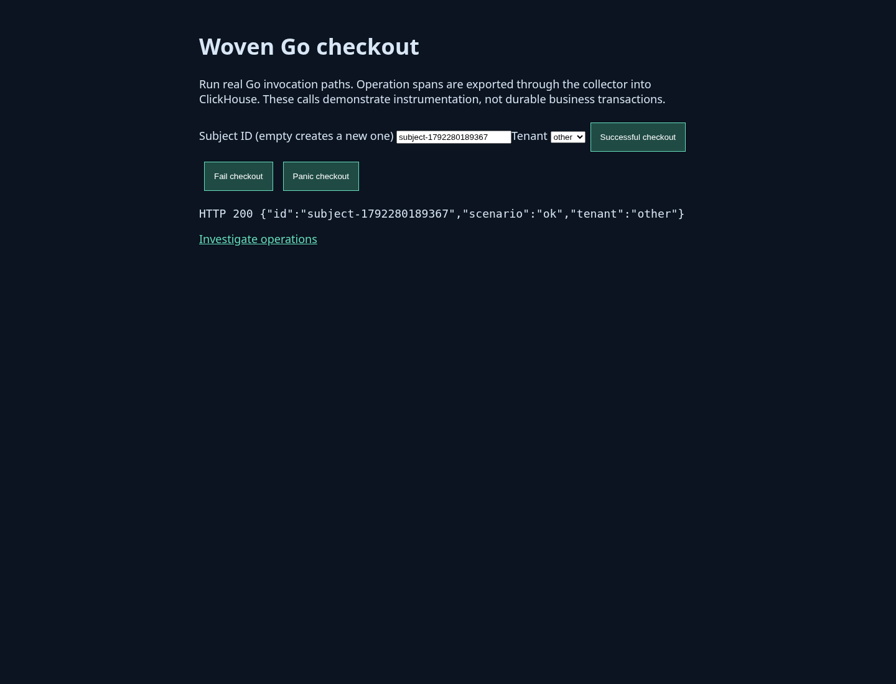
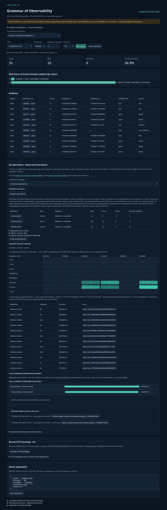
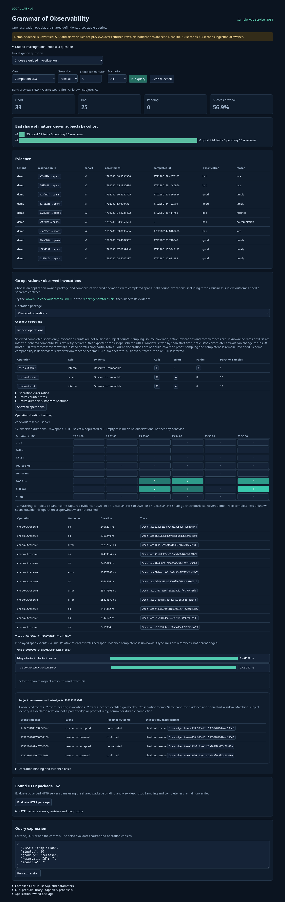

# Scoped subject navigation across operation traces

The operation explorer now exposes declared `//goo:event` span events. Open an
operation trace, inspect its observed subject events, and select **Follow subject**
to find event-bearing invocations across traces in the same captured evidence.

The subject key is the structured tuple **environment, service, namespace, tenant,
ID**. A match on ID alone is insufficient. Instance is not part of the business
key, although the current live adapter still selects one explicit instance.
These keys describe application-declared identity, not verified business truth.

## Real user storyboard

Playwright journey 10 exercises the actual woven Go app, collector, ClickHouse,
Go source adapter and browser:

1. In the sample app, enter a subject ID and select tenant `demo`. Submit two
   successful invocations using that ID. Each request starts a separate trace.
2. Change tenant to `other` and submit the same ID again. It must remain a distinct
   subject. Empty IDs now generate fresh random IDs; the former constant sample
   ID would have incorrectly collapsed every successful call.
3. In the investigation UI, inspect reserve calls and open one demo-tenant trace.
   It contains observed `reservation.accepted` and `reservation.terminal` events.
4. Select **Follow subject demo/reservation/…**. The timeline contains four events
   from two event-bearing invocations and two traces. The other tenant's trace is
   excluded. Open the second related trace without issuing a new operation query.





Run `npm run test:journeys` with the default stack. This extends the prior
[operation duration/trace journey](OPERATION_DRILLDOWN.md).

## Runtime and binding

The optional runtime helper attaches scope to subsequent annotation events:

```go
ctx = instrumentation.WithSubjectScope(ctx, "reservation", tenantID)
// Calls of annotated functions using ctx now emit namespace/tenant alongside
// goo.subject.id and optional goo.subject.outcome on their parent span events.
```

An explicitly supplied invalid scope is a diagnosed dropped event. Existing
unscoped callers still emit their events; the source adapter leaves those events
unlinked with a diagnostic. Namespace/tenant/subject values are never added as
metric dimensions by this helper.

The local YAML operation package explicitly declares `subjects.namespace: reservation`
alongside its service/environment/instance/library binding. The adapter reads
ClickHouse's nested event timestamp/name/attribute arrays, preserving exact
reported event-time nanoseconds. Arrays must align, and event times must lie
within the parent span extent; malformed source evidence fails the report.

Only event names declared in the source manifest can establish a subject relation.
The event name attribute must agree, the namespace must match the binding, and
tenant/subject identity must be present and bounded. Unsupported/unbound identities
remain visible with a diagnostic and no subject link. Source shape and namespace
bindings now come from [validated YAML operation packages](OPERATION_PACKAGES.md);
this is not a general relation-package resolver.
The exporter still drops instrumentation schema URLs; compatibility remains declared.

## Interpretation limits

This is navigation over observed events, not a lifecycle evaluator. A reported
terminal outcome does not prove transaction commit or durable completion. Repeated
event observations are preserved: there are no immutable event IDs establishing
business-event deduplication. Source copies of a parent span are still deduplicated
by the existing exact-record rules. Event time orders the display, not a proven
causal order across clocks. Related invocations are not automatically retries.

Only **event-bearing invocations** are joined. A failed call before an event is
emitted cannot be linked from absence or temporal proximity. A trace-context view
may include its other operation spans; those spans are context, not additional
subject-event matches. Parent/child relationships continue to use trace/span IDs.

All navigation retains the original resource/library/span-start window and
content-derived evidence basis. It does not search outside that captured response,
fetch a complete distributed trace, cross service identity authorities, establish
sampling/completeness, or persist an immutable custody snapshot. Events may fall
after the query's upper span-start bound when their parent started inside it; the
window remains defined by parent start time, not event time.

## Verification

Go source tests cover scoped normalization, missing identity fields, missing
bindings, mismatched event arrays and event times outside the parent span. An
actual OTel SDK test checks runtime scope attributes and rejects invalid scopes.
Node tests preserve repeated events, exact reported time ordering and separation
of every key component, including delimiter-collision cases.

Hegel generates 100 cases against the actual browser subject-selection kernel,
comparing results with a Go reference. The navigation Quint fixture now has five
actions: errors → cell → trace → subject → reset. quintgo validates observed
membership and retained evidence; deliberate wrong-cell and cross-tenant
memberships must both fail. This is a bounded kernel model, not a formal proof
of all UI behavior or subject semantics. Reports, observed steps and an ITF trace
are retained under artifacts/verification/subject-navigation*.

```sh
npm run test:visualizations
cd verification
go test -run 'TestRuntimeSubjectScope|TestHegelSubjectScopeIsolation|TestQuintObservedOperationNavigation' -v .
```
