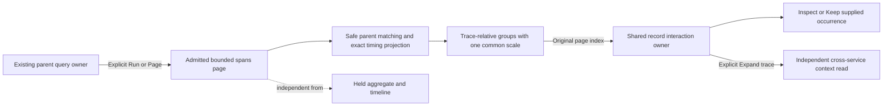

# Inspect timing in supplied spans

[Records-only compositions](RECORD_ONLY_VIEWS.md) reuse these displays and shared
record actions without an aggregate or grouping. No additional public component
is introduced; the application retains query, execution and paging ownership.

> Implemented in milestone 301. Executed checks are recorded in
> [VALIDATION.md](../VALIDATION.md#supplied-span-waterfall-records--301).

In a composed spans view, choose **Span waterfall** for the records child. It
presents the same bounded record page as Table or List. The question, source basis,
qualified fields, parent pager and held aggregate/timeline remain with their
existing application owners. Changing presentation reads no telemetry. Logs and
metrics cannot use this kind, including through hidden or reusable declarations.

[Captured span pages](CAPTURED_SPAN_PAGES.md) reuse this same kind from their
Table/Span waterfall choice. They supply only the checked current stored page;
local Inspect keeps its exact original occurrence, while fresh trace expansion
remains a separately labelled source read. Stored paging does not fetch omitted
telemetry or imply complete trace coverage.

The task is to see where time went in the supplied spans, inspect an observation
and Keep it or explicitly expand its trace when more context is needed. A bar is
an Inspect control in the application. Selection and Expand trace controls sit
beside it; interactive controls are never nested inside the bar button. Pending
record selections/submissions retain the current presentation-change guards.

## Comparable timing, explicit origins

Valid trace groups use their earliest **timed supplied** span as a relative origin, with
one common duration scale across all groups. Five milliseconds and 500 milliseconds
remain visually comparable within the page even if their traces occurred minutes
apart. The scale is derived from this supplied page and can change when paging;
use the stated bounds and exact values for comparisons across pages. Absolute
UTC origins and exact nanosecond values remain available; chart coordinates are an
approximate projection after exact integer subtraction.

An origin is not the real trace start, and the displayed fragment extent is not
complete trace latency or critical-path time. Async links do not create parent
edges. The page does not prove complete upstream telemetry or unique invocations.

Parent edges require unambiguous reported IDs within a valid trace. Missing parents,
duplicate/ambiguous parents and cycles remain explicit. Invalid or unreported trace
IDs are isolated occurrences, never combined into an implied trace. Missing/invalid
timing remains unavailable, not zero: the observation and its details stay present,
but it cannot establish the common scale. A recorded zero duration stays distinct.

## Page positions survive visual order

Parent-first visual order can differ from source-page order. Inspect, selection
and Keep use the original page position under this exact read, including duplicate
records. Neither trace/span IDs nor visual row order become durable event IDs.
Paging replaces that owner; reattached or delayed controls from the old rendering
cannot act on the new page. Record paging retains held aggregate/timeline bases.

The existing explicit **Expand trace** action is a separate cross-service read in
fixed bounds. A kind toggle never broadens service filters, fetches missing parents
or silently joins another trace page. Save, template reuse and staged reopen retain
this display through the existing view catalog and query owner.

## A passive reusable component

The pinned kind is `record-span-waterfall`, version 1, in the existing records role.
It uses the same UTC/summary/core columns and at most eight qualified fields as
Table/List. Resource and span attributes with the same name remain distinct;
missing, empty and null values retain their existing formatting. The Context
toggle controls the per-record ancestry disclosure; intrinsic trace-group identity
remains visible. Small positive durations below display precision use a less-than
label rather than appearing to be recorded zero.

`goo-record-span-waterfall` accepts `.page` and `.display` properties and equivalent
JSON attributes for server HTML. Detached property updates work before connection.
Default timing clicks reveal supplied details only. Serialized data grants no
source or publication authority. Application adapters explicitly use page-local
`.recordItems()` mounts; handles are indexed by original page position even when
DOM order differs, and expire on page/display replacement.

The shared waterfall geometry also stops choosing an arbitrary duplicate parent in
existing trace displays. Their established global origin remains the default;
the record kind explicitly chooses trace-relative origins and the common scale.

See [record interaction ownership](RECORD_INTERACTIONS.md),
[architecture review](reviews/SUPPLIED_SPAN_WATERFALL_ARCHITECTURE_301.md) and
[design review](reviews/SUPPLIED_SPAN_WATERFALL_DESIGN_301.md).
