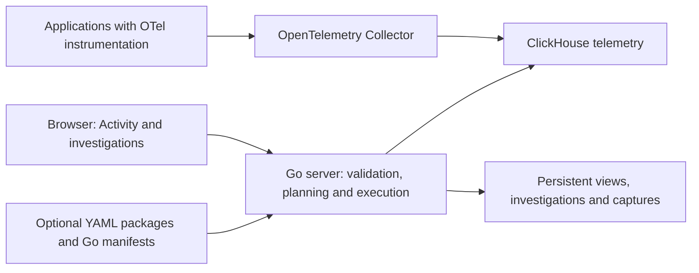

# How Goo works

Goo is one Go server that serves an embedded browser interface and an HTTP API.
It reads telemetry already stored in ClickHouse and separately stores reusable
configuration, investigations and captured observations.

## From activity to an investigation

Activity displays a bounded stream of logs or spans. Filters and selections define
the population to inspect. Fixed questions add an explicit time window and measures;
Run validates and executes them against source adapters. Charts, tables and
waterfalls render the returned data, while application controllers own source
reads, navigation and scope changes.

A child investigation retains its parent so Back can restore the observations and
local selections already on screen. New source reads stay explicit. Full-query
aggregates and a page of displayed records remain distinct.

## Configuration and captured observations

Saved questions and views describe work to run again. Captures retain observations
and their read context; reopening them does not query telemetry. Investigation
findings can link these artifacts and add notes or labels. Source time, read time
and capture time remain separate.

## Definitions and extensions

Ordinary OTel data is usable without application declarations. Optional measurement
and operation packages add checked meaning to that data. Go annotations and weaving
can emit application-specific OTel signals; they are an opt-in instrumentation
path, not a requirement for other languages.

Reusable UI displays consume supplied data. Query execution and storage remain in
the host application. See [shared components](UI_COMPONENTS.md),
[measurement packages](MEASUREMENT_PACKAGES.md), and the [API](API.md).
The [detailed diagrams](ARCHITECTURE_DIAGRAMS.md) distinguish implemented paths
from production patterns and proposed extensions.
