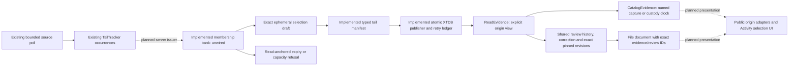

# Exact Activity selection: backend custody prerequisites

Status: the bounded membership bank and typed idempotent XTDB publisher are Go
backend libraries, **unwired to SSE and publication HTTP**. Origin-aware Go
catalog/read views and shared review/correction/pinned-document resolution are now
implemented. The public manifest/catalog routes and browser citation inspector
still require captured result pages. Exact Activity selection and browser retry
recovery are not yet available.

The concrete task is to preserve up to 20 observed Activity log/span occurrences
without rereading telemetry. This is observation custody, not unique physical-event
identity, complete trace capture, a population denominator or classifier training.

## Existing contracts and the gap

| Existing path | What can be reused | What cannot be assumed |
| --- | --- | --- |
| `Source.PollTail` / `TailTracker` | Bounded rolling read, exact record fields, per-connection multiplicity handles and late-event diagnostics. | A hash/ordinal handle is not durable membership. The same handle can recur in a new connection. Polls have distinct windows/read clocks; no ingestion cursor or replay. |
| `ResultSnapshots` | Immutable server-owned bytes, short-lived capabilities and explicit capacity refusal. | It holds a whole fixed `Result` page. It cannot represent a mixed-poll tail selection or supply fabricated aggregates. |
| `retention.Manifest` v1 | Saved/result-page selection, exact JSON payloads, immutable publication and meaning revisions. | It requires an actual capture/result-page origin. The validator deliberately rejects a tail origin. |
| `Store.Publish` / `RecoverSelection` | Transactional request-intent binding, atomic receipt publication, committed-request recovery after source-page expiry, and distinct read/custody clocks. | `RecoverSelection` verifies capture/result-page indexes. It cannot recover tail references without a new origin-specific contract. |
| Native browser retry journal | Reuse the immutable-intent lifecycle after a server publisher supports it. | Browser state does not establish server membership or make arbitrary writes idempotent. |

Current `/tail` reset/batch payloads issue no membership capability. Current
`GooTail.snapshot()` omits per-row provenance from its public handoff. `/retained-evidence`
accepts only saved capture IDs or fixed result tokens and indexes; it rejects client
records and tail-reference fields. These boundaries remain enforced.

## Implemented Go primitive

`exploration.NewTailMembershipSnapshots(clock)` creates an isolated process-local
bank. It is constructed explicitly; no global bank or route is registered. Its
only issuer is intended to be the server's existing validated source-poll path.
Calling it with arbitrary browser record payloads is not an admissible integration.

`Freeze(TailMembershipBatch)` freezes connection ID, normalized selector, original
half-open read window, observed/read clock, limited flag and emitted `TailRow`s.
The batch is copied; later caller/response mutations cannot change the bank.
Canonical record encoding uses the existing tracker convention: sorted object keys,
JSON number tokens retained through `UseNumber`, no float coercion. A valid handle
must match the canonical payload hash plus its positive occurrence ordinal. Event
timestamps must lie within the original poll window.

`Resolve(connection, selector, refs)` accepts only server-issued tokens and handles.
It resolves all references under one lock or returns no draft. Selector normalization
covers the default signal and Go JSON defaults, not arbitrary Boolean equivalence. The result retains
per-member window, read clock, basis, late/limited flags and canonical payload.
Sorting references makes retries/order changes deterministic. Identical payload
occurrences with different ordinals stay distinct; selecting the same occurrence
through two tokens is rejected. Mixed connections or selectors are refused.

The `TailSelectionDraft` version/digest describes ephemeral proof, **not a persistent
retained manifest or receipt**. It has no manufactured `SavedCapture`, aggregate
count, custody clock or physical event ID. Source corrections cannot change already
frozen bytes; later observations require their own provenance.

| Bound | Current primitive |
| --- | --- |
| Read window | Original 60-second half-open tail window. |
| Capability expiry | Two minutes after the original observed/read clock, not after issuance or last access. Delayed issuance cannot renew it. |
| Batch | 1..1,000 emitted observations; at most 1 MiB serialized provenance/payload. Raw input is bounded before decoding. |
| Bank | At most 64 batches and 8 MiB. Expired entries are pruned; capacity refuses new issuance without evicting valid proof. |
| Selection | 1..20 unique occurrences, one connection/selector, at most 2 MiB. |
| Failure | Missing/expired/unproven members reject the whole selection. No partial draft, source query or reconstructed payload. |

The bank is thread-safe; its injected clock must itself be safe for its callers.
Tokens are process-local opaque capabilities, consistent with the existing lab's
result-page bank. They are not authenticated user identities. Restart loses
uncommitted proof. Disconnect does not renew or revoke a capability; a selection
can still name its original connection until its original expiry. A different
connection must not silently rebind it.

## Implemented backend publication and retry contract

`retention.TailManifest` (`goo/tail-evidence/v1alpha1`) embeds the exact resolved
selection, with a deterministic immutable ID and structural/integrity validation.
`Store.PublishTail` accepts only `TailIntent`: a version, request ID, original
connection/selector, bounded references, tags and note. It resolves server proof;
it never accepts a client draft or record payload. Reference ordering and omitted
`logs` normalize before intent hashing. Tags and note bind exactly as supplied.
Request data is deeply owned before sorting/database access.

`goo_tail_evidence` and `goo_tail_requests` hold the typed manifest and receipt in
one asserted transaction. A receipt includes the initial meaning revision,
independent custody clock and returned XTDB read basis. The initial revision lives
inside that immutable receipt. Shared annotation history and corrections now
resolve this origin without copying or rewriting that initial revision. A before-commit interruption rolls back both tables; a
commit followed by lost acknowledgement recovers the same original receipt.
`LoadTail` remains a strict typed reader; `ReadEvidence` now resolves all supported
origins explicitly. Existing `Load` and the HTTP-owned `Catalog` continue to require
v1 captures/result pages. Their formats, hashes, validators and cursor bytes remain
unchanged. Shared `Annotations`, `Annotation` and `CorrectOnce` now also support
tail evidence, including exact review resolution during document creation.

This bounded cut intentionally isolates the new protocol before extracting shared
transaction mechanics: existing v1 request hashes bind a manifest, whereas tail
requests must bind references before proof resolution. Combining those protocols
prematurely would risk changing legacy retry identity. Shared backend catalog and exact review readers now understand the origin. Public
manifest/catalog adapters and citation presentation must do so before the UI
advertises durable Activity evidence.

A proposed `POST /retained-tail-evidence` request contains a version, client request
ID, original connection/selector, bounded token/handle references, tags and note.
It contains no client rows, hashes, basis, read windows or clocks to trust. The
server constructs those fields from its bank. The request ID binds the normalized
selector, sorted exact references and original tags/note; editing the intent
requires a different request, never silently changing a pending retry.

| Server outcome | Required behavior |
| --- | --- |
| Same request already committed | Return its original durable evidence/annotation identity even after capability expiry or process restart; do not resolve the bank or reread telemetry. |
| Same request ID, different intent | Refuse a conflict. Do not overwrite or republish the first intent. |
| Definitely uncommitted and proof valid | Resolve all members, validate the new manifest, atomically publish evidence + request intent + receipt. Record custody time independently of each read clock. |
| Definitely uncommitted and proof unavailable | Refuse expired/unavailable membership. Do not create a replacement source read or accept a client payload. |
| Request store unavailable / commit outcome unknown | Preserve the same pending intent and return retryable unavailability. Absence of a response is not proof of no commit; do not generate a new ID or claim simple expiry. |
| Issuance capacity exhausted | Future SSE should mark exact-preservation capability unavailable while normal observation can continue. Never advertise a capability that was not frozen. |

The existing saved/result-page transaction tests verify the reusable mechanics:
interruption leaves no partial publication, concurrent attempts converge, and an
already committed selection can be recovered after page expiry. They do **not**
prove durable tail publication. The tail publisher now separately passes lost-ack, changed-intent, expiry,
unavailable-store and concurrent retry checks. These backend guarantees do not
claim the unwired browser journal or public origin readers are implemented.

## Planned user storyboard — not implemented

1. Activity receives server-issued connection and optional batch capability metadata.
   Each buffered observation retains its own reference/window/read clock; the latest
   global poll window must not replace earlier members' provenance.
2. Pause and select up to 20 observations from one original connection/selector.
   The held selection is local, with an explicit exact-preservation expiry. Eviction
   from the scrolling buffer does not turn a handle into saved evidence.
3. Preserve selected observations prepares one immutable request intent and sends
   exact references. A pending journal retains that intent across lost responses.
4. A committed receipt promotes the selection to saved evidence with independent
   read/custody clocks. Reload retry can resolve that receipt without source reads.
5. Expired, definitely uncommitted proof stays unavailable. Inspection can retain
   local context; an explicitly named new fixed read is a separate action.
6. Catalog, documents and pinned reviews reference the new origin explicitly.
   Corrections create new meaning revisions; original observation payloads stay fixed.

Future Playwright/Bombadil acceptance must exercise duplicate payload occurrences,
late observations across polls, limited batches, buffer eviction, disconnect and
reconnect, scope changes, expiry, lost acknowledgement/reload and store outages.
No UI screenshots are fabricated for these planned steps. Existing live-tail
storyboards remain the implemented interaction.

## Executed evidence

- Go unit checks cover duplicate occurrences, exact numeric tokens, per-poll clocks,
  late/limited flags, input/output isolation, stable resolution, wrong scope,
  duplicated/forged/partial references, read-anchored expiry, delayed issuance,
  restart, count/byte capacity and concurrent issuance/resolution.
- Go race detection passes for the membership bank.
- Hegel state/swarm executes the actual bank across issue/advance/resolve sequences,
  with TTL invariants checked after every action; existing tail multiplicity
  properties remain separate.
- Observed Quint replay executes issue → resolve members → expire → refuse through
  the real bank. Four controls reject wrong counts, forged availability, changed
  member windows and accepting expired proof. This is a membership model, not a
  model of the separate durable publisher.
- Existing XTDB interruption, concurrent recovery and expired fixed-page recovery
  integration checks pass. Legacy origin/HTTP guards remain strict.

Actual commands/results and retained artifacts are in [VALIDATION.md](../VALIDATION.md).

### Typed publisher evidence

- Unit checks preserve mixed-poll windows/read clocks, late/limited flags, duplicate
  occurrences and exact numbers; canonical draft/manifest validation rejects a
  semantically invalid member even after both integrity digests are recomputed.
- Actual XTDB tests roll back an interrupted transaction with no partial evidence,
  lose the post-commit acknowledgement, discard the bank and recover the original
  annotation/manifest/custody clock. Changed intent conflicts; absent expired proof
  refuses; concurrent publication converges. An unavailable store is never reported
  as expired proof. `LoadTail` resolves the origin and the v1 reader refuses it.
- Hegel checks durable serialization and validity after ephemeral proof expiry.
  Observed Quint replay uses actual XTDB publish/recover/conflict/absent outcomes;
  four altered-output controls must be rejected. This bounded model does not prove
  HTTP, catalog, correction, SSE or browser behavior.

## Shared origin readers and review lifecycle

`ReadEvidence` returns a validated origin discriminant (`saved-capture`,
`result-page`, or `tail-selection`) and exactly one original typed manifest. It
never synthesizes a `SavedCapture`, aggregate count or fixed question for tail rows.
Only definite absence permits trying another origin; unavailable/corrupt data and
ambiguous IDs fail instead of falling back successfully.

`CatalogEvidence` is a separate Go catalog for all supported origins. It shares
pagination/cursor mechanics and exact service extraction with the legacy catalog;
the previous catalog's cursor bytes are frozen in a compatibility fixture.
Each item names its clock: `captured-at` for v1, `retained-at` for the earliest
recorded custody timestamp among tail publication receipts. This is recorded
application-clock metadata, not an inferred first ingestion/commit time. `From/To`
filter that named clock with half-open bounds; event time and per-poll read clocks
remain in the original manifest. Missing and empty services remain distinct.
Tags come from active review heads. Changing origin/filter or returned catalog
metadata invalidates the cursor; no atomic cross-query snapshot is claimed.

Tail roots remain in their original immutable request receipts; corrections use
existing `goo_annotations` and idempotent correction requests. New tail requests
add a `manifest_id` lookup projection without changing intent hashes or receipt
bytes. Old requests without that projection are decoded under explicit bounds,
not migrated on read. A complete history merges and deduplicates roots/revisions,
keeps branch heads/withdrawals distinct and rejects missing parents. Pinning a
review resolves the exact revision, not the current head. Retrying original
publication after a withdrawal still returns its original receipt; it does not
reactivate a review or change the manifest.

| Backend scan | Bound/refusal |
| --- | --- |
| Combined origin manifest catalog | 1,000 manifests / 16 MiB; fail without a partial catalog. |
| Tail receipt roots (all for catalog; matching or unprojected for a target) | 1,000 requests / 16 MiB; fail instead of silently omitting old roots. |
| Shared catalog annotations | 10,000 revisions / 64 MiB including manifest bytes. |
| Target history | 1,000 unique merged revisions; shared annotation input also limited to 1,000 / 16 MiB. |

The native integration fixture removes its own request's projection to exercise
the old row shape, verifies history/correction/pinning and confirms the original
receipt payload never changes. File documents can resolve/preserve these exact
IDs through the shared backend resolver and load offline. Their existing browser
citation inspector still expects a captured manifest; its tail adapter remains
planned. Unknown/cross-target review IDs, unavailable stores and missing custody
roots are refused.

Observed Quint replay executes actual publish → correct → withdraw → retry-original
reads from XTDB. It checks heads, active state, catalog visibility, exact pinned
review and unchanged manifest, with four rejecting controls. Hegel additionally
rejects relabeling a typed tail view as a capture. Pure catalog fixtures cover
clock/filter boundaries, missing/empty services, pagination and stale cursors.

Next: implement explicit public read/catalog and citation presentation adapters,
then issue SSE capabilities and connect selection/retry UI. No Activity browser
journey or screenshots are claimed by this backend milestone.
