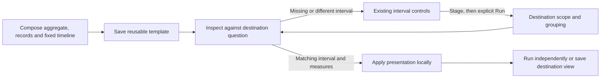

# Reuse a view with its timeline

> Implemented in milestone 299. Executed checks are recorded in
> [VALIDATION.md](../VALIDATION.md#time-aware-reusable-templates-and-whole-flow-checkpoint--299).

A reusable view can retain the existing fixed timeline beside its aggregate and
records. Use the composition's interval-width controls to stage a query with a
supported width, then Run explicitly. Choose the existing timeline presentation
and measure; enable Reusable template and Save in the existing view catalog.
No new template store or timeline query owner is introduced.

The template binds its category to the destination's existing single grouping.
It retains the source composition's child order, visibility, timeline kind,
count/mean/p95 measure, title and complete-only display requirement. The source
query is a validation specimen: its service, environment, predicates, time bounds
and rows never become defaults for the destination.

## Apply in another scope

Inspect the saved template against the current destination. The preview identifies
its timeline measure, required interval width and the destination's current width.
Apply is available only when both queries explicitly use the same supported
positive width and the destination supports the chosen measures.

If the interval is missing or differs, use the existing composition interval-width
controls to stage the matching width, then Run and inspect the template again.
For a destination without a composition, first use the existing Compose aggregate
and records action. No compatibility check silently adds a time aspect, changes
the current width or reads telemetry. Hidden timelines obey the same contract.
The normal interval-count limit and query validation remain in force.

Apply changes presentation locally over the current supplied data. Run remains an
independent source read. Record paging retains the held timeline/aggregate basis;
a newer record-page count does not reconcile or refresh those measurements.
Save/reopen preserves the configured destination view and stages it for explicit
Run. Interval/range gestures still use the current population owner and exact UTC
bounds, including clipped final intervals.

## Scope and guarantees

The supported profile remains one ordinary single-query grouping with aggregate,
records and an optional timeline. Count and query-supported span-duration timeline
measures reuse their existing units and denominator semantics. Complete-only
requirements are preserved, never synthesized from serialized configuration or a
bounded record page. Complete supplied query accounting is not proof of complete
upstream telemetry.

Grouped time-series, numeric/histogram and reported-edge profiles remain outside
this authored-template cut. The original 299 cut excluded capture comparisons;
[300](COMPARISON_VIEW_TEMPLATES.md) permits the existing count comparison with an
explicit destination-baseline input and separate evidence verification. Refusals preserve the current
question and configuration; nothing is silently stripped. Saved canonical
presentation remains the supported UI preview input; general unsaved-source
canonicalization is separate work.

See [authorable templates](AUTHORABLE_VIEW_TEMPLATES.md),
[architecture checkpoint](reviews/WHOLE_FLOW_ARCHITECTURE_299.md) and
[design checkpoint](reviews/WHOLE_FLOW_DESIGN_299.md).
