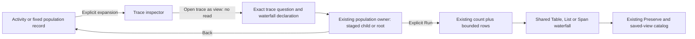

# Open a trace as an editable view — 303

> Delivered in milestone 303. Executed checks are recorded in
> [VALIDATION.md](../VALIDATION.md).

An inspected trace can become an ordinary editable records view. Use **Open trace
as view** after the inspector has read the trace. The action stages a spans-only
Waterfall in the existing population workspace; **Run population view** explicitly
acquires its count and bounded rows. Table/List, qualified record fields, paging,
Inspect/Keep and Preserve use their existing controls.

The handoff carries question intent and presentation only. It keeps the checked
environment policy and fixed time bounds, selects the exact reported trace ID,
and starts at offset zero. The originating service, search filters, inspector
summary/grouping options and current page offset do not restrict the new trace
question. It copies no inspector rows, basis, count, read clock, selection token,
completeness claim or selected occurrence into the new view.

## One navigation owner

From a population record, the existing population owner stages a child and keeps
its parent read. Returning uses the same parent/focus lifecycle as other child
views. From Activity or ordinary fixed exploration, the existing exploration owner
stages the view. Opening it does not resume Activity or invoke the inspector's
ordinary close-and-return callback over the newly staged screen.

The command belongs to the current successful inspector read and current opener.
Pending/failed/replaced reads and retired or hidden controls cannot stage an old
trace. An unavailable destination owner leaves the inspector usable rather than changing
the question or navigating to another owner. The display components remain passive; the handoff adds no
endpoint, subscription, query store or capture owner.

## Save configuration or preserve a finding

Preserve saves the editable question and presentation using the ordinary saved
view catalog. Reopening stages it for explicit Run. This differs from an existing
trace finding, which retains an explanation and its independent evidence custody.
Opening a view neither captures new evidence nor publishes a finding.

See [records-only views](RECORD_ONLY_VIEWS.md),
[shared record interactions](RECORD_INTERACTIONS.md),
[architecture review](reviews/TRACE_VIEW_ARCHITECTURE_303.md) and
[design review](reviews/TRACE_VIEW_DESIGN_303.md).
