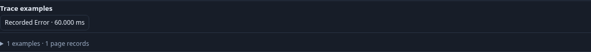
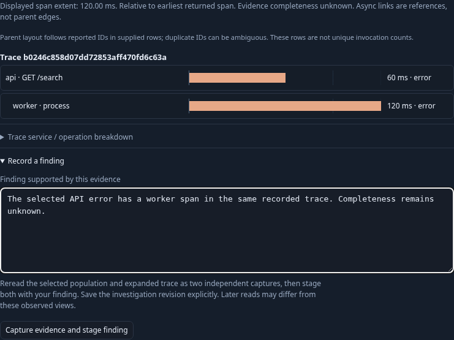
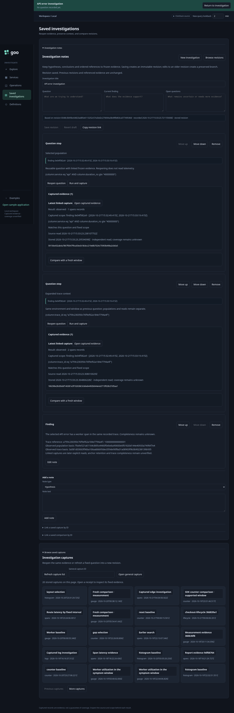

# From a population to a trace finding

Services presents its overview and operation diagnosis first. Signals and
operations, suggested questions and native instruments are supporting disclosures.
Following an operation stages its fixed question; running it and selecting a
population use the same checked record-question transforms as other exploration.

Span results now offer bounded **trace examples** chosen by Go from the returned
record page: the longest recorded Error span, longest linked span and shortest
linked span, with each trace ID included at most once. Duplicate choices are
skipped rather than replaced. Durations compare as exact uint64 values, including
values above JavaScript's safe integer range. Invalid identities, timestamps and
durations are excluded and counted. These examples are not a statistical sample,
a full-population latency ranking, a root span selection or a completeness claim.
Changed-between-reads evidence withholds examples. Capture pagination recomputes
examples from each frozen page; older captures without this metadata stay usable
without silently acquiring newly derived evidence.

Expanded trace waterfalls include an [observed-page interval breakdown](TRACE_PAGE_TIMING.md).
It unions each span's observed direct-child intervals, preserving unavailable
calculations for ambiguous identities or incompatible timing. Page-only grouped
inclusive/outside sums retain coverage counts and exact row highlights, separate
from the full-query aggregate. Selecting a diagnostic row uses the existing span
inspector and linked-log read. Group highlighting and disclosures are local;
missing children do not become verified exclusive time or a critical path.

Opening an example uses the existing trace expansion: the environment and fixed
window stay unchanged, while population filters are replaced by an exact trace-ID
predicate so other services can appear. The original question and observed basis
remain attached to the investigation context.

**Record a finding** accepts an authored statement and explicitly rereads the
selected population and expanded trace as two independent captures. It stages two
existing question cards linked to those immutable captures, followed by a finding
note containing the trace/span references and both original observed bases.
The note distinguishes those observed views from the later capture reads; anchor
continuity is checked against the returned retained trace page using both reported
trace and span IDs. The persisted note distinguishes a match (including matching
row count), no match on this page, and unavailable/malformed or mismatched-scope
rows. A page miss never means the reference is absent from the capture. Additional
retained pages and retained-subset limits are stated when present. Matching IDs
establish neither a unique occurrence, unchanged attributes nor a complete trace. **Save revision** is a
separate explicit action. No new document/card schema or evaluator is introduced.

If a capture fails, successful captures remain accessible through recovery links;
no partial finding is staged. Changes to the trace context or investigation draft
during capture prevent staging into the wrong document. The three-card operation
checks the document budget before mutating the draft. Reopening the saved revision
reads stored evidence without rerunning the source question.

```mermaid
sequenceDiagram
    participant UI as Service / Explore
    participant Go as Go query adapter
    participant CH as ClickHouse
    participant Store as Immutable evidence store
    UI->>Go: Run fixed population question
    Go->>CH: Aggregate + bounded records
    CH-->>Go: Population measures + page
    Go-->>UI: Result + exact page trace examples
    UI->>Go: Expand exact trace in same environment/window
    Go->>CH: Cross-service trace records
    Go-->>UI: Trace context + basis
    UI->>Go: Capture population, then trace (explicit independent reads)
    Go->>CH: Reread each question
    Go->>Store: Retain each successful capture
    Go-->>UI: Two retained capture pages (or recoverable partial failure)
    UI->>UI: Check selected reference in returned trace page; stage finding
    UI->>Store: Save revision (separate user action)
```

Executable storyboard: [journey 87](../journeys/trace-finding.spec.js). The generic
API/worker fixture uses ordinary OTel attributes without goo manifests. It checks
partial capture failure, explicit saving, separate capture scopes, cross-service
trace expansion, stored reopening and mobile overflow. The companion Bombadil
actor exercises example navigation and composing a finding without publishing.
Hegel generates bounded-page selections and existing immutable-history state/swarm
checks cover linked revisions. The live ledger replays through the existing Quint
linked-evidence model using quint-go; rejecting controls change environment, time,
trace reference, evidence links, source-read count on reopen, missing anchor rows
and a falsely reported anchor outcome. No capture wire schema or old bytes change.





## Related supplied-page comparison

The approved [trace-page comparison cut](TRACE_COMPARISON.md) is in progress. It
uses an explicitly held reference page and a separately expanded current trace.
Repeated service/operation labels remain ambiguous; a unique reported label and
kind is only an alignment candidate. The existing finding publication path and
stored capture fields remain unchanged. See the current roadmap for acceptance
status before treating the new UI as delivered.
