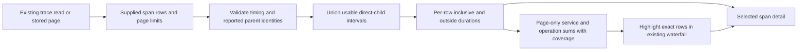

# Trace page interval breakdown

Implemented with reviewed source and actual OTel/browser/native acceptance. The
existing waterfall includes a compact breakdown of the supplied span page, with exact
span selection and service/operation highlights. No new query type, endpoint,
store or capture wire field is introduced.

## What is measured

Use only the public row fields `timestamp_ns` and `duration_ns`, both canonical
uint64 decimal strings. The reported interval is half-open: `[start, start +
duration)`. Zero duration is valid; an end beyond uint64 is unavailable. Do not
fall back to another timestamp alias or coerce a number into an exact string.

For a usable span, union its observed **direct** children's intervals and
subtract that union's length from its own duration. Concurrent children must not
be subtracted twice. Grandchildren contribute through their direct parent, rather
than being subtracted again from an ancestor. Async links remain references and
never become parent edges.

The result is **duration outside observed direct-child intervals**. It is not CPU
time, verified exclusive service time, trace wall time, request count or a critical
path. Missing spans, sampling, window bounds and page limits remain unknown even
when the calculation succeeds. Earlier omitted pages or a further page are
explicit partial-page context; neither a final page nor an absent parent proves
trace completeness.

## Uncertainty is local

Retain every original row index, including unusable rows. Reported inclusive
duration remains known when its duration field is valid even if identity or start
time prevents interval accounting. Preserve unavailable values as unavailable,
rather than substituting zero.
Malformed row metadata, including nonstring service/operation values, withholds
interval authority conservatively; a valid reported duration remains available.

- Duplicate trace/span identities are ambiguous; do not deduplicate or choose a
  winner. Affected rows and parents whose child relationships are ambiguous have
  unavailable child-union/outside durations.
- Cycle members, invalid intervals, end overflow and unusable direct-child edges
  withhold the affected calculation. A valid ancestor is not invalidated merely
  because a child's own residual is unknown if that child's interval and edge
  remain usable.
- A parent outside the supplied page is a diagnostic. It does not prevent
  calculating a span's own observed child coverage.
- A child interval extending beyond its parent withholds the parent's child-union
  and outside durations. Do not silently clip, repair timestamps or diagnose a
  clock failure: asynchronous children can legitimately outlive parents.

## Presentation and ownership

The Go pure model defines the interval contract and supports server rendering or
other Go consumers. A parity-tested JavaScript display projection consumes the
same supplied rows. Passive web components emit row/group selection intents;
application adapters own highlighting, inspection, navigation and any reads.
Opening disclosures and highlighting groups are local. Selecting a diagnostic
row uses the existing span-inspection action, including its existing explicit
linked-log read. There is no additional latency-evaluator query. Current-owner
guards reject hidden, closed, detached or superseded controls before selection,
inspection or that linked-log read.

Group only these supplied rows by exact service/operation tuples. Missing values,
present empty strings and literal placeholder-looking names remain distinct.
Inclusive sums include every known reported duration, including duplicate rows;
outside-duration sums include only computable rows. Show known/unavailable row
coverage for both, and leave a wholly unavailable sum undefined. Sums use exact
integer strings and may exceed uint64. Both kinds of sums can overlap across
spans and groups; do not normalize them into shares of trace wall time.

Keep the existing all-matching service/operation aggregate visibly separate: it
is an independent source query, whereas this breakdown explains a bounded page.
Display durations in readable units with exact nanoseconds in tooltips. Preserve
original row identities, waterfall geometry and async-link behavior. The passive
component can project supplied stored rows without changing captured bytes or
claiming newly captured measurements. The current saved-capture surface reopens
the raw record table source-free; its **Expand trace** action still performs the
existing fresh context read. This milestone does not add a stored-waterfall UI.

Acceptance covers deterministic ordinary OTel spans with overlapping/nested
children, malformed and partial graphs, exact Go/JavaScript parity and independent
generated interval oracles, passive SSR/SPA cases, real source/stored journeys,
Bombadil, finite trace replay with rejecting controls, updated actual frames and
independent source/design/evidence review. Finite replay validates observed
schedules rather than exhaustive interleavings, complete traces or synchronized
clocks. Executed receipts and diagnostics are in [VALIDATION.md](../VALIDATION.md).

Reviewed source is `c1c29ef` (Go model, JavaScript projection and shared fixtures)
and `3934986` (passive display and application integration). `94722e7` adds the
explicit closed-ancestor guard and inspector-width layout with equal physical
bar tracks. All 74 Node files, real main/graph/ownership journeys, synthetic
SSR/SPA and the 55-second actor pass. Independent properties cover 150 generated
examples and eight authority boundaries; all 80 native rejecting controls pass
over 7/6/3-action observed traces. Raw capture bytes remain unchanged. The
[storyboard](../journeys/184-trace-latency-breakdown-storyboard.md) links final
desktop/mobile frames and distinguishes real source evidence from synthetic
component tests.
