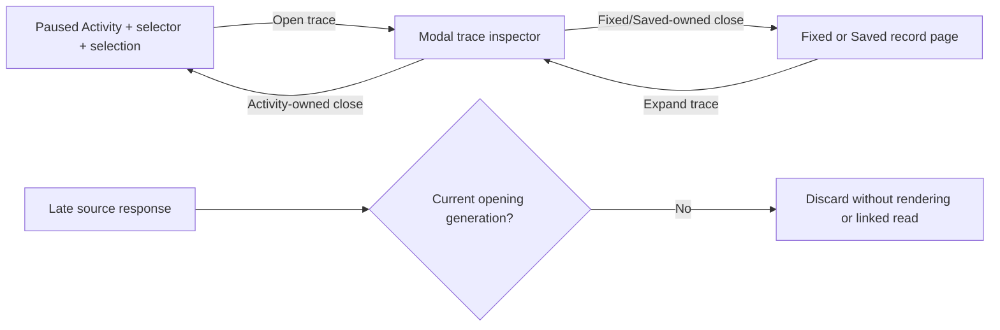

# Trace close belongs to its opening context — 260

An Activity trace opens as a modal inspector. Its visible **← Activity** exit,
ordinary close action and qualified Escape close the trace and return directly to
paused Activity. The original selector, held occurrence rows and selected records
remain; return neither reconnects the stream nor executes a source question.

Fixed-result and Saved-record traces use their normal **✕** close action. Closing
returns focus to their own row rather than borrowing an earlier Activity parent.
The close callback is captured per opening, cleared on replacement/leave, and
invalidated with the context's pending observations. An old response cannot reopen
a closed trace, trigger its linked-log read, or move focus back into a removed view.

The inspector uses a native HTML dialog for browser modal/inert behavior at desktop
and mobile sizes, retaining Goo's existing drawer/fullscreen geometry. Edge-only
Tab wrapping keeps sequential focus inside the dialog. Covered workspace controls
are not part of the close path. The initial close control is immediately keyboard
reachable; closing restores a visible opener or Activity's start/resume fallback.

Escape closes only when owned by this inspector. Native inputs, selects,
contenteditable editors, listboxes/comboboxes and disclosures retain their Escape
handling; prevented/composing events are not repurposed. The dialog's native
cancel default is prevented so it cannot bypass that ownership policy. Programmatic
hide on view withdrawal closes the modal without invoking a stale parent action.

Trace expansion remains a fresh, explicitly broader context read in the original
fixed environment/window. It still omits the original record predicate and keeps
separate span/log read bases. This change does not infer completeness, causality or
unique events, and does not make trace inspection source-free; closing/return is
source-free.

See the [executable storyboard](../journeys/260-trace-parent-return-storyboard.md).
The current frontend baseline requires native HTML dialog support; actual browser
validation is Chromium. Nested surrounding-log ownership is unchanged: opening
that separate inspector withdraws the trace and uses its existing close behavior.

The actual260 SDK journey passes in15.5s including runner setup. Its40s Bombadil
campaign also passes (58.0s total) with834 observed snapshots, all six phases,
one stream connection, two explicit trace/log reads, selected count1, paused
Activity and visible parent focus after close. Eight focused keyboard/gate tests
pass, including the outer-disclosure negative control. No new Hegel or Quint
campaign is claimed for this UI interaction cut.
