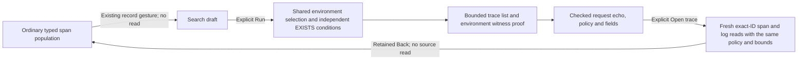

# Traces containing matching span observations

[Save a trace-search question](SAVED_TRACE_SEARCH_QUESTIONS.md) in an investigation
revision, then reopen its complete fixed conditions and list limit without reading
telemetry. Search remains explicit. [Capture](CAPTURED_TRACE_SEARCH.md) preserves
search results and witnesses separately. [Continuation](TRACE_SEARCH_CONTINUATION.md)
keeps page position outside authored intent and supports explicit fresh page reads.

`POST /api/trace-search` exposes the Go endpoint `POST /trace-search`. A search finds distinct valid reported trace IDs within one environment and fixed UTC window where every requested span condition matches at least one source span observation. Conditions can match different services or the same observation. There is no distinct-span constraint, span ordering, parent topology or causal inference.

```json
{
  "version": "goo/trace-search/v1",
  "environmentSelector": {"version":"goo/environment-selector/v1","policy":"effective","scope":{"mode":"named","value":"prod"}},
  "fromMs": 1792800000000,
  "toMs": 1792800060000,
  "conditions": [
    {"all": [
      {"field": {"kind": "column", "key": "service"}, "op": "eq", "value": "database"},
      {"field": {"kind": "column", "key": "duration_ns"}, "op": "gte", "value": "50000000"}
    ]},
    {"field": {"kind": "column", "key": "status_class"}, "op": "eq", "value": "error"}
  ],
  "limit": 20
}
```

## Scope and predicates

The checked environment selection and half-open `[fromMs,toMs)` window are the only shared scope. An explicit `environmentSelector` preserves current-only/effective policy and named/empty/unreported scope. The scalar `environment` shorthand means current-key-only; it is never derived from an effective selector. There is no implicit wildcard. Effective selection uses the current OTel key `deployment.environment.name` when present, including an empty value, otherwise `deployment.environment`; unreported means both are absent. The window follows the existing query bounds: at most 120 minutes, nonnegative timestamps, before 2100. Contextual application entry points preserve the original population selector inside the first condition together with the selected field/service/operation seed. Added conditions remain independent and can match other services. Applying the original service selector globally would incorrectly hide distributed matches.

There are 1–4 conditions, using the existing span `Predicate` DSL, including explicitly declared exact numeric attribute predicates. Every condition retains the existing per-predicate depth/node limits; the complete search admits at most 64 nodes. The request limit is 1–100 trace IDs. Log-only fields, unsupported operators, invalid bindings, malformed scopes and oversized compiled plans are refused. Reported-edge queries are not silently converted into span predicates; contextual entry from that unsupported scope must refuse staging.

The compiler binds user values and attribute keys as typed parameters. It groups source observations by exact lowercase, nonzero,32-character hexadecimal `TraceId`, evaluates `countIf(condition)>0` independently for every condition, and computes `count() OVER ()` over the qualifying trace groups before applying the bounded list limit. The total and list therefore come from one source query, rather than intersecting bounded row pages or combining independent aggregate reads. A trace with no valid reported trace ID cannot qualify. A malformed or absent span ID does not invalidate a matching observation with a valid trace ID; it limits span-specific continuation.

## Results and witnesses

The response includes `request`, `readAt`, `basis`, `state`, `matchedTraces`, `hasMore`, `items`, `plan` and `warnings`. `matchedTraces` is an exact integer string counting distinct qualifying reported IDs in the full queried source population. It is not an invocation count or a trace-completeness claim. `items` is a lexically ordered bounded list. A sentinel observation establishes `hasMore`; the response does not expose that extra list item. There is no offset pagination in this version: narrow the scope or raise the declared limit within its bound.

Each item has `traceId` and one witness per condition. A witness carries its `conditionIndex`, exact `matchingRecords` count, reported span/parent IDs, service, operation, kind, timestamp and duration. These counts include duplicate observations. A representative is chosen by earliest timestamp, then exact span ID, parent ID, service, operation, kind, duration and projected field evidence. It is not necessarily a root span, unique event, complete trace or every matching observation.

`fieldValues` supplies all unique qualified fields used by that condition, including fields referenced by numeric bindings and all OR branches, plus mandatory evidence for both `resource:deployment.environment.name` and `resource:deployment.environment` even when neither appears in the condition. Entries are `{field:{kind,key},value:null|string}`, sorted by field kind and key. Null means absent, while an empty string is a reported empty value. Numeric attributes remain raw reported strings; declared parsing, scale and unit stay in the condition. Derived OTel fields use the same compiler adapter as ordinary exploration. The response omits unrelated attributes and does not truncate proof values.

Absent evidence uses an empty internal payload in both witness projection and tie ordering; hidden adapter values cannot affect selection of later reported fields. The source decoder rejects a nonempty payload for an absent field.

The Go source parser reconstructs the logical fields, checks actual environment-key presence/values against the requested selection, and re-evaluates the condition with `Match`. It rejects missing, malformed or false proof, contradictory projected metadata, inconsistent totals/list shape, noncanonical IDs/counts, out-of-window witness timestamps and invalid duration strings. Known physical counterparts such as service, operation, kind, timestamp, duration, span/trace IDs and the requested deployment environment must agree with the displayed witness. A condition with OR branches still displays the reported values of every referenced field, rather than implying every branch matched.

## Boundedness and failure

The existing read-only source adapter enforces 10 seconds of source execution,256 MiB memory/read budgets, bounded returned rows and an 8 MiB raw response. Compiled SQL is limited to 256 KiB. Each returned witness field is bounded to 4096 bytes; a larger required value refuses the whole result. The complete marshaled result, including plan and parameters, must fit 8 MiB. There is no top-N aggregate substitution, proof truncation or partial success disguised as complete counts.

A successfully completed empty aggregate returns `state:no_data`, `matchedTraces:"0"` and an empty list. Source failures, cancellation, budget refusals and malformed proof remain failures; they never become an empty population. The source basis identifies the request and actual returned aggregate evidence. `readAt` records completion of this single aggregate read, not telemetry occurrence time, an ingestion watermark or durable custody.

## Continuation and custody

Opening or editing a search stages intent without reading telemetry. Run explicitly executes it. Opening a resulting trace uses the existing trace inspector for a separate fresh read of that reported trace ID in the fixed environment/window. The fresh span and log queries retain the exact environment representation/policy and UTC bounds and use only the checked trace ID as their predicate. The original search conditions need not match every span in the expanded trace. A changed request echo, weak policy or malformed witness is refused before continuation. Late/cancelled results cannot replace a departed task; retained Back restores the original context without rereading it. Waterfall and supplied-page comparison remain bounded observations with their own read provenance; missing parents, async links, invalid IDs, truncation and completeness caveats still apply.

This milestone adds no capture type, search persistence, saved-result promotion or mutation of existing captures. Ordinary `Query` and capture wire formats remain unchanged. The prerelease search witness contract now always requires both environment-key evidence entries. `ReferenceTraceSearch` is a pure Go reference over qualified logical source fields; a separate scalar record environment is not authority. Read-only ClickHouse parity tests exercise different-service witnesses, one observation satisfying multiple conditions, duplicate observations, exact numeric values above 2^53, environment/time/ID controls, bounded lists, deterministic evidence tie-breaking and completed empty populations.


## Compact condition editing

The contextual panel keeps all conditions visible as qualified, parenthesized
AND/OR summaries. Durations use readable units; declared numeric type, unit and
scale remain explicit. The seeded condition's full editor is disclosed on
demand, while a newly added condition opens ready for editing. A successful
Run closes editors to put the matching list directly below the compact scope
and conditions. This presentation does not flatten, deduplicate or replace
the original predicate AST.

Only visible current-editor changes update accepted draft intent. A retained
closed input cannot silently change the request; reopening restores the accepted
draft. Source reads remain confined to explicit Run and trace expansion.

## Typed ordinary entry — 340

Activity and Services span records expose the existing **Find traces containing**
action through the canonical record inspector. Activity observation-window analysis
stages the existing fixed question for explicit Run analysis; Services customization
uses the existing population workspace. The population owns its local
instance of the same search panel; it retires on drafts, selection, paging,
Run, child navigation, suspension and disposal. Opening/editing search is local;
Run reads one aggregate. Search launches from span questions; log-question parents and reported-edge
origins are refused rather than silently dropping or projecting their filters.

The UI canonicalizes optional empty placeholders for the Go request echo and
labels the checked policy. Every witness proves current and fallback key presence
independently of the condition. Missing and present-empty values stay distinct.



See [typed journey](journeys/340-typed-trace-search.md),
[architecture](reviews/TYPED_TRACE_SEARCH_ARCHITECTURE_340.md),
[design](reviews/TYPED_TRACE_SEARCH_DESIGN_340.md) and
[validation](../VALIDATION.md) for actual checks and remaining limitations.

[Capture search evidence](CAPTURED_TRACE_SEARCH.md) preserves an explicit reread,
full count and bounded qualified witnesses. Reopen works without telemetry;
following a trace stages a fresh question while Back retains the stored search.
