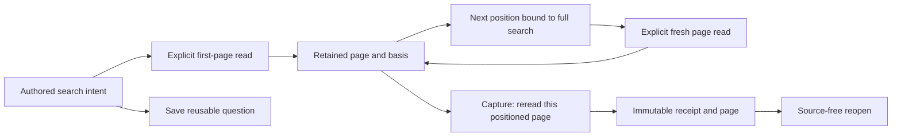

# Continue a trace search

Milestone 403 keeps authored search intent separate from execution position.
A saved question contains the fixed conditions, environment, UTC window and page
limit. A continuation binds those same fields to the last retained trace ID.
It grants no snapshot, source or capture authority by itself.

After an accepted read, **Search conditions** folds to keep page evidence and
controls first. Opening it is local; editing retires the displayed page.

**Next page** explicitly reads the next matching IDs in lexical order and replaces
the visible page. Each page has its own read time and evidence basis. The full
matching count describes the search before position filtering; the remaining
count describes matches after the requested position, before the page limit.
A page can be empty even though earlier IDs still match. Late ingestion and
corrections can change membership between reads; traversed pages are not a stable
or complete union. Witnesses retain the existing independent-condition semantics.

Save keeps authored intent. Capture explicitly rereads the current page and stores
its position with the immutable result. Reopening that evidence reads no telemetry;
refreshing it rereads the same positioned question and retains its predecessor.
Returning from a child trace restores the held page, not a new search read.

The Go server validates the full scope binding and compiles typed source parameters.
The UI independently admits the echoed request, position, ordering, counts and
witnesses before publishing current actions. Edited, pending, hidden, replaced and
retired owners cannot continue an old page. The position is a scope-bound cursor,
not an authentication token or proof of source completeness.

See [trace searches](TRACE_SEARCH.md), [saved intent](SAVED_TRACE_SEARCH_QUESTIONS.md),
[captured evidence](CAPTURED_TRACE_SEARCH.md) and [validation](../VALIDATION.md).

`POST /api/trace-search` accepts authored intent. `POST /api/trace-search/page`
accepts `{request, position}`, using the prior result's `nextPosition`. Results
echo `position` on continuation pages and supply `remainingTraces` plus
`nextPosition` only when more IDs exist. The position includes its version,
request hash and last retained trace ID. Capture keeps it as
`question.traceSearchPosition`; authored saved steps have no such field.
