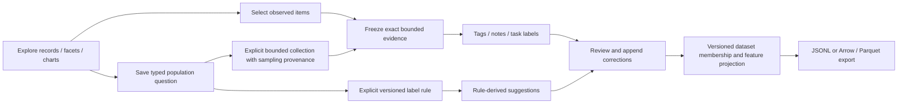

# Observability exploration as a source of training examples

> Implemented foundation: [cross-product tags/notes and optional retention of selected
> saved-capture or exact live-page observations](WORKBENCH_ANNOTATIONS.md). Reviewed
> training labels, vocabularies and dataset exports below remain proposed.

Observation-focused design note, 2026-10-22 UTC. Its delivery sequence applies to
retained training examples, not to all annotation surfaces. The
[whole-product annotation design](PRODUCT_ANNOTATIONS_DESIGN.md) is the primary
architecture and implementation roadmap. **Reviewed task-label editing,
dataset snapshots and training export are not implemented.** Current record
inspection, bounded selection, typed population definitions, immutable captures
and comparison receipts provide useful foundations. This design adds no model
runtime to the query path and does not require goo manifests or Go instrumentation.

The natural interaction is: notice something, select the evidence, give it meaning,
then preserve that meaning so it can be reviewed and reused. The same action
should help an investigation today and a classifier dataset later. Users should
not need to enter a separate training-data application to start labeling.

## Three distinct things users can save

| Object | Example | Membership and meaning |
| --- | --- | --- |
| Observation annotation | “These two logs are a connection-pool timeout.” | Exact retained observations, with original evidence and label history. |
| Population definition | “Spans with this service, route and attribute.” | A reusable typed question; future matches are not automatically human-labeled examples. |
| Label rule | “Suggest pool-timeout for future matches of this predicate.” | Explicit versioned typed query/rule producing suggestions, with its own provenance. |

These UI annotations are separate from source-code `//goo` instrumentation
annotations. They attach user meaning to observed evidence in any instrumented
language, using the workbench rather than modifying application binaries.

A descriptive tag such as `investigate-later` need not be a training target.
A label definition explicitly declares its task and vocabulary. Notes explain
judgments; notes do not silently become labels. Unlabeled, negative, uncertain,
withdrawn and disputed examples remain distinct. “Confirmed” is a review state,
not a claim of telemetry completeness or demonstrated causality.

## Natural journeys in Explore

1. **Label an observation.** Inspect a log/span, select its interesting fields or
   message excerpt, choose Annotate, then add a tag, note or task-specific label.
   Preview the exact evidence being retained and choose Save example. A small
   annotation marker opens the existing inspector; it does not add table columns
   by default or rewrite OTel attributes.
2. **Label a small set.** Select captured records using the page-selection controls.
   Annotate the selected observations together, with an explicit choice between
   one set-level judgment and individual record labels. A group note must not
   silently turn into an independent positive label on every member. The preview
   shows the chosen members, signal, event times, source window and evidence basis.
3. **Turn a lead into a reusable slice.** Use a shared attribute, facet or brushed
   range to open a population; compare it to a baseline and save the question.
   Choose Collect examples to explicitly read a bounded sample or freeze an
   already retained set. Label only those retained observations, not the aggregate
   count or an unmaterialized population. Record how the sample was obtained.
4. **Find counterexamples.** From a saved positive slice, widen the scope or open
   a baseline and collect examples with a different label. “Everything else” is
   not an automatic negative class. Expose ambiguous/unlabeled examples for review.
5. **Reuse during an investigation.** Search by tag or open an annotated item to
   recover its evidence, notes, label revisions and related population definitions.
   Revising a judgment appends a correction; it does not change the old dataset.
6. **Build a dataset revision.** Select reviewed examples and explicit target labels,
   preview a feature projection, split/group policy and label distribution, then
   publish a reproducible dataset snapshot for export. A projection change creates
   a new revision. JSONL is a reasonable first interchange; Arrow/Parquet can follow.

## Evidence identity must come before durable labels

Current selected-record provenance identifies observations in a particular page
read using question, basis, page position and exact nanosecond timestamp. It is
useful for session navigation, **not a durable membership API**. A result basis
hashes the query, plan and returned evidence; it is not a physical event ID.
Identical exported logs may be distinct observations. A trace/span ID is reported
identity within a source context and does not prove a complete trace or unique log.

Durable annotation targets should reference an immutable evidence receipt plus
its retained member position and exact observation digest. Keep duplicate
occurrences and original ordering; do not deduplicate examples by message text.
A target may be one observation, an explicit set, a captured trace fragment or
an aggregate/window snapshot, but its target kind and coverage must be explicit.
A label on a trace fragment must not masquerade as a label on a complete trace.

Existing fixed capture creation performs fresh source reads; using it blindly
for Annotate would risk labeling a different row from the one the user inspected.
Existing server-owned live snapshot freezing demonstrates a no-reread pattern,
but it does not provide exact fixed-record selection freezing today. First add
a bounded, server-verified fixed-read snapshot/member capability, with clear
expiry and explicit failure if the original evidence is no longer available.
Do not silently reread or accept arbitrary browser-authored rows as verified
source evidence. A separately identified user import could be supported later.

Existing investigation documents already retain capture references and revisions.
Reuse those references/history patterns for annotated findings rather than adding
a second investigation notebook. An example catalog can filter tags and reopen
retained evidence without telemetry reads. A badge on live data must be backed by
an exact verified target match; matching only message text or a reported trace ID
must not silently transfer a human label to another observation. Label-rule matches
should be visibly identified as suggestions.

## Annotation and dataset contracts

The proposed Go contracts can remain transport-neutral and use versioned JSON:

- **Label definition:** task ID, vocabulary/version, target kinds and cardinality
  (categorical, multi-label or other explicitly defined values). Domain failure
  classes, relevance and deployment-regression judgments are possible tasks;
  recorded OTel severity is an input, not automatically a human ground-truth label.
- **Annotation revision:** immutable target reference, label-definition version,
  value or abstention, note/excerpt anchors, origin (human/rule/model), author
  identity source, review state, creation time and optional superseded revision.
  Current lab has no production identity boundary; do not treat a client-supplied
  author string as authenticated attribution.
- **Provenance:** original typed question, source/adapter and semantic-convention
  versions where available, event-time window, evidence receipt and capture time,
  selection/sample method and coverage limits. Preserve resource/record/attribute
  namespaces, missing versus present-empty and original timestamp precision.
- **Dataset revision:** immutable member references, pinned annotation revisions,
  label schema, feature projection/version, grouping/split policy and creation
  cutoff. An export manifest carries those identities and exact example counts;
  it does not imply a representative sample of production traffic.

Label validity and recording time differ: “this evidence represents a pool timeout”
may be corrected tomorrow. Keep effective applicability separate from when the
judgment was recorded. An older dataset can retain what was believed at its
cutoff, while a later revision uses corrections. Late telemetry or new context
creates a new evidence/annotation revision; it does not mutate the old example.
Concurrent disagreement should remain reviewable rather than becoming accidental
last-writer-wins ground truth.

OTel semantic conventions help portable feature binding: service/namespace,
operation/route, span kind, exception type and relevant library attributes can
be projected through the same adapters used by exploration. Retain the original
exported values and binding version. Do not normalize every unknown attribute
into a guessed application concept or require manifests for labeling.

## Training usefulness and feedback

Show the selection method beside a dataset's label distribution: manually chosen
outliers, a saved query, time-window collection and random sampling are different
bases. Sampling must be implemented and recorded before calling a sample random.
Train/test grouping should avoid splitting the same reported trace or closely
related incident/deployment across sets. Use source-aware identity and time groups;
missing identity remains unknown and needs a conservative explicit policy.

The feature preview should separate labels, annotator notes and post-incident
attributes from model inputs, so outcome information is not accidentally leaked
into a predictor. Model suggestions can later prioritize uncertain or diverse
examples, with model/version provenance and explicit reviewer decisions. Keep
predictions, rule outputs and human judgments separately inspectable; never
silently promote a suggestion into a confirmed human label.

Useful reusable primitives are a label chip, annotation indicator, target/scope
preview, review-state control and revision history. They should remain passive
Web Components. Application adapters own evidence freezing, authorization,
persistence and exports; a label chip must not subscribe or write on mount.

## Bounded implementation order

1. Deliver record attribute actions and bounded page selection (current milestone).
2. Implement exact fixed-read evidence freezing and stable retained-member targets.
   Test expiry, tampering, duplicate observations, precision and no-reread behavior.
3. Add append-only annotation definitions/revisions and the inspector/selection
   Annotate action. Test set-versus-member labels, corrections, disagreement and
   reopening without telemetry reads. Model revision/withdrawal transitions in Quint.
4. Add dataset snapshots and a JSONL export with pinned features/labels, grouping
   and sampling provenance. Property-test deterministic export and immutable old
   revisions. Add real journeys for positive, counterexample and abstention cases.
5. Only then add label rules, reviewer queues and model-assisted suggestions when
   their task-specific value is clear. Training infrastructure and an inline
   inference engine are not prerequisites for an annotation-capable workbench.
