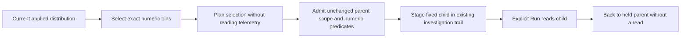

# Typed distribution continuation — 372

A selected numeric distribution can open a fixed child question without losing
its environment policy or parent scope. **Inspect selected population** plans
the range and stages the child. **Run question** explicitly reads that child.
The planner request is metadata work, not a telemetry acquisition.

The selected child retains the complete parent question, including typed
environment policy, namespace predicates, window, numeric source binding,
histogram profile and grouping. Paging resets to zero and the generated range
predicate is appended to the unchanged parent predicate. Exact integer and
decimal bounds remain strings; selecting above JavaScript's exact-number range
does not convert the selection to floating-point bounds.

Comparison arms retain their documented Go projections: count comparison drops
numeric display profiles, numeric comparison retains its numeric binding, and
each uses the first declared grouping or the service grouping. These are explicit
presentation projections, not permission to replace environment or population
scope. Go remains responsible for range arithmetic and partition semantics.

## Admission and held return

The distribution producer captures its actual result and operation epoch.
The fixed-question owner requires that result to remain current, applied and
visible. Hidden, detached, suspended or replaced producers cannot stage a child.
Planner replies must preserve the parent and child scope, the unchanged parent
predicate, the numeric binding and the prescribed comparison projections before
any navigation occurs. The selected/rest predicate trees must match the checked
bin endpoints exactly, including the missing/empty/invalid remainder arms.
Existing exact coefficient formatting checks this wire intent; it does not
evaluate records or aggregate bins. Hidden, inert or initially disabled actions
cannot start planning, and hiding an action while planning prevents staging.
Malformed questions are rejected before the trail leaves the current view.

Back restores the same held parent DOM and evidence without rereading. Its
selection capability stays paused: **Run the fixed question explicitly before
selecting again**. Old callbacks remain retired after return. If the old opener
is disabled, focus returns to the enabled parent Run control. A new parent Run
acquires new evidence and creates a new selection owner.

This is tab-held context, not an immutable capture, atomic source snapshot or
proof of complete collection. Numeric remainder semantics continue to include
missing, empty and invalid numeric values. No new router, evaluator or storage
format is introduced.

See [validation](../VALIDATION.md), the executable
[storyboard](../journeys/372-typed-distribution-population-storyboard.md) and the
[architecture review](reviews/TYPED_DISTRIBUTION_CONTINUATION_ARCHITECTURE_372.md).
