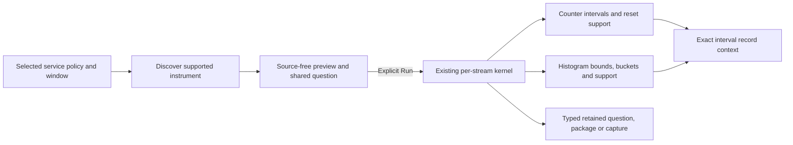

# Typed service counter and histogram intervals

320 extends the checked native service path from gauges to ordinary counters and
explicit duration histograms. Discovery, preview, Run, sharing, packages, capture
metadata and record interval context retain the same environment policy and fixed
window. This uses the existing kernels and UI; no new explorer or source owner is
introduced.

## Counter meaning stays per stream

A cumulative monotonic sequence `100 → 110 → 3` produces an observed delta of ten
for the first interval. A decrease makes the next interval unknown with its reset
reason; it does not fabricate a delta or rate. Delta temporality, gaps, resets,
maximum-gap admission and the optional nonnegative-decimal domain keep their
existing rules. An observation count is not a counter delta.

Current-key and legacy-key resource maps remain different streams, even when
service, instance and metric attributes are otherwise identical. Effective
selection chooses matching streams; it never joins their cumulative histories.
The per-stream endpoints, unit, delta/rate and support diagnostics remain available
in the existing native interface.

## Histogram meaning stays explicit

Typed service histograms use the existing explicit-bucket duration profile with
`s` or `ms` units. Each stream retains its bounds, bucket counts, total, temporality
and interval support. Layout changes, missing predecessors, gaps and incompatible
units retain their existing unavailable/unknown behavior. No cross-stream sum,
average of percentiles or inferred fleet percentile is introduced.

A retained interval/window/bucket selector keeps the complete definition, checked
policy and exact stream. Existing strict bounds and bucket admission apply.
Record context is contextual coincidence inside the selected interval, not a
causal join or completeness guarantee. Staging is source-free; Run is explicit.

## Admission and persistence

The typed profile admits service-bound **per-stream gauge, counter and explicit
histogram** definitions. Stock, state, lifecycle, consumer-group and resource-bound
host/pod/container profiles remain refused before source access. Legacy named
profiles retain their prior behavior. Service plans identify the native subset
as `service-per-stream`; unsupported instruments have a reason and no executable
prototype.

Definitions, authored question steps, YAML packages, capture scope/catalog data and
raw stream identity retain the selector. Environment membership follows current-
key presence, then legacy fallback, distinguishing present empty from unreported.
See [environment membership](SERVICE_ENVIRONMENT_POLICIES.md) and the
[initial typed gauge contract](NATIVE_GAUGE_ENVIRONMENT_POLICIES.md).

Deployment entities, entity-bound service annotations and service-bound view
libraries remain separate current-only named capabilities. Resource or declared
entity migration is outside this cut.
