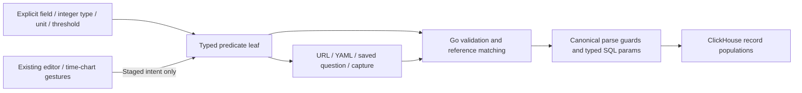
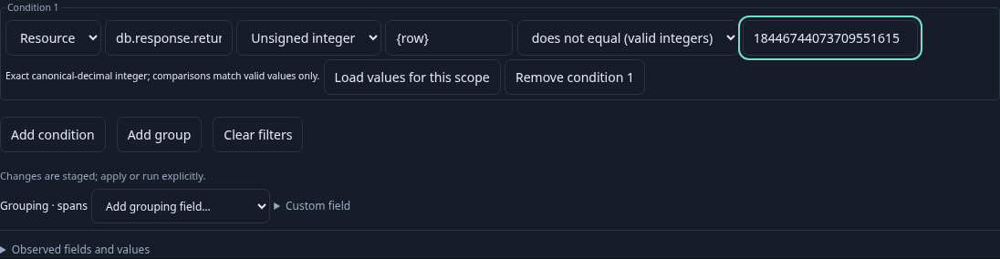
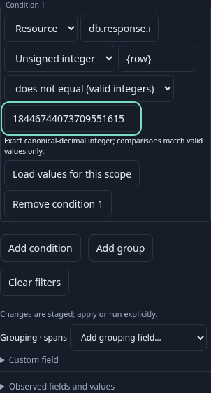
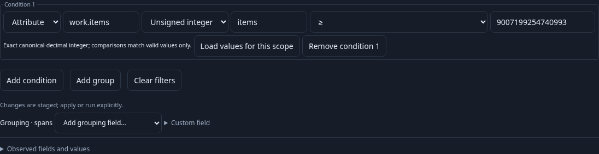
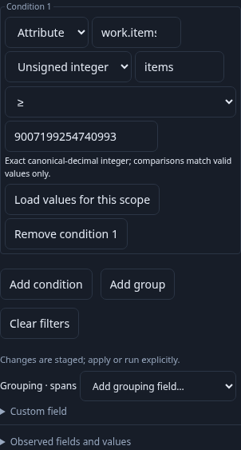
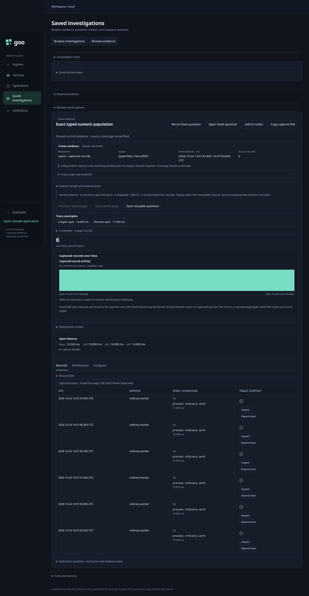

# Typed numeric attribute filters

Status: delivered after independent review of TF1 Go/parity (`19e45ad`), TF2
editor/protocol (`82a1920`) and TF3 real-telemetry/model/exploration acceptance. Existing string predicates and numeric aggregate
bindings retain their current behavior.

## Contract

A leaf declares its own interpretation of an exporter string map:

```yaml
numeric:
  field: {kind: attribute, key: db.response.returned_rows}
  type: uint64
  unit: '{row}'
  parse: canonical-decimal
op: gte
value: '1000'
```

Exactly one of `all`, `any`, `field` or `numeric` identifies a branch/leaf. Numeric
bindings support attribute/resource keys and explicit int64/uint64 types, unit
labels and canonical-decimal parsing. No type/unit is inferred from an OTel name.
The predicate binding is independent of the optional question-level numeric measure.
Adding the omitted optional field does not alter existing JSON/YAML or saved IDs.

| Raw map value | Numeric state |
| --- | --- |
| Absent key | missing |
| Present empty string | empty |
| Canonical decimal within the declared integer type | valid |
| Present nonempty value failing parsing/range | invalid |

Canonical integers have no whitespace, plus sign, leading zeros, negative zero,
fraction or exponent. Limits include exact int64 min/max and uint64 max; strings
above JavaScript's safe integer range remain strings. Units label values without
conversion. Comparisons `eq`, `ne`, `gt`, `gte`, `lt`, `lte` require a canonical
in-range threshold and match **valid values only**, including `ne`. State operators
`valid`, `missing`, `empty`, `invalid` take no threshold. These four states partition
the supplied records; they do not infer original OTLP scalar types or data coverage.

A full complement of a typed comparison includes missing/empty/invalid and the
inverse comparison over valid values. Threshold inversion uses gt/lte or gte/lt,
without increment/decrement at integer extrema. Existing selected/rest gestures
complement their generated categorical intent within the unchanged parent query;
they do not acquire an arbitrary-query NOT operator in this change.

## Layers and gates

1. **TF1 — Go semantics and SQL parity.** Shared canonical parsing and nullable
   SQL guards with existing numeric measures, strict AST/threshold validation,
   reference matching, typed ClickHouse parameters and total boolean results.
   Real ClickHouse parity and Hegel properties/state/swarm gate frontend exposure.
2. **TF2 — Existing editor and continuation.** Compact explicit interpretation
   in the shared condition editor, source-free staging, meaningful typed labels,
   protocol/recovery preservation and unchanged string controls. Time-chart
   selection preserves typed predicates through existing checked scope transforms.
3. **TF3 — End-to-end acceptance.** Real OTLP/ClickHouse boundary-value fixtures,
   exact counts/membership, missing/empty/invalid isolation, saved-link/capture and
   reusable YAML round trips, paused/saved reopening, actual screenshots, existing
   chart gestures, Bombadil and observed Quint rejecting controls. Independent
   review and validated commits complete each gate.



No floating-point filters, unit conversion, inferred bindings, new evaluation
runtime, production cursor or storage migration is introduced by these gates.


## Shared editor and authored-question continuation — TF2

Choose an Attribute or Resource namespace and exact key, then explicitly select
Signed integer or Unsigned integer and supply a unit. The editor offers numeric
comparisons and four parse states. Unit/type are never inferred from field hints.
Fixed columns retain their intrinsic type and nanosecond meaning. Switching type
or namespace retains authored text; unsupported operators/thresholds remain visible
and block execution until corrected. Selecting a state explicitly removes the
threshold. Return to String preserves the original literal-value semantics.

Controls stage intent and require existing Apply/Run actions. The shared pure
protocol guard is used by the editor and draft recovery; display labels retain
qualified field, type, unit and valid-only comparison meaning. Typed threshold
inputs show the full 20-digit integer domain on mobile. New wire fixtures cover
46 accepted/refused cases alongside the unchanged 16 shared-step fixtures.

Browser keys and units reject malformed UTF-16 before serialization/recovery,
while valid pairs and literal U+FFFD remain supported. Separate decode controls
record that Go's standard JSON decoder replaces unpaired surrogate escapes with
U+FFFD; this is an explicit transport boundary, not raw-input parity or secret
scanning. Known optional JavaScript undefined fields follow JSON omission during
checkpoint validation; unknown fields remain refused, including undefined ones.

[172–173 intent/recovery conformance](../journeys/typed-numeric-editor.spec.js)
uses the running UI and real Go document publication without executing a telemetry
source. It checks exact thresholds/invalid drafts, namespace/type/environment
changes, string mode, readable mobile inputs and typed-question reload/Restore
with zero API requests. These checks are distinct from TF3's real telemetry
population/capture/reuse acceptance.





## Real-data storyboard 171

[Journey 171](../journeys/typed-numeric-filters.spec.js) emits 512 ordinary OTLP
spans through the real collector and ClickHouse, with the same exact key in
attribute and resource namespaces. It declares the interpretation explicitly; the
fixture does not assert those string attributes conform to an OTel numeric schema.

The user authors an unsigned threshold above 2^53, sees 96 matching records,
changes namespace to see 128 resource matches despite a 100-row page, and isolates
all four parse states. Attribute valid/invalid counts are 160/288, also exceeding
that page. Valid-only ne excludes missing/empty/invalid; signed-min equality and
legacy literal `01` remain distinct. Invalid overflow stays staged and blocks Run.

A shared URL stages the exact predicate without reading sources. Existing time
chart selection narrows the fixed window with the complete typed parent intact;
Run selected population is explicit. Capture preserves that question, and reusable
YAML retains its binding/threshold for a separate fresh-window read. Reopening the
capture returns its original stored bytes/question/count without querying telemetry.
These are count/duration populations filtered by numeric attributes; comparisons
of numeric measure summaries and arbitrary numeric-value chart brushing remain
separate work.

The actual ledger is checked with an independent integer oracle, exact full
counts, page sizes, unique fixture timestamp membership, raw attribute/resource
presence and values, environment/signal identity and explicit read transitions.
The existing Quint grouped-series lifecycle is reused with 16 rejecting controls.
A bounded Bombadil actor opens the visible editor, tries noncanonical/overflow
thresholds, repairs them and verifies invalid Run blocking and no implicit POSTs.




