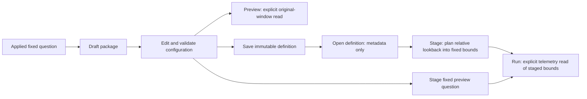

# Reusable questions retain their scope

Implemented in milestone 350. See the [executed journey](journeys/350-package-scope.md).

Create a package from an applied question without weakening its environment
policy. A package retains service, namespace and attribute predicates, grouping,
and the existing duration, status, numeric, histogram and split-time profiles.
It stores reusable configuration, not the records or an evidence receipt.
Planning deliberately resets delivery to the first 100 records; those presentation
limits do not redefine the measured population.

Package source configuration chooses exactly one environment arm: a scalar
current-key-only name, or the shared typed selector. For example, this source
selects spans whose environment is unreported under current-key precedence and
legacy fallback:

```yaml
source:
  adapter: clickhouse.otel/v1
  signal: spans
  environmentSelector:
    version: goo/environment-selector/v1
    policy: effective
    scope:
      mode: unreported
```

Effective named, present-empty and unreported scopes remain distinct. Current-only
named scope stays current-only even when the name matches an effective selector.
Package JSON and YAML reject null, unknown, malformed and mixed scope fields,
including an explicit empty scalar beside a selector. The ordinary transient
record-query wire has its own admission rules; it does not redefine the package
configuration union.



An original draft or workflow retains its fixed preview window. **Stage fixed
question in Explore** keeps that window; **Run question** explicitly reads it.
A saved or imported definition instead stores a relative lookback. Staging plans
new fixed bounds from that lookback without reading telemetry. A later Run reads
those held bounds; it does not silently advance the window. Opening, validating,
saving and staging never imply a source read.

Returned questions and definitions are detached from caller-owned nested profiles
and predicates. Revision hashing and storage retain the full checked selector.
Changing a local draft cannot alter a saved definition or an earlier plan.

Optional Go examples remain opt-in, non-equivalent instrumentation templates.
Current-only named scope can use the existing template path; effective scopes
cannot be represented by that code-local marker and refuse explicit template
generation. Preview, Save and Stage remain available. The package can be used
directly over ordinary OpenTelemetry from any language.

See the [architecture contract](reviews/PACKAGE_SCOPE_ARCHITECTURE_350.md),
[design review](reviews/PACKAGE_SCOPE_DESIGN_350.md) and
[validation record](../VALIDATION.md).
