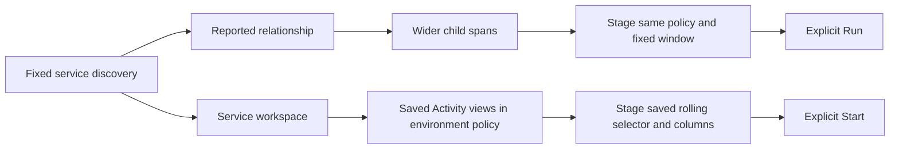

# Continue from a service without changing its environment policy

Implemented and validated in milestone 352. See the
[executed storyboard](journeys/352-service-continuations.md).
See [architecture review](reviews/SERVICE_CONTINUATIONS_ARCHITECTURE_352.md) and
[design review](reviews/SERVICE_CONTINUATIONS_DESIGN_352.md).

Distributed discovery describes observed parent relationships within a fixed
window. **Open child service spans (wider population)** stages all matching child-service spans in
that window, preserving the environment policy and the child's exact namespace.
It does not restrict the result to the selected parent relationship. Empty and
missing namespaces remain different identities.

Typed environment policies currently cannot execute the exact reported-edge
query. That action is explicitly unavailable; wider child records remain usable.
No effective policy is weakened to a current-key-only environment name. Exact
typed edges are the separate compiler/source milestone 353.

The service workspace also exposes the existing saved Activity-view library under
its checked environment policy. This is an environment-scoped configuration
library: a view's presence does not establish that its selector targets the
selected service. Opening retains that view's own signal, predicates, columns
and rolling behavior; it does not inject the service or the discovery's fixed
window. Opening a view stages configuration; Start explicitly reads telemetry.

Native metrics and service annotations retain their own capability restrictions.
Their current-only environment requirements do not determine whether ordinary
record views can be listed or opened.
