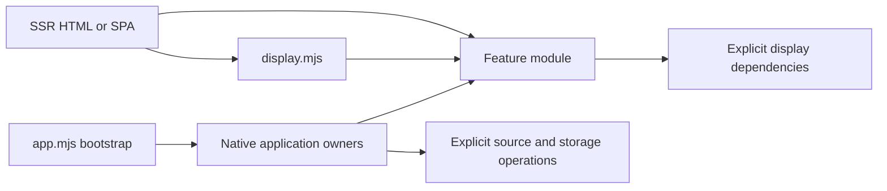
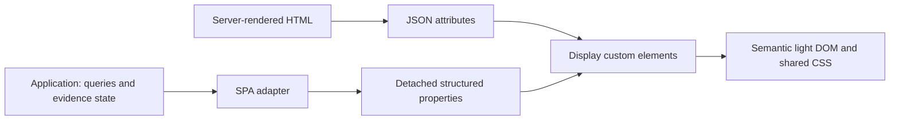
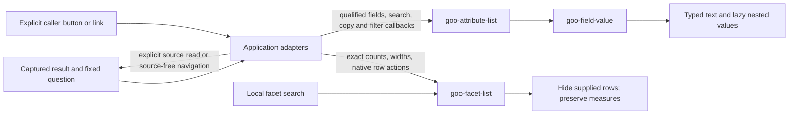

# Display component library

Goo's framework-neutral Web Components render supplied telemetry/evidence data in
server-rendered HTML or an SPA. Application adapters own source reads, query scope,
navigation, subscriptions, retention and publication. Ordinary OTel data does not
need a goo manifest to use the supplied record/attribute displays.

The [standalone reference source](../ui/components.html), served at `/ui-components`
by the local lab, contains labeled synthetic display fixtures. It loads display
modules rather than the application/query client; these conformance examples are
separate from real OTLP-backed [user journeys](journeys/README.md).

This is the current component contract index. [Known issues](KNOWN_ISSUES.md)
records product/backend limits; the [reviewed roadmap](ROADMAP_2026_10_24.md) owns
future priority. Earlier audits are dated design inputs, not another execution queue.

## Public elements

| Element | Supplied input / controlled state | Current contract or source |
| --- | --- | --- |
| `goo-latency` | `summary`, heading metadata, optional `ceiling-ns`; `.summary`, `.ceilingNs` | Compact span-duration summary; detailed contract below. |
| `goo-stat-list` | `items` JSON / `.items` | Exact supplied label/value pairs. |
| `goo-table` | Caller-owned native table; density, labels, optional sticky header | Native-table section below; no row/query ownership. |
| `goo-result-state` | Explicit `state`, caller-authored text/actions | Result-state section below. |
| `goo-facet-list` | Caller-owned rows; local `query` / `.query` | Facet section below; counts/scales remain supplied. |
| `goo-field-value`, `goo-attribute-list` | JSON `value` / `.value`, explicit presence; caller-owned field list | Typed-value section below; [source](../ui/attributes.mjs). |
| `goo-metric-comparison`, `goo-comparison-context` | `data` JSON / `.data` | Supplied paired values and independent side clocks; [comparison context](COMPARISON_CONTEXT.md). |
| `goo-trace-page-breakdown` | Supplied rows/truncation / `.data`; row-selection intent | Observed page intervals and diagnostics; [source](../ui/trace-page-breakdown-view.mjs). |
| `goo-trace-comparison` | Supplied baseline/current trace pages / `.data` | Page comparison and exact attribute differences; [source](../ui/trace-comparison-view.mjs). |
| `goo-trace-waterfall` | `data` / `.data`, controlled `selected-index` / `.selectedIndex` | [Waterfall](UI_WATERFALL.md); supplied spans, not complete-trace inference. |
| `goo-aligned-histogram` | `data` JSON / `.data`, count/share mode, optional range intent | [Aligned distributions](DISTRIBUTION_COMPARISONS.md); supplied exact paired bins, no source ownership. |
| `goo-time-bars` | `data` / `.data`, controlled key and optional range intent | [Time bars](UI_TIME_BARS.md); exact supplied count domain. |
| `goo-chart-frame` | Heading/unit/window/state attributes or `.data`; caller-owned children | [Chart frame](UI_CHART_FRAME.md). |
| `goo-value-timeline` | `data` / `.data`, controlled key, optional brush intent | [Native timelines](NATIVE_TIMELINES.md). |
| `goo-bucket-heatmap` | `data` / `.data`, controlled cell, optional range intent | [Bucket matrix](NATIVE_HEATMAPS.md); raw-span/native adapters remain separate. |
| `goo-comparison-series` | `data` / `.data`, UTC/elapsed alignment | [Count-series comparison](COMPARISON_SERIES.md). |
| `goo-time-range` | `data` JSON / `.data` | Bounded supplied millisecond range; [source](../ui/time-range.mjs). |
| `goo-evidence-summary` | `data` JSON / `.data` | [Evidence facts and exact clocks](EVIDENCE_SUMMARIES.md). |
| `goo-record-summary`, `goo-record-context` | Supplied `record`, signal, optional bounded companion `records` | [Record presentation](RECORD_PRESENTATION.md). |
| `goo-record-columns` | `model` JSON / `.model`; controlled layout intent | [Supplied column picker](RECORD_COLUMNS.md). |
| `goo-grouping-control` | `data` JSON / `.data`; controlled grouping intent | [Grouping control](GROUPING_CONTROL.md). |
| `goo-tag-list` | `tags` JSON / `.tags`, optional `interactive` | Authored tag display/selection; [source](../ui/tag-list.mjs), [authored context](WORKBENCH_ANNOTATIONS.md). |

## Native module entrypoints

The supplied-data display graph uses native ES modules, including records,
attributes, field pickers, exceptions, tags and aligned numeric distributions.
Load a single feature for its element/helpers, or use [display.mjs](../ui/display.mjs) to register the graph:

```html
<script type="module" src="/display.mjs"></script>
```

The entry exports named feature namespaces: `UI`, `Waterfall`, `ComparisonVisual`,
`TimeBars`, `ValueTimeline`, `ChartFrame`, `BucketHeatmap`, `ComparisonSeries`,
`TimeRange`, `EvidenceSummary`, `GroupingControl`, `StateObservations`,
`FieldPresentation`, `Attributes`, `RecordPresentation`, `RecordColumns`,
`ExceptionDetail`, `ServiceIdentity`, `AlignedHistogram`, `TagList`,
`TracePageBreakdown`, `TracePageBreakdownView`, `TracePageComparison` and
`TraceComparisonView`. Direct
feature imports include their own JavaScript dependencies:

```html
<script type="module">
  import {latencyModel} from '/components.mjs';
  import '/state-observations.mjs';
  // Data and event ownership stay with the embedding application.
</script>
```

Serve the modules over HTTP(S), with JavaScript MIME types and their relative
paths intact. Module scripts defer until parsing completes; await
`customElements.whenDefined(name)` when the caller needs the upgraded element.
Properties assigned before definition still upgrade and remain reactive, and
elements can reconnect. Load `components.css` and the feature's named styles
explicitly: this cut introduces no bundler or CSS injection. No display module
publishes a `Goo*` global or provides a CommonJS wrapper. Node validation uses
Node 24.19.0, including its native synchronous `require(ESM)` interoperability
for the existing application test harness; external integrations should import.
Browser conformance was checked in Chromium only; Firefox/Safari conformance is
not yet established.

The gallery loads only `/display.mjs`. It creates no `Goo*` namespaces and loads
no query, annotation, retention or numeric-question owners. Record detail imports
its attribute/exception presenters, aligned histograms import pure numeric bins
and exact formatters, and tags import only core DOM helpers. Log-pattern labels
use the same versioned pure identity decoder as application validation.

Application owners now import dependencies directly. The full application uses
one `/app.mjs` bootstrap that preserves explicit mount order; importing an owner
alone does not mount a screen, read telemetry or publish a `Goo*` namespace.
The old application namespace adapter and classic/CommonJS UI files are removed.
Use the supplied-data graph when embedding components, rather than the full app
bootstrap, which expects the application's HTML shell.

For helpers, use a direct feature import or the namespace exports from
`display.mjs`. Older `Goo*` names in dated adoption notes describe historical
application call sites, not global APIs available to an embedding page.

Optional action callbacks remain caller-owned. For example:

```js
import {mount} from '/attributes.mjs';
mount(document.querySelector('#details'), suppliedRecord, {
  canTraceSearch: () => canAct,
  onTraceSearch: intent => stageTraceQuestion(intent),
});
```

The supplied callback works without `GooVisuals` or an app runtime. The shared
visibility guard rejects hidden/detached trace actions; the element never executes
the question. Tag validation/rendering is similarly separate from annotation reads
and writes. No second display implementation or classic-script export path is kept.



Consult the element contract for snapshot-copy and update behavior; application
presenters and mutable owner models are not interchangeable APIs.

```html
<link rel="stylesheet" href="/components.css">
<goo-latency heading="Span latency"
  summary='{"state":"observed","count":"2","sumNs":"30000000","p50Ns":"20000000","p95Ns":"20000000","p99Ns":"20000000","minNs":"10000000","maxNs":"20000000"}'>
  <p>Mean 15 ms; p95 20 ms.</p>
</goo-latency>
<goo-stat-list items='[{"label":"Captured spans","value":"900719925474099300"}]'></goo-stat-list>
<script type="module" src="/components.mjs"></script>
```

Use the server template engine's ordinary HTML-attribute escaping for JSON,
including quotes and ampersands. For snapshot-rendering elements, optional child content is a server-rendered
fallback that upgrading replaces. Passive shells such as `goo-table`,
`goo-attribute-list` and `goo-chart-frame` retain caller-authored children. Inputs are data,
never expressions or HTML. Labels render as text. A malformed JSON attribute
produces an unavailable/empty display without executing anything.

```js
await customElements.whenDefined('goo-latency');
const latency = document.querySelector('goo-latency');
latency.summary = validatedResult.duration;
// No query, navigation or application event is triggered.
```

A latency summary uses the existing typed span-duration result: `state`, `count`,
`sumNs`, `minNs`, `maxNs`, and whichever of `p50Ns`, `p95Ns`, `p99Ns` were actually
supplied. All numeric fields are canonical nonnegative integer strings. Missing
quantiles remain absent; P90 is not invented or interpolated. Zero duration is
observed zero; `no_data` and `unavailable` do not render zero-valued markers.
Display rounding remains 0.001 ms, using BigInt arithmetic. Exact strings remain
in the disclosure. The percentile rail inside Latency details shows positions on one duration scale;
it is not a histogram or a reconstruction of a distribution.

Comparison data has `title`, `unit` and `rows`; each row supplies `label`, two
`values` (nonnegative decimal strings or null), two `display` labels, and `delta`.
The caller supplies already-compatible measurements and the actual difference.
The component chooses a shared zero-based axis and does no compatibility,
percentile, rate or health inference. An unavailable value has a hatched track.
Signed/scientific native formats continue to use exact tables where unsupported.

## Standard behavior and styling

Elements use light DOM and native semantic HTML, including `dl`, `table` and
`details/summary`. Disclosures support keyboard activation without a custom
widget protocol. `heading-level` accepts 2–6 (default 3), so an embedding page
can preserve its heading outline; service cards request level 6. Grid placement
and page layout belong to the embedding application. Snapshot replacement may
rerender/reset disclosures; controlled selection and child-preserving shells have
their own documented retention behavior. Documented selection/intent events let
application owners decide what to stage, navigate or execute. Component lifecycles
do not fetch, subscribe, store or publish. Attribute/point bounds vary by element;
the core JSON parser uses 64K characters, metric comparisons at most 16 rows, and
stat lists at most 32 entries. Presentation limits never define source totals.
Display keys and row indexes are not durable event identities.

`components.css` owns reusable component styles. Product page layout stays in
`product.css`. Theme with the existing CSS tokens (`--ink`, `--muted`, `--border`,
`--accent`); standalone defaults use the dark product palette. The library also
exports small native DOM/disclosure/action helpers for existing vanilla app
callers. Those are adapters, not a requirement for using the custom elements.
Additional display-only chart modules are listed above;
`GooComparisonVisual` retains shared paired-value and histogram presentation.



## Compact record scan lines (218)

`goo-record-summary[compact]` now keeps ordinary severity/status, message and
duration inline on desktop, with a two-line message preview for long values.
The label cannot collapse into a vertical letter column. Full noncompact summaries
and the owner-provided inspector retain the original record text. The behavior is
in `record-presentation.css`; duplicate Activity-specific height/clipping overrides
are removed from product CSS. No event, subscription or data API is added.

```html
<link rel="stylesheet" href="/record-presentation.css">
<script type="module" src="/display.mjs"></script>
<goo-record-summary compact signal="logs"
  record='{"Body":"Catalog loaded","SeverityText":"INFO"}'></goo-record-summary>
```

Opt-in record tables keep caller-owned actions beside short summaries at desktop
widths. Existing narrow row grouping, exact UTC metadata and touch targets remain.
SSR/detached-SPA, standalone/nested and real ordinary-OTel checks are in
[the 218 storyboard](../journeys/218-compact-activity-storyboard.md).

## Supplied record and range composition

`goo-record-columns` accepts a `model` JSON attribute for server HTML or a
`.model` property before/after attachment: `{layout:{columns:["utc","summary"],
fieldColumns:[]}, available:["utc","service","summary","context"], fields:[]}`.
`available` and `fields` default to core columns and an empty supplied inventory.
It emits bubbling `goo:record-columns` with a detached validated layout. The
owner must apply the event and supply the next model; the element performs no
fetch, storage or subscription. `GooRecordColumns.mount(host,table,options)`
projects supplied record rows into the common record-table shell; `update`,
`setLayout`, `layout` and `dispose` belong to its application adapter. Include/Exclude
intents delegate through `onFacet`; `canRefine` guards stale owners. Styles live
in `components.css`. See [field behavior and storyboard](RECORD_COLUMNS.md).

The attribute adapter exposes optional Include/Exclude callbacks and `mountShared`; `commonGroups` preserves namespaces and only offers supported exact strings. Display elements remain passive. Bounded row marks/provenance are page-owned application state; see [record contract](RECORD_POPULATIONS.md).


Categorical selection intent and the compact tray are application-owned; existing passive facet rows receive optional Include/Exclude callbacks. See [facet contract](FACET_SELECTION.md).


`goo-value-timeline[brush]` now emits display-only `goo-timeline-range` events
(`start`, `preview`, `commit`, `cancel`); preview/commit carry decimal-string
`fromNS`/`toNS` bounds inside the supplied domain. `touch-brush` explicitly enables
touch selection; ordinary swipes otherwise scroll. Escape/disconnection cancel
unfinished gestures. Native point-key and keyboard behavior remains supported.
The service-timeline adapter owns millisecond-bound projection, linked preview
and explicit apply/open actions. The population adapter owns paused retained
children, source generations and subscriptions. See the
[contract and executable SSR/SPA/real-data journeys](RANGE_DRILLDOWNS.md).

The broader [recent-activity design](LIVE_EXPLORATION_DESIGN.md#widget-and-adapter-work)
maps existing components to further selection, field choice and inspection work.
Bounded [raw-span rectangle selection](HEATMAP_SELECTION.md),
[categorical selection](FACET_SELECTION.md), and [supplied field columns](RECORD_COLUMNS.md)
are now implemented in their respective owners. Generalized transforms remain
separate; source/subscription/capture ownership stays outside display elements.

The first [recent-entry canvas](RECENT_ACTIVITY.md) composes existing time-range,
timeline, facets, table and typed inspector primitives. Its application adapter
owns fresh-bound resolution, source requests and local loaded-signal switching;
the display components acquire no new fetching or subscription behavior.

The general population workspace reuses `goo-time-range`, `goo-value-timeline`, `goo-table` and the existing attribute/record inspector. Population queries, paging, cancellation, selector portability and saved-view publication stay in application adapters/Go services; no display component owns those operations.

`goo-time-range` (`time-range.mjs` + `time-range.css`) accepts server JSON `data` or detached `.data`: `{fromMs,toMs,selection:{fromMs,toMs}}`. It renders two native UTC-labelled range handles and emits `goo-range-select` with exact safe-integer millisecond bounds. It performs no reads or navigation. Invalid, empty or out-of-domain selections withhold the controls. The standalone reference includes markup; journeys 88–89 exercise composition and keyboard/property upgrades.

## Adoption and verification

Services and live/frozen Explore use the same latency element and stat-list
primitive. A related group of mean/P95/P99 comparison values occupies one metric
matrix instead of three independent cards. Unsupported native percentile ranges
retain their original interval semantics. Widget secondary actions use one native
disclosure; opening the question remains visible. Explore combines search,
filters and breakdowns in one workbench; advanced measure settings remain closed
until requested, even when the applied query includes those measures.

Journey 63 exercises server HTML upgrade, SPA updates (including assignment before
registration), detached values, invalid JSON, exact large labels, zero/absence,
text safety, keyboard disclosure, shared geometry, and mobile containment with no
app runtime or API requests. Real journeys 35/52/54/58/59/62 exercise the adopted
components with captured telemetry and source-free evidence. Their observed Quint
ledgers and Bombadil checks retain the semantic and state-transition coverage.
This is an incremental library: adopt these primitives when touching remaining
views rather than introducing another local metric-card implementation.

The [whole-app component audit](UI_COMPONENT_AUDIT.md) maps remaining adoption
surfaces and records the design that led to the implemented table, result-state,
facet and typed-attribute elements below. Its remaining proposals do not override
the current [roadmap](ROADMAP_2026_10_24.md).

## Application-owned streaming adapters

Activity and other [live record adapters](LIVE_LOG_TAIL.md) now supply bounded recent
log/span observations over SSE and compose the same passive tables/inspectors.
These are application adapters, not subscriptions inside custom elements. Scope,
source cadence, cancellation, connection/gap state, ordering, retention, proof and
publication behavior stay with their documented owners. Saved Activity views
reopen paused; explicit Start alone begins their source read.

Snapshot summary updates can reset inner DOM/disclosures. Tail adapters separately
retain keyed record nodes, inspection focus and bounded held rows; their keys are
not durable ingestion cursors or evidence of complete traces. See [Activity](LIVE_ACTIVITY.md)
and [retention acceptance](ACTIVITY_RETENTION_ACCEPTANCE.md). Framework-specific
Datastar/htmx delivery is not required or claimed by this library.

Application-owned [rolling comparisons](LIVE_COMPARISON.md) now supply paired
snapshots through the shared comparison displays: baseline values remain fixed
while current values, basis and window advance together. The application owner
implements polling, coverage refusals and exact Freeze; these passive components
provide no subscription or live comparison engine. SSE comparison transport and
high-frequency keyed-row focus retention remain separate capabilities. The
standalone fixture tests current-side property updates without mutating the
baseline or starting a query.

## Native tables and result states

`goo-table` wraps a caller-authored native table, including its caption, thead,
tbody, scoped headers and controls. It supplies a keyboard-focusable labelled
region and contained horizontal overflow. Set `aria-label` or `aria-labelledby`,
`density="compact"` for tighter cells, and optionally `sticky-header` with an
app-owned bounded height. Default density uses comfortable spacing. It never
replaces children, sorts, pages, calculates totals or attaches subscriptions.
Adapters can append/update native rows while retaining existing nodes and focus;
reconnect and attribute updates retain all content. The adapter must supply row
identity, retention and follow/pause behavior for any future streaming surface.

`goo-result-state state="partial"` accepts caller-authored explanation and native
action children. Supported vocabulary is loading, empty, partial, unavailable,
stale and unknown. `.state` reflects the attribute, including pre-upgrade SPA
assignment. The component supplies a polite atomic status region; `announce="off"`
disables announcements. Update the explanation text when state changes; color is
supplementary, never the sole status cue. Caller-authored roles are retained.
Unknown states receive neutral styling. There is no telemetry health inference,
retry handler or source fetch. Avoid duplicating announcements in nested regions.

Explore adopts these for inspection pages, full-population breakdown tables and
main read status. Services uses them for operation lists, widget breakdowns and
independent source/empty/partial states. Existing query scope, total counts,
paging and action callbacks remain adapter-owned. Native source absence and local
search misses have distinct explanations. See journey 64 for native row patch,
focus retention, reconnect and keyboard overflow checks; journey 59 exercises real
OTLP-backed Services adoption and partial source availability.

The status region itself is not marked `aria-busy`: its loading explanation should
be announced immediately. An adapter may independently mark the result container
busy while replacing a snapshot. Real assistive-technology validation of the
existing mobile table-to-card layouts remains outstanding; browser contracts
verify native markup and keyboard behavior, not screen-reader output.

## Facets and typed attributes

`goo-facet-list` (components.mjs) keeps caller-authored direct children marked
`data-facet-item`, with `data-facet-text` as literal searchable text and optional
`data-facet-key` as an opaque identity. `query` / `.query` applies a local,
case-insensitive substring search by toggling those rows' `hidden` property.
`refresh()` returns `{visible,total}` and reapplies the search after caller row
patches. There is no mutation observer. Supply native buttons/links, including
controlled `aria-pressed` where selection is meaningful; the component neither
selects values nor emits query intent. Native click handlers belong to adapters.
Counts, measures, units, bar widths, rank and labels remain supplied exactly;
local search never recalculates any of them. Use `.distribution-row`, label,
track and fill classes for the shared compact bar presentation. Search controls
and full-population explanatory status stay with the caller. Reconnects and
searches retain row/action nodes. App adapters should show an explicit local
no-match state, distinct from absence of source records.

`goo-field-value` (attributes.mjs) accepts JSON `value` attributes or detached
`.value` properties. It renders text with a type label, preserving empty strings,
null, false, zero and exact integer strings. `state` / `.state` distinguishes
present, missing, unknown and unavailable. With no supplied value, presence
resolves to missing; malformed/oversized JSON resolves to unavailable. Explicit
unknown/unavailable values are not nulls. Properties accept plain JSON-compatible
values; cyclic, nonfinite, sparse, accessor-bearing and unsupported values are
withheld rather than coerced. Values returned by getters are detached copies.
Attribute JSON is limited to 64 KiB, as for existing component attributes.

Nested arrays/objects expand lazily in batches of 50; depth eight points to a
separate lazy Raw value disclosure for the full supplied JSON. Long strings use
native disclosure. Updates/reconnects rerender the field and reset disclosures;
this component is intended for snapshots, not focus-preserving live cell updates.
No telemetry string is inserted as HTML. Upgrading a field starts no source read.

`goo-attribute-list` is a passive child-preserving display shell. The existing
`GooAttributes.mount/disclosure` adapter owns physical-to-semantic field mapping,
scope grouping, local key/value search, clipboard feedback, and explicit filter/
breakdown actions. It composes these elements in Explore, trace/log context and
native metric identity displays. The component does not assume that string values
are queryable, map OTel keys, or construct a question. Missing fields are not
invented by the adapter; the standalone value API can display explicitly supplied
absence/unknown states. Use the shared attribute classes for native caller rows.

Journey 65 validates standalone SSR/SPA contracts, native facet selection
preservation, row patches/reconnects, exact strings, type/presence distinctions,
safe text and no API reads. Journey 29 follows real OTLP attributes through local
search, copying, fixed-window narrowing, trace/log inspection and mobile display;
journey 34 verifies full-population scales and saved facet evidence.



The return arrow is application behavior. Component upgrade, local search and
value disclosure never perform that read or navigation.

Types describe the supplied captured representation. In particular, numeric-looking
exporter attribute strings remain strings; these elements do not recover lost OTel
AnyValue types or authorize new numeric expressions.

## Trace and count-time plots

`goo-trace-waterfall` and `goo-time-bars` now share the display-only boundary.
See [waterfall API and limitations](UI_WATERFALL.md) and
[count-time bars](UI_TIME_BARS.md). Both accept server HTML JSON and detached SPA
properties. Controlled selection changes update native state without replacing
focused rows/bars; data snapshot replacement rerenders the plot. The application
retains trace details, source reads, question links and interval selection logic.

Waterfalls show supplied span extents and reported parent/link context, never a
complete-trace guarantee or invocation count. Count bars preserve supplied exact
counts/domain; zero has zero geometry and unavailable values remain explicit.
Explore and Services use these components. Native interval/histogram/metric
semantics remain in their separate adapters. The [chart/detail review](UI_CHART_DETAIL_REVIEW.md)
records the earlier extraction rationale; chart frames, shared inspectors and
heatmap matrices now have delivered contracts in the sections below.

## Shared chart frame

`goo-chart-frame` supplies passive heading/unit/window/state chrome around
caller-owned native plots, legends, disclosures and actions. Attribute or
`.data` metadata updates preserve those children and their focus. The app owns
freshness, refresh and evidence behavior; the frame performs no source reads.
See [the API](UI_CHART_FRAME.md) and the `/ui-components` example. The standalone
journey uses synthetic display data and explicitly verifies no telemetry reads.

## Supplied percentile domain

`goo-latency` now accepts optional `ceiling-ns="100000000"` in server HTML or
`.ceilingNs = "100000000"` from an SPA, including before registration. The exact
integer domain applies to percentile geometry; mean remains a separately labelled
scalar. Both compared elements receive the same domain. Missing domain retains
the original automatic behavior. Invalid domains or domains below a supplied
quantile render unavailable, never clip or silently expand. Zero and exact large
integers retain their existing semantics. Domain changes rerender the summary
and reset its disclosure, just like snapshot changes. Components do not calculate
comparison compatibility, fetch telemetry, rescale themselves or own subscriptions.

The shared comparison renderer accepts nonnegative integer/fraction rates and
computes common-domain geometry with exact BigInt cross multiplication. The
live-counter app adapter owns rounded labels, stable domains, coverage/freshness,
reads and freeze capabilities; display components do not subscribe or fetch.

Native measurement stream focus/clear actions belong to the app adapter. Their
identity disclosures reuse GooAttributes. Observation tables retain readable
columns inside the existing scroll owner on mobile; table minimum width is
scoped to the measurement table class and does not affect other table users.

Native stream navigation composes the existing passive `goo-facet-list`,
`goo-stat-list` and attribute disclosures. The measurement adapter owns full
inventory search/review predicates, pagination, focus and diagnostic mapping.
Only supplied interval/sample states are counted; no rates/coverage semantics or
subscriptions move into components. Observation table headings/cells stay intact
inside their existing horizontal scroll owner on narrow screens.

Native service cards reuse `goo-table`, `goo-stat-list` and structured attributes.
The service adapter owns typed-result matching, latest-interval presentation,
exact-stream links and lazy retained-result construction. Expanding/searching a
retained widget does not subscribe or fetch. The compact table remains outside
the retained browser and preserves its nodes while local inventory filters change.

Native service selection uses an application-owned standard details/form/fieldset
with labelled checkboxes and an explicit Apply action. It consumes retained pure
planner options, not a display-component fetch/subscription. The existing shared
tables, stats and attributes still render results; selection generation, abort
and evidence navigation stay in the service adapter.

### Scalar observations and interval timelines

[`goo-value-timeline`](NATIVE_TIMELINES.md#framework-neutral-component) accepts
exact supplied time/value strings, independent sample dots, interval segments
and explicit nonnumeric states. It has bounded visual scaling and controlled
selection only; native measurement semantics and detail panels stay in the app
adapter. It supports server `data` attributes, detached SPA properties and native
keyboard buttons without subscriptions/fetches. Shared chart-frame chrome wraps
its local plot. Native observation/bucket tables now use `goo-table` with captions
and column scopes; compact selected buckets avoid the wide interval-table minimum.
See `/ui-components` and journeys77/78.

## Bucket heatmap

`goo-bucket-heatmap` supplies exact-count, controlled-selection grids with SSR JSON and SPA properties. See [contract and integration](NATIVE_HEATMAPS.md); standalone journeys 79/80 cover focus, invalid data and mobile overflow.

## Fixed-time native histogram composition

The measurement adapter reuses `goo-chart-frame`, `goo-value-timeline` and `goo-bucket-heatmap` for explicit Go-evaluated time buckets and retained export intervals. The view switch is local; source/custody semantics remain in the application and Go kernel. See [time buckets](HISTOGRAM_TIME_BUCKETS.md) and the [current whole-product sweep](WHOLE_PRODUCT_COMPONENT_SWEEP.md).

## Evidence summary

`goo-evidence-summary` is a passive bounded display snapshot with native exact-detail disclosure, SSR JSON and detached/pre-definition properties. `GooEvidenceScope` is its application presenter for captured measurements and fixed service widgets. [Contract, adoption and storyboards](EVIDENCE_SUMMARIES.md).

Timestamp facts optionally use `unix-ns` / `unix-ns-range` / `utc` display formatting: UTC text, focusable exact-value tooltips, retained raw snapshot strings. `GooEvidenceSummary.unixNs` is the pure formatter; `timestamp` creates the same `<time>` presentation for native stream tables and selected intervals. These functions never alter question bounds.

Latency readouts now use inline Mean/p50/P95/P99 label/value pairs with compact spacing and wrapping. The percentile-position rail and exact counts/values stay in the keyboard-accessible Latency details disclosure. No duration calculations or query behavior changed.

See [comparison presentation](COMPARISON_PRESENTATION.md) for aligned scalar pairs, compact metric matrices, frozen-side summaries and UTC tooltip adoption.

The shared selected-item shell is now adopted in waterfall spans, span/log record inspection and native timeline/bucket selections. See [selected-item inspectors](SELECTED_ITEM_INSPECTORS.md) for lifecycle, retention, focus and source-action boundaries.

## Core experience refinements

See [the implemented workflow](CORE_EXPERIENCE_REFINEMENTS.md) for retained
application visits, typed population selection, compact diagnosis, trace
breakdowns and independently loaded context. These compose passive display
elements; application adapters own navigation, read lifecycle and scope. Journey
85 exercises real OTLP data and refreshed screenshots; the core-refinements
Bombadil actor covers selection and returning to retained evidence. Hegel
selection properties and the question-session state swarm complement observed
quint-go validation against the existing question-links model.

The population workspace reuses `GooDistributions` for facets, exact duration/error
ranking and baseline comparisons, with per-workspace, per-signal namespaced DOM. Its
`presentation()`/`restorePresentation()` transport only display choices and a
baseline question; reads and durable view custody remain in the owning adapter.
Population layout hides duplicated counts/timelines/summary tiles and keeps its
existing aligned timeline and record inspectors. No new evaluator or chart widget
was introduced for population breakdowns.

`GooDistributions.mount(..., {recordTabs:false})` exposes Distribution/Compare when
the owning workspace already renders record inspection. Keyboard navigation uses
that same visible tab set. Previous-window controls retain their own DOM reference
so a late request can finish after replacement without changing a newer control.

Population live telemetry reuses `GooTail` for bounded SSE records and
`GooLiveComparison` for full-population baseline measures. Both remain application
adapters. The tail now accepts logs or individual span records, with an optional
owner callback for trace inspection and explicit disposal. Shared tables,
attribute disclosures, latency displays and comparison scales remain passive.

On narrow screens, tail rows use labelled record cards within the same bounded
viewport; record text, disclosures and trace actions share the content column.
The UTC label retains exact nanoseconds in a tooltip. Focusing retained content
also cancels a pending reconnect, preserving inspection during a disconnect.

### Authored tag list

`goo-tag-list` in `ui/meaning.js` displays up to 16 unique lowercase annotation
slugs. Server HTML uses a JSON `tags` attribute; SPA callers set/get detached
`.tags` arrays, including assignment before custom-element definition. Invalid
input exposes `data-state="invalid"` without rendering an invented tag. Text is
never interpreted as HTML. Optional `interactive` emits `goo-tag-select` with an
exact tag; the application owns filtering. Mount performs no fetch, subscription,
publication or navigation. The editor and optional XTDB adapter remain application
code; see the [annotation contract](WORKBENCH_ANNOTATIONS.md).

The Live Activity adapter reuses `GooAttributes.mount(container, record, {onFacet, facetHint})` for
qualified recorded-field intents. `facetHint` optionally supplies local staging
feedback; existing consumers keep their default wording. The viewer does not
subscribe or fetch. The application owns draft/applied filters, chips, Apply and
the explicit fixed-query continuation.

Live Activity supplies its fixed-investigation action through the shared
`GooUI.inspector` action slot, outside the scrolling attribute body. The application
retains the inspector DOM and selected observation when a fixed child is active;
its return action does not ask display components to fetch or reconstruct records.

Shared `goo-record-summary` and `goo-record-context` are passive supplied-record
elements adopted by Live and fixed record presentation. The common detail body
reuses the typed attribute viewer with an optional `renderField` callback; the
record adapter formats only its normalized timestamp field, leaving raw Copy and
qualified resource/attribute values intact. [Contract, SSR/SPA examples, limits and
adoption gates](RECORD_PRESENTATION.md).

`GooRecordPresentation.table` composes a native table inside `goo-table`, with
standard time/service/summary cells and optional owner context cells. It returns
detached row/cell handles; insertion, stable row identity, selection, actions and
source lifecycle remain application-owned. Live, fixed/frozen pages and held
service observations adopt it. Aggregate/native tables retain their own schemas.

The pure `GooEvidenceScope.record` adapter now supplies frozen record facts to
capture pages and document references. Metadata-only references retain unavailable
source/page fields rather than borrowing custody time or totals from displayed
rows. [Saved owner contract](SAVED_RECORD_PRESENTATION.md).

`GooRecordResults` shares application-owned record/group tables and explicit
trace/log context between Live/fixed and Saved. It composes passive components;
it is not itself a source-free web component. `GooSavedRecords` renders stored
values without a query editor/session/tail and preserves page/retention/package
contracts. [Ownership and invalidation](SAVED_RECORD_PRESENTATION.md).

`GooRecordResults` uses one cached inspector per supplied table instead of an inline
attribute disclosure on every row. Only an open inspector's detail slot takes up
space. Selection precedes Inspect, then existing context follow-ups. Typed viewer
callbacks retain owner-specific permissions and source semantics. Standalone tails now share the cached record inspector, and native identity uses a shared lazy stream inspector or the body of an existing selected-point inspector.
Distribution comparison buttons stay hidden until a single-field nonnumeric
breakdown or retained baseline supplies a comparison context; draft invalidation
preserves a baseline's Clear action.

`GooAttributes.streamRecord` snapshots qualified OTel identity without adding a
record timestamp or measurement values. `mountStream` supplies typed fields to an
existing inspector. `streamInspection` lazily composes that identity with the shared
selected-item shell and an Inspect stream button. These are application adapters,
not custom elements or source clients. Native lists/service summaries/comparisons/
support previews share them. The older `disclosure` export remains for compatibility
with external callers; application consumers have migrated.

`GooNativePresentation` shares native latest values, series diagnostics, exact rate
formatting and comparison-window coverage. It composes existing stats, UTC timestamps
and disclosures, with styles in `native-presentation.css`. It has no source client or
query/evidence state. Its pure `instrumentLabel(name, unit)` helper qualifies
service widget and timeline headings with the exact source unit; absent units say
**unit not reported**. Same-name milliseconds/seconds instruments remain distinct,
and histogram count-axis units remain observations per interval. It performs no
conversion or stream merge. Service coverage remains compact and collapsed; measurement
stream details retain latest versus whole-window distinctions. Supported-window previews also compose its window values and coverage with the existing stream inspector; discovery and explicit recapture remain owned by `GooWindowDiscovery`. [Contract and diagram](NATIVE_PRESENTATION.md).

## Definition library presenter

`GooDefinitionLibrary` is an application presenter over supplied typed revisions,
composing compact rows and the existing inspector. It has no source client or
authoring lifecycle. Paging/search is local to the loaded catalog; details are
created on selection and cached with the inspector's existing bounded lifecycle.
Definitions record/native, fixed reusable-question and document revision adapters retain distinct execution/refresh semantics. Document rows use an explicit typed document ID, revision labels and current-server-page search scope; opening the guarded editor remains a separate application action. The optional `onSelectionChange` user-intent callback lets an application invalidate pending work on selection/close; passive refresh/search lifecycle does not execute or publish. Styles live
in `definition-library.css`. See [contract and diagram](DEFINITION_LIBRARY.md).


The library presenter's exported `row` is a passive supplied-data primitive shared
by definition/document controllers and the retained catalog. It renders an exact
revision/manifest label and invokes a supplied selection callback. It does not
validate a universal artifact schema, fetch, navigate, cache or subscribe. The
retained owner composes it with the shared inspector using per-load snapshot keys,
because current-head tags can change while the manifest ID remains unchanged.


`GooFieldPresentation` supplies pure record-field `qualified`, `label`, `operator`,
`parts` and nested `selectorText` functions to fixed chips, live selector summaries
and record package handoffs. Empty equality uses Go's omitted string default;
literal non-empty values are quoted. It owns no DOM or execution state. See the
[wire/display contract](FIELD_PRESENTATION.md).


`GooServiceIdentity.label(namespace, {lowercase})` supplies namespace presence and
literal labels to existing catalogs/dashboard scopes and annotation target
summaries. It quotes named values and preserves literal case; the lowercase option
changes only the sentence prefix. This is display-only: selection keys, predicates,
native bindings and server artifact digests retain their existing owners. Shared
[namespace fixtures](FIELD_PRESENTATION.md#service-namespace-identity--b2-continuation)
protect wildcard/missing/present-empty and literal sentinel separation.


Shared question helpers in `GooWorkspace` retain separate record/native payloads.
The private native comparison projection accounts for known Go zero/omitempty
binding defaults on a clone; it does not rewrite input/storage or validate full
native definitions. Both document evidence matching and fresh-baseline eligibility
consume `evidenceDifference`. See [wire fixtures and scope rules](QUESTION_PROTOCOL.md).

`GooComparisonBreakdown.recordMeasures(baselineQuestion, selectionQuestion)`
is the shared display-only signal-capability adapter for live comparison choices
and stored breakdown columns. It distinguishes unsupported log span measures from
missing captured span data. It performs no source or capability discovery reads.

`GooComparisonBreakdown.difference`, `compareRows` and `rankRows` are shared pure
presentation functions over supplied comparison rows and full population totals.
They use BigInt rational differences, return unknown for missing/zero-support
measures and preserve input order/data. Live and stored owners apply them without
source reads. Supported keys are share/count/error-rate/mean/p95/p99; eligibility
still comes from record-signal capability and captured coverage.

`goo-bucket-heatmap[range-select]` optionally emits `goo-heatmap-range` with
inclusive zero-based `fromColumn`, `toColumn`, `fromRow`, `toRow` indices.
Pointer drags and Space/Shift-arrow/Enter selection share that contract; Escape
cancels. The component never translates indices into queries or reads data.
Native grids omit this opt-in. See [raw span adapter](HEATMAP_SELECTION.md).

`goo-comparison-context` is a passive two-side composition of `goo-evidence-summary`.
Its `data` JSON attribute or detached/connected `.data` property accepts
`{sides:[{label:"Baseline",data:evidenceSummary},{label:"Comparison",data:evidenceSummary}]}`.
Both summaries use the existing evidence-summary contract, preserving full string
counts, fixed/live/frozen modes, exact UTC windows and separate source/custody clocks.
It validates both supplied sides, clones property input/output, preserves open
provenance disclosures and keyboard focus across property updates, and shows a
fallback for invalid data. It performs no reads, navigation, subscriptions or writes.
`GooEvidenceScope.comparisonContextSide(question,metadata)` is the application-side
adapter; absent read/basis/custody metadata is never inferred. The existing fixed,
stored/fresh/saved and live comparison owners supply their own questions and clocks.
The live owner retains this component across refreshes. Standalone server HTML is
shown at `/ui-components`; journey 126 covers upgrade and unknown-state transitions.

Comparison owners reuse `GooUI.actions` for compact primary commands and native
secondary disclosure. Buttons remain caller-owned nodes and retain their existing
handlers/disabled states; the helper owns only disclosure/Escape behavior. Population
comparison children and stored comparison pages reuse the existing record table,
record detail presenter and `GooUI.inspector`, with reads and retained-parent state
in their application owners. See [comparison actions](COMPARISON_ACTIONS.md).


`goo-comparison-series` (`comparison-series.mjs`, `time-bars.css`) renders two supplied count-interval series, with `data` JSON attributes or a cloned `.data` property and `alignment="elapsed|utc"`. It emits `goo-series-select` and `goo-series-range`; it never fetches or navigates. Exact values use a shared BigInt count domain and an expandable interval table. `comparison-series-owner.js` owns alignment controls, UTC range handles, staged continuation and explicit immutable-page reads. See [contract](COMPARISON_SERIES.md).

The supplied comparison-series contract accepts an optional exact `ceiling` string. Overflow refuses bars instead of clipping. The application series owner now supports retained `create/update/rescale` controls; rolling selection stays bound to its original question while supplied chart data updates. Polling, pause, inline child navigation and Freeze remain in the live owner.

The [D1 comparison acceptance audit](D1_ACCEPTANCE.md) maps the adopted context,
count-series, action-group and inspection components to real consumers and their
source-free display contracts. Native metric semantics remain in separate adapters.

[Native instrument discovery](NATIVE_INSTRUMENT_DISCOVERY.md) reuses `goo-table`
for compact supplied metadata and native disclosures for hints. Its application
adapter owns local paging and delegates Build to the measurement owner; no new
fetching custom element or component library was introduced.


Retained content now shares the display-only `GooRetentionPresentation` adapter:
`model`, `summary` and `observations` consume supplied typed-origin content and its
exact JSON string. They compose existing `goo-record-summary`, shared UTC record
descriptions, `goo-evidence-summary` and structured attribute viewers. Attributes
are disclosed locally after the compact record/provenance view. No fetch, source
lifecycle, navigation or publication belongs to this adapter. The catalog,
retention owner and citation owner retain those responsibilities.
`displayJSON` preserves numeric tokens beyond browser round-trip precision as
explicit display text; original manifest JSON remains unchanged. This is display
representation, not conversion of stored telemetry types or query values.

Activity selection remains in `GooTail`, an application adapter. It owns a bounded
`TailSelection` of original capabilities, contextual retention controls and a
reference-only intent handed to `GooRetentionClient`. Shared display components do
not issue proof or publish. Each row/snapshot keeps its own read provenance.
`GooPendingSaves` stores immutable `/tail` intents separately from fixed pages;
`GooRetentionRecovery` reuses the native retry panel and shared retained readers.

`GooRetentionStatus` is shared pure application policy for save-failure messages,
configuration states and explicit uncertainty. Activity and Saved recovery use it;
`GooRetentionClient` retains HTTP status and pre-send storage refusal metadata.
Periodic Activity expiry updates preserve the committed link's DOM/focus and do
not repeatedly replace unchanged live status text. No new fetching display element
or universal execution owner is introduced.

## Subsequent component and adapter contracts

Reusable [Activity views](ACTIVITY_VIEWS.md) use a typed rolling configuration in
workbench's existing immutable file publisher, separate from fixed exploration
views. Shared revision-library display appears in Activity’s Views menu, Saved and Services. The stream
adapter restores configuration through `GooTail.stage`; Start alone opens SSE.
No observations or capabilities cross the configuration boundary. The linked
flow diagram documents publication, staging and later separate retention.

Activity-view browsing adopts `GooDefinitionLibrary` with an explicit `activity`
family and exact revisions, keeping same-title scopes distinct. The existing
record-column picker projects both streamed and staged layouts. Configuration
reads, clipboard sharing and library paging stay in `GooActivityViews`; scope and
draft lifetime stay in `GooStreamEntry`. `GooTail.stage` prepares local display
without a subscription. No display component fetches or starts telemetry.

`GooFilterEditor.mount(host, {where, signal, onChange})` is the shared supplied
predicate editor for Activity and fixed population adapters. `set` restores a
supplied tree; `snapshot` returns detached local input. It emits normalized
predicates or a validation error and never reads or executes. Styles live in
`components.css`; adapters retain execution and custody. See [contract and
journey](FILTER_EDITOR.md).

Single-question filtering now adopts the same helper. `setFields(fields)` supplies
local attribute/resource-key suggestions without changing input, emitting edits
or reading data. The old flat field picker/composer and their page styles are
removed; service/message/duration shortcuts are application-owned AST inputs.

`GooFilterEditor.setSuggestions(data)` accepts detached, scope-labeled observed fields/values supplied by application adapters. `GooAttributes.suggestionData(records,fields)` bounds the physical-record projection, preserving namespaces and missing/empty distinctions. Neither reads telemetry. Suggestion search and selection use the same passive editor across all record-query surfaces.

The shared filter editor accepts `setValueLoader` and supplied `setCountedValues` states. Count lists reuse passive `goo-facet-list` and `goo-result-state`. The application-owned `GooFilterValues` module validates fixed breakdown scope, exact counts, cancellation and obsolete responses; presentation and local search never fetch. See [contract](FILTER_VALUES.md).

`goo-time-bars[range-select]` adds optional supplied-key range gestures for interactive button bars. `goo-time-range` emits `{fromKey,toKey}` in supplied order. Drag uses pointer capture, keyboard uses Space/Shift-arrows/Enter, Escape cancels an unfinished range, and touch drag scrolls normally. Removing the attribute or replacing data clears gesture state; components never fetch. The app-owned [latency histogram adapter](LATENCY_SELECTION.md) maps those keys to typed duration bounds and existing population actions. `GooPopulationSelection.mount` accepts `compact:true` to disclose exact bounds while keeping preview/actions visible.

`goo-time-bars.clearRange()` withdraws painted/unfinished range state without emitting a selection or reading a source; the histogram owner uses it when exact bounds are edited.

The latency histogram adapter accepts app-supplied `onBegin` and `onSelect(bounds,{count,total})` callbacks, plus a compact hint mode. Activity uses these instead of the fixed selection form. Activity's begin callback cancels its pending reads before staging a typed range; source cadence, cancellation, filters and comparison remain in `activity-latency.js`/`stream-entry.js`. See [Activity latency](ACTIVITY_LATENCY.md).

Activity baseline comparison reuses `GooComparisonVisual.histogram` and supplied `goo-comparison-context` with a fixed 0–100% shape scale. App-owned `activity-baseline.js` loads stored metadata, validates native comparison accounting and publishes independent side clocks. Count/context disclosures do not fetch. [Contract](ACTIVITY_BASELINE.md).

`GooComparisonVisual.histogram` now accepts `layout:'rows'` and supplied side labels. It renders a semantic table with aligned bucket labels and paired percentage bars on the same 0–100% scale, using the existing exact-string bar primitive. The original SVG layout stays the default. Journey 157 is a labeled passive fixture with no application/source requests and mobile label/overflow checks.

Saved Activity baseline selection remains app-owned configuration: `GooActivityBaseline.restore` stages an exact reference without fetching, while `reference` exposes the selected ID separately from loaded evidence. `GooActivityLatency.restoreBaseline` resets the panel/cadence without subscribing. Existing supplied comparison displays are unchanged. [Contract](SAVED_ACTIVITY_BASELINE.md).

Activity’s embedded library receives applied environment and visibility from the stream owner. `setScope` cancels stale reads and clears supplied rows plus inspector cache when the environment changes. `GooDefinitionLibrary.clear()` resets supplied presentation without reading. The catalog’s server page is capped at 20, so its redundant internal 25-row pager is hidden; explicit server first/next controls remain.

Activity’s Investigate control uses native disclosure and ordinary action buttons. The stream adapter owns its transition to the existing fixed editor, parent retention and focus restoration; no reusable display element gains navigation or read behavior. Record inspectors and folded definition-library inspectors remain separate regions with separate selection lifetimes. [Navigation contract](ACTIVITY_NAVIGATION.md).

`goo-table[record-layout="compact"]` opts supplied record rows into the shared narrow-screen layout in `record-presentation.css`. `GooRecordPresentation.table({compact:true})` emits it; server-rendered cells use the same semantic `data-record-core`/`data-record-field` markers. Core fields group by role on mobile, chosen fields keep qualified labels, and action buttons remain caller-owned. Legacy application rules explicitly exclude this layout; no component read/subscription is introduced. [Composition and storyboard](COMPACT_MOBILE_RECORDS.md).

`GooRecordPresentation.table({mobileCompact:true})` separates responsive record layout from `compact` preview content. Responsive time markup retains full accessible date text and an aria-hidden short mobile rendition in one exact `time` element. Generic spanning detail cells stay full-width; fixed messages keep disclosure/expansion. The shared result owner adopts this for fixed, saved and explicit context tables while retaining source/provenance and action ownership. Legacy telemetry-card rules exclude the opt-in. [Adoption contract](COMPACT_MOBILE_RECORDS.md#fixedsaved-adoption-storyboard-162).

Service-held span observations also call `GooRecordPresentation.table({mobileCompact:true})`, with short visible Inspect text and the existing accessible name. Service detail retains its cached inspector, original supporting question and source lifetime; the shared primitive owns only responsive presentation. [Service adoption](COMPACT_MOBILE_RECORDS.md#service-observation-adoption-46).

`GooRecordPresentation.attributes(host, record, options)` centralizes exact root event-time rendering while preserving caller options, scoped fields and custom fallback rendering. Record details, retained cards and waterfall inspectors use it. Retained cards keep `raw:false`; original manifest disclosure stays separate. [Renderer inventory and action meanings](RECORD_RENDERER_AUDIT_2026_10_24.md).

Operation waterfalls use optional `goo-trace-waterfall.data.facts`: an array matching `rows.length`, with up to four `{label:string,value:string}` facts per original row index. Facts render as literal text and follow row identity through sorting, property cloning and detached updates. Malformed facts refuse the supplied display. `GooVisuals.waterfall` accepts `{facts}` as its sixth argument and mirrors them in its cached inspector. Source rows remain unchanged. See [independent operation status](OPERATION_STATUS.md).

`GooFieldPresentation.hint(field)` and `searchText(field)` provide optional shared display metadata for [OTel field discovery](OTEL_FIELD_HINTS.md). Filter/attribute adapters own their existing source-free browse and explicit action behavior; passive component lifecycles add no reads. Hints use literal text, retain exact keys, return detached metadata and fall back when unavailable.

The filter editor accepts optional `onGroup(field, opener)` and `canGroup()` for supplied observed fields, with `syncGrouping()` for owner availability updates. Grouping emits detached intent, preserves the filter tree and adds no source reads. Exact behavior and owner contracts are in [observed grouping](OBSERVED_GROUPING.md).

The filter editor now accepts `grouping`, controlled `setGrouping(fields)`, detached `suggestions()`, and an optional third `onGroup(field, opener, mode)` argument (`replace`, `add`, `remove`). Add prevents duplicates and a third field; chips emit removal intent without changing filters. See [two-field composition](COMPOSED_GROUPING.md).

[`goo-grouping-control`](GROUPING_CONTROL.md) is a passive native picker/chip/custom-key element with JSON attribute/property input, cloned state, `goo:grouping-intent`, HTML/SPA/detached support and scoped `grouping-control.css`. It performs no reads or saves. The filter editor supplies labels, field inventory, availability and signal validation.


The [shared question protocol](QUESTION_PROTOCOL.md#pure-protocol-owner--n1-continuation)
is application infrastructure rather than a display element: `question-protocol.js`
owns pure intent/link helpers, workspace retains navigation, and source/state
owners remain separate. No component lifecycle gains reads or publication.


[Typed numeric filtering](TYPED_NUMERIC_FILTERS.md) extends the shared controlled
filter editor rather than adding a second authoring panel. Explicit integer/unit
controls remain application intent; common field labels render the declared
interpretation. Scoped numeric threshold styles preserve full integer visibility
on mobile; no display element evaluates source values or starts requests.

The [integer distribution adapter](NUMERIC_HISTOGRAMS.md) reuses `goo-time-bars`
for supplied categorical counts over unequal numeric ranges, preserving exact
original bin keys. The adapter owns coverage/schema checks, the exact-bin table,
selection planning and population handoff. The element still has no numeric
parser, source access or query ownership. Its name does not imply a temporal
axis; caller-supplied labels declare the numeric domain and count semantics.

The [numeric comparison adapter](NUMERIC_COMPARISONS.md) adds an opt-in
`signed: true, scale: per-row` mode to `goo-metric-comparison`. Each supplied
metric row shares an exact signed rational domain across both sides and anchors
at zero. Existing positive/default displays retain their original scale. Numeric
parsing, compatibility, source reads and custody stay in their existing owners;
the display converts only bounded layout ratios to pixels.

`goo-aligned-histogram` composes two passive count-bar elements with the same
global bin keys, union-cropped extent and count ceiling (or 0–100% population-share
scale). It accepts explicit integer type/unit, valid-count pair and the supplied
Go distribution output; its optional interactive mode emits `goo-aligned-range`
with `{side,fromBin,toBin}` using half-open global indices. It neither constructs
queries nor fetches. Missing/unknown shares remain unavailable. `goo-time-bars`
adds an opt-in exact nonnegative rational value format; old uint defaults remain
unchanged. See the synthetic SSR reference at `/ui-components` and executable
`journeys/aligned-histogram-components.spec.js` for attribute, detached-property,
retained-child, mobile and zero-source-effect contracts.

## Supplied exception details

`goo-exception-details` is a passive display element exported by
`ui/exception-detail.mjs`, styled by `ui/exception-detail.css`. It accepts the
standard `data` JSON attribute or detached/connected `.data` property:

```html
<goo-exception-details data='{"signal":"logs","record":{"timestamp_ns":"1792800000123456789","Attributes":{"exception.type":"IOError","exception.message":"Read failed"}}}'></goo-exception-details>
```

The envelope is `{signal: "logs" | "spans", record: suppliedRecord}`. Span records
use the existing `event_names`, `event_times_ns` and `event_attributes` arrays;
log records use normalized `Attributes` (legacy `LogAttributes` only when the
normalized field is absent). Named span exception events stay separate from span
attributes. Property inputs/getters are detached copies, predefinition properties
upgrade on connection, and redraw preserves the outer disclosure's open state.
No fetch, query, subscription, navigation, grouping, evidence publication or parent
window selection occurs in the element. `GooExceptionDetail.mount` remains a
compatibility composition wrapper used by shared record and waterfall inspectors.

Missing/malformed arrays or nonstring exception metadata show partial/unavailable
states rather than a known-zero exception claim. Misaligned attributes are not
attached to event names; aligned type/message data can remain visible when event
time is unavailable. The element inspects at most 1,000 supplied events, shows five
occurrences initially with local Show more, and truncates individual displayed
strings at 65,536 characters with a visible marker. Stacktraces are disclosed
locally as literal text. Those are display bounds, not source/group cardinality
limits or evidence of complete telemetry. UTC formatting retains the exact supplied
nanosecond time in a tooltip. The standalone synthetic component tests are separate
from journey 179's actual OTLP integration screenshots.

### Fixed-scale numeric display

The existing numeric adapters support explicit decimal64 scale 1–9. Supplied
summary and histogram strings remain exact coefficients; adapters format them
with declared scale before passing labels and exact rational values to passive
components. The aligned histogram accepts optional scale for decimal labels.
Integer component data and rendering remain unchanged. No display component
infers a scale from an attribute name, performs a source read or converts units.

The existing measure/filter editor conditionally exposes a scale control with
the decimal type. Scale is preserved in protocol, session identity, recovery,
saved definitions and captures. It is part of measurement compatibility, never
a local chart formatting preference. See [contract](FIXED_SCALE_DECIMALS.md).

Decimal comparison rows may additionally supply `rangeDisplay: [min, max]`
caption strings in the passive cloned DTO. These labels format the same exact
signed domain; they do not change bar geometry, numerical data attributes or
exact tooltips. Decimal captions wrap fully on mobile. Integer rows omit the
optional field and retain their existing presentation.

### Contextual Plot values

The [contextual numeric owner](CONTEXTUAL_NUMERIC_PLOTS.md) uses optional
`onPlot(field, opener)` and independent `canPlot` callbacks in attribute/observed
field presenters. Existing facet callbacks retain their own eligibility rules.
The dialog reuses numeric controls with explicit declaration and a locked field;
its compact presentation hides duplicated field controls and discloses detailed
parsing guidance. Standard numeric editors keep their existing defaults.

`GooNumericPlot` owns local confirmation only: supplied current question, active/
clean authority, optional provenance, pause and stage callbacks. Hidden tabs
invalidate open dialogs permanently; disconnected hosts cannot confirm. Scope,
navigation, publication and source requests stay in the application owners.

### Log-pattern display

The [log-pattern adapter](LOG_PATTERNS.md) reuses compact tables and existing
volume charts. Counts/shares derive from the complete bounded group result;
local frequency sort and search do not query. Labels visibly escape controls
and literal token markers, while record inspection discloses exact identities.
Open links stage canonical equality; service comparisons use exact selected/rest
queries. Inactive/hidden/detached links block both default navigation and event
propagation so the global trail cannot stage stale intent. Display elements do
not normalize source bodies, fetch examples or infer issues.

### Pattern time comparisons

`ui/log-pattern-comparison.js` contains a pure model over complete supplied
cohorts and their validated comparison. It binds source bases, counts, states and
canonical group unions before calculating reduced integer ratios. Counts retain
uint64 precision; rates normalize by each fixed window, and shares retain each
whole-population denominator. An inconsistent side leaves missing group counts
unavailable and suppresses derived measures and presence labels. Presentation
rounding never turns a nonzero value into an apparent zero.

The application owner stages baseline scopes and executes reads. Display adapters
reuse compact tables and shared comparison visuals; their measure changes and
ranking remain local. The same arithmetic serves live-result and immutable saved
comparison presentation. [Contract](LOG_PATTERN_TIME_COMPARISONS.md).

### Supplied-page trace breakdown

`goo-trace-page-breakdown` consumes `{rows, truncated}` through a bounded JSON
attribute or a detached `.data` property, preserving pre-upgrade properties.
`selectedIndex` and `selectedGroupIndex` are controlled presentation properties.
The component emits `goo-trace-page-row` and `goo-trace-page-group` intents; the
application validates ownership and visible controls before accepting them.
It does not fetch, subscribe, navigate, or publish.

The [exact Go/JavaScript model](TRACE_PAGE_TIMING.md) covers at most 1,000 supplied
rows. The component's JSON attribute is bounded to 65,536 string code units.
Exact millisecond text and nanosecond tooltips retain tiny nonzero values and
sums beyond uint64. Shared comparison bars use a common scale, explicit partial
subtotals and known-row coverage. Group identities distinguish missing, empty
and literal labels. The application adapter keeps the selected-span summary in
the existing inspector and coordinates page and full-query highlights.

### Supplied trace-page comparison

`<goo-trace-comparison>` is a passive display of two bounded supplied pages. Load
`components.mjs`, `comparison-visual.mjs`, `trace-page-breakdown.js`,
`trace-page-breakdown-view.js`, `trace-page-comparison.js`, `attributes.mjs`, and
`trace-comparison-view.js`, with `trace-comparison-view.css`. Set `.data` to
`{baseline:{rows,truncated},selection:{rows,truncated}}`; each side accepts at most
1,000 rows. A JSON `data` attribute supports server rendering up to 64 KiB;
pre-definition properties and detached SPA updates are supported. Values are cloned.

Relative start offsets and durations share the maximum physical extent of both
pages. Unique reported service/operation labels with matching reported span kind
can align observations; this does not identify the same invocation. Repeated
labels show page aggregates without ordinal row pairing. Unknown or absent work
is never zero-filled. Twenty groups appear initially, with local Show more.
`goo-trace-comparison-pair` emits original `{groupIndex,baselineIndex,selectionIndex}`
for an explicit local pair inspection. The component itself only displays supplied
qualified attribute differences through `goo-field-value`; it never fetches,
navigates, subscribes, or invokes the native waterfall's linked-log behavior.

The record-results application owner pins one detached reference page in memory,
including its fixed question, source clock and basis. Closing the inspector keeps
that reference; disposing the owner clears it. A subsequent Expand trace is an
explicit fresh read. Pin, Compare and Clear perform no source reads. Generation,
visibility and closed-disclosure guards reject stale controls. These page
observations do not establish complete trace coverage, CPU time or a critical path.

### Contextual trace search owner

`GooTraceSearch.mount(host,{current,onOpenTrace})` is an application adapter, not a
new passive element. It composes the existing supplied-predicate filter editors
and typed `goo-field-value` witness display. `open(seed,opener)` stages one
condition in the current applied fixed span scope without reading telemetry.
`invalidate()` cancels pending work and withdraws results; `dispose()` also removes
the panel. The current callback supplies `{question,active,clean}`.

One to four conditions are independent span existentials within the same reported
trace ID, environment and fixed window. The original population selector remains
inside condition one only. An internal AND within one condition still applies to
one span record. Explicit Run reads the full population through trace search;
returned trace IDs and representative witnesses are bounded independently from the
full distinct-ID total. Opening a result delegates the existing explicit fresh
trace expansion. There is no automatic capture, saved resource or inferred
parent-child relationship. Qualified witness fields preserve missing versus empty
and show only requested fields, not complete attribute-map claims.

Trace-search conditions show complete parenthesized predicate summaries. The
seeded full editor starts closed, a newly added editor starts open, and a
successful Run closes editors to keep results visible. Accepted drafts are
separate from mutable editor snapshots: retained hidden input changes cannot
alter Run intent, and reopening restores the accepted draft. Opening an editor
is local; editing withdraws old results before the next explicit Run.

## Named-pool composition

[Named-pool connection observations](POOL_CONNECTIONS.md) use the existing passive
`goo-time-bars`, typed attribute inspector and timestamp presenter. The app-level
`GooPoolConnections` adapter assembles supplied domain-validated stock samples
into exact pool/instance/state rows. It owns only local filtering, 25-row paging
and a 256-state display bound, with explicit omissions and a stable shared count
scale. It does not fetch or publish, infer a capacity ratio or merge contributors.
Service widgets and frozen native evidence share this composition; their existing
owners retain question execution, navigation and capture custody.

The pool-signal continuation adds metadata-only candidate planning outside the
passive count display. Its pending scope cancels or ignores late responses after
parent withdrawal; the existing native measurement/navigation owner stages,
executes and captures each signal independently. See [contract](POOL_SIGNALS.md).


## Compact aligned pool view

`ui/pool-view.js` is a supplied-data renderer and response-scope guard. It reuses
`goo-table`, `GooComparisonVisual.cell` and the UTC timestamp presenter. Known
count states and capacity use one visible zero-based count scale; stale values
are muted and unknown values unpainted. Wait keeps its own histogram units and
interval. The Go composer alone decides ratio eligibility; JavaScript only
formats its exact rational, marking truncated percentages. Used and idle remain
visible before the bounded custom-state list.

`GooPoolSignals` is the application owner for selected optional reads and pure
composition. Opening/reopening cached metadata or results is local; explicit
Load uses the existing measurement transport, then the pure pool-view endpoint.
Selection edits, parent withdrawal and closing cancel or ignore pending work.
The display renderer never fetches, subscribes or publishes. Preview delegates
existing native inspection/navigation and individual capture ownership.

Nested narrow panels stack signal/value and short UTC observation rows. Full UTC
and nanoseconds remain in focusable timestamp tooltips; epochs and read bases
stay in a closed disclosure. Scoped checkbox sizing overrides global input
minimums without changing common component styles. See [contract](POOL_VIEW.md)
and [executable journey](../journeys/198-pool-view-storyboard.md).


## Host-resource presentation

`GooHostDashboard` is a supplied-data presenter using the shared scalar timeline,
attribute inspector and UTC timestamps. It does not fetch, aggregate CPU cores,
combine memory states or calculate capacity denominators. A display-only copy
masks out-of-domain reported fractions/negative byte values as unknown marks;
original evidence remains available for native inspection. Byte labels retain
exact-value tooltips and reported fractions retain their raw unit values.

`GooHostBrowser` owns explicit inventory, metadata planning, at most two default
native reads and cancellation/generation state. Native inspection/capture and
record staging use existing owners. Services & resources tabs retain one route;
switching scope or leaving withdraws pending host work. Host-only comparison and
draft recovery accept absent/null/empty no-service and no-dimension aliases without
rewriting authored payloads. The shared `goo-value-timeline` plot height now honors
`--value-timeline-height` with a 150px fallback; hosts choose 90px and existing
service-specific overrides remain intact.

See [host contract](HOST_RESOURCES.md) and [journey 199](../journeys/199-host-storyboard.md).

### Go runtime observations

`ui/runtime-observations.js` is a supplied-data application renderer over the
existing passive value timeline and UTC timestamp components. `model(result)`
requires one certified, exact-stream cumulative stock question for the pinned Go
runtime instruments; `render(host, result, {onOpen, onInspect})` renders the latest
observation and delegates inspection intent to the existing service/native owner.
It performs no source reads, subscriptions, joins, instance sums or capacity
arithmetic. Unknown latest observations do not fall back to older values; stale
values retain their state and accumulation epoch. GC heap goal means an exported
heap target, not GC activity, pause duration or process-memory capacity.

Dashboard adapters retain the two-native-instrument budget and explicit picker.
Exact instance and literal metric dimensions remain visible in picker labels.
The renderer uses scoped `.runtime-observations` styles and the timeline's
`--value-timeline-height` opt-in; native capture and frozen replay retain the
original measurement semantics and evidence owner.


## Resource browsing adapters (201)

Kubernetes observations reuse `goo-table`, the structured attribute inspector,
UTC timestamp presentation and existing record-question navigation. The new
`kubernetes.css` owns application layout and compact row behavior; it does not
change global table or reusable component geometry. Full resources and nullable
schema facts are supplied data, not a live Kubernetes API model.

`resource-tabs.js` is a small application tab adapter with arrow/Home/End
navigation, retained panels and leave callbacks. Selecting a tab never fetches.
The Services callback suspends pending work while preserving completed views;
Hosts and Kubernetes withdraw their generation-owned requests.

`resource-scope.js` supplies fixed-window validation, bounded canonical matching-
resource question authoring and a request-generation owner shared by host and
Kubernetes adapters. These are application utilities, not source-reading display
components or a universal entity/ownership abstraction. The adapters own query
admission, cancellation, navigation, held filters and focus restoration. The
record helper preserves declared missing qualifiers only when requested and
refuses predicates over the existing budgets; it does not drop attributes to
make a question fit.

Kubernetes resource details use a full-width companion table row (`colSpan=4`)
with a native disclosure and lazy, supplied-data attribute viewer. Outer table
selectors target direct children, allowing the nested shared viewer to retain
its own layout. The actual desktop/mobile replay verifies full-width geometry,
readable field values and disclosure toggles without source requests. Family
labels distinguish log/span records from gauge/sum/histogram data points.


## Shared resource-native observations (202)

`resource-native-view.js` is a passive supplied-result renderer shared by host
and pod panels. `host-dashboard.js` preserves its existing compatibility exports.
Byte formatting, UTC clocks, exact-stream inspection and timeline snapshots reuse
existing components. The optional pod strict-byte display policy masks negative,
fractional and unsafe byte counts in both its headline and a detached plotted
copy. Original native results, source rows and host behavior are unchanged.

`pod-metrics.js` owns explicit discovery, pure planning and at most two default
native requests. Kubernetes rows retain one full-width selected panel; filtering,
redraw, scope changes and departure withdraw pending work. Completed panel
inspection/capture navigation uses the existing native owner and returns to held
filters/focus. Display elements and raw-resource disclosures never fetch.


### Categorical observations

`goo-state-observations` is a framework-neutral passive display for supplied state
categories, not a decoder or query owner. Supply `data={title?, samples}` using a
JSON HTML attribute (at most 65,536 UTF-16 code units) or a detached/cloned
`.data` property (2 MiB of JSON).
Each sample has canonical decimal `atNS`, observation `state` observed/stale/unknown,
optional finite numeric or bounded string `code`, supplied `label`, independent
`codeState` supported/unsupported and optional reason. Known supported samples need
a bounded label; unsupported samples retain raw code without an invented label;
unknown samples have neither code nor label. Latest state is selected by time,
never by code ordering or severity. The history is closed by default and retains
the latest 200 of at most 10,000 supplied samples, with totals/omissions explicit.
UTC timestamps reuse the exact-nanosecond tooltip primitive.

Load components.mjs, evidence-summary.mjs, state-observations.mjs and the matching CSS.
The existing gallery includes clearly synthetic server-rendered and detached SPA
examples from a non-Kubernetes domain. Property updates, pre-definition upgrade,
cloning, literal text, bounded input and disclosure-open retention use the same
component contract. Descendant focus across data rerenders is not guaranteed;
app-owned retained Back focus is tested separately. No lifecycle, disclosure or update fetches or publishes.

`GooStateMeasurement` in state-measurement.js is a separate application adapter.
It owns the pinned k8scluster phase and container-readiness mappings, typed definition, resource/schema and
exact-stream proof, including Go's historically omitted empty binding unit. It
rejects fabricated health labels or broadened identities before mounting the
component, and accepts an app-owned Inspect callback without performing reads.
Pod and native/saved views share this adapter. Other categorical domains may use
the display directly with their own validated supplied labels.

The container mapping requires literal reported container.id plus pod UID and
container-name context, and validates Ready/Not ready as 1/0 independently of
quality. Zero is never a missing-value test. The passive element itself has no
Kubernetes knowledge; readiness adds no new display component or automatic read.

The Kubernetes app adapter now adds compact reported workload summaries, one
local qualified-context select, and per-kind staged record actions using existing
select/details/table patterns. The pure kubernetes-context.js catalog owns field
mapping; display elements do not query or infer controller relationships. The
shared state app renderer exposes a wrapping full literal container name/ID cue
for defaults/native/frozen evidence, independent of its generic passive category
component. No new component or automatic read is required.

The container-memory app owner explicitly discovers chosen held resource
variants, preserves deliberate per-role choices/skips, and loads at most three
signals before the pure composer. Its supplied display adapter reuses goo-table,
GooComparisonVisual byte bars, byteSI and exact UTC primitives. It owns no fetch,
join eligibility or capture operation. The app retains request cancellation and
native Back; stale invalid bytes retain both display-domain and observation
quality labels. No new passive component or lifecycle subscription is added.


Container CPU context (207, accepted) reuses the memory owner's configured
source/read/navigation factory and the existing supplied table/bar/UTC display
primitives. Domain adapters retain distinct byte and fractional-core rules, labels
and wire versions. This adds no passive lifecycle fetch or domain-specific web
component. Exact exported values remain available alongside compact display.


The current container entry uses container-resources.js, a shared application
coordinator over the existing family owners in sharedSources mode. One metadata
response feeds both choice sets. Shared Sources controls own metadata only; each
family owns independent Load, result, cancellation and native Inspect. The outer
coordinator owns global withdrawal. Family displays keep byte/core axes separate,
reuse supplied table/bar/UTC primitives and lead with held answers before setup.
No new custom element, endpoint or lifecycle subscription is introduced.


`goo-value-timeline` now accepts opt-in supplied `domain: {min,max}`, `scaleLabel`
and point `series` tokens. Domain values contain zero and all supplied known
points; defaults retain automatic scaling. Exact decimal input is bounded at
512 characters. Series tokens only become mark data attributes for app-scoped
palettes. Unknown point glyphs stay compact; unknown intervals keep interval
geometry. No lifecycle/disclosure fetch or measurement eligibility is introduced.

container-resource-history.js supplies all three family roles on one scale,
256-mark pages with explicit retained totals, role focus and UTC axes. It owns
exact held-point/raw-row inspection and record-context intents. The existing
controlled time-range element supplies keyboard/touch fallback; point selection
leaves the displayed context range unchanged. Original result/custody objects
are retained, not relabeled as narrowed native execution.


The 210 automatic Resources overview uses the existing family view adapter's
`primaryOnly` display option: one usage row without unrequested capacity/ratio
clutter. Full validated DTOs and explicit expanded rendering remain unchanged.
Automatic loading, cached results and expansion intent belong to the app owner;
no reusable custom-element lifecycle gains source effects. See
[automatic defaults](AUTOMATIC_RESOURCE_DEFAULTS.md).


The 211 host CPU-time profile reuses `goo-value-timeline`, native inspection and
resource view adapters. Interval labels use CPU-seconds/s and UTC; exact decimal
delta/rational rate belongs to selected evidence. Unknown/reset regions remain
unknown, with no interpolation or older fallback headline. No new generic
component or lifecycle source effect is introduced. See [contract](CPU_TIME_RATES.md).


The 212 Network app adapter owns source effects and interface/ambiguity choices.
It reuses resource cards, evidence disclosures, native inspection and
`goo-value-timeline`. The passive resource presenter adds compact byte-rate
formatting (including tiny nonzero values) and an optional supplied chart domain.
Two direction charts receive a common domain, while exact values/units, clocks
and unknowns remain independent. No reusable lifecycle starts a source read.

`host-counter-pair.js` shares app-owned exact paired-byte reads for Network and
Disk; thin profile wrappers retain their public candidates/choices/result/mount API.
Request ownership, role ambiguity, incomplete discovery, scale selection and
withdrawal stay outside passive reusable charts and resource-native rendering.

Filesystem uses existing native resource cards and value timelines with a supplied
common byte domain. The app-owned pair profile validates cumulative stock questions,
selects used/capacity roles and retains exact device/mount/mode/type identities.
Source loading, selection, cancellation and custody remain outside display elements.

The shared app-owned pair adapter supports closed nested adapters with inherited
selection, reset/withdrawal/disposal hooks and role-count read captions. Filesystem
bytes use two roles; reported utilization uses one role and a fixed 0–1 domain,
with no duplicated visible mount selector. The passive resource view formats the
reported fraction as percent while preserving raw-value/UTC inspection.

Host cards opt into `compact` in the shared passive resource renderer: sibling
Inspect/Evidence actions, with raw dimensions in direct lazy structured Evidence.
The full-width expanded disclosure preserves UTC/epoch/read basis and raw stream
identity. `GooAttributes.mountStream(container,stream,options)` now accepts the
existing viewer options, preserving default raw inspection and naming native metric
attributes correctly. Other callers retain noncompact defaults. Family controls
hide only complete single choices and standardize Refresh after attempts.

## Stored capture table adoption (220)

The capture catalog now reuses `goo-table` with native title/kind/time cells,
sticky headers and application-owned open/paging actions. Narrow catalog layout
is scoped to `.capture-catalog` in product CSS; the display primitive owns no
store/client. Focusable UTC metadata retains the exact stored capture clock.
Retry-recovery cards remain a separate consumer of their existing card style.
See [the real stored-page journey](../journeys/220-saved-catalog-storyboard.md).

The workspace shell owns the shared responsive Menu disclosure (222), including
Escape/focus and route-selection collapse. Activity owns its stream and local
controls; mounting or disposing it does not create or remove navigation. Menu
disclosure itself makes no source reads or publications.

Definition-family selection reports to the workspace shell for contextual global
lookback visibility (223). This application adapter preserves the next-read default;
passive tabs and display components do not reinterpret fixed query windows or read
telemetry when a panel is selected.

Service/host/pod application owners treat new-discovery lookback edits separately
from completed fixed observations (224): cancel pending work, retain completed
context, and read again only on explicit discovery. Environment changes and
rediscovery still invalidate replaced host/pod return controls. Display components
continue to receive supplied data without owning these transitions.

Resource drill-downs share the application adapter `resource-return.mjs` (225).
Its per-parent ownership selects the latest resource origin and guards stale
callbacks; each browser retains its own data and navigation callback. The common
bar reuses supplied-data UTC timestamp presentation. Source reads, publication
and persistent history stay with their existing owners. Native interval return
continues to represent its distinct parent measurement. See the executable
[storyboard](../journeys/225-resource-return-storyboard.md).
