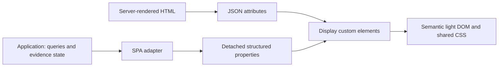
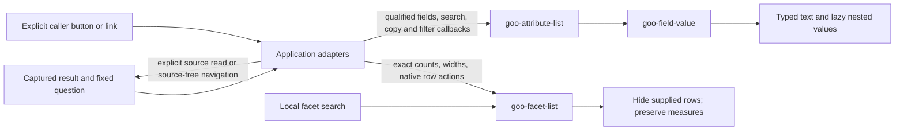

# Display component library

The public UI library is framework-neutral Web Components: custom elements that
upgrade ordinary server-rendered HTML and accept property updates in an SPA.
They render supplied data. They do not fetch telemetry, calculate measurements,
choose question scope, navigate, publish evidence or own investigation state.
The application remains responsible for those actions and their read boundaries.

The standalone [component reference](http://localhost:8088/ui-components) loads
only the display library, its stylesheet and synthetic fixtures. It does not load
the goo application or a query client. Its examples are component conformance
fixtures, separate from the real OTLP-backed application storyboards.

## Public elements

| Element | HTML attribute | SPA property | Purpose |
| --- | --- | --- | --- |
| `goo-latency` | `summary` (JSON), `heading`, `heading-level` | `.summary`, `.heading`, `.headingLevel` | One mean and a compact p50/P95/P99 group, with exact values and min/max in native disclosure. |
| `goo-stat-list` | `items` (JSON) | `.items` | Label/value pairs; counts remain exact strings. |
| `goo-metric-comparison` | `data` (JSON) | `.data` | A related group of paired metrics on one zero-based scale. |

Load `components.css` and `components.js`. The comparison element additionally
loads `comparison-visual.js`; it depends only on the display library. Classic
script tags or side-effect imports work; no framework or application bootstrap
is required. Wait for `customElements.whenDefined(name)` if needed. Properties
assigned before definition are upgraded and remain reactive. Elements can be
reconnected. Structured properties and getters are detached copies.

```html
<link rel="stylesheet" href="/components.css">
<goo-latency heading="Span latency"
  summary='{"state":"observed","count":"2","sumNs":"30000000","p50Ns":"20000000","p95Ns":"20000000","p99Ns":"20000000","minNs":"10000000","maxNs":"20000000"}'>
  <p>Mean 15 ms; p95 20 ms.</p>
</goo-latency>
<goo-stat-list items='[{"label":"Captured spans","value":"900719925474099300"}]'></goo-stat-list>
<script src="/components.js"></script>
```

Use the server template engine's ordinary HTML-attribute escaping for JSON,
including quotes and ampersands. The optional child content is a server-rendered
fallback; upgrading replaces it with the component's display. Inputs are data,
never expressions or HTML. Labels render as text. A malformed JSON attribute
produces an unavailable/empty display without executing anything.

```js
await customElements.whenDefined('goo-latency');
const latency = document.querySelector('goo-latency');
latency.summary = validatedResult.duration;
// No query, navigation or application event is triggered.
```

A latency summary uses the existing typed span-duration result: `state`, `count`,
`sumNs`, `minNs`, `maxNs`, and whichever of `p50Ns`, `p95Ns`, `p99Ns` were actually
supplied. All numeric fields are canonical nonnegative integer strings. Missing
quantiles remain absent; P90 is not invented or interpolated. Zero duration is
observed zero; `no_data` and `unavailable` do not render zero-valued markers.
Display rounding remains 0.001 ms, using BigInt arithmetic. Exact strings remain
in the disclosure. The percentile rail shows positions on one duration scale;
it is not a histogram or a reconstruction of a distribution.

Comparison data has `title`, `unit` and `rows`; each row supplies `label`, two
`values` (nonnegative decimal strings or null), two `display` labels, and `delta`.
The caller supplies already-compatible measurements and the actual difference.
The component chooses a shared zero-based axis and does no compatibility,
percentile, rate or health inference. An unavailable value has a hatched track.
Signed/scientific native formats continue to use exact tables where unsupported.

## Standard behavior and styling

Elements use light DOM and native semantic HTML, including `dl`, `table` and
`details/summary`. Disclosures support keyboard activation without a custom
widget protocol. `heading-level` accepts 2–6 (default 3), so an embedding page
can preserve its heading outline; service cards request level 6. Grid placement
and page layout belong to the embedding application. Updating data rerenders the display and resets disclosures.
There are no custom business events, storage, timers, network clients or hidden
source reads. JSON attributes are bounded to 64K characters; comparisons have at most 16
metric rows and stat lists at most 32 entries. Presentation limits never define
source totals. Layout does not introduce record IDs or shared DOM IDs.

`components.css` owns reusable component styles. Product page layout stays in
`product.css`. Theme with the existing CSS tokens (`--ink`, `--muted`, `--border`,
`--accent`); standalone defaults use the dark product palette. The library also
exports small native DOM/disclosure/action helpers for existing vanilla app
callers. Those are adapters, not a requirement for using the custom elements.
Existing charts remain in the display-only `GooComparisonVisual` module.



## Adoption and verification

Services and live/frozen Explore use the same latency element and stat-list
primitive. A related group of mean/P95/P99 comparison values occupies one metric
matrix instead of three independent cards. Unsupported native percentile ranges
retain their original interval semantics. Widget secondary actions use one native
disclosure; opening the question remains visible. Explore combines search,
filters and breakdowns in one workbench; advanced measure settings remain closed
until requested, even when the applied query includes those measures.

Journey 63 exercises server HTML upgrade, SPA updates (including assignment before
registration), detached values, invalid JSON, exact large labels, zero/absence,
text safety, keyboard disclosure, shared geometry, and mobile containment with no
app runtime or API requests. Real journeys 35/52/54/58/59/62 exercise the adopted
components with captured telemetry and source-free evidence. Their observed Quint
ledgers and Bombadil checks retain the semantic and state-transition coverage.
This is an incremental library: adopt these primitives when touching remaining
views rather than introducing another local metric-card implementation.

The [whole-app component audit](UI_COMPONENT_AUDIT.md) maps remaining adoption
surfaces and proposes passive table, result-state, facet and attribute contracts.
These are recommendations, not additional implemented elements.

## Eventual streaming adapters

The same property/attribute contracts can receive snapshots from an application
SSE adapter, and a passive table shell can retain caller-owned HTML rows patched
by Datastar/htmx-style delivery. No component lifecycle or disclosure should
subscribe or fetch. Transport authentication, retry/cursor/gap state, ordering,
retention and fixed/live scope belong outside the components. Current summary
updates replace their inner DOM and reset disclosures; they are not a high-rate
tailer with keyed rows, preserved focus or scroll-follow. The audit defines those
future requirements; no SSE endpoint, tailer or framework dependency is added.

A future baseline-vs-live adapter can send one paired snapshot to
`goo-metric-comparison.data`: the baseline values remain fixed while supplied
current values/differences and the app's visible current basis/window advance
together. That display update is already supported; a live comparison engine,
SSE transport, coverage semantics and high-frequency focus retention are not.
The standalone fixture tests current-side property updates without mutating the
baseline or starting a query.

## Native tables and result states

`goo-table` wraps a caller-authored native table, including its caption, thead,
tbody, scoped headers and controls. It supplies a keyboard-focusable labelled
region and contained horizontal overflow. Set `aria-label` or `aria-labelledby`,
`density="compact"` for tighter cells, and optionally `sticky-header` with an
app-owned bounded height. Default density uses comfortable spacing. It never
replaces children, sorts, pages, calculates totals or attaches subscriptions.
Adapters can append/update native rows while retaining existing nodes and focus;
reconnect and attribute updates retain all content. The adapter must supply row
identity, retention and follow/pause behavior for any future streaming surface.

`goo-result-state state="partial"` accepts caller-authored explanation and native
action children. Supported vocabulary is loading, empty, partial, unavailable,
stale and unknown. `.state` reflects the attribute, including pre-upgrade SPA
assignment. The component supplies a polite atomic status region; `announce="off"`
disables announcements. Update the explanation text when state changes; color is
supplementary, never the sole status cue. Caller-authored roles are retained.
Unknown states receive neutral styling. There is no telemetry health inference,
retry handler or source fetch. Avoid duplicating announcements in nested regions.

Explore adopts these for inspection pages, full-population breakdown tables and
main read status. Services uses them for operation lists, widget breakdowns and
independent source/empty/partial states. Existing query scope, total counts,
paging and action callbacks remain adapter-owned. Native source absence and local
search misses have distinct explanations. See journey 64 for native row patch,
focus retention, reconnect and keyboard overflow checks; journey 59 exercises real
OTLP-backed Services adoption and partial source availability.

The status region itself is not marked `aria-busy`: its loading explanation should
be announced immediately. An adapter may independently mark the result container
busy while replacing a snapshot. Real assistive-technology validation of the
existing mobile table-to-card layouts remains outstanding; browser contracts
verify native markup and keyboard behavior, not screen-reader output.

## Facets and typed attributes

`goo-facet-list` (components.js) keeps caller-authored direct children marked
`data-facet-item`, with `data-facet-text` as literal searchable text and optional
`data-facet-key` as an opaque identity. `query` / `.query` applies a local,
case-insensitive substring search by toggling those rows' `hidden` property.
`refresh()` returns `{visible,total}` and reapplies the search after caller row
patches. There is no mutation observer. Supply native buttons/links, including
controlled `aria-pressed` where selection is meaningful; the component neither
selects values nor emits query intent. Native click handlers belong to adapters.
Counts, measures, units, bar widths, rank and labels remain supplied exactly;
local search never recalculates any of them. Use `.distribution-row`, label,
track and fill classes for the shared compact bar presentation. Search controls
and full-population explanatory status stay with the caller. Reconnects and
searches retain row/action nodes. App adapters should show an explicit local
no-match state, distinct from absence of source records.

`goo-field-value` (attributes.js) accepts JSON `value` attributes or detached
`.value` properties. It renders text with a type label, preserving empty strings,
null, false, zero and exact integer strings. `state` / `.state` distinguishes
present, missing, unknown and unavailable. With no supplied value, presence
resolves to missing; malformed/oversized JSON resolves to unavailable. Explicit
unknown/unavailable values are not nulls. Properties accept plain JSON-compatible
values; cyclic, nonfinite, sparse, accessor-bearing and unsupported values are
withheld rather than coerced. Values returned by getters are detached copies.
Attribute JSON is limited to 64 KiB, as for existing component attributes.

Nested arrays/objects expand lazily in batches of 50; depth eight points to a
separate lazy Raw value disclosure for the full supplied JSON. Long strings use
native disclosure. Updates/reconnects rerender the field and reset disclosures;
this component is intended for snapshots, not focus-preserving live cell updates.
No telemetry string is inserted as HTML. Upgrading a field starts no source read.

`goo-attribute-list` is a passive child-preserving display shell. The existing
`GooAttributes.mount/disclosure` adapter owns physical-to-semantic field mapping,
scope grouping, local key/value search, clipboard feedback, and explicit filter/
breakdown actions. It composes these elements in Explore, trace/log context and
native metric identity displays. The component does not assume that string values
are queryable, map OTel keys, or construct a question. Missing fields are not
invented by the adapter; the standalone value API can display explicitly supplied
absence/unknown states. Use the shared attribute classes for native caller rows.

Journey 65 validates standalone SSR/SPA contracts, native facet selection
preservation, row patches/reconnects, exact strings, type/presence distinctions,
safe text and no API reads. Journey 29 follows real OTLP attributes through local
search, copying, fixed-window narrowing, trace/log inspection and mobile display;
journey 34 verifies full-population scales and saved facet evidence.



The return arrow is application behavior. Component upgrade, local search and
value disclosure never perform that read or navigation.

Types describe the supplied captured representation. In particular, numeric-looking
exporter attribute strings remain strings; these elements do not recover lost OTel
AnyValue types or authorize new numeric expressions.

## Trace and count-time plots

`goo-trace-waterfall` and `goo-time-bars` now share the display-only boundary.
See [waterfall API and limitations](UI_WATERFALL.md) and
[count-time bars](UI_TIME_BARS.md). Both accept server HTML JSON and detached SPA
properties. Controlled selection changes update native state without replacing
focused rows/bars; data snapshot replacement rerenders the plot. The application
retains trace details, source reads, question links and interval selection logic.

Waterfalls show supplied span extents and reported parent/link context, never a
complete-trace guarantee or invocation count. Count bars preserve supplied exact
counts/domain; zero has zero geometry and unavailable values remain explicit.
Explore and Services use these components. Native interval/histogram/metric
semantics remain in their separate adapters. The [chart/detail review](UI_CHART_DETAIL_REVIEW.md)
prioritizes chart frames, detail panels and heatmap matrix reuse as follow-up work.

## Shared chart frame

`goo-chart-frame` supplies passive heading/unit/window/state chrome around
caller-owned native plots, legends, disclosures and actions. Attribute or
`.data` metadata updates preserve those children and their focus. The app owns
freshness, refresh and evidence behavior; the frame performs no source reads.
See [the API](UI_CHART_FRAME.md) and the `/ui-components` example. The standalone
journey uses synthetic display data and explicitly verifies no telemetry reads.

## Supplied percentile domain

`goo-latency` now accepts optional `ceiling-ns="100000000"` in server HTML or
`.ceilingNs = "100000000"` from an SPA, including before registration. The exact
integer domain applies to percentile geometry; mean remains a separately labelled
scalar. Both compared elements receive the same domain. Missing domain retains
the original automatic behavior. Invalid domains or domains below a supplied
quantile render unavailable, never clip or silently expand. Zero and exact large
integers retain their existing semantics. Domain changes rerender the summary
and reset its disclosure, just like snapshot changes. Components do not calculate
comparison compatibility, fetch telemetry, rescale themselves or own subscriptions.

The shared comparison renderer accepts nonnegative integer/fraction rates and
computes common-domain geometry with exact BigInt cross multiplication. The
live-counter app adapter owns rounded labels, stable domains, coverage/freshness,
reads and freeze capabilities; display components do not subscribe or fetch.

Native measurement stream focus/clear actions belong to the app adapter. Their
identity disclosures reuse GooAttributes. Observation tables retain readable
columns inside the existing scroll owner on mobile; table minimum width is
scoped to the measurement table class and does not affect other table users.

Native stream navigation composes the existing passive `goo-facet-list`,
`goo-stat-list` and attribute disclosures. The measurement adapter owns full
inventory search/review predicates, pagination, focus and diagnostic mapping.
Only supplied interval/sample states are counted; no rates/coverage semantics or
subscriptions move into components. Observation table headings/cells stay intact
inside their existing horizontal scroll owner on narrow screens.

Native service cards reuse `goo-table`, `goo-stat-list` and structured attributes.
The service adapter owns typed-result matching, latest-interval presentation,
exact-stream links and lazy retained-result construction. Expanding/searching a
retained widget does not subscribe or fetch. The compact table remains outside
the retained browser and preserves its nodes while local inventory filters change.
