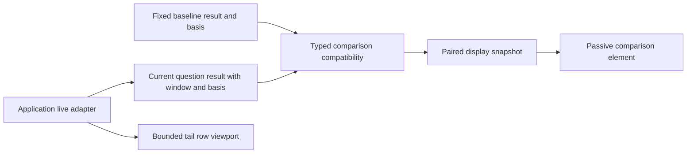

# Whole-app display component audit

Reviewed 2026-10-20. This is a source/design audit, not an implementation claim
or a new live browser validation campaign. It covers Explore, Services,
Operations, Measurements, Definitions, and saved investigations. Sources include
their UI modules and existing frames 29b (facets), 40a (definitions) and 48a
(services). Those frames describe earlier recorded deployments; the active
component round is regenerating its affected frames separately.

The current library contract is documented in [UI_COMPONENTS.md](UI_COMPONENTS.md).
It introduces `goo-latency`, `goo-stat-list` and `goo-metric-comparison`. The
recommendations below extend that approach: framework-neutral custom elements,
ordinary server-rendered HTML, detached SPA properties, primarily display behavior,
and native HTML interaction. They do not propose a framework migration.

## Highest-value next extractions

| Order | Component or pattern | Existing duplication | Minimal responsibility |
| --- | --- | --- | --- |
| 1 | `goo-table` | Record/group tables in Explore; service inventory/dependencies/widgets; measurement streams/subjects; comparisons; ratio/fleet interval matrices. | A semantic table viewport, caption, density, contained overflow, and optional sticky header. Preserve caller-authored native cells and actions. |
| 2 | `goo-result-state` | Loading/error/empty paragraphs, evidence notes, widget state text, local-search no-match messages, native unknown/no-data intervals. | Consistent visible state, concise explanation, optional caller action content and standard live-region behavior. Never infer health from state. |
| 3 | `goo-facet-list` | Explore distribution rows, captured service filters, grouped-series filtering and several library searches. | Already-supplied labels, exact counts and shared-scale bars; local find and controlled selection only when requested. No predicate or query execution. |
| 4 | `goo-field-value`, then `goo-attribute-list` | `attributes.js` record/trace/native stream inspection; fallback stream identity strings; repeated JSON evidence viewers. | Typed values, scope groups, long/nested value disclosure, local find, copy feedback and optional native action content. Preserve missing/empty/null distinctions. |
| 5 | Scope/evidence summary pattern | `question-scope.js`, Explore banners, native stream headings, captures, document evidence entries, comparison sides, fleet policy receipts. | A concise scope/state line with expandable exact identity, clocks and basis. The application supplies semantics and clock labels. |
| 6 | Plot frame and interval display patterns | Time bars, grouped small multiples, native gauge dots, heatmaps, ratios, percentile/comparison plots. | Shared caption/axis/legend/value disclosure, accessible selection and explicit gap treatment. Keep different chart types and metric semantics distinct. |

Start with the table viewport and result-state display. They have the widest
adoption surface and can improve the app without moving semantic or workflow
logic. Extract facets and attributes next using their existing pure display models.
A new custom element is useful when it standardizes a real rendering/interaction
contract; ordinary CSS classes and native HTML are enough for a generic card,
section or button row.

## Table contract: preserve HTML, avoid a datagrid framework

Prefer progressive enhancement of a native table over JSON column definitions
with executable cell render callbacks:

```html
<goo-table aria-label="Captured route populations" density="compact" sticky-header>
  <table>
    <caption>Captured route populations</caption>
    <thead><tr><th scope="col">Route</th><th scope="col">Span records</th></tr></thead>
    <tbody><tr><th scope="row">/search</th><td>1200</td></tr></tbody>
  </table>
</goo-table>
```

This initial API is now implemented (see the adoption update below). It retains the table and supplied
links/buttons in light DOM. The original adoption requirements are:

- Native caption, column/row-header semantics and visible numeric alignment.
- Keyboard-reachable overflow when content actually overflows, with a meaningful
  viewport label, visible focus, and no global horizontal page overflow.
- One opt-in sticky-header implementation rather than per-view inline styles.
- A default horizontal comparison layout on narrow screens. A record-card layout
  is a separate opt-in pattern; do not silently turn a comparison matrix into
  unlabeled cards or remove screen-reader header relationships.

Sorting, filtering, row expansion content, pagination, selection state, record
identity, totals and cell actions stay outside the initial component. A button
can request a sort, but the application decides whether that means a new source
query or ordering already-supplied rows. A displayed page must not become a
measurement population. Keep arbitrary native HTML actions supplied by the caller;
a shared table must not learn about query ASTs, capture IDs or investigation routes.

The app adapters should omit unsupported columns deliberately. For example,
log comparison breakdowns currently retain unavailable span-error/duration
columns. Hiding those columns belongs to the adapter's known result contract,
not to the table guessing a signal from a field name.

## Facets: one visual vocabulary, application-owned intent

The current distribution renderer already has a useful pure split: full groups
arrive from the result, local search hides rows, and the application handles
`refine(field, value)`. Reuse that separation. A proposed `goo-facet-list` accepts
items with an opaque key, text label, explicit value state, exact count label,
already-computed share/measure value, selected state and optional disabled reason.
The adapter also supplies a scale ceiling and measure/unit label.

Keep a read-only default. For selectable lists, use controlled selection with a
small documented selection-request event carrying only the opaque key, or retain
caller-authored native row buttons. The adapter decides whether to stage a draft,
run an explicit narrowing operation, or open a source-free question link. Labels
must communicate that difference; a library must not turn every click into a read.

Local search must not recompute a denominator, scale or rank from visible rows.
Display how many supplied values match the local search, while retaining the full
population denominator. Missing key, present-empty string, literal string, null,
zero records and unavailable measurements remain different values/states. Counts,
error percentages, numeric magnitudes and durations need distinct units and
formatting; a shared bar does not make those measurements interchangeable.

A separate controlled filter-chip pattern can show a supplied qualified field,
operator, value and optional native remove button. Predicate nesting, AND/OR,
resource/attribute/column namespaces, draft/applied state and validation remain
in the application. Do not combine the predicate builder into the facet display.

## Attributes and exact values

`attributes.js` is already the best extraction seed: type labels, nested/lazy
values, long strings, local key/value search, scope grouping and safe text output
are reused across records and native stream identity. Preserve that renderer
rather than creating another JSON viewer.

The public value shape should explicitly separate presence from value. For
example, `{state:"present", value:""}`, `{state:"present", value:null}` and
`{state:"missing"}` are different. Unknown and unavailable measurements are not
null attribute values. Qualified source labels are supplied by the adapter; the
component must not map physical `ResourceAttributes` columns to semantic fields.

Copy is a reasonable optional standardized behavior, with permission failure
feedback and selectable text as a fallback. Filter/breakdown links and buttons
belong to callers. A display component must never construct `goo:open-question`,
assume that a string is queryable, or read telemetry after a value is selected.
Keep lazy nested disclosure and bounded DOM construction for 100-row record pages.
Depth/preview limits must expose a route to the full supplied raw value; they are
presentation limits, not claims that omitted attributes do not exist.

## States, scope and evidence

A common result-state component should accept an explicit state and explanation.
It must distinguish at least loading, unavailable, no captured data, unknown,
partial result, changed-between-reads, and no local matches. These labels are not
interchangeable: a local search can hide rows while captured totals remain known.
Observed telemetry does not establish healthy service status; no data does not
establish success or failure. Do not assign a green health check to every
`observed` value.

Use a stable polite status region for asynchronous changes and `aria-busy` for
loading. Reserve assertive announcements for actionable failures rather than
announcing every receipt or widget. Action content is supplied by the application;
the display must not decide that retrying, refreshing, capturing or rerunning is
safe/equivalent. If a source failed, do not keep old numbers under a new scope.

A scope/evidence summary should reduce repeated paragraphs while keeping the
important visible facts: signal/grain, environment, fixed window, service/namespace,
and unavailable/incompatible states. Exact receipt IDs, full stream dimensions,
clock precision and basis can be in a native disclosure. Preserve event time,
source read time, capture custody time, evaluation time and knowledge cutoff as
separate labeled clocks. Do not infer those roles from a generic timestamp.
Missing and present-empty OTel namespace identities remain distinct.

## Whole-app adoption map

| Surface | First adoption | Keep in the application |
| --- | --- | --- |
| Explore records, trace inspector and surrounding logs | Table viewport; attribute/value display; result state. | Fixed question, paging limits, trace expansion, broader-context explanation and filter/run actions. |
| Explore distributions and grouped time series | Facet rows, controlled filter chips, shared plot frame. | Full group totals, exact measure choice, ranking, AND/OR and draft/applied session state. |
| Services catalog and distributed relationships | Table viewport, state and qualified identity display. | Namespace identity, declaration/observation distinction, exact edge selector and wider-service handoff. |
| Automatic service widgets | Existing latency/stats; table viewport; result-state and evidence summary. | Widget planning, bounded reads, failure isolation and capture/add-to-investigation actions. |
| Measurements and lifecycle subjects | Table viewport, stream identity/value display, state and paging controls. | Temporality/reset/coverage semantics, subject classification, prepared cohort and explicit source reads. |
| Operations, ratio/fleet and native heatmaps | Table viewport and plot frame; shared selected-value detail. | Actual interval support, fleet alignment, bound events, contextual span searches and no scalar-percentile aggregation. |
| Definitions and reusable question libraries | Shared catalog-row/card CSS, local search/status and restrained secondary actions. | Package validation, revision grouping, YAML editing and immutable save/preview/run workflows. |
| Saved investigations and evidence comparisons | Existing metric matrix; evidence-summary and result-state display; standard action/disclosure styling. | Narrative revisions, read-only reopening, stored receipt references, draft safety and publishing/capture intent. |
| Recipes and guided workflows | Shared catalog/list styling and capability-state display. | Prerequisites, authored steps, scope transformations and navigation. |

Definitions currently shows many cards for immutable revisions with repeated
names. A common card would make the duplication consistent but would not solve
the discovery problem. Grouping revisions by definition, choosing a current
revision and revealing history is an application-level design task. Likewise,
service identity and scope adapters should remain explicit instead of being
hidden inside a universal result-card component.

## Library boundaries and near-term consistency fixes

Keep host page placement in product layout: a standalone
`goo-metric-comparison` should not force itself to span two columns in an unrelated
server page. The app's comparison grid can request that placement. Components
own internal geometry, spacing and responsive containment; the host owns page
navigation, grid position and result ordering.

Keep heading hierarchy caller-controlled. The current latency contract is being
extended with a bounded `heading-level` attribute / `.headingLevel` property
(default h3; service cards use h6). A native heading slot is another viable future
option, but there is no need to add both APIs now. Labels must remain accessible
without replacing all native headings with custom ARIA-only elements.

Use the existing component token vocabulary consistently and document defaults.
The library should be usable with its standalone stylesheet; avoid accidental
dependence on global app `table`, `.scroll`, button, or heading rules. Shadow DOM
is not required: semantic light DOM plus component-scoped styles fits SSR and
native slotted/caller content. Standard disclosures and native buttons need less
custom protocol than a new menu or datagrid implementation.

Light-DOM ownership needs an explicit selector rule: page and adapter CSS should
target the table/viewport they own, not arbitrary descendant tables inside nested
components. The active round exposed this in `.comparison-breakdown table`: its
58rem minimum width leaked into a nested metric comparison and pushed the Change
column offscreen. The fix scopes the rule to the owning direct `.scroll > table`.
Moving styles into a library alone does not prevent this kind of ancestor leak.
Include composition fixtures and real nested comparisons alongside standalone
component fixtures; on a sufficiently wide desktop host, all metric-matrix
columns should be visible without an inherited application minimum width.

## Eventual live updates: transport-neutral display contracts

A future log/trace tailer should fit these components without coupling them to a
transport library. Server-rendered HTML patches or ordinary property/attribute
updates can work with Datastar, htmx or a small application adapter. This is a
compatibility direction, not a chosen SSE protocol or an implemented tailer.

The application/server adapter owns SSE connection and authentication, reconnect
policy, cursor/watermark semantics, cancellation and the exact read scope. It
also owns ordering, deduplication, stable row keys, late-data handling, bounded
retention and whether a view is following or paused. None of these should be
inferred by a display element from the arrival order of DOM updates. Component
upgrade, DOM reconnect, data assignment and disclosure never start implicit
polling or a stream subscription.

A stable presentation key must identify the intended physical record/update.
`TraceId`/`SpanId` alone is not guaranteed physical row identity: an exporter can
emit duplicate span records. Choosing how to retain, replace or deduplicate those
records is an adapter/source contract, not a generic table convenience. A retained
tail ring buffer is an inspection population; its counts cannot silently become
full-population counts, rates, errors or duration measures.

The proposed table viewport should preserve its outer element and enhance the
caller's native table without rebuilding a caller-owned `tbody`. Keyed row
insertions, updates and removals can then arrive as server HTML patches or be
applied by an SPA. Avoid replacing the complete table merely to add one record.
A passive viewport must tolerate those patches while preserving keyboard focus,
expanded-row identity and the user's scroll position. A follow/pause affordance
can be caller-owned native content; the adapter decides whether pause means stop
auto-scrolling, buffer incoming records, or stop the connection, and labels the
actual behavior. Do not silently jump back to the bottom while someone inspects
an older record. Show retained/displayed counts and eviction/truncation explicitly
when the application's bounded retention removes rows.

Streaming also changes what facets and result states can honestly display:

- A facet list receives an explicit population/basis and already-computed values.
  An evolving live window, retained tail buffer and full source population are
  different denominators. App-supplied keys preserve selected values across updates;
  disappearing/evicted values must not silently clear an authored filter.
- A result-state display needs supplied connection/follow status separately from
  telemetry-result state. Disconnected, reconnecting, canceled, paused and an
  acknowledged gap are different from no captured records or an unavailable query.
  A connected stream alone does not establish complete ingestion.
- Arrival order is not event-time order. Keep live event time, adapter observation
  time and capture custody time distinct. A trace can still be incomplete when its
  first span arrives; a parent may appear later, and sampling may omit it entirely.
  The adapter supplies provisional/incomplete status and any changed membership;
  the table or waterfall must not invent a root, parent or completeness claim.
- Late records can alter a live summary or relationship while an existing fixed
  capture and its frozen evidence basis remain immutable. A tail view is not frozen
  evidence. Capturing a bounded question or advancing an evidence basis remains
  an explicit application action.

The current summary elements rerender with `replaceChildren` when their supplied
properties or attributes change. That is suitable for bounded, infrequent summary
updates, and currently resets native disclosure state. It does not provide keyed
row reconciliation, incremental tail buffering or focus/scroll preservation for a
high-frequency tailer. Keep that limitation explicit. A future streaming round
should test keyed patches and retained focus/scroll under real reconnect, gap,
pause/resume, eviction and late-parent cases before claiming live-tail support.

### Comparing a baseline or another question against a live view

Proposed flow only; streaming delivery and reconciliation are not implemented.



The row viewport is a separate inspection path; its retained rows do not define
the current question's full-population measures.

A future comparison can pair an immutable baseline capture, or an explicitly
identified fixed-question result snapshot, with a scoped rolling/current question.
A fixed question alone does not freeze its source data: pin the actual result
basis and window, and distinguish an in-memory pinned snapshot from a durable
capture. Do not silently reread or advance the baseline when the tail updates.

Publish current comparison inputs as a coherent snapshot: exact question/window,
result basis, sequence/as-of marker, measures and relevant state together. Atomic
publication means the UI does not pair counts from one update with durations or
groups from another; it does not assert a transactional source read. Preserve the
existing changed-between-reads state when source reads disagree. Full-population
aggregates for that question must remain separate from the retained tail rows and
ring-buffer counts.

The application uses the existing typed comparison kernels to check supported
measure, grain, unit, signal, environment and selector/definition compatibility.
An arbitrary second question is not automatically numerically comparable. Keep
both scopes visible and withhold unsupported deltas. Different window widths
must remain explicit; record-count changes do not silently become throughput.
Native rates still require their actual supported intervals, and native
percentile ranges remain ranges. See [captured comparison](CAPTURE_COMPARISON.md),
[question scope](QUESTION_SCOPE.md) and
[fresh fixed-window comparison](FRESH_COMPARISON.md) for the current boundaries.

Keep geometry readable across updates: changing a shared axis can change the
baseline bar length even when its value is fixed. A future adapter should choose
a stable scale where useful or expose rescaling clearly, without clipping new
values or substituting zero for unavailable data.

Pause, disconnect, acknowledged gaps and late data remain part of the current
side's state. Label whether pause stops only tail following, also holds comparison
snapshots, or stops the source adapter. Retaining the last valid snapshot can be
useful, but show its actual as-of/window and state rather than relabeling it as a
fresh current value or filling a gap with zero. Late data can revise a new current
basis while the pinned baseline and already-frozen comparison remain unchanged.

A proposed **Freeze current comparison** action should explicitly identify the
baseline and current question/window/basis being retained. It must state whether
it persists the displayed validated snapshot or rereads the fixed current
question; existing capture actions perform a reread and can observe late data.
Use the existing [capture](GENERAL_CAPTURES.md) and
[saved comparison](SAVED_COMPARISONS.md) semantics where applicable. This audit
introduces no new persistence endpoint, stream message format or backend protocol.

Display elements receive a supplied paired snapshot; they do not subscribe,
recompute deltas or decide compatibility. One `.data` update can replace the
metric matrix coherently. The current summary renderers still replace their
children, so that mechanism is appropriate for bounded, infrequent updates; it
is not yet a high-rate, focus-preserving live comparison implementation.

## Acceptance for the next extraction round

Add standalone SSR and SPA fixtures for the table, state and facet contracts,
then adopt each in at least two real surfaces before adding another abstraction.
Prove exact strings, no hidden source reads, safe text, property updates before
registration, reconnect behavior, keyboard navigation, focus retention and mobile
containment. Include missing/empty/null, unavailable measures and local no-match
fixtures. Tables need header/caption and keyboard-overflow checks; facets need
unchanged full denominators and equal geometry across local-search results.

Real journeys 29/30, 31/32, 35, 38–40, 45, 48, 52/54, 58 and 59–62 provide the
adoption paths. Keep their actual OTLP-backed screenshots current; standalone
synthetic fixtures document components but do not replace source-backed journeys.
Existing Go/Hegel properties continue to verify semantic adapters. Quint observed
traces and Bombadil actions should verify that component adoption preserves
application read boundaries, exact scopes and stale-result rejection. Do not move
those semantic or workflow assertions into a display component's implementation.

## Adoption update (2026-10-20)

The first two proposed primitives, `goo-table` and `goo-result-state`, now exist
and are adopted in Explore inspection/group results and Services operation/widget
results. Native table content is retained across attribute changes and reconnects.
This is a passive viewport foundation, not an SSE transport or live evaluator.
Facets, typed attributes and broader table migration remain next adoption work.

The facet and typed-value extraction is now implemented: caller-owned facet rows
with local search, typed snapshot values and a passive attribute-list shell.
The existing adapter retains scope/search/copy/filter actions. Automatic field
mapping, source-backed facet requests and streaming value patches remain outside
the components. See [current contracts](UI_COMPONENTS.md).
