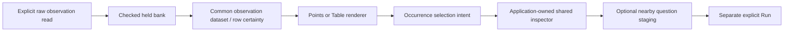

# Passive raw gauge points

`goo-raw-gauge-points` displays a checked `goo.dataset/1` observation snapshot.
It never reads telemetry, subscribes, evaluates measurements or opens an inspector.
The application supplies the held dataset and handles selection intent.

```js
import {dataset} from '/raw-gauge-points.mjs';
import '/raw-gauge-points-view.mjs';
const points = document.querySelector('goo-raw-gauge-points');
points.data = dataset(heldRawGaugeRead);
points.addEventListener('goo-raw-gauge-point', event => {
  const keys = event.detail.occurrenceKeys;
  if (keys.length === 1) inspectHeldOccurrence(keys[0], event.target);
});
```

Load `components.css`, `chart-frame.css` and `raw-gauge-points-view.css`. Server HTML can place the
same snapshot JSON in the `data` attribute after normal HTML attribute escaping.
Attributes accept at most 2 MiB; the property supports the validated raw-bank
budget. Pre-definition `data` and `selectedKey` properties upgrade on connection.
Assignment and readback detach values.

## Exact values and approximate positions

Known finite recorded observations receive value/time coordinates. UTC bounds and
full observation timestamps remain inspectable. Plot positions are approximate;
raw scalar strings and exact nanosecond timestamps remain authoritative. The
plot contains no connecting lines or inferred producer identity.

Identical normalized coordinates share a marker with their supplied occurrence count. They need not be
identical raw values: binary64 normalization can place different exact values at
the same position. Activating such a marker opens explicit member choices; it
never chooses the first member automatically. Each member returns its original
read-local occurrence key. Nearby markers can also overlap on screen;
**Observation values** still lists every supplied occurrence.

Unknown recording flags, unrecorded values, invalid/nonfinite values and eligible
observations beyond the 1,000-location display budget remain accounted for.
**Observation values** offers all supplied rows through local pages of 100,
including unplotted rows. It does not acquire another source page. The component
never turns an unknown source read into complete coverage. Reaching the raw read
budget does not establish a partial result: the raw API refuses an over-budget
read atomically, and an exactly-at-budget result retains unknown coverage.

## Interaction contract

Native mark buttons use a single Tab stop and arrow/Home/End navigation. A marker
or member button emits the bubbling `goo-raw-gauge-point` event from that actual
button, with `{occurrenceKeys: [...]}`. The owner must recheck its bank, revision
and visible control before acting. A multi-key event identifies a collision;
applications must not treat its first key as uniquely selected. Selection belongs
to the dataset/revision: the same ordinal key in another read is not the same
source observation.

`selected-key` / `.selectedKey` is controlled by the caller. Selection updates
`aria-pressed` without rebuilding the plot, detaching the opener or closing member
choices. A data replacement rebuilds the snapshot and retires old click handlers.
Hidden, detached and retired controls emit no selection intent.

Generic `<goo-chart>` uses the same renderer for `{kind: 'points'}` and
`{kind: 'table'}`. Table mode renders UTC timestamps, raw values, explicit
recording/value state and inspection intent through local pages. Singleton
selections adapt to the existing `goo-select` dataset/scope envelope; a
coordinate group does not become an arbitrary first selection.

The component module is exported as `RawGaugePoints` by `ui/display.mjs`. The
public display graph remains passive; raw acquisition and nearby-record owners
stay outside it. See the [raw gauge workflow](RAW_GAUGE_OBSERVATIONS.md) and
[validation](../VALIDATION.md) for actual application checks.

## Dataset and certainty contract

The common dataset uses `shape: 'observations'`, a `rawGauge` descriptor with the
exact request/read time/read budget, and occurrence rows. Each row retains the
original typed observation and raw source row. Its `state` is `recorded`,
`unknown`, `not-recorded` or `invalid`; raw text stays in
`observation.rawValue`. The numeric field represents the parsed binary64 value
as an exact rational. It does not replace the original source text.

Imported/SSR snapshots retain the normal immutable browser-held downgrade and
local identities, without inventing a source basis or completeness attestation.
The raw profile has a bounded 16 MiB / one-million-node normalized import budget
so 10,000 valid source occurrences remain expressible. Ordinary dataset limits
remain unchanged. Complete-only displays refuse this unknown-coverage profile.


