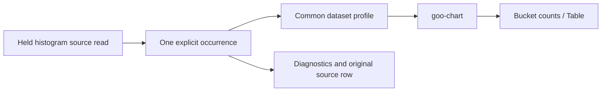

# Raw histogram bucket displays

Inspect a discovered explicit histogram, choose **Read observations**, then
**Inspect** one point. **Bars** and **Table** use that same held occurrence.
Switching displays, paging buckets and closing the inspector do not read data.

Bars compare exact source bucket counts. Intervals have equal visual spacing;
bar lengths are approximate counts, not probability density. Infinite edge
intervals have no invented finite width. Negative bounds, arbitrary reported
units, zero buckets and UInt64 counts above JavaScript’s integer precision remain
available as exact text. A recorded zero-total point remains a recorded empty
point, distinct from missing bucket data.

Only known-recorded, structurally valid vectors get bars. Unknown recording
flags, no-recorded-value flags, omitted vectors and malformed vectors retain their
explanation and original raw fields. Table can show structurally valid counts
with explicit recording uncertainty. Neither mode merges points, converts
aggregation temporality, infers a producer identity or computes percentiles.

## Shared contract

The existing `goo.dataset/1` grammar has a closed `observations` profile,
`rawHistogram`, containing the checked request, source read clock and read limit.
Its single row retains the exact admitted source occurrence. `histogram` and
`table` display kinds delegate through `goo-chart` to the passive
`goo-raw-histogram-buckets` element. This profile is separate from evaluated
histograms; raw source support does not weaken evaluated histogram admission.
Global coverage, value certainty and upstream sampling remain unknown. Snapshot
hold/import does not invent a source basis or completeness attestation.
Complete-only displays refuse this profile.

```js
import {dataset} from '/raw-histogram-dataset.mjs';
import '/display.mjs';
const chart = document.createElement('goo-chart');
chart.snapshot = dataset(heldHistogramBank, selectedOccurrence);
chart.display = {kind: 'histogram'}; // or table
container.append(chart);
```

The lower-level element accepts one admitted occurrence through `.data` or a
JSON `data` attribute, with `mode="bars"` or `mode="table"`. Optional
`heading-level` follows the containing document hierarchy. Detached property
assignment and server-rendered HTML are supported. The direct element’s JSON
attribute is bounded to 2 MiB; common snapshot import uses the existing bounded
raw-observation envelope. Include
`raw-histogram-buckets-view.css` with the common component/chart styles.
It performs no requests, subscribes to no data source and emits no bucket-to-record
selection intent: summarized metric samples do not identify log/span records.

Bars/Table and heading changes preserve the current bucket page while the same
admitted snapshot remains mounted. Replacing supplied data resets it and retires
old callbacks. The application also retains inspected content through Close/reopen
within its bounded cache. Repeated inspection uses a
[prepared immutable bank](RAW_OBSERVATION_CONSOLIDATION.md#display-state-and-prepared-banks)
rather than revalidating every other occurrence.

At most 100 bucket rows render per page. A vector may contain up to 10,001
buckets; paging preserves all counts and uses the maximum across the full vector
for a stable count scale. No sampled prefix replaces the vector. Exact interval
text remains visible, with original source boundary text available in tooltips.
The read-local occurrence key is not a durable sample identity.



See [raw histogram semantics](RAW_HISTOGRAM_OBSERVATIONS.md),
[executed journey](journeys/raw-histogram-buckets.md) and
[validation](../VALIDATION.md).
