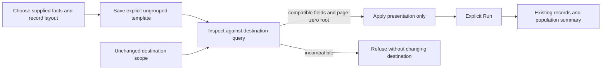

# Reuse records with key facts

Milestone 404 extends reusable templates to ordinary ungrouped log/span views.
Start with **Customize summary** in a fixed result. Count-only reads expose this
action inside **Population context**. Choose the summary facts and record
presentation, enable **Reusable template** in **Preserve**,
and save the configuration. Inspect it in another compatible population, then
Apply. Only **Run** reads the destination's telemetry.

The first arm contains exactly one summary and one records child. Summary facts
use the existing supplied population dataset: count, requested span duration and
requested recorded-status measures. Selected field order and title are reusable.
Numeric measure bindings, grouping, aggregate/timeline/facet/comparison children and
specialized sources remain outside this arm. A summary is not computed from the
visible row page; unavailable values remain distinct from zero.

```json
{"version":"goo.template/1","group":"none","profile":"ordinary-summary"}
```

This binding is explicit about having no grouping. Category-bound templates keep
their separate destination-group contract. Both source and destination must be
page-zero roots. A continuation page is refused rather than silently rewritten.
The destination retains its exact predicates, environment policy, fixed bounds,
projection and page limit. The selected summary fields must already be supplied
by that query; Apply never enables extra query measures to make a template fit.

Inspect/Apply transfers presentation only: no captured data, baseline, certainty,
source lease or donor query replaces the destination. Save and reopen deal in
configuration. Actual source and immutable evidence reads remain separately owned.



See [summary authoring](AUTHORED_POPULATION_SUMMARIES.md),
[template contract](AUTHORABLE_VIEW_TEMPLATES.md),
[shared components](UI_COMPONENTS.md) and [validation](../VALIDATION.md).
