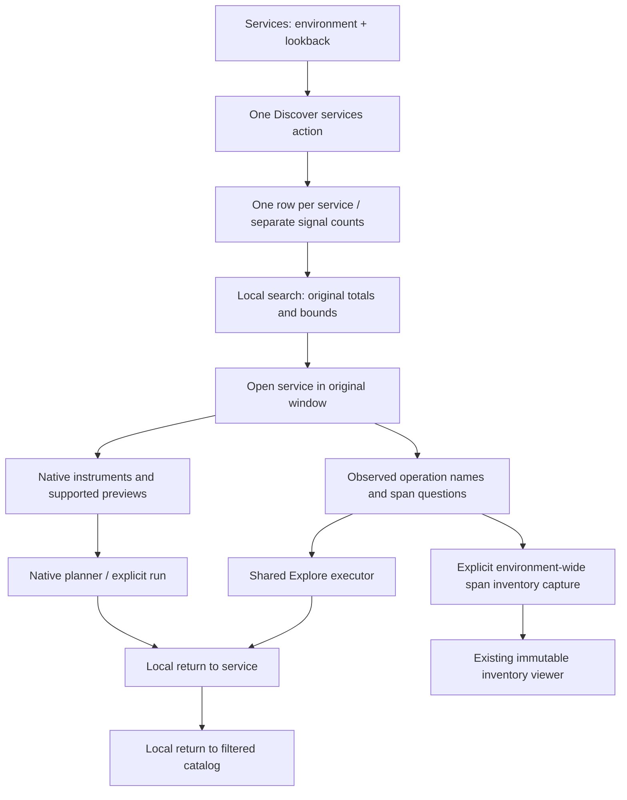

# One Services catalog

Services now starts with one **Discover services** action and one local search.
It calls the existing typed all-signal discovery adapter and presents one row per
observed service. Span records, log records and native metric data-point records
remain separate columns, including decimal counts larger than JavaScript's exact
number range. Missing observations say **Not observed**, not zero or healthy.
Latest event is the latest captured event among those signals, not ingestion lag.

The catalog displays its fixed half-open UTC window. Search filters service names
and observed signal names without rereading or changing totals. Reported dependency
edges and diagnostics are secondary disclosures from the same discovery response.
They remain trace/parent-span evidence; metric-only services imply no topology.

**Open service** retains the catalog environment and bounds. It reads four
independent sources: signal activity, service-scoped spans/attributes, native
instrument metadata and environment-wide span-operation inventory. The service
view filters that inventory to the selected service and offers operation drilldown,
observed-convention questions, native previews and capture/reuse actions. Partial
source failures remain separate; no combined transactional snapshot is claimed.

The operation inventory is deliberately still the existing environment-wide typed
kernel, bounded to 1000 service/operation pairs. Its capture action is explicitly
**Capture environment span inventory** and explains that it rereads all services
in the original environment/window, including other services. It does not archive
the catalog or just the displayed service. Service-scoped inventory compilation is
future work; an environment-wide cardinality failure does not disable successful
native/attribute sections. Native measurement definitions and record questions
continue through the existing preview/Explore executors and capture workflows.

Returning from Explore or a native preview restores service detail without a read.
**Back to service list** restores the catalog and its search locally. Focus returns
to the opener, a visible catalog button, or the search field when no row matches.
These are retained browser views, not durable navigation history or shareable drafts.
A new discovery run or scope edit aborts pending catalog/service work and clears
publishable evidence. Generation checks reject late responses; returned catalog
scope must also exactly match the active request.

The saved-inventory viewer remains a separate read-only renderer. Existing frozen
receipts, local filtering and explicit fixed-window span drilldowns remain usable.
Opening an inventory question live now opens the unified catalog with those exact
bounds, rather than restoring the removed span-first entry. Capture formats and
backend measurement/query semantics have not changed.

Updated [storyboard 46](journeys/README.md#46--browse-a-service-and-follow-observed-conventions)
checks one entry, mixed-signal collapse, separate exact counts, local list return and
keyboard focus, original-window handoffs and deliberate wrong-scope rejection.
[Storyboard 48](journeys/README.md#48--one-services-catalog) documents the new entry
and mobile catalog. Hegel invokes the actual JavaScript catalog planner with
100 requested generated cases; live quint-go validation rejects eight custody,
count/grain, identity and scope mutations. Migrated inventory, captures, core,
metric-only and workbench journeys preserve the existing use cases through this
single entry. See [VALIDATION.md](../VALIDATION.md) for actual acceptance evidence.
