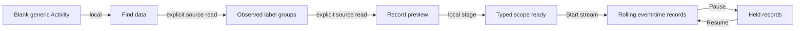

# Choose unfamiliar telemetry from Activity

Activity's **Find data** control sits beside Environment. You can discover
what was reported before knowing any labels, without a manifest or sample package.
In generic mode the chooser is highlighted until a scope is chosen; opening it
performs no source read.

1. Open Find data. Read available signals if you do not know which signal exists;
   Choose logs/spans stages the signal without reading environments or restarting Activity.
2. Read a bounded window of environment labels across that signal's services.
3. Preview a named, empty or unreported environment.
4. Stage in Activity, then Start stream.

The preview uses the effective current/legacy environment policy. Empty labels,
missing labels and conflicting reported keys remain distinct. Stage preserves
existing Activity filters; it neither drops them nor starts a stream. The preview
may therefore contain records excluded by those filters when streaming starts.

The existing discovery and preview endpoints are reused. No all-environments
selector or direct-stage shortcut is introduced.

Named preview buttons expose the complete environment value in their accessible
names. Scope cells are row headers. Explicit Pause/Resume keeps keyboard focus on
the available counterpart; automatic pauses leave the user's focus alone.
Unchanged stream statuses no longer rewrite the live region, and idle local Find
counts do not announce background updates. Changing Find results can still
announce; this is not a complete assistive-technology audit.

Native controls must remain available in the active disclosure. Hidden, inert,
disabled or stale discovery actions cannot start reads or stage a scope. Returning
from a withdrawn request releases its private busy state without publishing data.

## Remaining work

[Source capability checks](SOURCE_CAPABILITIES.md) now identify available
signal families and allow partial-family service/instrument inventories.
Environment discovery still uses the selected Logs/Spans signal; metrics-only
identity bootstrap remains planned. Streaming still uses the latest 60 seconds of event time; sparse and
delayed-event recovery is separate work. See the
[ad-hoc review](reviews/ADHOC_OTLP_REVIEW_2026_11_14.md) and
[current roadmap](ROADMAP_2026_11_14_CHECKPOINT_430.md).

[Executable storyboard](journeys/unknown-data-entry.md) ·
[Independent acceptance](reviews/UNKNOWN_DATA_ENTRY_430.md).
