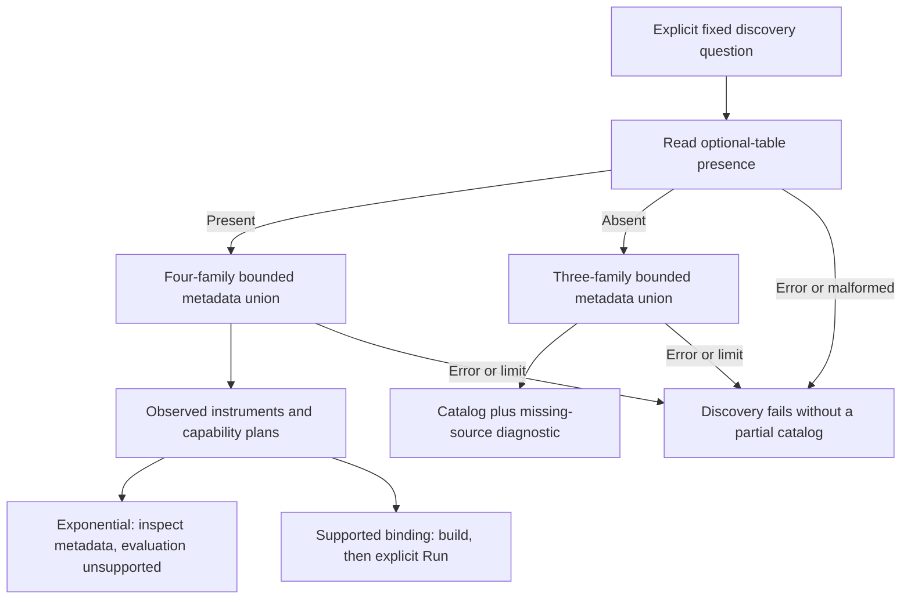

# Observed unsupported metric instruments

Status: delivered (376). Source, API, generated transport properties and native
browser/actor checks pass; see [validation](../VALIDATION.md).

Discovery answers which exported metric points were retained for the selected
service, environment, namespace and fixed window. It does not establish complete
instrument coverage, temporal coverage, producer conformance or value validity.
An observed instrument can be unsupported for evaluation.

## Exponential histograms

Exponential histograms have a distinct metadata kind, `exponential-histogram`.
Discovery retains the reported metric, scope/version/schema, unit, temporality
and observed dimension keys. Counts describe **exported points**, not the bucket
mass or the number of requests represented by those points.

An exponential instrument never receives an executable measurement definition.
Its support plan remains ineligible and the existing catalog explains why. The
[374 readiness decision](EXPONENTIAL_HISTOGRAM_READINESS.md) records loss of zero
threshold and optional-statistic presence in the current exporter, together with
unresolved exact bounds and mixed bucket closure in the native representation.
Discovery does not repair these losses or convert to explicit buckets.

## Source availability and bounds

A fixed, read-only `EXISTS TABLE otel_metrics_exp_histogram` probe distinguishes an
absent optional table from a successfully read window containing no matching
exponential points. Only one valid 0/1 result establishes presence or absence.
An absent table produces an explicit `optional-table-missing` diagnostic alongside
ordinary discovery results. Authentication, cancellation, timeout, malformed probe
results or an error after a positive probe fail the request; they are not absence.

When present, the exponential metadata branch shares the existing single global
10,000-row allowance with gauge, sum and explicit histogram metadata. A limit
failure publishes no partial catalog. All branches use the same typed service,
environment and namespace predicates and half-open fixed time bounds. There is
no automatic retry that drops a family or broadens the question.

The catalog reuses the existing stacked native table on narrow screens; its
identity/metadata cell spans the row so disclosed details do not wrap into a thin
column. Native column headers and header-derived cell labels remain in place.

Paging and metadata disclosure remain local presentation actions. They do not
read telemetry or make an unsupported binding executable. See the
[design review](reviews/UNSUPPORTED_METRIC_DISCOVERY_DESIGN_376.md) and
[architecture review](reviews/UNSUPPORTED_METRIC_DISCOVERY_ARCHITECTURE_376.md).

## Entry boundary

376 extended explicit service metric discovery in Measurements. 379 also includes
optional exponential points in the broader all-signal service catalog, so an
exponential-only service can be opened through the normal Services flow. Both
entry points share strict optional-table availability semantics; neither grants
exponential evaluation support. See [service discovery](METRIC_SERVICE_DISCOVERY.md).
