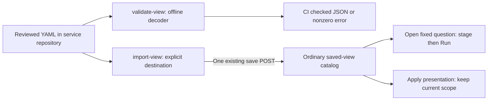

# View definitions from repository to CI and catalog — 306

> Delivered in milestone 306. Executed checks are recorded in
> [VALIDATION.md](../VALIDATION.md).

Use the same checked YAML definition in code review, offline CI validation and
an explicit Goo installation. The CLI reuses the [portable view codec](PORTABLE_VIEWS.md)
and existing saved-view endpoint. It adds no registry, deployment watcher or
telemetry executor.

From the repository root:

```sh
go build -o /tmp/goo ./cmd/goo
/tmp/goo validate-view -file config/views/service-requests.yaml
/tmp/goo import-view -file config/views/service-requests.yaml -url http://127.0.0.1:8088
```

The [checked example](../config/views/service-requests.yaml) uses `prod` and a
fixed five-minute window on 2026-01-01. Update a reviewed copy explicitly for a
different original question, or apply its compatible template to a current scope
through the catalog. Import does not reinterpret those bounds as a live window.

## Validate offline

`validate-view -file PATH` reads one regular YAML file, up to 64 KiB, and calls the
existing strict decoder. The command makes no network request, writes no catalog
entry and evaluates no telemetry. Building or installing the binary is a separate
step from this offline command. Invalid input exits nonzero and reports its file
and validation error on stderr. Existing view/query requirements and store-local
capture-reference refusals remain unchanged.

Success writes one JSON object to stdout with version `goo.view-validation/1`,
namespace, name, revision and the admitted canonical `view`. This supports CI
inspection without another artifact grammar. There are no positional arguments,
implicit file searches, environment-selected targets or stdin fallback.

## Import to a chosen server

`import-view -file PATH -url BASE` requires the destination explicitly. `BASE` is
the Goo UI base URL, such as `http://127.0.0.1:8088`, not the saved-view API path.
An optional deployment prefix is preserved. The CLI appends
`/api/exploration-views`. Credentials in the URL, query strings, fragments and
non-HTTP(S) URLs are refused. Normal Go proxy and certificate trust apply.

The file is fully checked locally before any request. Import then makes one POST
of the admitted `artifact.view` to the existing save endpoint. It does not remotely
decode the file, enumerate catalogs, open a question, apply a display or run a
source query. No redirects or automatic POST retries are followed. The request
has a 15-second deadline; the JSON receipt is bounded to 128 KiB.

Success requires HTTP 201, a single checked saved-view response, unchanged complete
view content and its matching catalog content ID. The shared workbench identity
helper is also used by catalog Create/Load; the CLI has no private hash recipe.
Only then does stdout receive one JSON object with version `goo.view-import/1`,
namespace, name, revision and `id`. Those file labels remain descriptive, not
registry keys, release pins or automatic replacement instructions.

A failed request or invalid response exits nonzero and emits no success receipt.
After submission, a failure can leave persistence uncertain; the command reports
that the destination may have saved the view and that no retry was attempted.
If saving succeeded but writing stdout failed, the error includes the saved ID.
The CLI does not invent rollback or claim that a missing receipt proves no write.

## Continue in the existing interface

The imported entry appears in **Saved exploration views**. Open its original fixed
question and Run explicitly, or inspect/apply compatible presentation over an
existing population. The latter retains the destination's query and held data.
No observations, completeness claims or selected occurrences are carried by the
file or CLI receipt.



See [portable YAML definitions](PORTABLE_VIEWS.md),
[architecture review](reviews/VIEW_ARTIFACT_CLI_ARCHITECTURE_306.md) and
[usability review](reviews/VIEW_ARTIFACT_CLI_DESIGN_306.md).
