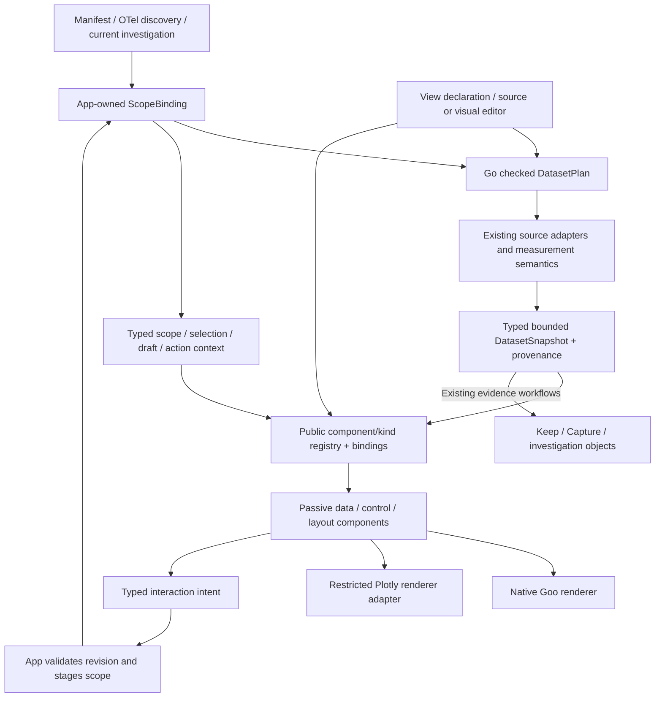

# Goo UI composition grammar and extensible views — proposal 260

2026-10-30. **Design proposal for the next implementation sequence.** The trace-return
and shared-control corrections delivered in this round are recorded separately in
[validation](../VALIDATION.md). `goo-chart`, the dataset/kind contracts, contributed
view packages and the visual editor described here are proposed; this document does
not claim that a Plotly runtime or WYSIWYG editor is already implemented.

## Prerelease policy

The user explicitly confirmed that Goo has no legacy compatibility requirement.
Choose one clean scope/data/kind/view model. Change Go APIs, JSON/YAML formats,
component properties and stored development formats together when that improves
the design; update callers and tests instead of adding compatibility shims,
old-format fallbacks or parallel authoring paths. Remove obsolete implementations
and probes after their useful behavior is covered by the canonical path. Development
fixtures can be regenerated; a one-time import or lab reset is a separate deliberate
action, not a permanent runtime architecture.

Preserve semantic correctness—units, population/support, OTel field-version and
presence policies, clocks and explicit evidence meaning. Those are current product
requirements, not a promise to support every earlier Goo representation. Keep
native renderers only where their behavior is useful; their existing APIs are
replaceable. View/kind revision references protect current evidence meaning and
reproducibility, not a backward-compatible schema floor.

## Product decision

Goo should let an investigator **scope telemetry, choose a useful representation,
interact to refine it, and keep/reuse the result**. A service or team should be able
to package those representations beside its instrumentation and measurement
contracts. This is the missing composition layer of the Goo grammar, rather than
a separate dashboard product or an exposed chart-vendor configuration language.

Keep the data-first entry: Activity shows current logs/spans with compact scope
and field controls. Add a contextual **View as** affordance where there is an
applied result, selected population, service/resource context or saved observation.
Offer compatible display kinds first. **Customize view** opens the existing
Definitions/authoring workflow with the current context; it should not add another
permanent top-level builder or place an editor before the stream.

The architectural choice is:

> One scope binding → checked dataset plan → typed observations → compatible
> display/control kinds → reusable whole-view composition. The visual and source editors edit
> the same declaration. Renderer implementations stay behind Goo contracts.

This extends existing typed questions, measurement/telemetry packages, immutable
captures/keeps and investigation documents. It does not replace their different
semantics with a universal JSON blob or another query evaluator in the browser.

## What the reviews establish

| Review | Concrete finding | Design consequence |
| --- | --- | --- |
| [Common UI](reviews/UI_SYSTEM_REVIEW_260.md) | Useful passive components already exist; styles, control semantics and explanatory text need consolidation | Standardize the existing library; fix shared controls before adding page-specific widgets |
| [Product capabilities](reviews/PRODUCT_CAPABILITIES_REVIEW_260.md) | Goo has substantial investigation and evidence capability; composition/reuse is a stronger next investment than copying every competitor feature | Extend the scope/result workflow; prioritize query → useful view → refine → reuse |
| [Chart architecture](reviews/CHART_PLATFORM_DESIGN_260.md) | Chart frame supplies chrome, not a renderer abstraction; exact native plots already carry valuable semantics | Add `goo-chart` and a registry; retain native waterfall/histogram/selection implementations |
| [oscope/Kindly/Plotje/Portal](reviews/CUSTOMIZATION_RESEARCH_260.md) | oscope has an actual text editor and safe preview/rebinding. Portal offers compatible viewer switching. Plotje has staged plot preparation | Reuse these contracts in Go/declarative data; the visual editor remains new work |

Research uses inspected source/documentation with links and pins in the supporting
reports. Hosted vendor documentation was unavailable for some sites; the reports
identify official repository/provider sources and unverified UI-specific claims.
No live Datadog, Honeycomb or Grafana instance was tested. No design-specific skill
is installed in this environment; the UI review uses the project's component
contracts and accessibility practices rather than claiming an unavailable skill.

`scicloj/plotje` is distinct from Plotly.js. Kindly is a Clojure metadata
convention whose value/display-hint separation inspires Goo’s language-neutral transport; Portal's compatible viewer registry and
history are the closest interaction precedent. Plotje's inspected built-in backends
are SVG and image outputs; its extensible planning pipeline is useful without
claiming that it already supplies Goo a Plotly adapter. None requires embedding Clojure
in Goo. oscope's current editor is text-edit + preview, not WYSIWYG.

## Common controls, style and prose

Use a small shared role-token set for canvas/surface/border, text/muted/accent,
semantic status colors and focus, then spacing/type/density/radius. Migrate one
component family at a time with standalone and nested conformance; application
CSS owns page layout, not private component descendants.

| Consolidation | Reuse first | Missing contract or next cleanup |
| --- | --- | --- |
| Scope/quality chrome | Evidence summary, result state, chart frame | One compact app-owned summary per result; exact clocks/support in details |
| Field choice | Record columns, grouping and facet controls | One qualified-field picker with supplied options and typed intents; app owns asynchronous lookups |
| Options and actions | Native controls, shared actions/disclosures | Explicit button types, label/help/error linkage, busy/disabled behavior and consistent density |
| Tables and detail | `goo-table`, structured attributes, shared inspector | Standard captions/labels, visible mobile actions, parent-aware close and cross-browser accessible structure |
| Chart interaction | Existing range/time/heatmap controls | One revision-keyed selection/range/reset contract with keyboard/touch equivalents |
| View selection | Existing result tabs and definition library | A compatible-kind menu over the applied dataset, rather than duplicated per-page chart selectors |

Prose should identify the next action or a fact that changes interpretation. Put
data first, keep one concise status/scope line, and move repeated background into
one details location. Preserve visible partial/no-data/unknown/unsupported state,
selected-versus-population distinction and a source action's effect. Removing those
facts to make a screen shorter would make the product less usable.

The shipped cleanup addresses concrete focus/contrast/form/motion and shared-copy
issues; it is not a claim that every surface has been restyled or accessibility
certified. The next family migrations should use the audit's prioritized inventory,
including native table/assistive-technology checks across browser engines.

## Target: the whole UI is a composable view

The target is broader than chart configuration. Goo's built-in screens and
user/service/team views should be expressible with the same component vocabulary,
typed model and declarative interaction bindings. Tables, lists, streams,
waterfalls, inspectors, attributes, search/filter/facet controls, summaries,
breadcrumbs, forms and responsive layouts are peers in that vocabulary. A chart
is one component family, not the boundary of the grammar.

Use one `ViewDefinition` composition for a whole screen, a reusable section or an
individual widget. Do not create separate internal-only screen and external-user
view languages. Host runtime services still own data execution, navigation,
subscriptions and publication; definitions bind to those services through typed
capabilities/intents rather than executable closures or arbitrary endpoints.

### One typed context, several controlled model roles

A shared model does not mean forcing every value into one numeric row table. The
canonical context contains typed dataset snapshots, named scope sessions,
selection state, view parameters, documents/drafts and action outcomes. Display
components consume the roles they declare. Controls bind to the same context and
emit operations; they do not privately mutate datasets or own independent copies
of the application's population.

A scope session has explicit draft/applied scope, a context generation, parent/
history identity, execution/subscription policy and dataset-role bindings. Several
widgets can share that session; baseline, child and diagnostic scopes are separate
named bindings with explicit relationships. Committing a scope invalidates stale
reads/selections and updates the shared data graph. Identical declared data demands within the same source/context generation and
basis/execution policy can share an observation/subscription rather than each
widget fetching its own copy. Matching query text does not merge independent
live, fixed, saved or baseline observations.

Context domains remain typed. A telemetry scope session, a catalog search/cursor,
and an authoring document/draft share the composition/binding/intent envelope but
have different operations and lifetimes. Saved Find is not a telemetry predicate
or source Run; catalog repair is not measurement execution. Action outcomes include
pending/unknown/success/failure so durable retries keep their captured original
intent rather than rebinding an uncertain save to the latest scope. Reads and
subscriptions withdraw on context leave/hiding. Durable effects keep their
journaled intent and may have committed after a lost acknowledgement; cancellation
is not proof of non-publication, and a late result cannot replace another active
view.

Selections name dataset role + revision + stable key (and attested membership
where applicable), not an unqualified row index shared across widgets. Public
components expose controlled selection properties and emit intents; the context
owner decides which other views receive that selection.

Distinguish three kinds of interaction:

1. **Presentation/local selection:** sort supplied rows, change kind/columns, select
   a supplied row or show detail. No source-scope change or new read is implied.
2. **Scope modification:** search, include/exclude a facet, change a time range,
   remove a clause, change a grouping/measure recipe or fork/restore a child scope.
   Emit a typed operation to the named scope owner; preserve unrelated constraints.
3. **Effects:** Run, Start/Pause, inspect a broader trace/context, Keep, Capture,
   publish a definition or navigate to a referenced view. Use registered host
   actions with explicit inputs, availability and lifecycle guards.

The definition declares staged versus user-commit application behavior. Current
Apply/Run semantics remain useful defaults; a user-click facet can explicitly
commit through its owner when that view/policy permits it. Live or debounced
execution is an explicit source-owner policy, never a component lifecycle side
effect or permission to resume a paused scope on typing. Local filtering of loaded
rows is separately named; it cannot masquerade as filtering the source population.

### Scope-aware search, filters and facets

Provide controlled local and scope-bound variants of tables/lists/search/facets.
They share value/quality/display primitives; the variant declares which context
operation it emits. Search convenience syntax compiles to the canonical predicate
model. Facet selections carry qualified field identity and typed values, preserving
missing versus empty and exact source semantics.

Facet counts also declare their basis: applied scope, scope excluding that facet's
own clause, an explicit baseline, or supplied inspection rows. Excluding its own
clause uses a stable control/clause identity; it must not remove another filter
merely because that filter uses the same field. The model retains
support, omitted values and completeness. A partial value list is not all possible
values, and counts over loaded rows are not source counts. A new facet/count read
is a declared data demand handled by the scope/data owner, not a fetch hidden in
the facet element. Quality/completeness requirements apply to controls as well as
charts—for example, a facet can require an exhaustive aggregate before enabling
an action whose semantics depend on all categories.

Illustrative composition, not accepted by the current API:

```yaml
version: goo/view-proposal/v1
name: teams/payments/incident-explorer
contexts:
  incident: {scope: $context.scope, commitPolicy: explicit}
datasets:
  events: {recipe: records, scope: $incident.applied}
  services:
    recipe: facet-values
    scope: $incident.applied
    field: {kind: column, key: service}
    countsAgainst: scope-excluding-own-facet
body:
  component: layout.split
  children:
    - component: controls.scope-search
      bind: $incident.draft
      onCommit: {intent: scope.commit, target: incident}
    - component: controls.facet-list
      data: services
      onSelect: {intent: scope.include-value, target: incident, apply: staged}
    - component: records.table
      data: events
      selection: $incident.selection
      onInspect: {intent: context.inspect-record, target: incident}
```

Normal authors assemble components and declare bindings/actions. Team-contributed
components/kinds expose the same input schemas, quality requirements, intent
contracts and editor metadata, so built-ins and contributions compose together.
New primitive behavior or backend effects require a trusted registered extension;
a template cannot gain source/write authority by naming an action. The editor
should offer a small useful action vocabulary rather than make authors implement
a reducer or manipulate renderer internals.

### Whole-screen expressiveness gate

Chart parity is necessary but not sufficient. Maintain representative declarations
for the current Activity screen, a scoped service/resource overview, trace/detail
inspection, Saved discovery/detail, Definitions authoring and an investigation
with view/evidence/text sections. These declarations must use the public component
and action contracts, not special hidden payloads available only to Goo pages.
Navigation chrome and privileged effects can remain host-provided capabilities,
but screens must compose them through the same declared interfaces. This is a
prerelease refactor: replace per-page control/model branches as the common path
lands instead of retaining parallel legacy implementations.

## Layers and ownership



| Object | Owns | Does not own |
| --- | --- | --- |
| `ScopeBinding` | Applied selector, window policy, current/fixed/saved origin, context generation and identity | Renderer state or implicit broadening |
| `DatasetPlan` | Typed source recipe, measures, grouping, explicit transforms, semantic conventions, read requirements and budgets | Pixel layout or browser subscriptions |
| `DatasetSnapshot` | Typed columns/rows, stable keys, exact values, basis, clocks, states and support/coverage | Query execution or author code |
| `KindDefinition` | Declarative requirements checked by trusted registry code, role schema, defaults, visual composition, interaction capabilities and accessible alternative | A source connection or arbitrary script |
| `ViewDefinition` | Dataset-role bindings, chosen kind(s), bounded options, variables, layout and declared interactions | A new definition of custody or event identity |
| Renderer adapter | Supplied geometry/marks, local hover/zoom, resize and cleanup | SQL, measurements, source fetch, navigation or evidence publication |
| Application owner | Run/subscription, cancellation, draft/applied state, safe gesture handling, navigation and persistence | Vendor-specific public options |

Kind compatibility is declared as data and evaluated by trusted registry code,
not an uploaded JavaScript predicate. Scope, coverage, freshness and provenance
chrome are public composable components with sealed host-supplied facts. Templates
can place/style them within the supported contract; the compiler/runtime enforces
the required quality presentation. They are not an internal-only imperative screen
exception, and a custom kind cannot hide partiality or relabel selected evidence
as a complete population. A `DisplaySpec` is one kind plus its role mappings/options; `ViewDefinition` is
the authored resource containing dataset roles and a composition of display specs.
The chart report’s illustrative `ViewSpec` corresponds to this leaf display spec,
not a second competing persisted view format. Generic
chart data is not automatically keepable: Keep still requires eligible
server-attested record membership; aggregate gestures stage a population/read.

These are semantic boundaries; implementation can begin with ordinary Go structs
and small pure JavaScript modules. Do not create a universal store framework,
complex generic user API or separate runtime for every layer.

### Scope is inherited explicitly

A view can bind to the current applied scope, a parameterized saved question,
a fixed result, a capture or kept occurrences. Its declaration states which origins
and signals it supports. Inherited service/namespace/environment policy, filters
and time bounds are preserved. A child may narrow them through a checked operation;
broadening requires an explicit user action.

Record pages and kept occurrences are selected observations, not full populations.
A service dashboard may have independently read RED/native datasets, not a
transactional combined snapshot. The envelope must preserve each dataset's origin,
source/read clock, capture/keep custody, window and evidence basis independently.
An inspection-to-full-population view is a staged new read, not a reinterpretation
of the earlier page's rows as the population.

### Authoring scope parity is a prerequisite

Current record execution/Keep supports checked unreported/empty/effective scopes,
but saved Activity views and reusable telemetry packages still reject
`environmentSelector` (`workbench/activity_views.go`, `exploration/package.go`).
Native/service/resource families also have explicit adoption limits. A renderer
registry does not remove those gates.

The first grammar cut must carry the checked scope unchanged or declare a typed
scope parameter that binds to the current context. It must never replace an
unreported/effective selection with an empty environment string, magic name or
wildcard to get through an older save API. Snapshot-only View as can ship before
persistence parity; **Save reusable view** cannot be advertised for those scopes
until its Go schema, plan, storage and reopen path all preserve policy identity.
Replace string-only scope contracts with the canonical checked representation;
do not retain both paths as a compatibility obligation. Update the affected
readers, writers and callers together. Keep not-yet-converted families explicit
and test OTel field-version/presence conflicts at every authoring handoff. This is part of the feature, not optional later polish.

### Typed datasets, not arbitrary renderer input

The chart report supplies an illustrative contract. The normalized dataset should
include:

- Shape: records, ranked groups, time series, precomputed distribution, time/bucket
  grid, span intervals, state intervals or scalar/summary.
- Qualified field references, logical types, units and semantic roles; exact
  int64/uint64/decimal/rational/time values remain strings or checked exact values.
- Stable row/series/bin keys, optional server-attested member references, and a
  dataset revision distinct from view/renderer identity.
- Coverage, limited/omitted observations, support/denominators, gaps and explicit
  unknown/no-data/invalid/stale/partial states.
- Original evidence references, source/window/basis, and the declared data recipe.

First adapt existing result shapes; do not rebuild source execution around a
browser dataframe. Prefer shape-specific Go validation over one permissive schema.
Use the current source adapters for physical OTel columns and versioned semantic
profiles for explicit OTel field-version/presence conventions. Views bind semantic fields or explicit
qualified raw fields; they must not scatter exporter aliases through templates.

Display transforms may format labels/units, sort a supplied bounded table, map
roles and hide a series locally. Authoritative dataset transforms—population grouping/filtering, rates,
percentiles, binning, joins and native counter/reset handling—belong to the checked
Go plan. Registered pure projections over an already supplied bounded dataset may
run locally, including inspection-page grouping and trace geometry, when their
input extent, exactness, quality propagation and interaction semantics are explicit
in the grammar. They cannot widen membership, claim query-population totals or
upgrade completeness. This preserves useful local views without a source read on
every display change. Ratios require aligned units and support. Missing is not zero; averaging
percentiles is not a fleet percentile; overlapping span durations are not request
wall-clock latency.

### Certainty and uncertainty are part of the model

Every existing chart/widget must be expressible by the canonical data model and
plotting/composition grammar with its intended semantics intact. That includes
partial-data displays, specialized trace views and native metric/resource widgets,
not just generic numeric series. A specialized renderer is allowed; an opaque
semantic escape outside the grammar is not.

Use separate quality facets rather than a single `uncertain` flag:

| Facet | Required distinctions |
| --- | --- |
| Value knowledge | Recorded/observed value; exact declared derivation; estimate; known bounded value; unknown; invalid; missing; not applicable |
| Numeric representation | Exact integer/decimal/rational and units versus approximate plotting coordinates/rounded labels; this is not statistical confidence |
| Bounds/statistics | Deterministic bounds versus statistical intervals, inclusive/exclusive ends, method, confidence level and assumptions when known; absent bounds remain absent |
| Population/result coverage | Complete/partial/unknown extent, selected/page/population basis, omitted rows/groups/bins, support and denominators |
| Sampling/collection | Known sampling method/weights/fraction or unknown collection coverage, separately from exhaustive query results |
| Time and freshness | Event/read/evaluation/custody clocks, interval coverage, late/correction policy, stale basis and known/unknown clock uncertainty |
| Relationships | Reported versus declared versus contextual association; resolved, missing, ambiguous or cyclic links; no automatic causal certainty |

Quality may vary by dataset, series, row, cell, bin or edge. An exactly encoded
recorded number is not a claim that the underlying measurement or collection is
certain. Empty strings and absent attributes remain distinct; an observed zero is
not unknown or no-data. A count can be known zero while a percentile is unavailable.
An unrecognized status can be an exact raw value with an unknown interpretation.

Each kind declares supported quality states and its rendering policy. Common
rules are part of the grammar contract, not custom page prose:

- Known recorded/derived values retain exact values, units and derivation lineage.
- Estimates have an explicit non-color-only indication and method/support details.
  Bands/error bars are drawn only from supplied, typed bounds. Never invent a
  confidence interval, confidence level or statistical precision from sampling.
- Unknown/missing/no-data values use explicit gaps/markers/states rather than zero
  or interpolation. Invalid values retain a diagnostic and safe raw detail; they
  are not silently clamped, discarded or replaced with an older healthy sample.
- Stale values retain their actual basis/time and cannot masquerade as current.
  Open-ended bins and clipped geometry keep exact bounds and overflow meaning.
- Partial denominators, independent comparison clocks and ambiguous relationships
  remain visible in the shared quality chrome and accessible data alternative.
  Custom templates cannot hide these states. Graph edges carry their relationship
  basis; proximity is not causality.

Go transformations must declare quality propagation. For example: unknown required
operands produce unknown results; a ratio with unavailable/zero denominator is
not a finite known ratio; gaps/reset boundaries do not become valid counter rates;
comparisons require the relevant support/units/bins; and estimated inputs cannot
silently yield a certain output. Bound propagation needs a declared method and
assumptions—especially for ratios, correlated inputs and statistical intervals.
Reaggregation of scalar percentiles into a fleet percentile remains invalid.

The kind editor exposes appropriate defaults and requirements, including complete
input, known support or required bounds. A valid definition may be unavailable for
the current input. If a kind cannot represent the supplied uncertainty faithfully,
it refuses with a reason or offers another compatible kind; it does not drop the
uncertainty to force a chart to render. Keep the default surface compact: one
quality summary with details, plus local marks where quality differs.

#### Expressiveness/parity gate

Before replacing the existing display paths, maintain an exhaustive inventory of
all current chart/widget families and map each to a dataset shape, semantic roles,
quality facets, grammar declaration, renderer and typed interaction intents. This
is functional/semantic coverage, not a legacy API or pixel-format compatibility
requirement. Replace older implementations and tests directly where useful.

The inventory must cover records/attributes/facets, stats/quantiles, ranked groups,
time bars/value/grouped series, raw/native histogram and heatmap variants,
aligned comparisons/explanations, state intervals, trace waterfall/tree/page
breakdown/timing and service/host/Kubernetes/native resource widgets. Business/demo
labels must be expressible as ordinary definitions rather than bespoke rendering
branches. The chart report carries the detailed mapping.

For each family, tests must exercise its real current states: exact/estimated or
bounded values where applicable, missing/invalid/no-data, partial/unknown coverage,
unsupported source values, stale/corrected data and incompatible comparisons.
Render plans and selection intents must preserve those semantics. A single successful
line chart is a useful first slice, not proof that the grammar covers the product.
Whole-screen declarations must additionally prove controlled search/facet/filter
behavior, shared scope/selection, action availability, parent navigation and
source/subscription lifecycle without page-private semantics.

### Complete-data requirements are hard kind contracts

A kind/widget can require full/complete data. This is an eligibility condition,
not a caveat the renderer may ignore. Express completeness relative to a declared
scope and aspect, and bind the claim to the dataset revision, source plan and read
basis. A team template cannot mark its own input complete.

| Requirement | What must be established | What is insufficient |
| --- | --- | --- |
| Complete record result | All matching captured records from the declared fixed query result, with no page/sample/limit omissions | A displayed page; matching its length to a separate count; `hasMore=false` without an exhaustive source contract |
| Complete aggregate result | Exhaustive required groups/bins/support for the declared measure and scope | Aggregating the visible page; omitted groups; a top-N list used as the entire distribution |
| Complete window | Required intervals/cells cover the fixed window under the declared cutoff/lateness policy | A moving live tail or gaps silently filled with zero |
| Complete reported graph | The declared graph/relationship closure and required identities are established | A full returned span page, no truncation flag, or merely plausible parent IDs |
| Collection/no-sampling guarantee | The required source collection/sampling contract is actually available | A complete query over a telemetry store whose upstream completeness remains unknown |

Completeness also names the required extent: all rows of an explicit selection
is not all rows of its parent query. A kind requiring the full query population
cannot consume a complete twenty-row kept selection as a substitute. Complete
query results and complete real-world telemetry are different claims.
A widget may require either or both. Completeness is also independent of minimum
support and no-data: an exhaustively read empty result can be complete and still
show No data, not healthy or statistically useful.

Illustrative kind declaration, not an implemented API:

```yaml
requires:
  shape: records
  completeness:
    records: full-query-result
    window: closed
  # Optional stronger requirement, only eligible when the source can establish it:
  # sampling: none
```

An exact raw-record distribution might require complete records; an aggregate
histogram can require complete bins/counts without downloading every raw record.
The plan must request the right form of complete data. Source budgets and overflow
must fail explicitly rather than returning a truncated success advertised as full.
Completion can require an exhaustive bounded read, stable materialization or
appropriate complete source aggregation. Existing row/count/group reads do not
become one complete snapshot merely because they look consistent.

The View as menu distinguishes **available now**, **requires complete data**, and
**unsupported**. A blocked complete-only kind explains the missing guarantee and
can stage an explicit acquisition/materialization plan. If the source or budget
cannot satisfy it, it stays unavailable; there is no automatic downgrade or forced
render over partial data. Generic record/table inspection can remain available. A complete-only definition
can still be valid and publishable when the current preview is partial; its
preview stays blocked and explains the data requirement. Definition validity and
runtime data eligibility are separate checks.

Re-evaluate eligibility on every dataset revision, including SSE updates. A live
partial window cannot drive a complete-only widget until its required completion
signal is established. If coverage regresses, withdraw the current rendering or
retain the last eligible frozen result explicitly as stale with its original
basis. Neither the renderer nor an optimistic custom template can silently keep
presenting it as a current full result.

Backend portability remains a data-plan concern. The existing
[Databricks metric-view work](DATABRICKS_METRIC_VIEWS.md) keeps dimensions/measures
separate from display. A view/kind must not embed ClickHouse SQL or Plotly semantics
into the authoritative measurement definition; unsupported backend capabilities
remain explicit at planning time.

## A base chart abstraction with a focused portfolio

Add a new passive `goo-chart`; compose the existing `goo-chart-frame` rather than
changing its narrow metadata contract. Supply a checked dataset, a view, local
selection and an application-injected renderer. The app loads a pinned local
renderer asset explicitly. Element connection/disclosure must not load telemetry
or begin a subscription. Server HTML and detached SPA properties use the same
contract; renderer failure leaves exact-value fallback content available.

Normal authors select a versioned kind and map semantic roles such as time,
measure, series, category or interval. They do not author Plotly traces/layout.
The registry is also the schema for property panels and view compatibility.

| First-class kind family | Natural observability use | Required guard |
| --- | --- | --- |
| Record table/stream/field detail | Current logs/spans and kept observations | Page/selection coverage and exact membership remain explicit |
| Time-series line/step/bars | Throughput, errors, utilization, native values | Interval semantics, gaps, temporality and units choose defaults |
| Ranked bars/table | Top services, operations, failures or resource consumers | Support, denominator, top-N/other population and unknowns |
| Histogram/exact-bin table | Latency/value distributions | Supplied counts and exact bounds; unequal-width bins are explicit |
| Time/bucket heatmap | Latency shape over time, anomaly populations | Aligned layouts, unknown cells and exact range selection |
| Scatter/paired table | Duration versus size/work/another supplied value | Coverage and paired-record identity; no implicit new aggregate |
| State timeline/table | Process/container state and availability | Unknown gaps and interval persistence policy |
| Trace waterfall/tree/table | Parent/child spans and distributed work | Preserve specialized missing/ambiguous/cyclic-parent semantics |
| Compatible comparison overlay/pair | Baseline versus current | Independent provenance, compatible units/bins/support and shared axes |
| Stat/compact quantiles | RED/USE headline measurements | Reuse current compact components; no heavyweight plot for a few numbers |

Only compatible kinds appear as immediately usable alternatives. An aggregate
heatmap is not a local alternative to twenty raw log rows. If another shape is
needed, show **Requires a new read** with a staged recipe and an explicit Run.
Choosing table versus bars for the same ranked dataset should require no read.

### Renderer recommendation and escape hatch

Keep the current native renderers and make a restricted Plotly.js 2D adapter the
first vendor pilot. It can expand the portfolio without exposing the vendor API.
Use only the necessary modules, pin the build, serve it locally, and measure the
chosen bundle/render/update/disposal cost. No Plotly dependency is introduced by
this proposal. ECharts is a fallback candidate if the measured pilot misses its
requirements; loading several general-purpose engines is not the default.

Plotly must render Goo's supplied bins/values rather than recompute statistics from
an inspection page. Preserve exact labels and keys separately from finite plotting
coordinates; subtract exact timestamp origins before numeric conversion. Actions
map back to exact keys/bounds, never authoritative thresholds reconstructed from
rounded coordinates. Keep existing specialized waterfall and histogram validators.

A later advanced, trusted, code-managed renderer option may expose a version-pinned
Plotly spec. It is clearly marked nonportable, excluded from normal WYSIWYG edits
and subject to the same data/lifecycle limits. It cannot bypass canonical quality/completeness eligibility or introduce opaque
semantics, arbitrary URLs, SQL, scripts, source reads or evidence writes. No automatic fallback from a failed
normal declaration to raw vendor options.

### Interaction intents and live updates

Components emit typed intents carrying kind, dataset ID/revision and stable keys
or exact declared bounds: point/row selection, range preview/commit, local legend
visibility, drill or context actions. Application owners validate these before
staging filters or calling the existing Go planners. A gesture is not authority
to publish a browser-supplied record or silently subscribe to a wider population.

Quality-sensitive gestures need explicit meaning too: an estimated point or band
is not exact record membership. Intents distinguish observed record references,
aggregate bins, declared numeric ranges and diagnostic/uncertain marks. Only
supported exact references can feed Keep; other gestures stage the appropriate
checked population/read. A vendor point index or rounded estimate cannot invent
an exact source predicate.

SSE remains app-owned. Replace/append/correction messages identify the scope and
dataset revision; coalesce rendering, retain source/event clocks and cancel stale
work. Compatible same-scope updates preserve the user-selected kind/options and can
preserve local zoom. Resolve defaults deterministically: explicit user choice,
pinned view choice, compatible manifest recommendation, then a built-in shape
default. An incompatible prior choice is explained before falling back; do not
silently change the user’s interpretation. Scope changes cancel
selection/gestures and restore appropriate defaults. A baseline/live overlay keeps
two independently identified datasets. It is not a transactional comparison.

Provide keyboard and touch equivalents for meaningful brush/point actions. Keep
summary, exact-value table and native controls available outside vendor SVG/canvas;
use labels/patterns as well as color, visible focus and reduced motion. Do not
narrate every incoming point through a live region. Plotly rendering alone does not
prove keyboard/screen-reader accessibility.

## Team/service kinds, views and templates

A contributed component/kind declares its compatible model roles, data shape, role schema, defaults,
editor controls and one safe composition using registered primitives. A view binds
such kinds to dataset roles and the selected context. Both live in a namespaced,
versioned package alongside the service's manifest/measurement definitions.

Start with bounded declarative nodes: chart, table/list/stream, waterfall, stat,
attributes/detail, search/filter/facet controls, field/parameter controls, actions,
breadcrumbs, text, grid/stack/split, tabs, modal/disclosure, conditional and repeat. Text interpolation is escaped. Repeats, nesting,
rows/series and expressions have explicit budgets. Template syntax is not an
arbitrary HTML/Hiccup/JavaScript execution facility. Raw telemetry's kind-like
attributes are data; they do not grant permission to load a renderer or execute a
template. A trusted package may suggest a preferred compatible kind; users can
switch it without changing source observations.

Use YAML for the external declaration and one checked internal AST. Reuse existing
typed predicate/measurement constructs. Pure derived calculations can follow the
accepted CEL direction with explicit types, units and evaluation time; KCL can be
an authoring/compiler option producing the same normal form. Choose based on a
concrete Go pilot rather than embedding two evaluators in every view.

Illustrative proposal syntax, **not accepted by the current API**:

```yaml
version: goo/view-proposal/v1
name: teams/payments/db-errors
scope: $context.scope
parameters:
  group: {type: field, default: {kind: column, key: service}}
datasets:
  errors:
    signal: spans
    inherit: $scope
    where:
      field: {kind: column, key: status_class}
      op: eq
      value: error
    groupBy: [$parameters.group]
    measures: [{name: matching_records, operation: count}]
view:
  kind: goo/ranked-bar/v1
  dataset: errors
  channels: {category: $parameters.group, measure: matching_records}
  options: {title: Error spans by service, palette: semantic}
```

The compiler checks whether that field/recipe is available and lowers it through
existing planners. It does not concatenate SQL or treat a normal plot option as a
query. Published definitions use immutable revisions and bounded catalogs with
explicit source/publication effects. When saving an investigation/embed, pin its
view and contributed-kind revisions alongside the existing evidence reference;
reopening must not silently adopt a later template. Missing/unsupported pinned
renderers show an explicit safe table/detail fallback without new source reads.
Adopt the canonical evidence/view representation directly. Old development formats
need not remain readable; regenerate fixtures or make a deliberate one-time import
when useful, then remove the old reader. A current renderer failure still needs
an accessible data fallback; that is error recovery, not legacy compatibility. Contribution permissions/team ownership are
future control-plane work; the current lab has no authentication, so first pilots
use trusted local/code-managed packages rather than claiming multi-tenant safety.

A dashboard is a view composition over one or more explicitly scoped dataset roles.
Automatic service/RED/USE/resource views become predefined packages using the same
mechanism, selected by existing discovery inventory and semantic profiles. Keep
sensible built-in defaults; don't require users to build an empty dashboard first.

## One visual/source editor

Extend existing Definitions/authoring surfaces. **Customize this view** carries the
applied scope and frozen preview data into a draft; it never mutates a published
view or rewrites a kept observation.

1. Choose a compatible kind; edit its field-role mappings and schema-derived
   properties. Preview the existing bounded dataset without a source query.
2. Add an explicit recipe when new data is needed. Show its inherited scope and
   requirements; Preview plan is source-free and Run is explicit.
3. Add/move/resize composed widgets through both pointer and keyboard controls.
   Use responsive grid/stack layout tokens, not unrestricted pixel placement.
4. Toggle visual/source mode over the same AST. Valid source updates the preview;
   invalid source retains the draft and clearly labels the last valid preview.
   Do not silently discard unknown clauses or promise lossless comment formatting.
5. Undo/redo affects the draft. Preview, Run and Publish are separate actions.
   Publish creates a new immutable definition revision, not an evidence capture.
6. Keep/Capture/attach-to-investigation retain their existing distinct meanings.
   Later annotations/classifier labels target explicit evidence or population
   definitions with independent provenance; selecting a view is not a review label.

A text editor with preview, as oscope already demonstrates, is a useful intermediate
step. The first visual editor can be field mappings + properties + scope/action bindings
+ simple layout;
a full arbitrary canvas is not necessary to deliver customization.

## Planned user journeys and acceptance

These storyboards are proposed, not screenshots of shipped functionality:

| Journey | Intended interaction | Acceptance |
| --- | --- | --- |
| Incident investigation | Activity → narrow service/error scope → stage/Run ranked aggregate → View as bars/table → select a group → stage child scope → Keep/Capture | No read on compatible kind change; narrowing is explicit; original support and retained parent survive |
| Useful chart quickly | Applied time-series dataset → line/step/bar/table → inspect an exact point | One base chart contract, same data/basis, keyboard/touch actions and exact fallback |
| Team's service view | Discovered service → recommended manifest view → Customize → map fields → preview → publish revision | Semantic-convention diagnostics, inherited scope, no handwritten Plotly JSON |
| Existing/foreign telemetry | Unmanifested traces/logs → ad hoc grammar package → choose kinds → save reusable view | No Go instrumentation prerequisite; current ad hoc package work is extended |
| Live with baseline | Live tail/aggregate → compatible view → add fixed baseline → inspect difference | Independent datasets/clocks, stable scoped updates, unknown intervals remain gaps |
| Safe custom display | Team package contributes a kind → user toggles it → missing field or renderer failure | Clear compatibility/refusal; table/values remain; no implicit source/code execution |

Acceptance tests should include pure schema/compatibility/property checks, actual
SDK/source Playwright tasks, Bombadil invariants and bounded Quint trace validation.
Important negative controls: complete-only widgets offered partial/unknown/sampled
inputs, falsely matching page/count totals, missing bins/window coverage, live
eligibility regression, exhausted full-read budgets, stale revisions, changed
environment policy, aggregate
views over sampled pages, missing units, counter resets, incompatible histogram
bins, wrong member keys, hidden subscriptions and arbitrary vendor options in a
normal saved definition. Measure actual bundle size and renderer update/disposal
under multiple charts and live data before broad migration.

## Implementation order

| Step | Deliverable | Completion gate |
| --- | --- | --- |
| 0 — current round | Trace parent return/keyboard corrections and common control cleanup; review/proposal | Actual trace journey, common-component embedding checks, updated docs and frames |
| 1 | Typed scope/context/data contracts, public component/kind registry and `goo-chart` native line/bar/table plus scope-bound table/facet pilot | Compatible View as changes perform zero source reads; exact values/actions and quality facets survive; exhaustive existing-family mapping is maintained; checked policy is never downgraded; complete-only requirements refuse partial/unknown inputs; SSR/detached SPA and accessible fallback tested |
| 2 | Restricted pinned Plotly adapter for the same contract, then scatter/heatmap as justified | Measured transfer/render/update/disposal, CSP and keyboard/fallback acceptance; keep one vendor engine |
| 3 | Versioned view declaration with checked scope/typed parameters; field/property editor over one AST, source mode and immutable publication | Current-context authoring preserves checked scope semantics through save/reopen; canonical format only, no vendor JSON; pinned view/kind references; plan/Run/Publish separation and retry recovery |
| 4 | Team/service contributed kinds, semantic profiles and manifest recommendations | Namespaced revisions, missing-field diagnostics, safe templates and clear trusted-author policy |
| 5 | Responsive whole-view WYSIWYG and reusable Activity/investigation/service compositions | Whole-screen declarations use the public contracts; keyboard/pointer layout, undo/redo, shared scopes/selection, declared actions and one source owner per data demand |

Keep the product review's operational capability gaps in the backlog, with their
specific users and prerequisites. Alerts/SLOs, collaboration/RBAC, broader telemetry
families and richer infrastructure defaults should not be represented as solved
by a chart abstraction. Reconcile that work after the first complete scoped-view
pilot, rather than adding another disconnected gallery of demo widgets.
