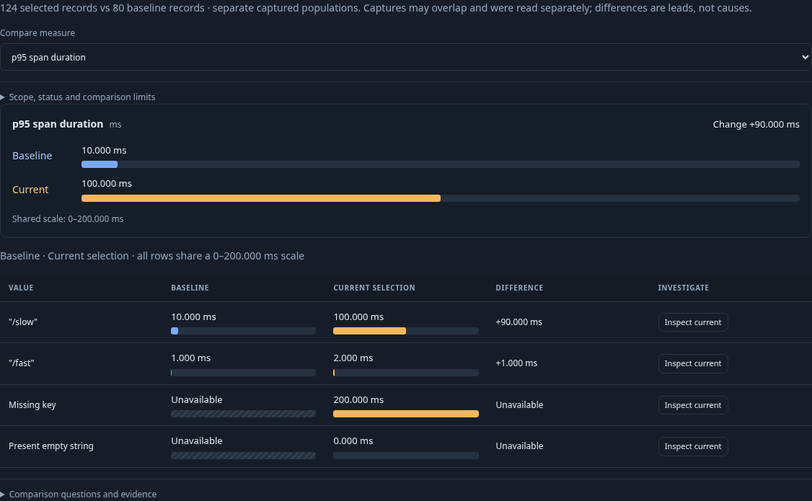

# Seeing comparisons

Product rule: use position, length and distribution shape to communicate a
result before asking someone to read its explanation. Comparisons need common
units, a visible common axis and equal geometry within each paired plot. Keep
scope and evidence accessible, and keep critical unavailable states visible.

Comparisons now put aligned visual values ahead of long explanations:

- Whole-population record counts, mean/P95/P99 duration and recorded error share
  use paired baseline/current bars with a common zero and scale within each metric.
- Cohort rows use the same scale across both populations and every displayed group.
  Share/error plots use 0–100%; duration rows use one common maximum in milliseconds.
  Stored duration cards likewise share a ceiling across mean/P95/P99, and paired
  breakdown tracks have equal pixel widths even when table columns differ.
- Stored breakdown counts show within-population share bars while retaining exact
  counts, so differently sized populations can be compared by composition.
- Comparable native rates use paired exact-stream values. Explicit histograms with
  aligned bounds show paired bins on a common percentage axis. Native rate/shape
  leads its stream view; metric-record counts remain in exact values and coverage
  clocks in a disclosure. Bucket-bound P95
  ranges remain ranges; no scalar percentile delta is fabricated.

Blue and amber distinguish the populations, with redundant side labels. Bar
geometry uses bounded ratios computed from decimal strings and BigInt arithmetic;
large counts are not converted to floating-point totals. Exact values remain
visible or in labeled disclosures. Missing/unavailable values use an unfilled,
hatched track, not a zero value. Visual scale metadata is exposed for verification.

Current-minus-baseline changes retain their units. Record count is not throughput,
duration is not rate, percentage-point change is not percentage change, and a
larger value does not automatically mean an unhealthy application. Incompatible
or unavailable comparisons remain withheld under the existing comparison kernel.

Scope, status details, exact difference tables and assumptions are available on
request. Important result states remain visible. Service-overview boilerplate is
collapsed under **How these widgets are measured**. Storyboard comparison frames
focus on the working comparison panel and are captured from the actual app.

Relevant executable journeys: [35](../journeys/error-comparison.spec.js), stored
evidence comparisons, native windows and captured breakdowns. These validate real
source data, stored receipts, missing groups, mobile containment and source-free
reopening. This is a first visual pass, not a claim that every native value format
or signed quantity has a chart.
