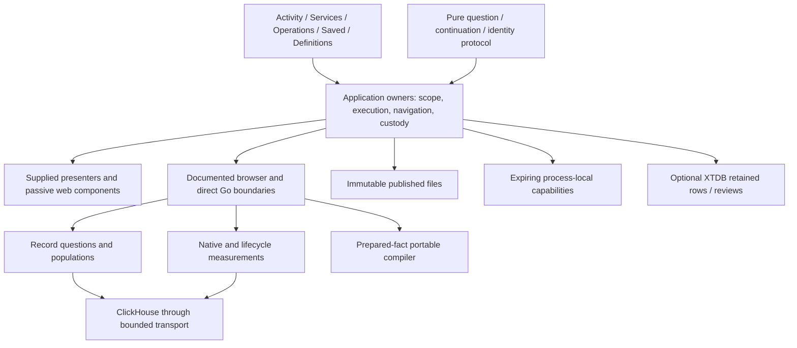

# Whole-product architecture review — 2026-10-22

> Historical package-path note: the prepared-fact `measurement/` package was
> renamed to `subjectfacts/` in 227. The review below retains its original names;
> current usage is in [the compiler guide](PORTABLE_COMPILER.md).

Reviewed baseline: `f54d07c`, branch `work`. This is a read-only architectural review of implementation and existing acceptance records, not a claim that the proposals below have shipped. No runtime changes or new test executions accompany this document.

## Product decision

Goo should be one observability investigation product: **observe → narrow → inspect → investigate a fixed scope → preserve/explain → reuse**. The likely entry is current logs or spans, scoped to an explicit environment. Services, Operations, Definitions and Saved are alternate entrances to this loop. They should contribute context and reusable meaning rather than mount another complete workspace.

The central abstraction is an explicitly scoped question with typed results and provenance. It is not a universal query engine, a manifest editor, a dashboard builder or a bitemporal database. Ordinary manifest-free OTel must remain useful. Definitions add named meaning progressively; durable evidence lets people support an explanation without rerunning the source.

The next product increment should improve **isolating and understanding a population**, beginning with a compact whole-canvas “Analyze this scope/window” continuation, then reusable field controls and meaningful rankings. Full comparison consolidation is useful but should not automatically precede that increment merely because D1 is next in an older queue. Exact custody of live observations remains a separately gated feature.

## Current architecture: what is actually present

The implementation already has more coherent ownership than several earlier reviews suggest:

| Area | Current implementation and evidence | Architectural assessment |
| --- | --- | --- |
| Live entry and fixed analysis | `ui/stream-entry.js` owns entry eligibility, staged/applied scope, the tail subscription, held inspection and paused return. It constructs a fixed question from the selected observation's `readWindow` and labels the continuation as a separate reread. Fixed execution uses `ui/exploration.js` and the pure lifecycle in `ui/question-session.js`. | Keep the two execution lifetimes. The handoff exists; do not reimplement it as a new feature. |
| Saved inspection | `ui/saved-records.js` mounts supplied record/distribution presentation without a hidden query editor or a tail. Explicit trace/context continuations may read separately; simply showing a stored page must not. | The earlier read-only-editor removal recommendation is delivered. Preserve this ownership. |
| Reusable presentation | `ui/record-presentation.js`, record results, field/native presentation and passive elements in `ui/components.js` provide shared rows, context and inspectors. | Continue adoption where two real consumers agree. A new framework or wholesale component rewrite would add migration cost without solving the current product problem. |
| Population work | `ui/population-workspace.js` owns multi-question views, staged facets, nested fixed populations, layout/columns, tails and live-baseline preparation. `ui/service-dashboard.js` also renders scoped breakdowns and continuations. | This remains a consequential composition seam. Extract supplied presentation and pure transforms before considering a common execution owner. |
| Navigation and question protocol | `ui/workspace.js` claims navigation ownership but also validates and serializes record/native steps, checks evidence compatibility, normalizes comparison defaults and creates capture questions. | A concrete misplaced responsibility remains. Separate pure protocol from DOM navigation without changing links or wire identity. |
| Go semantic families | `exploration/` handles record questions/populations; `metrics/` native instruments; `measurements/` native/lifecycle composition; `measurement/` prepared-fact portable compilation. `annotations/` concerns instrumentation, while `workbench/meaning.go` concerns authored meaning. | Similar names do not imply interchangeable semantics. Clarify them in module documentation and preserve distinct contracts. |
| Shared mechanics | `internal/sourcehttp` provides bounded transport to all six audited ClickHouse readers. `cmd/goo/source_dependencies.go` and `retention_dependencies.go` inject startup connection configuration; callers retain per-operation basis. `internal/immutablefile/publish.go` supports all six immutable publishers with explicit collision/sync policies. | Old transport, environment and filesystem deduplication proposals are substantially delivered. Do not reopen them as broad rewrites. |
| HTTP contract | `api/openapi.json` inventories 64 operations. Reflected Go shapes plus reviewed route policy feed the spec; frozen and observed conformance protect behavior. Python remains the browser proxy and owns five `/api` operations. | OpenAPI is now a useful contract, not a missing prerequisite. It does not replace semantic validation or source-free acceptance. |
| Evidence storage | Immutable files hold published artifacts; process-local result/draft capabilities authorize bounded operations; browser journals preserve limited retry intent; optional XTDB retains selected exact rows and review history. `retention/store.go` preserves original JSON as text with independent indexed projections. | These are separate authorities and durability promises, not interchangeable persistence implementations. |

See [PRODUCT_ESSENCE](PRODUCT_ESSENCE.md), [API](API.md), [API_ACCEPTANCE](API_ACCEPTANCE.md), [S2/A3 acceptance](S2_A3_ACCEPTANCE.md), [HTTP boundaries](HTTP_BOUNDARIES.md) and [immutable publication](IMMUTABLE_PUBLICATION.md). Existing validation records establish bounded delivered behavior; this review does not extend those claims.

## Proposed architecture: simplify composition, retain semantics

This diagram is a responsibility map, not a proposal to move browser custody authority into the browser. The server validates and publishes evidence; the application owner orchestrates the request and presents its receipt.

Unify **language, supplied presentation, pure question transforms and documented effects**. Keep execution and publication protocols separate. A useful common action vocabulary is Inspect, Include/Exclude, Investigate this scope, Preserve evidence, Add to investigation and Save reusable question. Availability must come from the owning result's real capabilities, not its visual resemblance to another result.

Do not introduce a second universal capability system beside existing route effects and result-specific contracts. Begin with small typed adapters for the particular result being displayed. A disabled action with a concrete reason is appropriate when the limitation matters; unsupported actions need not occupy every toolbar.

## Boundaries that must remain distinct

1. **Observation versus population versus evidence.** A bounded tail buffer is not a population total. A fixed reread is not preservation of held rows. A captured result page is not proof that every source row was retained.
2. **Record versus native versus prepared-fact computation.** Units, temporality, reset behavior, missing values and population accounting differ. No common evaluator should erase these differences. DataFusion may eventually be another compiler target; it is not a prerequisite for this simplification.
3. **Clocks and bases.** Event time, requested window, read time, capture/publication time, authored applicability and database visibility are separate. XTDB await tokens provide a visibility lower bound, not a historical cutoff for all operations.
4. **Definition, evidence and explanation.** A reusable definition describes a question; a receipt identifies captured results; an investigation/document explains and links them. A preview or current head must not silently replace a pinned reference.
5. **Passive display versus application effects.** Components render supplied state and emit standardized gestures. They must not discover environments, compile predicates, start telemetry reads, retain records or choose navigation policy themselves.
6. **File publication, process memory, browser intent and XTDB.** File reopening must work without XTDB. Process restarts may invalidate capabilities. A retry journal is not a general draft store. Successful immutable linking followed by a sync failure may still have published an artifact; retries must preserve family-specific identity rules.

## Bounded implementation cuts

These are recommendations for incorporation into the single implementation plan, not a competing backlog.

### 1. Retire stale plan state and extract the misplaced pure protocol (maintenance, not a product prerequisite)

**Scope:** update the active queue's current-state summary and extract question/step/link/evidence compatibility functions from `ui/workspace.js` into one pure browser/CommonJS module. Keep existing public calls through a temporary compatibility facade if necessary. Do not combine this with renaming every Go package or introducing generated clients.

**Why first:** navigation currently owns protocol used by service charts, fixed exploration, investigations and comparisons. This is a real dependency inversion, unlike deduplication based only on similar-looking request loops.

**Acceptance:** existing `#question` and `#step` links round-trip identically; exact nanosecond strings, predicate defaults, native zero/omitempty equivalence and qualified field identities retain fixture parity; importing protocol has no DOM, network or storage effects; navigation contains route/layout logic rather than validators. Remove the facade only after consumers migrate. Existing behavior fixtures suffice unless a changed protocol needs additional coverage.

**Risk:** validators intentionally enforce different boundaries from Go and from live filters. Extraction must preserve those limits rather than silently reconcile them. Captured bytes and identity algorithms are outside scope.

### 2. Deliver one coherent population-isolation increment

**Scope:** first make the general Activity-to-analysis continuation stage the applied selector and an explicitly identified window in a compact analysis view. The selected-record continuation already does this; opening the advanced disclosure is not equivalent. Keep full blank authoring secondary, and remove competing recent/run choices from the primary continuation after parity. Then choose a real span/log investigation journey across Activity, fixed results and one service entry. Reuse field presentation for a bounded column chooser/order and contextual Include/Exclude; provide one useful error or latency ranking from complete supplied aggregates. Consolidate the matching record/table controls and remove replaced duplicates. Keep time-duration rectangle selection and exact selection-versus-rest as later bounded D2 slices if they require new Go semantics.

**Sequencing:** this is the first recommended user-facing cut. The pure protocol extraction above is optional parallel maintenance, not a blocker; use the existing question/session owners. A general stream scope has no single canonical read window across all held rows, so choose and label the fixed bounds deliberately rather than borrowing an arbitrary row window or implying a frozen population.

**Why ahead of wholesale D1:** users need to see and isolate the interesting population before they need another baseline workflow. The current staged live scope and fixed handoff already supply the entry path. Complete that path using existing primitives rather than adding a parallel analysis screen.

**Acceptance:** no additional read to inspect, reorder columns or stage filters; one explicit application of a draft starts the intended generation; entering fixed analysis preserves the held row's original window and clearly stages a reread; returning restores paused parent/focus. Rankings identify denominators, units and missing/limited states and never derive population totals from displayed rows. One real browser storyboard demonstrates the whole path on manifest-free OTel. Update relevant Bombadil actions/invariants; use existing Hegel/Quint protocols where owner transitions change, and new properties only for new predicate algebra.

**Risk:** live filters, fixed predicates and population selection support different operations and budgets. Present unsupported operations honestly; do not broaden all three through a shared generic filter builder.

### 3. Make one operational discovery path trustworthy

**Scope:** E1's pinned HTTP-server semantic convention and a generic fallback, using existing service/instrument inventory and definitions entrances. Keep declaration, observed data and verified support visibly distinct. Adopt shared native presentation where it fits; do not build a parallel dashboard framework.

**Acceptance:** namespace-qualified services, absent/empty values, units and unsupported temporality remain correct; manifest-free/non-Go data is useful; convention-version fixtures produce deterministic plans; missing instruments produce unavailable coverage, not healthy zeros. No inferred complete topology or fleet percentile. Database-pool or messaging support follows only after this path is coherent.

**Risk:** semconv names alone do not prove aggregation compatibility, collection completeness or a valid denominator.

### 4. Resolve one browser/direct API discrepancy at a time

**Scope:** select a user-visible discrepancy from `API.md`, document the intended policy, then change both contract and observed tests. For example, decide whether browser body limits should admit the already-supported Go dashboard/discovery requests. Decide Retry-After forwarding separately. Continue observed coverage opportunistically for the endpoint touched by a product change.

**Acceptance:** exact byte-boundary and real HTTP proxy tests demonstrate the chosen behavior; OpenAPI generation/conformance passes; documentation states any remaining difference. Preserve SSE cancellation, no-store and independent connection lifetime.

**Risk:** silently standardizing limits during JSON-helper extraction changes product behavior. OpenAPI generation is partly reflected and partly authored; new route request envelopes and effects still need review. Do not undertake another exhaustive helper migration solely to make handlers uniform.

### 5. Consolidate comparison presentation after a concrete isolation journey needs it

**Scope:** one two-sided supplied presenter used by two real existing owners, with common domains, units and selected-item inspection. Delete duplicated presentation only after parity. Keep stored comparison, fresh capture and rolling comparison execution separate.

**Acceptance:** independent windows/bases and incompatibility refusal remain visible; unknown/gap updates do not appear healthy; exact table fallback and keyboard selection work; merely opening a stored comparison causes no new source read. No change to publication identity or recovery promises.

**Risk:** common-looking cards can conceal different custody and refresh contracts. The presenter must not own baseline fetching, capture publication or rolling timers.

## Remove or defer

- Retire completed recommendations for separating saved/live operation ownership, deleting saved hidden editors, splitting retention owners, introducing a compact definition catalog, sharing bounded source HTTP and immutable publication. Keep their acceptance gates as regression obligations.
- Remove duplicate controls and render bodies only when their replacement preserves meaningful actions, source basis, keyboard return and unknown states. Do not delete alternate product entrances just to reduce navigation count.
- Defer a universal request owner. The bounded B2 audit already found insufficient semantic agreement; repeat only when two actual consumers share cancellation/publication rules.
- Defer microservices, framework replacement, a general storage adapter and Python-proxy removal. None is needed for the current interaction improvements.
- Defer exact tail retention until server-owned connection membership, canonical records, per-row basis/window, expiry and idempotent retry identity exist. Connection-local observation handles cannot substitute for result tokens or durable event IDs.
- Keep XTDB optional and focused on exact retained evidence and temporal reviews. A broad bitemporal query layer, external ClickHouse ingestion, classifier export or collaboration whiteboard requires its own concrete workflow and data lifecycle decision.
- Continue the YAML/typed compiler direction. CEL/KCL evaluation or DataFusion adoption should follow a demonstrated expressiveness/optimization need, with offline ClickHouse/Databricks portability fixtures; neither a metric view nor an SQL planner supplies investigation custody.
- Shared deployment requires authentication, source-scoped rights, evidence-reference authorization, budgets, retention/GC and operational recovery. OpenAPI and XTDB do not supply those. This is a deployment gate, not a prerequisite for local UX work.

## Reconcile the plans before implementing

[IMPLEMENTATION_PLAN](IMPLEMENTATION_PLAN.md) is the active queue. [PRODUCT_IMPLEMENTATION_PROPOSAL](PRODUCT_IMPLEMENTATION_PROPOSAL.md), [ARCHITECTURE_REFACTORING_REVIEW](ARCHITECTURE_REFACTORING_REVIEW.md) and [STREAM_FIRST_WHOLE_PRODUCT_ARCHITECTURE](STREAM_FIRST_WHOLE_PRODUCT_ARCHITECTURE.md) contain useful rationale but also earlier baselines. In particular, the older stream wrapper and saved-editor findings must not be read as current defects.

Recommended planning change: condense the long current-position paragraph into delivered slices plus a short remaining list; change C1's lingering “has begun” language to its bounded delivered status; separate C2's delivered mechanics/OpenAPI acceptance from remaining coverage and explicit policy decisions. Consider naming the compact analysis continuation and chosen population-isolation journey as the next milestone, retaining D1 as a smaller subsequent presentation cut rather than an automatic next program. This review recommends that reprioritization; it does not change the authorized queue itself.

The architecture is ready for focused product consolidation. Its strongest property is that meaning, execution and evidence authority remain explicit. Simplification should make those boundaries easier to use and maintain, rather than erase them.
