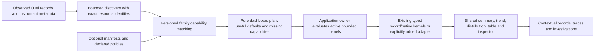

# Whole-product architecture review — 2026-10-25

> Historical package-path note: the prepared-fact `measurement/` package was
> renamed to `subjectfacts/` in 227. The review below retains its original names;
> current usage is in [the compiler guide](PORTABLE_COMPILER.md).

Reviewed baseline: `9e07b88`. This is a read-only review of source, contracts, prior reviews and recorded acceptance. No implementation, tests, browser campaign, deployment or new performance measurement was performed. Recommendations are inputs to the revised roadmap, not an activated implementation queue.

## Recommendation

Remove the demo-only startup prerequisite in a bounded parallel enabling cut. Make the existing service workspace explain **which observation population it measures**, then make its aggregate reads cheaper and more useful at ordinary attribute cardinality. Save one reusable investigation definition after that workflow is coherent. Do not start by persisting every recently added transient feature.

Goo already has a substantial general observability core: ordinary OTel record exploration, native metric kernels, service discovery, qualified attribute filtering, numeric distributions, independent population comparisons, log patterns, trace-wide existential search, page interval analysis and immutable evidence. Its next architectural problem is composition and population grain, rather than another evaluator, datastore or top-level product surface.

The strongest spine remains Activity → scoped population/service lens → explicit investigation → evidence and authored context. Services should provide a useful second entrance to that spine. A generic mixed-kind span summary is honest, but does not directly answer a common question such as “which incoming operations are slow?” A saved trace-search definition would improve continuity without fixing that entry problem.

## What is established, and what is not

### Source-backed observations

| Observation | Evidence | Architectural implication |
| --- | --- | --- |
| Generic record/metric routes are registered only after `serve-http` requires prepared binding, inventory, instrumentation scope/version and loads a default checkout operation package. Python eagerly imports the reservation package through `grammar`. | [`serve_http.go:19–55,74–83`](../cmd/goo/serve_http.go#L19), [`server.py:13`](../server.py#L13), [`grammar.py:5`](../grammar.py#L5) | Ordinary OTel is usable semantically, but the documented general-purpose bootstrap still needs demo-specific configuration. This is a confirmed adoption constraint, not an assertion the legacy lab is broken. |
| Service record questions restrict service, namespace, environment and window, without selecting span kind. The default span widget groups by name and requests span-duration/status summaries. | [`dashboard.go:71–76,113–146`](../exploration/dashboard.go#L71) | Mixed server/client/internal/retry spans can occupy one overview. This is explicitly labeled `span-record`, not a confirmed counting bug. A separate explicit observation lens is feasible with the existing AST. |
| Service native widgets already execute typed measurements. There are at most two selected instruments; defaults follow deterministic instrument sorting, not an HTTP incident-purpose ranking. | [`dashboard.go:150–206`](../exploration/dashboard.go#L150), [`service-dashboard.js:38–46`](../ui/service-dashboard.mjs#L38) | Reuse the planner and native presenter. Do not build another service metrics engine or call observed histogram records a request count. |
| HTTP and messaging instrument candidates, dimension presence, missing/empty instance diagnostics and exact stream identity already exist. The HTTP capability profile pins v1.30.0 and marks verification `not-run`. | [`instrument_capabilities.go:8–11,74–145,164–224`](../measurements/instrument_capabilities.go#L143), [E1 acceptance](E1_ACCEPTANCE.md) | Semconv-aware service work should adopt these capabilities. Discovery eligibility is not verified interval coverage, conformance or a valid fleet denominator. |
| A separate prebuilt catalog pins v1.37.0 profiles. Its prepared HTTP expansion requires an explicit binding/policy; prepared requests are not arbitrary raw OTLP. | [`prebuilt/catalog.yaml:3–58`](../prebuilt/catalog.yaml#L3), [`expand.go`](../prebuilt/expand.go), [`http.go`](../prebuilt/http.go) | These are different supported contracts, not interchangeable “latest OTel.” Keep rule versions explicit; no silent alias union or common-version upgrade. |
| Counted field values already read full-scope groups through `/api/explore`; they are not merely sampled suggestions. Generic exploration additionally reads rows and discovered fields. | [`filter-values.js:5–24`](../ui/filter-values.mjs#L5), [`source.go:130–220`](../exploration/source.go#L130), [`source.go`](../exploration/source.go) | Do not rebuild full-source counted values. A narrow aggregate-read projection can remove unnecessary reads from this existing feature and future service lenses. |
| Ordinary grouping refuses more than 1,000 groups. Explanations make a field partial/unavailable rather than rank truncated groups. | [`source.go:212–218`](../exploration/source.go#L212), [`explanation.go:409–465`](../exploration/explanation.go#L409) | Honest refusal is implemented. A high-cardinality summary would be a new explicit contract, not permission to present the current first 1,000 groups as a complete distribution. |
| A normal exploration combines independent count, row, group, discovery and optional series reads. Explanations use up to fourteen reads with three-second child deadlines. Trace search instead uses one aggregate statement for qualifying IDs, total and witnesses. | [`source.go:133–218`](../exploration/source.go#L133), [`explanation.go:362–465`](../exploration/explanation.go#L362), [`trace_search.go:89–127`](../exploration/trace_search.go#L89) | Reuse actual consistency contracts. A common UI shell must not turn separate reads into an asserted snapshot. |
| Current execution defenses are substantial: four admitted controlled requests, bounded cancellation registry, route/child deadlines, source timeout/read/memory limits, and a compiled trace-search SQL limit. Admission still names effectful POST routes explicitly. | [`query_budget.go:28–107`](../cmd/goo/query_budget.go#L28), [`source.go:65–95`](../exploration/source.go#L65), [`trace_search.go:113–115`](../exploration/trace_search.go#L113) | Preserve budgets. Route admission coverage and query cost are related but distinct; a bounded result list does not make a full-source aggregation cheap. |
| Browser proxies retain their own method/path/body/timeout policies. OpenAPI and frozen fixtures document compatibility rather than eliminate these differences. | [`server.py:42–134`](../server.py#L42), [API contract](API.md), [`openapi.json`](../api/openapi.json) | Add policy conformance when touching a route. Removing Python is not a prerequisite for a service lens or definition save. |
| Stream Activity polls a bounded rolling event-time window. It is not an ingestion cursor. Trace page timing/comparison analyze supplied rows; trace search evaluates a different, full-source distinct-ID population. | [`tail.go:14–63`](../exploration/tail.go#L14), [trace timing](TRACE_PAGE_TIMING.md), [trace comparison](TRACE_COMPARISON.md), [trace search](TRACE_SEARCH.md) | Preserve those separate grains. Neither a page miss nor a bounded tail establishes telemetry absence or complete traces. |

### Confirmed defects versus hypotheses

This review confirms documentation contradictions, not a new blocking runtime defect:

- [`KNOWN_ISSUES.md:337`](KNOWN_ISSUES.md#L337) says investigation drafts persist only in the current page, while [`investigation-draft.js`](../ui/investigation-draft.mjs) and the delivered M4 contract implement bounded explicit same-tab reload recovery.
- [`KNOWN_ISSUES.md:741`](KNOWN_ISSUES.md#L741) says full-source value ranking is unsupported, while [`filter-values.js`](../ui/filter-values.mjs) explicitly requests complete counted groups. The remaining issue is cardinality/expense, not the absence of counted lookup.
- The older issue-list API inventory says 75 operations; a source inventory of `api/openapi.json` contains 76, including `/trace-search`. Historical acceptance totals should remain historical, while the current inventory should have one authoritative source.
- The roadmap has correctly appended delivered work through trace search, but still contains multiple “Current continuation” headings for already delivered N1/N2. The older implementation proposal and review tables remain historical input, not independent active backlogs.

Potential duplicate execution policies, dense browser owner composition and repeated decimal SQL guards are **design risks**, not proof of a current stale-response defect or slow production deployment. The prior decimal timeout is recorded separately from successful reproductions; this review does not reinterpret it as a proven optimizer regression. Likewise, the recent nullable-witness tie defect is already corrected and reviewed; it is not unfinished work.

## Preserve the semantic layers

The present package boundaries are useful:

1. `exploration/`: record predicates, physical record lowering, record populations, full-source trace search, and supplied-page models.
2. `metrics/` and `measurements/`: exact native stream identity, unit, temporality, reset, interval coverage and supported compositions.
3. `measurement/`: portable aggregates over explicitly prepared, typed subject facts. [`compile.go:10–20,65–84`](../subjectfacts/compile.go#L10) labels the artifact `requires-prepared-source` and does not deploy it.
4. `annotations/` and `instrumentation/`: source declarations/build weaving and runtime OTel instruments. [`manifest.go:40–50,75–83`](../annotations/manifest.go#L40) binds source revisions; [`runtime.go:16–33,36–80`](../instrumentation/runtime.go#L16) emits named standard OTel signals with explicit goo attributes/outcomes. A declaration is not runtime coverage, and goo operation outcomes are not a generic business outcome policy for arbitrary OTel spans.
5. `workbench/`, immutable captures and optional retention: authored context, reusable configuration, observed evidence and exact external citations, each with its own authority.
6. Passive components and pure browser display models: supplied-data display and bounded intent. Application owners retain source effects, navigation, cancellation and publication.

Go/JavaScript mirrors for page geometry and comparison need one normative contract plus shared complete fixtures, rather than an HTTP service for every local calculation. Server-authoritative query predicates, evidence validation and immutable identity must not move into an unreviewed browser convenience layer. The new trace-search field-evidence projection is a good reusable physical-field seam; do not copy map-key conventions into its renderer.

## Definitions, observations and fresh reads

These meanings already differ intentionally:

| Artifact | Authority and lifetime | Required behavior |
| --- | --- | --- |
| Reusable exploration/Activity/package definition | Immutable typed configuration; no captured statistics | Opening stages intent. An explicit Run obtains a new observation. [`ExplorationView`](../workbench/exploration_views.go#L22) already says this directly. |
| Live buffer or retained application visit | Bounded connection/tab-local observations | Pause/Back preserves supplied context; no automatic source replay or implied completeness. |
| Process-local result token | Expiring capability over server-produced bytes, not durable custody | Existing pool: two-minute TTL, 64 entries, 64 MiB total and 2 MiB per result. [`result_snapshots.go`](../exploration/result_snapshots.go#L34) must not silently accept an 8 MiB search result merely because another endpoint can return it. |
| Immutable capture | Validated observed result with original question, source basis/read time and separate custody time | Reopen stored bytes without telemetry reads; refresh produces new evidence. [`capture_store.go`](../exploration/capture_store.go#L135) and explanation promotion preserve that distinction. |
| Saved baseline scope | A saved artifact provides selectors/window for an explicitly fresh comparison | Do not label the resulting reread as the original stored counts. Keep originating reference provenance separate from the new read basis. |
| Authored document/review | Branching authored context and exact references | Restore intent separately from publication; revisions are not a mutable collaborative head. [`documents.go:103–165`](../workbench/documents.go#L103) preserves that boundary. |

Trace-search definitions and observed search results have neither the same size nor the same custody requirements. A definition-only save fits the existing workbench scale. Persisting its exact result would require an explicit typed result contract, byte budget, promotion/idempotency and reopen policy; it must not be smuggled into a generic record capture or browser-submitted “observed” JSON. Existing raw-record captures can already supply page observations for future source-free trace display; that does not require persisting derived timing/comparison arithmetic separately.

## Ranked next cuts

Each cut is finite and independently reviewable. Cut 1 is a small enabling track that can proceed alongside the main functional priority, cut 2. Cut 3 should follow the lens contract or adopt counted facets first. Later cuts need their own approval and concrete design.

### 1. Explore-only startup without demo operation bindings

**User outcome:** point a local Goo instance at compatible ordinary OTel tables and use Activity, Services, record/native exploration and saved artifacts without inventing a reservation/checkout package or prepared HTTP inventory.

**Bounded implementation:** add one explicit startup profile to the existing Go process; retain the legacy profile and its old startup validation. Assemble generic source/store/route owners independently of optional prepared-fact and operation bindings. Do not manufacture empty declarations or a fake prepared expansion. A route that requires an unconfigured family must return an explicit not-configured/unsupported result or remain deliberately absent according to a documented capability policy; it must not report a healthy empty operation catalog as evidence of runtime absence.

The browser entry must work in that same profile. Decouple Python static/proxy startup from the eager `grammar.PACKAGE` reservation-file load; keep the Python example query/compiler available when its example capability is configured. Make unavailable Operations/Examples explain their configuration boundary, while generic data discovery stays usable. Keep `PACKAGES_URL`, ClickHouse source dependencies and store directories explicit. This does not require removing Python, adding authentication, deploying a new service or converting all configuration into a universal schema.

**Gates:** startup from a directory without demo operation/binding/inventory files; generic source/store routes registered; explicit unsupported legacy routes; static assets/API docs and proxy work without the reservation package; an ordinary non-Go OTel fixture can open Activity, scope a service and execute a fixed query. Misconfigured optional packages fail clearly when that capability is requested. Old lab startup, declared operation routes and response fixtures remain compatible. Source-dependent startup probes must not become implicit expensive population queries.

### 2. Explicit service observation lenses

**User outcome:** from a service, choose incoming server operations or a named protocol view, inspect latency/error evidence at that declared grain, then continue to existing logs, trace search and waterfall owners.

**Bounded implementation:** extend the existing dashboard planner and view adapter with an explicit lens. Keep generic all-span activity available. Start with one incoming HTTP server-span lens using an explicit supported kind/key profile; group by reported operation or route while preserving missing/empty values. Call it “HTTP server span observations,” not request throughput, unique requests, roots, transactions or business outcomes. RPC/messaging and client/dependency lenses should be additional explicit profiles, not one blended denominator. The first implementation should activate one lens, not multiply every lens into simultaneous queries.

Reuse existing HTTP/messaging capability diagnostics and exact native measurement packages. A native `http.server.request.duration` candidate can be offered alongside spans when eligible, with its own stream grain, units, interval coverage and basis. Native histogram observations, span statuses and log severities must not share an inferred success/error denominator. No automatic fleet percentile or missing-instance relaxation is included.

**Refactoring tied to the feature:** separate pure lens planning from widget execution in `dashboard.go`; centralize the small profile-to-predicate mapping beside the Go source/field adapters. Adopt existing supplied-data summary and continuation components rather than another landing panel. Preserve namespace and original fixed-window selectors in every continuation.

**Gates:** mixed server/client/internal and retry observations; missing/empty route and attributes; ordinary manifest-free OTel; semconv version mismatch; invalid native coverage; same service name in distinct namespaces; true zero versus missing signal; source-free planning/staging; explicit Run; no added hidden source reads on local lens changes; old dashboard behavior/fixtures remain compatible or get an explicitly versioned change. A real journey must follow service lens → narrowed operation → trace search/waterfall and return to the paused parent.

### 3. Lean aggregate execution for service and counted facets

**User outcome:** loading a service aggregate or counted values does not also fetch an irrelevant inspection page and field inventory.

**Bounded implementation:** introduce a narrow record-aggregate execution entry point used by exactly two callers first: the new service lens and counted-value lookup. Reuse `Query` validation, compiled count/group/series expressions, physical adapters and result validation. Specify selected reads and per-read bases explicitly; leave `Source.Fetch` and old response bytes unchanged behind their compatibility contract. Do not emulate an inspection result with fake empty rows.

A first slice can support count plus one grouped distribution, retaining the current 1,000-group refusal. Add time series only when the service lens needs them. Projection is a source-family application seam, not a universal evaluator shared with native streams or prepared facts. A narrow shared request-owner lifecycle is justified only if those two application adapters still duplicate begin/invalidate/current/dispose; it must not auto-subscribe or retry.

**Bounds and gates:** retain existing source timeout, memory/read limits, cancellation and global admission. Assert the actual issued read set, exact counts/groups, missing/empty and changed-between-reads states; compare typed parameters and numerical/source parity against the existing path. Measure representative elapsed time and compiled SQL size before making performance claims. Record a held-response/edit/navigation test and preserve legacy capture bytes. Decimal histogram alias/subquery optimization remains a separate measured follow-up, not an incidental rewrite during this cut.

### 4. Explicit high-cardinality facet summaries

**User outcome:** an ordinary high-cardinality attribute does not force the user to abandon scoping after a truthful 1,000-group refusal.

**Bounded design first:** provide a dedicated exact top-K categorical summary, with full-population denominator and an explicit remainder count, or choose another bounded semantic contract after comparing costs. It must say which groups are shown and which population was measured. Do not reuse the complete `Cohort` contract for truncated groups, rank a sample as a population, or silently drop the remainder. Exact selected-value drilldown can stage the existing predicate; remainder drilldown needs its own bounded exclusion/membership plan and must refuse if the predicate budget cannot express it.

Build on cut 3 instead of adding another full `Source.Fetch`. Start with one field and a small fixed K, explicit missing/empty groups and one source-supported rank policy; no approximate sketches, general chart algebra or automatic anomaly attribution. If obtaining exact top-K exceeds the existing source budget, return unavailable rather than widening budgets.

**Gates:** more than 1,000 actual values; ties; missing and empty; selected-count/remainder conservation; full denominator versus rendered list; late source changes; excessive values; Unicode keys; preserved parent numeric predicates and namespace; no forged complete comparison from a partial summary. Real ClickHouse evidence is required before claiming this works at useful cardinality. This is a confirmed capability gap, not a claim current bounded grouping is incorrect.

### 5. Save and reuse one trace-search definition

**User outcome:** keep a useful multi-condition investigation question and reopen it staged, without remembering its conditions or mistaking it for saved evidence.

Start with a versioned definition containing the exact typed trace-search request and a bounded title. Reuse the existing immutable workbench mechanics and definition-library presenter; keep a distinct family adapter. Absolute fixed bounds should stay absolute unless the user explicitly chooses a separately modeled fresh-window action. Opening, sharing, restoring and saving configuration perform no telemetry query. Do not automatically pin witnesses or persist local trace comparison pairs in the same cut.

An observed-result save is a later distinct decision: the search response can reach 8 MiB, while the current server-held observation pool admits only 2 MiB per entry. Do not widen shared token limits or accept client-supplied proof statistics as a shortcut. Reuse the explanation promotion/idempotency pattern only after choosing a typed budget and failure policy.

**Gates:** old stores/IDs unchanged; source-free create/reopen; exact predicate/binding/window round trip; title/revision collisions; malformed schema; source unavailable on reopen; explicit Run updates the observation but not the stored definition; canceled/late source responses cannot replace staged intent. This is lower priority than a clear service observation lens, unless user evidence establishes a pressing continuity need.

### Conditional follow-up, outside the five-cut queue: pipeline/source diagnostics

**User outcome:** distinguish an application with no observed records from an unavailable query source or an actual reported collection/export failure.

Start with bounded query-source diagnostic categories and, only with an actual pinned collector instrument source, one collection/export failure view. The current collector configuration wires OTLP pipelines but does not ingest its own diagnostic metrics into those tables. There is no authority to infer exporter drops from record age or absent service metrics. Do not add a global green health indicator.

Reuse source transport and native kernels. Retain a sanitized bounded error category, affected operation and clock; unknown errors stay unknown. Collector counters require a declared scope/version/unit/reset contract and a real induced failure/recovery acceptance case. This cut is conditional on that named source gate; it is not a reason to deploy a new monitoring backend.

## Refactoring opportunities that should travel with those cuts

- **Aggregate projection and validation:** cut 3 can retire repeated unnecessary reads from two actual callers. Keep complete-distribution accounting in Go and state/basis vocabulary explicit. Avoid a new configurable query planner or a `Result` union containing every family.
- **Capability descriptors:** cut 2 can consume the existing instrument plan rather than repeat HTTP name/unit checks in JavaScript. Separate profile identity, source-shape match, kernel eligibility and verified read coverage. Do not merge v1.30 metadata profiles with v1.37 prepared profiles by string replacement.
- **Effect policy:** the next touched route should update one reviewed route/effect inventory and direct/proxy conformance. A later small route-registration descriptor can generate admission/documentation assertions, while explicit family handlers retain status mapping, SSE and body-limit policies. No router/framework migration is needed.
- **Result composition:** the service lens should reuse scope/state/summary/actions from one existing fixed-record composition, then delete the superseded local markup. Avoid a generic owner that silently equates native source results, held page arithmetic and immutable receipts.
- **Readability:** several browser adapters are dense despite low line counts. Format or split only touched application boundaries in separate mechanical changes. Fewer physical lines or more shared helpers do not establish correct lifetime ownership.
- **Catalog mechanics:** file catalogs deliberately refuse scans beyond 10,000 entries, and direct IDs remain openable ([capture catalog](../exploration/capture_store.go#L492), [workbench catalog](../workbench/store.go#L79)). Introduce an index only when a real catalog workload reaches that limit; do not migrate all artifact families for hypothetical scale.

## Reconcile prior unfinished work

Treat these earlier proposals as follows when constructing the new backlog:

| Prior proposal | Current disposition |
| --- | --- |
| Pure question protocol extraction, shared source HTTP mechanics, startup dependency injection, immutable-file mechanics, read-only saved presenter, bounded draft recovery | Delivered; adopt the existing boundaries. Do not reopen as broad cleanup. |
| Numeric attribute predicates, numeric/distribution comparisons, decimal64, contextual plotting, explanations, log patterns, page timing/comparison, trace existential search | Delivered bounded contracts. Extend them only for a named user workflow; preserve old receipt intent and wire omission. |
| Universal result composition or universal async owner | Reframe as two-caller adoption tied to cuts 2–3. No whole-product replacement. |
| Automatic HTTP/RPC/messaging/USE dashboards | Partly delivered discovery/capabilities and service widgets. The next missing piece is an explicit grain/policy lens, not another metadata registry or assumption all planned prebuilt features execute. |
| General full query-session persistence, collaborative whiteboard, training-label export | Deferred pending a concrete recovery/collaboration/consumer contract. Existing authored documents and tags do not imply a collaborative mutable head or training-dataset validity. |
| Trace-search save, stored page comparison replay | Genuine continuity gaps, but definition reuse and observed evidence are separate cuts. No blanket persistence-first dependency. |
| Dynamic native fleet membership, missing-instance execution, exponential histograms, exemplars | Separate semantic work with actual instruments and coverage tests. Never fill missing identity with an empty shared instance. |
| Databricks live execution, XTDB external ClickHouse ingestion, production weaving rollout | External gates remain open. Offline generation, source review and a local example are not substitutes. |

The revised roadmap should provide one finite active queue, and link delivered historical sections rather than accumulate another list of contradictory “Next” headings. Repair the confirmed issue-list contradictions in that documentation closeout; retain recorded acceptance evidence and original artifact IDs.

## Named external gates and limits of this review

- **Databricks execution gate:** a named workspace/catalog, authorized deployment target, prepared fact ingestion and runtime comparison against real Metric Views. Current generated artifacts do not establish Databricks acceptance or raw nested OTel/event translation.
- **XTDB integration gate:** an actual supported XTDB release/configuration and concrete record-custody/external-source acceptance. No source review here proves external ClickHouse ingestion, cross-store transactions or safe production deletion.
- **Native instrumentation gate:** actual exporter shapes, full OTel resource/scope identity, instance policy, temporality/reset/bucket coverage and an agreed instrument set. Broader names in a discovery catalog do not validate the kernel input.
- **Shared deployment gate:** named target and approved authentication, tenant authorization, query-source credentials, quotas, redaction, backup/retention and concurrency ownership. The local loopback/disposable lab account is explicitly not that deployment model ([known issues](KNOWN_ISSUES.md#L213), [`compose.yaml`](../compose.yaml#L20)).
- **Collector diagnostic gate:** pinned self-telemetry instruments and an induced, observed failure/recovery. No current record/tail timestamp proves end-to-end ingest health.

This review has not benchmarked real customer volumes, interviewed users, audited every publisher fault mode, or rerun the recorded formal/browser checks. Generated properties, observed trace/model validation, negative controls and real journeys are valuable acceptance layers; each proves its stated model or finite schedule, not exhaustive runtime interleavings or telemetry completeness.

Do not introduce DataFusion, another frontend framework, CEL/KCL execution, a universal authoring schema, a fleet database, a new bitemporal store, a service split, distributed collaboration or automatic statistical anomaly claims as incidental work. Keep Rust/Go, authoring-language and backend-target choices separate from a measured need. The next useful simplification is a runnable generic entry and a smaller, clearer path through the existing kernels.

## User clarification: automatic USE/RED and discovered-entity dashboards

The user's clarification expands the intended outcome beyond the single HTTP lens proposed above. **The HTTP lens is an initial delivery slice, not the completed C2 product goal.** Goo should automatically assemble useful default dashboards for discovered applications and infrastructure: web/RPC RED, database dependencies and pools, messaging producers/consumers and brokers, host/runtime USE, and Kubernetes cluster/node/workload/pod views. A user should not need a goo manifest, choose metric names from scratch, or build a dashboard before seeing relevant supported panels.

This is an additive planning clarification. It does not claim those dashboard families execute today or authorize implementing all missing kernels at once. The roadmap should make C2 a staged capability-driven dashboard program with an explicit family matrix, rather than treating a defensible HTTP-only implementation as completion of the broader request.

### Reuse one capability-to-dashboard path

Use the existing discovery, prebuilt catalog, Go planner, native kernels and passive presenters as one path:

**Discovery supplies evidence, profiles supply meaning, and the application owns execution.** A manifest may enrich names, membership or an outcome policy, but ordinary OTel must activate applicable families without one. Keep declared intent, observed metadata and validated evaluation separate in the plan; do not make lack of a manifest look like lack of observability.

The existing [`prebuilt/catalog.yaml`](../prebuilt/catalog.yaml) already names HTTP/RPC, messaging, database operation/pool, host CPU and Go runtime families. Most associated features are marked `proposed`; that catalog is a starting requirement registry, not evidence all panels work. [`PlanInstrument`](../measurements/instrument_capabilities.go#L143) already provides observed coverage and HTTP/messaging capability hints. [`PlanServiceDashboard`](../exploration/dashboard.go#L79) already composes typed widgets. Extend those seams instead of maintaining another unrelated dashboard-template system in JavaScript.

A proposed family capability descriptor should carry:

- A versioned profile/rule-set ID, subject kind and exact identity requirements; required and optional observed instrument/resource dimensions.
- The binding alternatives actually supported by source adapters: signal family, metric name, kind, unit, temporality and explicit schema-version policy. A legacy name or unit is a separate alternative, not an inferred alias.
- Each panel's population grain, calculation, required evidence, supported execution path, query dependencies, known limits and default rank.
- Separate states for observed candidate, supported plan, evaluated result and missing/unsupported capability. An observed name is not a successful evaluation; an unsupported calculation is not zero.
- Existing contextual continuations and their scope-transfer contract. A panel stages record or trace context using shared facts; it does not invent cross-signal identity.

Panel defaults should follow a stable task/family ranking, not the first two lexically sorted metric definitions. For an application service, incoming workload/RED should normally precede outbound dependencies, messaging and runtime detail; a selected infrastructure entity should start with its own usage/capacity/state panels. Show supported panels immediately after the existing dashboard-opening action, while compactly explaining missing family capabilities. Do not replace the dashboard with a long setup wizard or a wall of unavailable cards.

### Source-backed numerical and discovery boundaries

The clarification does **not** require inventing a fractional gauge kernel: it already exists. [`measurements/source.go:262–271`](../measurements/source.go#L262) parses finite floating-point gauge observations, and [`metrics/gauge.go`](../metrics/gauge.go) preserves per-stream latest/sample values. A fractional utilization gauge in unit `1` can therefore supply a useful panel today when its binding and service/instance identity are supported. Percent formatting is a profile-declared display convention, not implicit unit conversion or evidence of health.

The actual missing capabilities are more specific:

| Source fact | Consequence for dashboard families |
| --- | --- |
| Generic gauge evaluation accepts finite floating values and nonempty declared units, but requires service and instance identity. | Fractional utilization and byte/count gauges are usable for qualifying service-bound instruments. Host/node/broker gauges without those identities need an entity identity path, not a new float parser or synthetic service instance. |
| The measurement counter adapter rejects fractional values, values at or above 2^53 and non-monotonic sums; the pure counter kernel uses exact integer values. | Fractional cumulative CPU-time/resource counters need a separately reviewed numerical/precision contract. Do not route them through integer counters, round them, or reuse the decimal-attribute binding as if it defined native metric semantics. |
| Discovery reads gauge, sum and histogram tables. Non-monotonic sums are not eligible counters; there is no typed current-value UpDownCounter/sum adapter. | Database connection counts, Go memory/goroutine UpDownCounter instruments and similar resource measures may be discovered but cannot be evaluated merely by relabeling their sum table as a gauge. Add a bounded non-monotonic-sum current-value path while preserving its source kind and identity. Reuse latest-value arithmetic only after that contract is explicit. |
| Native histogram evaluation is duration-oriented and restricts units to `s`/`ms`; the current source projection does not retain histogram sum. | Existing latency distributions and bucket-range percentiles can be reused. Arbitrary byte/unit histograms and native histogram means require additional reviewed support; do not manufacture a mean from a percentile or from span durations. |
| Metric discovery filters one service; measurement decoding and kernels require nonempty `service.name` and `service.instance.id`. | Host, broker and Kubernetes entity dashboards are not obtained merely by adding names to the prebuilt registry. They need resource-entity discovery/binding and an explicit non-service identity policy. |
| Resource attribute maps and record-resource filters are preserved, but there is no Kubernetes cluster/node/workload/pod inventory or owner-relationship adapter. | Existing observations can reveal reported `k8s.*`, `host.*` and container keys. That is useful metadata, not an authoritative cluster inventory or proof of owner/readiness relationships. |

References: [`discovery.go:46–72,120–130`](../measurements/discovery.go#L46), [`source.go:235–280`](../measurements/source.go#L235), [`gauge.go:49–57`](../metrics/gauge.go#L49), [`histogram.go:175–185`](../metrics/histogram.go#L175), and the catalog above. These are confirmed source constraints; no new runtime acceptance was performed for this clarification.

### Useful default panels and the required next adapters

| Family | Automatic useful panels from supported observations | Additional capability needed for fuller coverage |
| --- | --- | --- |
| Web / HTTP server and RPC server RED | Incoming server-span observation counts/rates, recorded status/error evidence, operation/route or RPC method duration distributions, slow-operation trace continuation. Eligible native HTTP duration or explicitly bound legacy RPC duration histograms provide their own distributions and complete-window observation counts. Keep native and span populations labeled separately. | Explicit HTTP/RPC profile/version and status-policy bindings; no request/business success inference. Native mean needs histogram sum support. Broader native rates/aggregation require complete supported intervals and declared compatible members. |
| Database client / pool | Client-span operation counts, duration/error evidence by reported database system and low-cardinality operation/summary, slow dependency traces. Eligible `db.client.operation.duration` and pool wait-time duration histograms can use existing duration kernels. Reported eligible gauges can show pool usage/capacity values side by side. | Non-monotonic-sum current values for standard connection-count instruments; pool-name/state value-level binding; a matched capacity/identity/time policy before utilization. Pool wait, open/busy connections and server contention are separate quantities. Raw SQL text is not a default grouping key. |
| Messaging producer / consumer / broker | Producer/consumer span attempt activity, recorded failures, processing durations and destination/group breakdowns; consumer trace/link continuation. Eligible `messaging.process.duration` uses the existing profile/kernel. Actual compatible queue depth/pending gauges can show raw backlog immediately. | Pinned producer/broker instrument bindings and resource identity; typed current values or fractional counters where required. Lag, redelivery, deliveries and application subject success need their own real signals/identity, not destination/time guesses. The custom lab queue profile is not a portable broker adapter. |
| Host and runtime USE | When present and bindable: per-core/state fractional CPU utilization, memory usage and reported capacity, worker/queue activity and raw saturation indicators, runtime duration distributions and observed error counters. These are useful panels before a composite utilization ratio exists. | Host identity independent of service instance; fractional CPU-time counter semantics; UpDownCounter current values for applicable Go runtime instruments; explicit aggregation/capacity alignment. Memory use is not a percentage without a valid denominator, and a goroutine count is not a leak diagnosis. |
| Kubernetes cluster / node / workload / pod | Discover observed entity/resource keys; present the active entity's reported CPU/memory usage, capacity and status/restart metrics when actually supplied by a compatible receiver. Offer cluster → node/workload → pod/container drilldown and related service/log/trace context using reported resource mappings. Show missing instrument families compactly. | A real resource inventory/discovery adapter, supported entity identities, pinned kubelet/cluster receiver metric bindings and an observed owner mapping. Desired/ready replica counts, readiness conditions, restart counts, requests/limits and node saturation require their actual instruments; none follows merely from a pod emitting telemetry. |

The dashboard should make partial coverage useful: for example, database client latency can work while pool counts are unsupported, or memory usage can render while its capacity is unreported. Supported data should not disappear because the full USE or RED acronym cannot yet be completed. Missing panels should identify the absent instrument/adapter/policy, not block the whole family or imply good health.

### Infrastructure identity and Kubernetes scope

Service identity remains `(environment, service namespace state, service name, instance where applicable)`. Infrastructure needs separately typed subjects, such as a host ID or reported Kubernetes cluster/node/pod/workload UID, with a declared fallback policy only where a profile explicitly permits it. Preserve complete resource/scope/attribute maps as stream identity. Do not satisfy the current service kernel precondition by adding fake `service.name` or an empty shared instance.

For Kubernetes, bind the keys actually reported by the pinned source profile: candidate cluster name/UID, node name/UID, Kubernetes namespace, workload kind/UID and pod/container identity. Kubernetes namespace is not `service.namespace`. Same names in different clusters/namespaces, reused pod names and restarted containers must not collapse. Workload ownership must come from observed owner/resource metadata or an explicitly configured inventory source; a pod-name prefix is not an owner relationship. No ambient Kubernetes API access is assumed or authorized by this review.

The reuse opportunity is to separate **resource identity eligibility from interval arithmetic** in native kernels with an explicit, versioned subject policy. Keep legacy service validation as the default and preserve old stream/capture identifiers. Add actual entity-source acceptance before enabling a host/Kubernetes execution path. Avoid either extreme: duplicating all counter/histogram arithmetic per entity, or globally removing identity checks to make sample infrastructure data pass.

### Automatic planning with bounded execution

Automatically producing a dashboard does not mean eagerly querying every possible panel. Planning from supplied discovery facts is source-free. Opening a dashboard can execute the already declared active default panels under the application owner's existing read policy; hidden families and tab changes must not fan out into an unbounded source sweep. Keep one active family/lens, reuse two-worker execution and the current native panel limit until a separately measured budget is approved. Add visible, explicit refresh/live behavior rather than automatic background polling from custom elements.

A dashboard plan should disclose its bounded read dependencies. Retain the current source deadlines, memory/read/response limits, metadata/cardinality bounds and cancellation ownership. Do not raise the 1,000-group limit to make a Kubernetes or database view appear general. Narrow by cluster/namespace/workload or use a separately designed paged/summary operator; preserve unknown/partial/refused states. A summary list and a full-population metric are different capabilities.

### Staged C2 program and completion evidence

A coherent sequence can deliver useful panels without misrepresenting the program as one HTTP change:

1. **Family planning and the HTTP/RPC reference implementation:** one Go capability-to-panel plan using current discovery and catalog versions; useful automatic incoming-workload defaults and shared record/native presentation. Keep protocol populations explicit and manifest-free.
2. **Database and messaging adoption:** reuse that exact planning/display path for dependency, pool, producer/consumer and actual broker panels. Implement the non-monotonic-sum current-value adapter only when a real pool/runtime instrument proves the need; do not create local JavaScript metric calculations to bypass missing kernels.
3. **Host/runtime identity and numerical support:** finite fractional gauges are already available; add the specific entity identity and counter/current-value capabilities required by real source fixtures. Reuse interval kernels and retain kind/unit distinctions.
4. **Kubernetes resource discovery and dashboards:** supply actual cluster/node/workload/pod metadata and receiver metrics, then compose the same panels over those identities. Test association to services rather than assume every pod is one service or every service belongs to Kubernetes.

The matrix is the completion contract: each family should identify implemented useful panels, unsupported calculations, required source adapters and real acceptance evidence. It is not enough to add a catalog entry, render all families as empty, or show only HTTP while reporting “automatic dashboards” complete.

Required evidence includes ordinary non-Go, manifest-free OTLP; mixed/absent protocol metadata; real fractional gauges; fractional counters correctly refused until supported; UpDownCounter versus gauge/source-table distinctions; duration and non-duration histogram units; namespace/name/UID collisions and restarts; source errors and no-data; useful partial-family rendering; deterministic default ranking; bounded issued reads and unchanged legacy evidence. Kubernetes and broker acceptance need actual source-shaped fixtures and declared metadata/instrument mappings. No new cluster, exporter deployment, credentials or production access is implied by this planning clarification.
